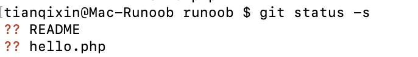
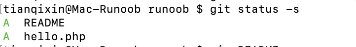
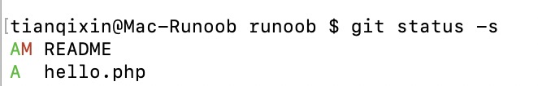

# git add 命令

> 来源：[菜鸟教程 · git add 命令](https://www.runoob.com/git/git-add.html)　·　系列第 14 / 40 篇

> 所属章节：[Git 基本操作](06-Git基本操作.md)

**git add** 命令可将该文件的修改添加到暂存区。

通过运行 **git add** 命令，你可以告诉 Git 哪些文件的修改应该包含在下一次提交（commit）中。

添加一个或多个文件到暂存区：

```bash
git add [file1] [file2] ...
```

添加指定目录到暂存区，包括子目录：

```bash
git add [dir]
```

添加当前目录下的所有文件到暂存区：

```bash
git add .
```

以下实例我们添加两个文件：

```bash
$ touch README  # 创建文件
$ touch hello.php  # 创建文件
$ ls
README        hello.php
$ git status -s
?? README
?? hello.php
$
```



git status 命令用于查看项目的当前状态。

接下来我们执行 git add 命令来添加文件：

```bash
$ git add README hello.php
```

现在我们再执行 git status，就可以看到这两个文件已经加上去了。


```bash
$ git status -s // s = --short **简短模式输出**，不再打印大段提示文字，只给一行一个文件的状态码
A  README
A  hello.php
$
```
```markdown
#### 格式：`XY 文件名`

- X：**暂存区（index）** 的状态
- Y：**工作区** 的状态

常用标记：

- `??`：未跟踪新文件
- `A` ：已经 add 到暂存区
- `M`：文件改了，**没 add**
- `M `：已经 add 暂存
- `MM`：add 之后又改了
- `D` ：删除并暂存
```



新项目中，添加所有文件很普遍，我们可以使用 **git add .** 命令来添加当前项目的所有文件。

现在我们修改 README 文件：

```bash
$ vim README
```

在 README 添加以下内容：**# Runoob Git 测试**，然后保存退出。

再执行一下 git status：

```bash
$ git status -s
AM README
A  hello.php
```



`AM` 状态的意思是这个文件在我们将它添加到缓存之后又有改动。改动后我们再执行 `git add .` 命令将其添加到缓存中：

```bash
$ git add .
$ git status -s
A  README
A  hello.php
```

文件修改后，我们一般都需要进行 git add 操作，从而保存历史版本。

---

**系列导航：** [← git clone 命令](13-git-clone.md)　·　[目录](00-Git教程目录.md)　·　[git status 命令 →](15-git-status.md)
