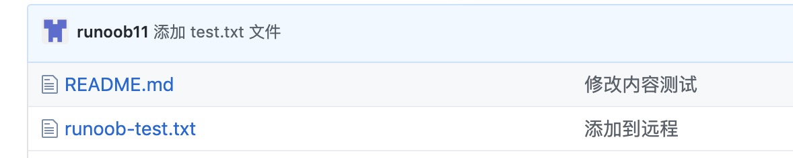

# git push 命令

> 来源：[菜鸟教程 · git push 命令](https://www.runoob.com/git/git-push.html)　·　系列第 24 / 40 篇

> 所属章节：[Git 基本操作](06-Git基本操作.md)

**git push** 命令用于从将本地的分支版本上传到远程并合并。

命令格式如下：

```bash
git push <远程主机名> <本地分支名>:<远程分支名>
```

```bash
git push <远程主机名> <本地分支名>
```

## 实例

以下命令将本地的 master 分支推送到 origin 主机的 master 分支。

```bash
$ git push origin master
```

相等于：

```bash
$ git push origin master:master
```

如果本地版本与远程版本有差异，但又要强制推送可以使用 --force 参数：

```bash
git push --force origin master
```

删除主机的分支可以使用 --delete 参数，以下命令表示删除 origin 主机的 master 分支：

```bash
git push origin --delete master
```

以我的 <https://github.com/tianqixin/runoob-git-test> 为例，本地添加文件：

```bash
$ touch runoob-test.txt  # 添加文件
$ git add runoob-test.txt
$ git commit -m "添加到远程"
master 69e702d] 添加到远程
 1 file changed, 0 insertions(+), 0 deletions(-)
 create mode 100644 runoob-test.txt

$ git push origin master  # 推送到 Github
```

将本地的 master 分支推送到 origin 主机的 master 分支。

重新回到我们的 Github 仓库，可以看到文件已经提交上来了：



---

**系列导航：** [← git pull 命令](23-git-pull.md)　·　[目录](00-Git教程目录.md)　·　[Git 测验 →](25-Git测验.md)
