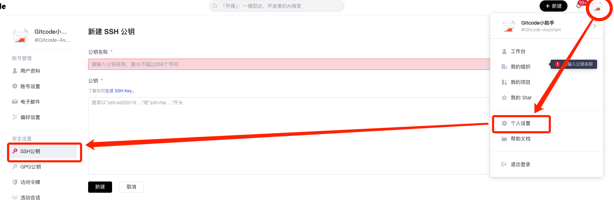
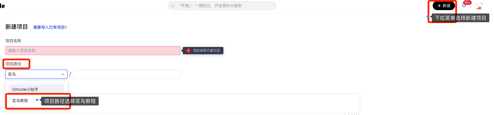

# GitCode 使用教程

> 来源：[菜鸟教程 · GitCode 使用教程](https://www.runoob.com/git/git-gitcode.html)　·　系列第 39 / 40 篇

本门讲介绍如何在 GitCode 上练习 Git 命令。

## 第一步：注册和设置 SSH 密钥

在使用 GitCode 进行代码管理之前，你需要完成一些基本的设置。以下是详细的步骤：

### 1. 访问 GitCode 并注册账号

- 首先，打开你的浏览器，访问 [GitCode](https://gitcode.com/?utm_source=cainiao_git) 网站。
- 点击["注册"](https://gitcode.com/invite/link/230b21a883d9439b884c?utm_source=cainiao_git)按钮，按照提示填写必要的信息，如用户名、密码、手机号码等。

### 2. 生成 SSH 密钥对

如果你还没有 SSH 密钥对，你需要生成一对。

SSH 密钥对由一个公钥和一个私钥组成，公钥可以公开，而私钥则需要保密。

在终端中，你可以使用以下命令生成 SSH 密钥对：

```
ssh-keygen -t rsa -b 4096 -C "your_email@example.com"
```

这里的 `your_email@example.com` 应替换为你的电子邮件地址，这有助于识别这个密钥对的用途。

### 3. 将公钥添加到 GitCode 账户中

- 生成密钥对后，你会在 ~/.ssh 目录下找到两个文件：id\_rsa（私钥）和 id\_rsa.pub（公钥）。
- 你需要将公钥的内容添加到 GitCode 账户中。打开 id\_rsa.pub 文件，复制里面的内容。
- 登录到你的 GitCode 账户，进入["个人设置"](https://gitcode.com/setting?utm_source=cainiao_git)页面，找到"SSH 公钥"部分。
- 点击"添加 SSH 公钥"按钮，将复制的公钥内容粘贴到相应的文本框中，并填写一个描述（如"个人笔记本"或"工作电脑"），然后点击"保存"。



### 4. 验证 SSH 密钥是否设置成功

在添加 SSH key 后，为了确保一切设置正确，你可以在终端中运行以下命令：

```bash
ssh -T git@gitcode.com
```

这个命令会尝试连接到 GitCode 的 SSH 服务器，并返回一些信息。如果看到类似"Welcome to GitCode"的消息，说明 SSH 密钥设置成功。

如果遇到任何问题，比如"Permission denied (publickey)"，可能需要检查你的 SSH 密钥是否正确添加到 GitCode 账户中，或者重新生成并添加新的 SSH 密钥。

通过以上步骤，你可以确保你的 GitCode 账户与你的本地开发环境通过 SSH 密钥安全地连接起来，从而可以安全地进行代码的提交和拉取。这不仅提高了安全性，还使得操作更加便捷。

---

## 第二步：创建一个新的仓库

在成功注册并设置 SSH 密钥之后，接下来你可以开始创建一个新的项目来托管你的代码。

以下是详细的步骤：

### 1. 登录你的 GitCode 账号

- 打开浏览器，访问 [GitCode](https://gitcode.com/?utm_source=cainiao_git)。
- 输入你的用户名和密码，登录到你的 GitCode 账户。

### 2. 选择"新建项目"

在下拉菜单中，[找到并点击"新建项目"选项](https://gitcode.com/create?position=nav_top&utm_source=cainiao_git)。这将引导你进入创建新项目的界面。

### 3. 在项目路径中，选择"菜鸟教程"组织

- 在创建新项目的过程中，你需要选择一个项目路径。这里建议大家将测试用的项目创建在"菜鸟教程"组织下。
- 选择["菜鸟教程"](https://gitcode.com/test121?utm_source=cainiao_git)组织，这样创建的测试项目都会归属于这个组织。



### 4. 填写仓库信息

在项目创建界面，你需要填写一些基本信息：

- 项目名称：输入一个简洁而描述性的名称，比如"我的项目"或"测试仓库"。
- 项目路径：项目路径是该项目创建成功后的地址，注意该地址每个项目都是唯一的，不可以重复。
- 仓库描述：简要描述这个仓库的用途或内容，这有助于其他人理解这个仓库的目的。
- 公开或私有：选择仓库的可见性。公开仓库任何人都可以访问，而私有仓库则只有被授权的用户才能访问。

填写完所有必要的信息后，点击页面底部的"创建项目"按钮。

系统会处理你的请求，并在几秒钟内为你创建一个新的仓库。

### 5. 验证仓库创建成功

- [进入菜鸟教程组织下的 "项目" 页面](https://gitcode.com/org/test121/repos?utm_source=cainiao_git),看到你新创建的仓库。
- 点击仓库名称，进入仓库的主页。在这里，你可以查看仓库的文件、提交历史、issues、pull requests 等。
- 点击项目导航栏右侧的 "Clone" 按钮，你将看到 clone 该项目的命令提示（由于大家已经设置了 ssh key，这里建议大家都使用 ssh 的方式进行 clone）

### 6. 初始化本地仓库

- 在本地计算机上，打开终端或命令提示符。
- 使用以下命令克隆你的新仓库到本地：

  ```
  git clone git@gitcode.com:test121/your-demo-repo.git
  ```

这里的 `git@gitcode.com:test121/your-demo-repo.git` 是你新创建的仓库的 SSH 地址，确保替换为你的实际仓库地址。

通过以上步骤，你不仅成功创建了一个新仓库，还可以开始在本地开发环境中进行代码的编写和提交。这为后续的代码管理、版本控制和协作开发打下了坚实的基础。

---

## 第三步：推送和拉取代码

在创建了新的项目并初始化了本地仓库之后，接下来你需要学会如何将本地的代码更改推送到 GitCode，以及如何从 GitCode 拉取最新的代码。以下是详细的步骤和一些相关的操作。

### 推送代码到 GitCode

**1. 在本地进行代码更改**

- 打开你的代码编辑器或 IDE，开始编写或修改代码。
- 保存你的更改。

**2. 将更改添加到 Git**

打开终端或命令提示符，切换到你的仓库目录。

使用以下命令将更改的文件添加到 Git 的暂存区：

```bash
git add .
```

这里 `.` 表示添加当前目录下的所有更改的文件。你也可以指定具体的文件名，如：

```bash
git add filename.txt
```

**3. 提交更改**

使用 git commit 命令提交你的更改，并添加一个描述性的提交信息：

```bash
git commit -m "添加了新功能"
```

提交信息应简洁明了，描述你所做的更改。

**4. 推送更改到 GitCode**

使用 git push 命令将你的更改推送到 GitCode：

```bash
git push origin main
```

这里 origin 是远程仓库的名称，默认为 origin，main 是你推送的分支名称。如果你使用的是其他分支，如 develop 或 feature-branch，则需要相应地替换。

**5. 处理推送冲突**

如果你在推送时遇到冲突，可能需要先拉取最新的代码并解决冲突：

```bash
git pull --rebase origin main
```

这会将远程分支的更改重新应用到你的本地分支上，你可能需要手动解决一些冲突。

打开[立即体验](https://gitcode.com/test121?utm_source=cainiao_git)。

---

## 拉取代码从 GitCode

### 1. 拉取最新代码

在终端或命令提示符中，切换到你的仓库目录。

使用 git pull 命令从 GitCode 拉取最新的代码：

```bash
git pull origin main
```

这会将远程仓库的最新更改合并到你的本地仓库中。

### 2. 处理合并冲突

如果在拉取过程中遇到合并冲突，Git 会提示你解决这些冲突。

打开冲突的文件，找到 Git 标记的冲突部分，决定保留哪些更改，删除哪些更改。

保存文件并关闭编辑器。

### 3. 重新提交更改

处理完冲突后，你需要重新提交这些更改：

```bash
git add .
git commit -m "解决合并冲突"
```

### 4. 再次推送更改

将解决冲突后的更改推送到 GitCode：

```bash
git push origin main
```

### 5. 保持代码同步

定期使用 git pull 命令来保持你的本地仓库与远程仓库同步，避免在推送时遇到过多的冲突。

通过这些步骤，你可以有效地管理你的代码更改，并确保你的代码仓库始终保持最新状态。这不仅有助于个人开发，也是团队协作中非常重要的一部分。

打开[立即体验](https://gitcode.com/test121?utm_source=cainiao_git)。

---

## 第四步：探索高级功能

GitCode 不仅仅是一个代码托管平台，它更是一个促进知识共享、技术交流和协作开发的社区，我们希望 GitCode 成为国内开发者们高效、便捷、友好的代码家园。

### 发布和分享代码

在网站创建一个新的代码仓库，将你的代码提交到该仓库中，通过分享链接让其他人访问你的代码。

### 参与讨论和交流

反馈关于代码的问题或者想法，了解开源组织的最新活动、内容推荐。

### 协作编程

参与他人的项目，共同解决问题或开发新功能，通过 Pull Request 向项目提交你的修改和建议。

### 阅读和学习他人代码

通过搜索找到感兴趣的项目或代码仓库，查看项目的源代码、文档和贡献者信息。

更多功能的详细介绍，欢迎查看：[https://docs.gitcode.com/docs/](https://docs.gitcode.com/docs/?utm_source=cainiao_git)。

---

**系列导航：** [← git describe 命令](38-git-describe.md)　·　[目录](00-Git教程目录.md)　·　[GitHub Actions →](40-GitHubActions.md)
