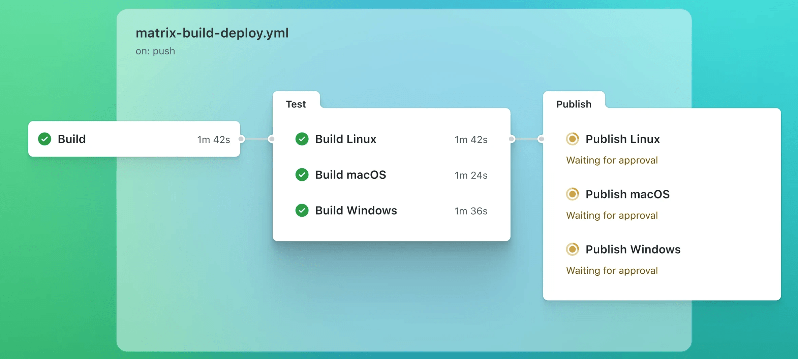

# GitHub Actions

> 来源：[菜鸟教程 · GitHub Actions](https://www.runoob.com/git/github-actions.html)　·　系列第 40 / 40 篇

GitHub Actions 是 GitHub 内置的自动化平台，允许你在代码仓库中直接定义并运行自动化流程，无需借助任何外部 CI/CD 工具。

常见的用途包括：代码推送后自动运行测试、合并 PR 后自动部署到服务器、定时执行数据抓取脚本等。



GitHub Actions 对**公开仓库完全免费**，私有仓库每月有 2,000 分钟的免费额度。

---

## 核心概念

在开始编写配置文件之前，需要先理解以下几个核心概念，它们之间的关系如下：

```text
仓库（Repository）
└── Workflow（工作流）          ← 一个 .yml 文件 = 一个 Workflow
    ├── Event（触发事件）        ← 什么情况下启动这个 Workflow，如 push、PR
    └── Job（作业）× N          ← 一个 Workflow 可以包含多个并行或串行的 Job
        ├── Runner（运行器）     ← 执行 Job 的服务器，如 ubuntu-latest
        └── Step（步骤）× N     ← Job 内按顺序执行的一系列操作
            ├── Action          ← 可复用的封装好的操作，如 actions/checkout
            └── Run             ← 直接执行 Shell 命令
```

| 概念 | 说明 | 类比 |
| --- | --- | --- |
| **Workflow（工作流）** | 整个自动化流程，由一个 `.yml` 文件定义，存放在 `.github/workflows/` 目录下 | 一份完整的工作计划书 |
| **Event（事件）** | 触发 Workflow 运行的条件，如代码推送、创建 PR、定时任务等 | 计划书的启动条件 |
| **Job（作业）** | Workflow 中的一个独立任务单元，每个 Job 运行在独立的虚拟机上，多个 Job 默认并行执行 | 计划书中的一个章节 |
| **Step（步骤）** | Job 内按顺序执行的最小操作单元，可以是一条 Shell 命令，也可以是一个 Action | 章节中的每一个具体步骤 |
| **Action（动作）** | 可复用的封装好的操作，来自 GitHub 官方、第三方或自己编写，通过 `uses` 引用 | 现成的工具模板 |
| **Runner（运行器）** | 执行 Job 的服务器，GitHub 提供 Ubuntu、Windows、macOS 三种托管环境 | 执行计划的工作人员 |

---

## 创建第一个 Workflow

### 1、目录结构

所有 Workflow 文件必须存放在仓库根目录的 `.github/workflows/` 文件夹下，文件名以 `.yml` 或 `.yaml` 结尾，文件名可以自定义：

```text
your-repo/
├── .github/
│   └── workflows/
│       ├── ci.yml          ← 持续集成流程（如运行测试）
│       ├── deploy.yml      ← 部署流程
│       └── scheduled.yml   ← 定时任务
├── src/
├── package.json
└── README.md
```

一个仓库可以有多个 Workflow 文件，它们相互独立，分别由各自定义的事件触发。

### 2、最简单的 Workflow

下面是一个最基础的示例：每次向仓库推送代码时，打印一行"Hello, GitHub Actions！"：

**示例**

```yaml
# .github/workflows/hello.yml
name: Hello World  # Workflow 的名称，显示在 GitHub Actions 页面上
on: push  # 触发条件：任意分支有代码推送时触发
jobs:  # 定义所有 Job
  say-hello:  # Job 的 ID（自定义名称，同一 Workflow 内唯一）
    name: 打印问候语  # Job 的显示名称（可选，不填则显示 Job ID）
    runs-on: ubuntu-latest  # 指定运行环境：使用 GitHub 提供的最新版 Ubuntu 虚拟机
    steps:  # 该 Job 下的所有步骤，按顺序执行
      - name: 打印消息  # Step 的名称（可选，用于在日志中标识该步骤）
        run: echo "Hello, GitHub Actions！"  # run：直接执行 Shell 命令
```

> YAML 文件对缩进非常敏感，必须使用**空格**缩进，不能使用 Tab 键。建议使用 VS Code 并安装 YAML 插件，可以实时检测格式错误。

---

## 触发事件（on）

`on` 字段定义哪些事件会触发这个 Workflow。可以是单个事件，也可以是多个事件的组合。

### 1、常用触发事件

| 事件 | 触发时机 | 常见用途 |
| --- | --- | --- |
| `push` | 有代码被推送到仓库时 | 运行测试、代码检查 |
| `pull_request` | 创建或更新 Pull Request 时 | PR 合并前的自动审查、测试 |
| `schedule` | 按 Cron 表达式定时触发 | 定时备份、定时数据抓取 |
| `workflow_dispatch` | 在 GitHub 网页上手动触发 | 按需部署、手动执行脚本 |
| `release` | 发布新版本（创建 Release）时 | 自动打包、发布到生产环境 |
| `workflow_call` | 被其他 Workflow 调用时 | 复用公共流程（如公共测试流程） |

### 2、指定分支或路径过滤

**示例**

```yaml
on:
  push:
    branches:
      - main  # 只在推送到 main 分支时触发
      - develop  # 或者推送到 develop 分支时触发
      - 'release/**'  # 或者推送到任何 release/ 开头的分支时触发（** 匹配任意字符）
    paths:
      - 'src/**'  # 进一步过滤：只有 src/ 目录下的文件发生变化时才触发
      - 'package.json'  # 或者 package.json 文件发生变化时触发
                        # 两者是"或"的关系，满足任意一个即触发
  pull_request:
    branches:
      - main  # 只在目标分支为 main 的 PR 上触发（即要合并进 main 的 PR）
    types:
      - opened  # PR 被创建时
      - synchronize  # PR 有新的提交推入时
      - reopened  # PR 被重新打开时
```

### 3、定时触发（schedule）

使用标准的 Cron 表达式定义执行时间，时区为 UTC（北京时间 = UTC+8，需换算）：

**示例**

```yaml
on:
  schedule:
    # Cron 格式：分 时 日 月 星期
    - cron: '0 2 * * *'  # 每天 UTC 02:00（即北京时间 10:00）执行一次
    - cron: '0 9 * * 1'  # 每周一 UTC 09:00（即北京时间 17:00）执行一次
    - cron: '*/30 * * * *'  # 每 30 分钟执行一次
# 常用 Cron 表达式速查：
# '0 0 * * *'    每天午夜（UTC 00:00）
# '0 * * * *'    每小时整点
# '0 0 * * 0'    每周日午夜
# '0 0 1 * *'    每月 1 号午夜
```

### 4、手动触发（workflow\_dispatch）

`workflow_dispatch` 允许在 GitHub 网页的 Actions 标签页中手动点击按钮启动 Workflow，还可以定义输入参数：

**示例**

```yaml
on:
  workflow_dispatch:
    inputs:
      environment:  # 输入参数的名称（可在 steps 中通过 ${{ inputs.environment }} 引用）
        description: '部署目标环境'  # 参数的描述，显示在手动触发的表单中
        required: true  # 是否为必填项
        default: 'staging'  # 默认值
        type: choice  # 参数类型：choice（下拉选择）
        options:
          - staging  # 可选值
          - production
      run_tests:
        description: '是否运行测试'
        required: false
        type: boolean  # 参数类型：boolean（勾选框）
        default: true
jobs:
  deploy:
    runs-on: ubuntu-latest
    steps:
      - name: 显示部署参数
        run: |
          echo "目标环境：${{ inputs.environment }}"
          echo "运行测试：${{ inputs.run_tests }}"
```

---

## Jobs 与 Steps 详解

### 1、Job 的基本结构

**示例**

```yaml
jobs:
  build:  # Job ID，同一 Workflow 中必须唯一
    name: 构建项目  # Job 的显示名称（可选）
    runs-on: ubuntu-latest  # 运行环境（必填）
    # 可选：为整个 Job 设置环境变量，Job 内所有 Step 都可以访问
    env:
      NODE_ENV: production
      APP_PORT: 8080
    # 可选：设置超时时间（分钟），超时后 Job 自动取消，防止卡死
    timeout-minutes: 30
    steps:
      # Step 写法一：使用 Action（用 uses 引用）
      - name: 拉取代码
        uses: actions/checkout@v4  # 引用官方 checkout Action（@v4 表示使用 v4 版本）
      # Step 写法二：执行 Shell 命令（用 run 指定）
      - name: 输出 Node 版本
        run: node --version
      # Step 写法三：执行多行 Shell 命令（用 | 表示多行）
      - name: 安装依赖并构建
        run: |
          npm install
          npm run build
          echo "构建完成"
```

### 2、运行环境（runs-on）

GitHub 提供以下免费的托管运行器，可以按需选择：

| 标签 | 操作系统 | 说明 |
| --- | --- | --- |
| `ubuntu-latest` | Ubuntu（最新 LTS） | 最常用，速度快，免费额度最多，推荐优先使用 |
| `ubuntu-22.04` | Ubuntu 22.04 | 指定固定版本，避免因 latest 升级引入不兼容问题 |
| `windows-latest` | Windows Server（最新） | 用于需要 Windows 环境的测试或构建 |
| `macos-latest` | macOS（最新） | 用于 iOS/macOS 应用构建，消耗免费额度最快（约 Ubuntu 的 10 倍） |

### 3、Job 之间的依赖（needs）

默认情况下，多个 Job 并行运行。使用 `needs` 可以设置 Job 的执行顺序，形成串行依赖关系：

**示例**

```yaml
jobs:
  test:  # 第一步：运行测试
    runs-on: ubuntu-latest
    steps:
      - uses: actions/checkout@v4
      - run: npm test
  build:  # 第二步：构建项目
    runs-on: ubuntu-latest
    needs: test  # 必须等 test Job 成功完成后，build 才会开始
    steps:
      - uses: actions/checkout@v4
      - run: npm run build
  deploy:  # 第三步：部署
    runs-on: ubuntu-latest
    needs: [test, build]  # 必须等 test 和 build 都成功完成后，deploy 才开始
    steps:
      - run: echo "开始部署..."
# 执行顺序：test → build → deploy（串行）
# 如果去掉 needs，则三个 Job 会同时并行执行
```

### 4、条件执行（if）

通过 `if` 可以控制 Job 或 Step 是否执行，常用于区分分支、判断上一步是否成功等：

**示例**

```yaml
jobs:
  deploy:
    runs-on: ubuntu-latest
    # if 写在 Job 级别：整个 Job 只在推送到 main 分支时才运行
    if: github.ref == 'refs/heads/main'
    steps:
      - uses: actions/checkout@v4
      - name: 部署到生产环境
        run: ./deploy.sh
      # if 也可以写在 Step 级别，控制某个具体步骤是否执行
      - name: 发送成功通知
        if: success()  # success()：上面所有 Step 都成功时才执行
        run: echo "部署成功，发送通知"
      - name: 发送失败通知
        if: failure()  # failure()：任意 Step 失败时才执行
        run: echo "部署失败，发送告警"
      - name: 总是执行的清理步骤
        if: always()  # always()：无论成功还是失败，都执行（常用于清理临时文件）
        run: rm -rf ./tmp
```

---

## 环境变量与 Secrets

### 1、环境变量（env）

环境变量可以在 Workflow 的三个层级定义，作用范围依次缩小：

**示例**

```yaml
# 层级一：Workflow 级别（所有 Job 和 Step 都可以访问）
env:
  APP_NAME: my-app
  NODE_VERSION: '18'
jobs:
  build:
    runs-on: ubuntu-latest
    # 层级二：Job 级别（只有当前 Job 内的所有 Step 可以访问）
    env:
      BUILD_MODE: production
    steps:
      - name: 显示环境变量
        # 层级三：Step 级别（只有当前 Step 可以访问）
        env:
          STEP_VAR: hello
        run: |
          echo "应用名称：$APP_NAME"  # 访问 Workflow 级别变量
          echo "构建模式：$BUILD_MODE"  # 访问 Job 级别变量
          echo "步骤变量：$STEP_VAR"  # 访问 Step 级别变量
          echo "Node 版本：$NODE_VERSION"
```

### 2、GitHub 内置变量（github 上下文）

GitHub Actions 提供了一组内置的上下文变量，可以在任意位置通过 `${{ }}` 语法引用：

**示例**

```bash
steps:
  - name: 打印常用内置变量
    run: |
      echo "仓库名称：${{ github.repository }}"  # 如：your-user/your-repo
      echo "触发事件：${{ github.event_name }}"  # 如：push、pull_request
      echo "当前分支：${{ github.ref_name }}"  # 如：main、develop
      echo "提交 SHA：${{ github.sha }}"  # 当前提交的完整 SHA 哈希值
      echo "提交者：${{ github.actor }}"  # 触发此次 Workflow 的用户名
      echo "工作目录：${{ github.workspace }}"  # 代码检出后所在的目录路径
      echo "运行 ID：${{ github.run_id }}"  # 本次 Workflow 运行的唯一 ID
      echo "运行编号：${{ github.run_number }}"  # 本次运行是该 Workflow 的第几次执行
```

### 3、Secrets（敏感信息管理）

密码、API 密钥、服务器地址等敏感信息**不能直接写在 yml 文件中**（因为代码是公开的），必须存储在 GitHub 仓库的 Secrets 中。

设置步骤：进入仓库页面 → **Settings** → **Secrets and variables** → **Actions** → 点击 **New repository secret**，填写名称和值后保存。

**示例**

```yaml
steps:
  # 在 Step 中通过 ${{ secrets.密钥名称 }} 引用已设置的 Secret
  # Secret 的值在日志中会自动被 *** 遮盖，不会泄露
  - name: 部署到服务器
    env:
      SSH_KEY: ${{ secrets.SSH_PRIVATE_KEY }}  # 服务器 SSH 私钥
      SERVER_IP: ${{ secrets.DEPLOY_SERVER_IP }}  # 服务器 IP 地址
    run: |
      echo "$SSH_KEY" > ~/.ssh/id_rsa
      chmod 600 ~/.ssh/id_rsa
      ssh user@$SERVER_IP "cd /app && git pull && pm2 restart all"
  # GitHub 自动提供 GITHUB_TOKEN，用于操作本仓库（如推送代码、创建 Release）
  # 无需手动创建，直接使用即可
  - name: 推送变更到仓库
    run: |
      git config user.name "github-actions[bot]"
      git config user.email "github-actions[bot]@users.noreply.github.com"
      git add .
      git commit -m "自动更新 [skip ci]"
      git push
    env:
      GITHUB_TOKEN: ${{ secrets.GITHUB_TOKEN }}  # GitHub 自动提供，无需手动创建
```

---

## 常用 Actions 介绍

GitHub 官方及社区提供了大量开箱即用的 Action，通过 `uses: action名称@版本` 引用，可以避免重复编写常见操作。

### 1、actions/checkout（拉取代码）

几乎所有 Workflow 的第一步都是拉取仓库代码，使用官方的 `actions/checkout`：

**示例**

```yaml
steps:
  # 最基础的用法：拉取当前分支的最新代码到工作目录
  - uses: actions/checkout@v4
  # 高级用法：通过 with 传入参数进行定制
  - uses: actions/checkout@v4
    with:
      ref: develop  # 拉取指定分支（默认拉取触发事件所在的分支）
      fetch-depth: 0  # 拉取完整的 git 历史记录（默认只拉取最新一次提交）
                                # 设为 0 可以获取所有历史，git log 等命令才能正常使用
      submodules: true  # 同时初始化并更新 git 子模块（submodule）
```

### 2、actions/setup-node（配置 Node.js 环境）

**示例**

```yaml
steps:
  - uses: actions/checkout@v4
  - name: 配置 Node.js 环境
    uses: actions/setup-node@v4
    with:
      node-version: '20'  # 指定 Node.js 版本
  # 配置完成后，npm 和 node 命令即可直接使用
  - run: node --version
  - run: npm install
  - run: npm test
```

### 3、actions/setup-python（配置 Python 环境）

**示例**

```yaml
steps:
  - uses: actions/checkout@v4
  - name: 配置 Python 环境
    uses: actions/setup-python@v5
    with:
      python-version: '3.11'  # 指定 Python 版本
  - name: 安装依赖
    run: pip install -r requirements.txt
  - name: 运行测试
    run: pytest tests/
```

### 4、actions/cache（缓存依赖加速构建）

每次 Workflow 运行时都重新下载依赖会很慢。使用 cache Action 可以将依赖缓存起来，下次运行时直接使用缓存，大幅缩短构建时间：

**示例**

```yaml
steps:
  - uses: actions/checkout@v4
  - uses: actions/setup-node@v4
    with:
      node-version: '20'
  - name: 缓存 node_modules
    uses: actions/cache@v4
    with:
      path: ~/.npm  # 指定要缓存的目录
      key: ${{ runner.os }}-node-${{ hashFiles('**/package-lock.json') }}
      # key：缓存的唯一标识符
      # hashFiles('**/package-lock.json')：根据 lock 文件内容生成哈希值
      # lock 文件不变则 key 不变，直接命中缓存；lock 文件有变化则重新安装依赖
      restore-keys: |
        ${{ runner.os }}-node-
      # restore-keys：当 key 未命中时的降级匹配策略，使用最近一次有效缓存
  - run: npm ci  # npm ci 比 npm install 更适合 CI 场景，更快更严格
  - run: npm test
```

### 5、actions/upload-artifact / download-artifact（Job 间传递文件）

不同 Job 运行在独立的虚拟机上，文件不能直接共享。通过 artifact（产物）可以将一个 Job 的输出文件传递给另一个 Job：

**示例**

```yaml
jobs:
  build:
    runs-on: ubuntu-latest
    steps:
      - uses: actions/checkout@v4
      - run: npm install && npm run build  # 构建产物会输出到 ./dist 目录
      - name: 上传构建产物
        uses: actions/upload-artifact@v4
        with:
          name: dist-files  # 产物的名称（下载时通过此名称引用）
          path: ./dist  # 要上传的目录或文件路径
          retention-days: 7  # 产物保留天数（最长 90 天）
  deploy:
    runs-on: ubuntu-latest
    needs: build  # 等 build Job 完成后再执行
    steps:
      - name: 下载构建产物
        uses: actions/download-artifact@v4
        with:
          name: dist-files  # 与上传时的名称一致
          path: ./dist  # 下载到本地的目录
      - name: 部署文件
        run: rsync -avz ./dist/ user@server:/var/www/html/
```

---

## 矩阵构建（Matrix）

矩阵构建允许你用一份 Job 配置同时在多个环境下并行运行，常用于跨版本、跨操作系统的兼容性测试：

**示例**

```yaml
jobs:
  test:
    name: 测试 Node ${{ matrix.node-version }} on ${{ matrix.os }}
    runs-on: ${{ matrix.os }}  # 从矩阵变量中读取运行环境
    strategy:
      matrix:
        os: [ubuntu-latest, windows-latest, macos-latest]  # 3 个操作系统
        node-version: ['18', '20', '22']  # 3 个 Node 版本
        # 以上组合共产生 3 × 3 = 9 个并行 Job
      fail-fast: false  # 默认 true：一个 Job 失败后取消其余所有 Job
                                      # 设为 false：即使某个组合失败，其他组合继续运行，
                                      # 方便看到所有环境的测试结果
    steps:
      - uses: actions/checkout@v4
      - name: 配置 Node.js ${{ matrix.node-version }}
        uses: actions/setup-node@v4
        with:
          node-version: ${{ matrix.node-version }}  # 引用矩阵变量
      - run: npm ci
      - run: npm test
```

**示例**

```yaml
# 高级用法：通过 exclude 排除某些不需要的组合，通过 include 追加特殊配置
strategy:
  matrix:
    os: [ubuntu-latest, windows-latest]
    node-version: ['18', '20']
    exclude:
      - os: windows-latest
        node-version: '18'  # 排除 windows + Node 18 这个组合
    include:
      - os: ubuntu-latest
        node-version: '20'
        experimental: true  # 为特定组合追加额外的变量（可在 steps 中用 matrix.experimental 引用）
```

---

## 实战示例

### 示例一：Node.js 项目 CI（自动测试）

每次推送代码或创建 PR 时，自动安装依赖、运行代码检查和测试：

**示例**

```yaml
# .github/workflows/ci.yml
name: Node.js CI
on:
  push:
    branches: [main, develop]
  pull_request:
    branches: [main]
jobs:
  test:
    name: 代码检查与测试
    runs-on: ubuntu-latest
    steps:
      - name: 拉取代码
        uses: actions/checkout@v4
      - name: 配置 Node.js 环境
        uses: actions/setup-node@v4
        with:
          node-version: '20'
          cache: 'npm'  # setup-node 内置了缓存支持，比单独用 cache Action 更简洁
      - name: 安装依赖
        run: npm ci  # npm ci 会严格按照 package-lock.json 安装，
                                             # 比 npm install 更适合 CI 场景
      - name: 运行代码检查（ESLint）
        run: npm run lint
      - name: 运行单元测试
        run: npm test -- --coverage  # 同时生成测试覆盖率报告
      - name: 上传覆盖率报告
        uses: actions/upload-artifact@v4
        if: always()  # 无论测试是否通过，都上传报告（方便查看失败原因）
        with:
          name: coverage-report
          path: ./coverage
```

### 示例二：Python 项目 CI

**示例**

```yaml
# .github/workflows/python-ci.yml
name: Python CI
on:
  push:
    branches: [main]
  pull_request:
jobs:
  test:
    runs-on: ubuntu-latest
    steps:
      - uses: actions/checkout@v4
      - name: 配置 Python 环境
        uses: actions/setup-python@v5
        with:
          python-version: '3.11'
          cache: 'pip'  # 缓存 pip 依赖
      - name: 安装依赖
        run: |
          python -m pip install --upgrade pip
          pip install -r requirements.txt
          pip install flake8 pytest  # 安装代码检查和测试工具
      - name: 运行代码格式检查（flake8）
        run: |
          # 检查语法错误和未定义变量（E9, F63, F7, F82 系列），发现问题直接报错退出
          flake8 . --count --select=E9,F63,F7,F82 --show-source --statistics
          # 检查代码风格（最大行长度 120），只统计问题数量，不报错退出
          flake8 . --count --max-line-length=120 --statistics
      - name: 运行测试
        run: pytest tests/ -v  # -v 输出详细测试结果
```

### 示例三：构建并推送 Docker 镜像

**示例**

```yaml
# .github/workflows/docker.yml
name: 构建并推送 Docker 镜像
on:
  push:
    branches: [main]
    tags:
      - 'v*'  # 推送 v 开头的 tag 时触发，如 v1.0.0
jobs:
  docker:
    runs-on: ubuntu-latest
    steps:
      - uses: actions/checkout@v4
      # 使用官方 Docker 元数据 Action 自动生成镜像标签
      # 如推送 tag v1.2.3 时，自动生成 1.2.3、1.2、1、latest 等多个标签
      - name: 提取 Docker 元数据（镜像标签等）
        id: meta  # 为此 Step 设置 ID，供后续 Step 引用其输出
        uses: docker/metadata-action@v5
        with:
          images: your-dockerhub-username/your-image-name
      - name: 登录 Docker Hub
        uses: docker/login-action@v3
        with:
          username: ${{ secrets.DOCKERHUB_USERNAME }}
          password: ${{ secrets.DOCKERHUB_TOKEN }}  # 使用 Access Token 而非密码，更安全
      - name: 构建并推送镜像
        uses: docker/build-push-action@v5
        with:
          context: .  # Dockerfile 所在目录（当前目录）
          push: true  # true：构建完成后推送到 Registry
          tags: ${{ steps.meta.outputs.tags }}  # 引用 meta Step 生成的标签列表
          labels: ${{ steps.meta.outputs.labels }}  # 引用 meta Step 生成的标签信息
```

### 示例四：构建后自动部署到服务器

**示例**

```yaml
# .github/workflows/deploy.yml
name: 构建并部署
on:
  push:
    branches: [main]  # 只有推送到 main 分支才触发部署
jobs:
  build-and-deploy:
    runs-on: ubuntu-latest
    steps:
      - uses: actions/checkout@v4
      - uses: actions/setup-node@v4
        with:
          node-version: '20'
          cache: 'npm'
      - name: 安装依赖并构建
        run: |
          npm ci
          npm run build  # 构建产物输出到 ./dist 目录
      - name: 通过 SSH 部署到服务器
        uses: appleboy/ssh-action@v1.0.3  # 第三方 SSH Action，无需手动配置 SSH
        with:
          host: ${{ secrets.SERVER_HOST }}  # 服务器 IP 或域名
          username: ${{ secrets.SERVER_USER }}  # SSH 登录用户名
          key: ${{ secrets.SSH_PRIVATE_KEY }}  # SSH 私钥内容（对应服务器上的公钥）
          port: 22  # SSH 端口，默认 22
          script: |
            # 以下命令在远程服务器上执行
            cd /var/www/my-app
            git pull origin main
            npm ci --production
            pm2 restart my-app  # 用 pm2 重启 Node.js 应用
            echo "部署完成：$(date)"
```

### 示例五：定时任务（自动备份数据库）

**示例**

```yaml
# .github/workflows/backup.yml
name: 定时备份数据库
on:
  schedule:
    - cron: '0 2 * * *'  # 每天 UTC 02:00（北京时间 10:00）执行
  workflow_dispatch:  # 同时支持手动触发，方便临时备份
jobs:
  backup:
    runs-on: ubuntu-latest
    steps:
      - name: 通过 SSH 执行备份脚本
        uses: appleboy/ssh-action@v1.0.3
        with:
          host: ${{ secrets.SERVER_HOST }}
          username: ${{ secrets.SERVER_USER }}
          key: ${{ secrets.SSH_PRIVATE_KEY }}
          script: |
            TIMESTAMP=$(date +%Y%m%d_%H%M%S)
            BACKUP_FILE="/backup/db_$TIMESTAMP.sql"
            # 执行数据库备份
            mysqldump -u root -p${{ secrets.DB_PASSWORD }} my_database > $BACKUP_FILE
            # 压缩备份文件
            gzip $BACKUP_FILE
            # 删除 30 天前的旧备份文件，避免磁盘占满
            find /backup -name "*.sql.gz" -mtime +30 -delete
            echo "备份完成：${BACKUP_FILE}.gz"
```

---

## 调试技巧

### 1、开启 Debug 日志

当 Workflow 运行失败但日志信息不够时，可以开启详细调试模式。方法：进入仓库 **Settings → Secrets and variables → Actions**，添加以下两个 Secret（值均设为 `true`）：

- `ACTIONS_RUNNER_DEBUG`：开启运行器详细日志
- `ACTIONS_STEP_DEBUG`：开启每个 Step 的详细调试日志

### 2、打印上下文信息辅助排查

**示例**

```bash
steps:
  - name: 打印所有上下文信息（调试用，排查问题时加入，解决后删除）
    run: |
      echo "=== github 上下文 ==="
      echo '${{ toJson(github) }}'  # toJson() 将对象格式化为 JSON 字符串输出
      echo "=== env 上下文 ==="
      echo '${{ toJson(env) }}'
      echo "=== job 上下文 ==="
      echo '${{ toJson(job) }}'
```

### 3、本地测试 Workflow（使用 act）

每次推送代码才能测试 Workflow 效率很低。`act` 是一个开源工具，可以在本地模拟运行 GitHub Actions，大幅提升调试效率：

```bash
# 安装 act（需要本地已安装 Docker）
# macOS
brew install act
# Linux
curl https://raw.githubusercontent.com/nektos/act/master/install.sh | sudo bash
# 在仓库根目录运行所有 Workflow
act
# 只运行指定事件触发的 Workflow
act push
# 只运行指定的 Job
act -j build
```

> 本地测试时，`act` 会使用 Docker 容器模拟 GitHub 运行环境，但部分 Action（如 `actions/cache`）在本地模拟时效果可能与真实环境有差异，最终结果以 GitHub 上实际运行为准。

---

## 常见问题与注意事项

**1、权限问题（Permission denied）**

如果 Workflow 需要向仓库推送代码或操作 Issues，需要在配置文件中显式声明权限：

**示例**

```yaml
# 在 Workflow 顶层或 Job 级别设置权限
permissions:
  contents: write  # 允许读写仓库内容（代码、文件）
  issues: write  # 允许创建和修改 Issues
  pull-requests: write  # 允许操作 Pull Requests
# 最小权限原则：只开放实际需要的权限，其余默认为 read 或 none
```

**2、避免 Workflow 循环触发**

如果 Workflow 会自动向仓库推送代码，可能触发新的 push 事件，导致无限循环。解决方法：在自动提交的 commit message 中加入 `[skip ci]` 关键字，GitHub 会跳过该次提交的 Workflow 触发：

```bash
git commit -m "自动格式化代码 [skip ci]"
```

**3、YAML 特殊字符转义**

在 `run` 字段的 Shell 命令中使用 `${{ }}` 表达式时，如果表达式包含冒号（`:`）等 YAML 特殊字符，需要用引号包裹整个值，或改为先赋值给环境变量再使用：

**示例**

```yaml
steps:
  # 不推荐：${{ }} 表达式直接嵌入复杂命令，可能引发 YAML 解析错误
  - run: echo ${{ github.event.pull_request.title }}
  # 推荐：先将值赋给环境变量，再在 Shell 中使用环境变量
  - name: 打印 PR 标题
    env:
      PR_TITLE: ${{ github.event.pull_request.title }}
    run: echo "PR 标题：$PR_TITLE"
```

更多完整文档请参考官方文档：<https://docs.github.com/zh/actions>

---

**系列导航：** [← GitCode 使用教程](39-GitCode使用教程.md)　·　[目录](00-Git教程目录.md)
