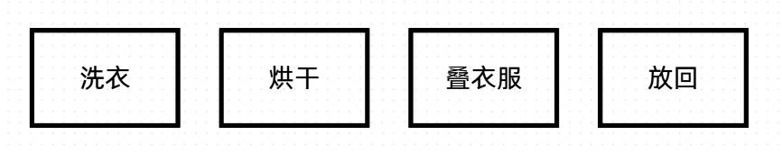
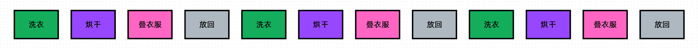
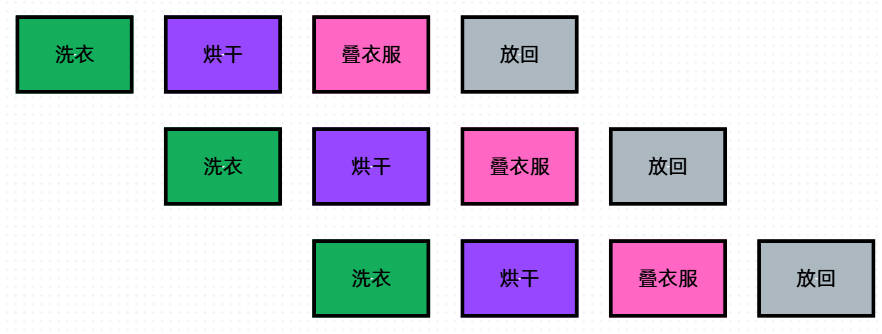
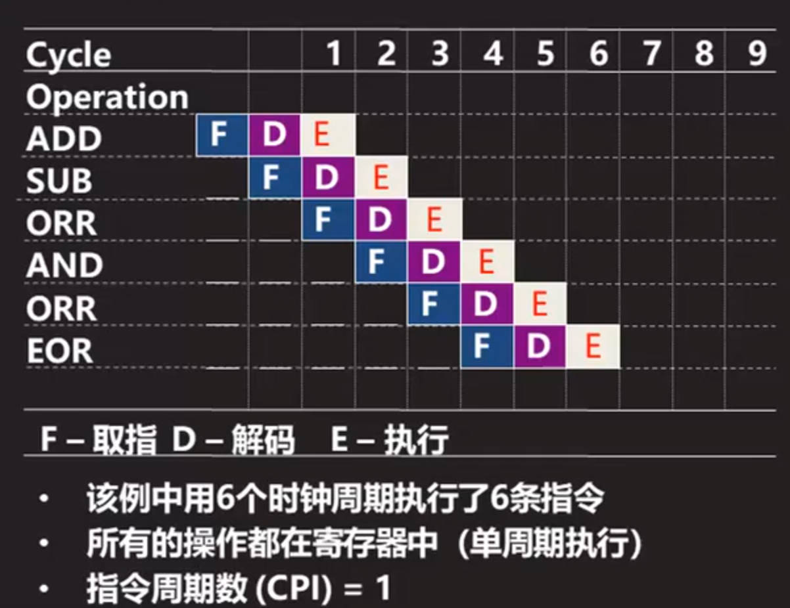
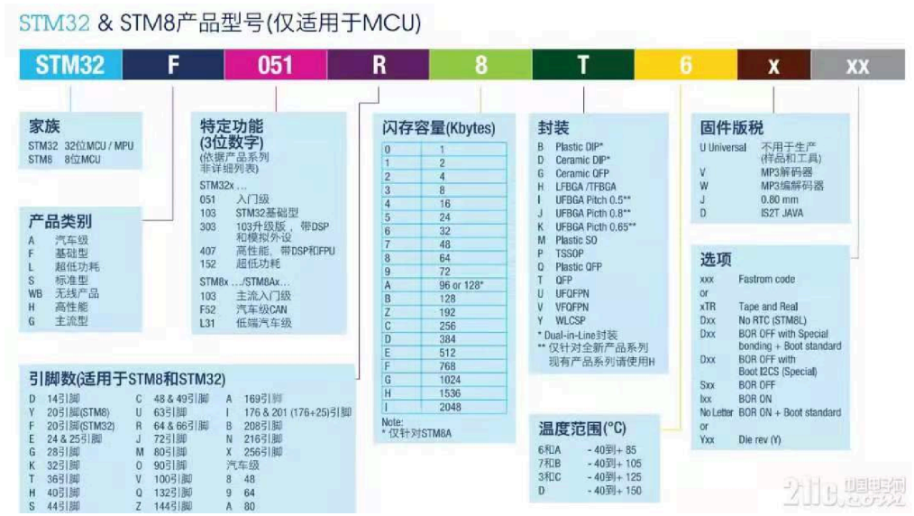
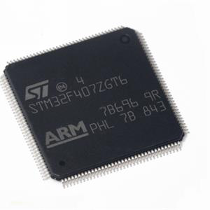

# 00 STM32内核架构-前置

> 本课整理自 `STM32/0.STM32内核架构-前置.pdf`(共 13 页)。返回 [[STM32学习目录|📑 STM32学习目录]]。

## 本章要点

- 计算机按冯·诺依曼体系分为运算器、控制器、存储器、输入设备、输出设备五大部件,这是理解 STM32 的理论基础。
- 数据用原码/反码/补码表示,补码统一了加减法,是现代计算机的标准表示方式。
- 指令 = 操作码 + 地址码;需掌握 8 种寻址方式与 6 类指令(数据传送、算数、逻辑、程序控制、处理器控制、串操作)。
- CPU 的两大核心部件是运算器与控制器;Cortex-M3/M4 采用 3 级流水线(取指-译码-执行),示例中 CPI = 1。
- 储存系统分工:Flash 非易失、存程序;RAM 易失、存运行数据;总线(数据/地址/控制)与 I/O 接口完成系统互连。
- STM32 型号按"家族-类别-功能-引脚数-容量-封装-温度范围"命名,如 `STM32 F 407 Z G T 6`。

## 初识嵌入式


### 芬诺伊曼结构(冯·诺依曼结构)

> 📄 原课件 p.1

计算机按设计原理分为**运算器、控制器、存储器、输入设备、输出设备**五大基本部件。这么设计的原理就是将**储存程序**和**程序控制**分成两部分来控制,这也是冯·诺依曼体系的结构和基础。

### 计算机组成原理下的STM32

在这个体系结构中,计算机分为 **5 大功能部件**:

- **运算器**:负责执行所有算术与逻辑运算,是数据处理的执行核心,通常集成于 CPU 内部,以 ALU(算术逻辑单元)形式存在。
- **控制器**:解析指令并生成控制信号,协调各部件按正确时序运作,构成 CPU 的指挥中枢。
- **存储器**:分为 RAM(随机存取存储器)与 ROM(只读存储器),分别承担程序运行时的数据暂存与固件永久存储任务。
- **输入设备**:将程序和数据以机器能识别的形式输入计算机,如键盘、鼠标等。
- **输出设备**:将计算机处理的结果以人们可接受的形式输出,如显示器、打印机。(此条续至 📄 原课件 p.2)

#### 数据表示与运算

#### 数据表示

> 📄 原课件 p.2

数据根据不同的进制进行区分,主要分为**二进制、八进制、十进制、十六进制**,中间就会涉及进制转换。面试中对底层要求很高的公司都会涉及类似问题;计算起来也很简单,一般用除法实现,简单来说就是"逢几进 1"的问题。

比较常用的进制转换:**十进制转二进制、二进制转十进制、二进制转十六进制、十六进制转二进制**,在嵌入式里也是最为常用的。

#### 编码方式

**原码、反码、补码**。

- **原码**:是最直观的表示方法。
  - 正数:符号位为 0,数值位为绝对值的二进制。
  - 负数:符号位为 1,数值位为绝对值的二进制。例如 8 位表示:`+5 = 00000101`,`-5 = 10000101`。
- **反码**:主要用于负数的表示。
  - 正数:反码与原码相同。
  - 负数:在原码的基础上,符号位不变,其余位按位取反。例如 -5 的反码:原码 `10000101` → 取反 `11111010`。
- **补码**:是计算机中最常用的表示方法。
  - 正数:补码与原码相同。
  - 负数:在反码的基础上加 1。例如 -5 的补码:反码 `11111010` → 加 1 得 `11111011`。

> 📄 原课件 p.3 —— 补码运算示例(课件灰底代码框)

```text
5  补码  0000 0101
-3 原码  1000 0011
   反码  1111 1100
   补码  1111 1101

5-（-3）
相加 0000 0101 + 1111 1101 = 0000 1000 （8）
```

即 5 减 -3 转化为两数补码相加,直接得到结果 8。

#### 总结

- **原码**:简单直观,但运算复杂。
- **反码**:改进了负数表示,但仍有两个零。
- **补码**:最常用,统一加减法,简化硬件设计,是现代计算机的标准表示方式。

### 指令系统

> 📄 原课件 p.3

#### 指令格式

指令是**计算机硬件**能够直接识别和执行的操作,并且被分为了两部分:**操作码**与**地址码**。

#### 操作码

- 指令中**唯一**标识**操作类型**的部分。
- 决定指令执行什么功能,比如加、减、乘、除、跳转等。
- 操作码的具体内容**不是固定的**,由指令集来确定(复杂指令集 CISC / 精简指令集 RISC)。

> PS:CISC 主要用于 Windows 计算机和服务器,也就是 x86 架构上;RISC 主要用于嵌入式系统和移动设备,也就是 ARM 架构。

#### 地址码

一般为被操作数的位置,或者就是被操作数,可能包含一个或者多个地址字段,取决于指令的格式。

```text
一地址指令：ADD A（累加器 = 累加器 + A）
二地址指令：ADD R1, R2（R1 = R1 + R2）       a += b
三地址指令：ADD R1, R2, R3（R1 = R2 + R3）   a = b + c

零地址指令：栈式架构中的指令，如ADD（从栈顶弹出两个操作数，结果压回栈顶）
```

#### 寻址方式

> 📄 原课件 p.4 —— 寻址方式解决"怎么获取指令的操作数"。

#### 立即寻址

- 操作数直接包含在指令中。

#### 直接寻址

- 地址码直接给出操作数的内存地址。
- `MOV EAX, [0x10000]`

#### 寄存器寻址

- 操作数位于 CPU 寄存器中。
- `ADD EAX, EBX`

#### 间接寻址

- 地址码指向的内存单元中存放的是操作数的地址。
- `MOV EAX, [[0x1000]]`

#### 寄存器间接寻址

- 寄存器中存放的是操作数的地址。
- `MOV EAX, [EBX]`

#### 基址寻址

- 操作数地址 = 基址寄存器内容 + 位移量。
- 强调程序的重定位。

#### 变址寻址

> 📄 原课件 p.5

- 操作数地址 = 变址寄存器内容 + 位移量。

#### 相对寻址

- 操作数地址 = 程序计数器(PC)当前值 + 偏移量。

#### 指令类型

指令按功能分为以下几类。

#### 数据传送指令

- 功能:在寄存器、内存、I/O 设备之间移动数据。
- 代表指令:`MOV`, `LOAD`, `STORE`, `PUSH`, `POP`。

#### 算数运算指令

- 功能:执行基本算术运算。
- 代表指令:`ADD`, `SUB`, `MUL`, `DIV`, `INC`, `DEC`。

#### 逻辑运算指令

- 功能:执行位级逻辑操作。
- 代表指令:`AND`, `OR`, `NOT`, `XOR`, `TEST`, `SHIFT`。

#### 程序控制指令

- 功能:改变指令执行顺序。
- 代表指令:`JMP`, `CALL`, `RET`, 条件分支指令(`BEQ`, `BNE` 等)。

#### 处理器控制指令

- 功能:控制处理器状态和特殊功能。
- 代表指令:`CLI`, `STI`(中断开关), `HLT`(停机), `IN`, `OUT`(I/O 操作)。

#### 串操作指令

> 📄 原课件 p.6

- 功能:处理字符串或数据块。
- 代表指令:`MOVSB`, `CMPSB`, `SCASB`, `LODSB`。

#### 中央处理器(CPU)

> 📄 原课件 p.6

- **CPU(中央处理器)**:主要负责执行计算机程序的指令,处理数据,通常用于个人电脑和服务器,强调高性能和多任务处理能力。
- **MCU(微控制器)**:集成了处理器、存储器和输入输出接口,适用于嵌入式系统,体积小、成本低,通常用于家电、汽车等设备。
- **SoC(片上系统)**:将 CPU、MCU、内存、输入输出接口等多个功能集成在一块芯片上,能够运行操作系统,适用于智能手机、平板电脑等复杂应用。


#### CPU功能以及组成

CPU 的核心部件其实有两个:**运算器**与**控制器**。

#### 运算器

- **核心功能**:执行所有算术和逻辑运算。
- **组成部件**:
  - 算术单元:执行加、减、乘、除等运算。
  - 逻辑单元:执行与、或、非、异或等位操作。
  - 移位器:执行左移、右移、循环移位等操作。
- **相关组件**(📄 原课件 p.7):
  - 通用寄存器组:暂存操作数和运算结果。
  - 标志寄存器(PSW):记录运算状态(如进位、零、符号、溢出等标志)。
  - 累加器(ACC):特定架构中作为主要运算寄存器。
- **特点**:纯组合逻辑电路,运算速度取决于电路延迟。

#### 控制器

- **核心功能**:协调和控制计算机各部件有序工作。
- **主要职责**:
  - 从内存取指令。
  - 分析/译码指令。
  - 产生控制信号。
  - 控制指令执行顺序。
- **关键组件**:
  - 程序计数器(PC):存储下一条要执行指令的地址。
  - 指令寄存器(IR):暂存当前正在执行的指令。
  - 指令译码器(ID):解析指令的操作码。
  - 时序产生器:生成时序信号。
- **实现方式**:微程序控制或硬布线控制。

#### 其他关键组件

- **寄存器组**:高速存储单元,包括通用寄存器、特殊寄存器。
- **内部总线**:连接 CPU 内部各组件的数据通路。
- **高速缓存(Cache)**:减少访问主存延迟,提升性能。

#### 怎么提高效率

> 📄 原课件 p.8


举例来说,就拿洗衣服举例:洗衣服分成哪些步骤?——洗衣、烘干、叠衣服、放回。





> 📄 原课件 p.9



所以我们可以使用类似于流水线一样的结构,加快代码的执行效率。

#### 指令执行流程(流水线结构)

#### 在嵌入式系统中的流水线架构(重要)

不管是 ARM Cortex-M4 还是 ARM Cortex-M3,采用的其实是 **3 级流水线架构**,不同的架构使用的流水线分级是不同的。



上图为 3 级流水线示例:指令 ADD、SUB、ORR、AND、ORR、EOR 逐条经过 F/D/E 三级并相互重叠,图下方给出结论(图内文字转写):

- F - 取指,D - 解码,E - 执行。
- 该例中用 **6 个时钟周期执行了 6 条指令**。
- 所有的操作都在寄存器中(**单周期执行**)。
- **指令周期数(CPI)= 1**。

三级流水线各阶段的含义:

- **取指(IF)**:从指令存储器(Flash/Cache)读取下一条指令。
- **译码(ID)**:解析指令操作码,确定操作类型及操作数。(📄 原课件 p.10)
- **执行(EX)**:完成算术逻辑运算、数据访问或状态更新。

**RISC** 指令执行通常使用流水线结构,这种结构是为了提高 CPU 处理的效率所打造出来的。

```text
CISC
MOV [AX], [BX]
RISC
MOV EAX，EBX
```

| 对比项 | CISC | RISC |
| --- | --- | --- |
| 指令复杂度 | 复杂(多操作/指令) | 简单(单操作/指令) |
| 指令长度 | 变长(1~15字节) | 固定(通常4字节) |
| 执行周期 | 多周期(依赖指令复杂度) | 单周期(多数指令) |
| 寄存器数量 | 较少(如x86的16个通用寄存器) | 较多(如ARM的31个通用寄存器) |
| 内存访问 | 指令可直接操作内存 | 仅Load/Store指令访问内存 |
| 典型应用 | 桌面、服务器(x86) | 移动设备、嵌入式(ARM、RISC-V) |
| 功耗效率 | 低(硬件复杂) | 高(硬件精简) |

#### 储存系统

#### Flash储存

- **特性**:非易失性存储器,断电后数据不丢失。
- **用途**:存储程序代码、常量数据、配置参数和固件。
- **访问特点**:
  - 读取速度快,可随机访问。
  - 写入/擦除速度慢,需特殊操作序列。
  - 有擦写寿命限制(通常 10 万~100 万次)。
- **组织方式**:分为扇区/块,最小擦除单位为扇区(4KB~128KB)。

#### RAM运行数据

- **特性**:易失性存储器,断电后数据丢失。
- **用途**:存储运行时变量、堆栈、堆内存和临时数据。
- **类型**:
  - SRAM:静态 RAM,速度快,无需刷新,用于 Cache 和小容量内存。
  - DRAM:动态 RAM,需定期刷新,密度高,用于大容量主存。(📄 原课件 p.11)
- **访问特点**:
  - 读写速度快,通常单周期访问。
  - 无写入寿命限制,可无限次读写。
  - 一般比 Flash 容量小,成本高。

#### 总线与IO系统

> 📄 原课件 p.11 —— 在这里就要建立起对总线和 IO 系统的概念。

#### 总线

总线让 CPU、内存、传感器、显示屏等组件能够互相通信和交换信息。

#### 总线的三种基本类型

#### 1. 数据总线

- **作用**:专门负责传输实际的数据(如数字、文字、图像)。
- **类比**:像快递公司的货车,专门运送包裹。
- **特点**:宽度决定了同时能传多少数据(8 位总线 = 每次传 8 个 0/1,32 位总线 = 每次传 32 个 0/1)。

#### 2. 地址总线

- **作用**:告诉系统"数据要送到哪里去"或"从哪里取数据"。
- **类比**:像快递单上的收货地址。
- **特点**:宽度决定了系统能识别多少不同的位置(20 位地址总线 = 能访问 1MB 空间)。

#### 3. 控制总线

- **作用**:传输各种控制信号,如"现在是读数据还是写数据"、"操作是否完成"。
- **类比**:像红绿灯和交警,控制交通流向和规则。
- **特点**:包含多种信号线,各自有特定功能(读信号、写信号、时钟信号等)。

#### IO系统

> 📄 原课件 p.12

I/O 系统是嵌入式系统用来接收外界信息(输入)和向外界发送信息(输出)的一套机制,是系统的感官和行动器官,负责与外部世界进行信息交换。

#### I/O接口

为了使输入和输出能够正确工作,需要特定的接口来连接实际的物理设备到嵌入式系统上。常见的 I/O 接口有:

- **数字 I/O**:用于处理简单的开/关信号,比如开关门的感应器。
- **模拟 I/O**:用于处理连续变化的信号,比如温度计的读数。
- **串行通信接口(如 UART, SPI, I2C)**:允许与其他设备进行数据交换,例如通过蓝牙模块发送数据到手机应用。
- **并行通信接口**:同时传输多位数据,适合高速数据传输需求。

## 单片机选型方法

> 📄 原课件 p.12



上图为课件给出的 STM32/STM8 型号命名规则,型号由以下字段组成(图内关键文字转写):

- **家族**:STM32 = 32 位 MCU/MPU;STM8 = 8 位 MCU。
- **产品类别**:A 汽车型、F 基础型、L 超低功耗、S 标准型、WB 无线产品、H 高性能、G 主流型。
- **特定功能(3 位数字,依据产品系列非详细列表)**:STM32x… 中 `051` 入门级、`103` STM32 基础型、`303` 103 升级版(带 DSP 和模拟外设)、`407` 高性能(带 DSP 和 FPU)、`152` 超低功耗;STM8x…/STM8Ax… 中 `103` 主流入门级、`F52` 汽车级 CAN、`L31` 低端汽车级。
- **闪存容量(Kbytes)**:`0`=1、`1`=2、`2`=4、`3`=8、`4`=16、`5`=24、`6`=32、`7`=48、`8`=64、`9`=72、`A`=96 或 128、`B`=128、`C`=256、`D`=384、`E`=512、`F`=768、`G`=1024、`H`=1536、`I`=2048。
- **封装**:B Plastic DIP、D Ceramic DIP、G Ceramic QFP、H LFBGA/TFBGA、I UFBGA Pitch 0.5、J UFBGA Pitch 0.8、K UFBGA Pitch 0.65、M Plastic SO、P TSSOP、Q Plastic QFP、T QFP、U UFQFPN、V VFQFPN、Y WLCSP。
- **固件版税**:U Universal(不用于生产,样品和工具)、V MP3 解码器、W MP3 编码器、J 0.80 mm、D IS2T JAVA;另有选项字段(Fastrom code、Tape and Reel、BOR 开关、Die rev 等)。
- **引脚数(适用于 STM8 和 STM32)**:D 14 引脚、Y 20 引脚(STM8)、F 20 引脚(STM32)、E 24 & 25 引脚、G 28 引脚、K 32 引脚(汽车级 8=48、9=64、A=80)、T 32 引脚、H 40 引脚、S 44 引脚、C 48 & 49 引脚、R 64 & 66 引脚、J 60 引脚、U 63 引脚、M 80 引脚、V 90 引脚、O 100 引脚、Q 132 引脚、Z 144 引脚、A 169 引脚、I 176 & 201(176+25)引脚、B 208 引脚、N 216 引脚、K 256 引脚。
- **温度范围(°C)**:`6` 和 `A` 为 -40 到 +85;`7` 和 `B` 为 -40 到 +105;`3` 和 `C` 为 -40 到 +125;`D` 为 -40 到 +150。

#### STM32 F 407 Z G T 6

> 📄 原课件 p.13



按上表的命名规则逐段解读 `STM32 F 407 Z G T 6`(以课件示例型号为例):

- `STM32` —— 家族:32 位 MCU/MPU。
- `F` —— 产品类别:基础型。
- `407` —— 特定功能:高性能,带 DSP 和 FPU。
- `Z` —— 引脚数:144 引脚。
- `G` —— 闪存容量:1024 Kbytes(1MB)。
- `T` —— 封装:QFP。
- `6` —— 温度范围:-40 到 +85 °C。

即该型号为:基础型系列、高性能(带 DSP 和 FPU)的 144 脚、1MB Flash、QFP 封装、-40~+85°C 的 STM32 单片机。

## 小结与下一步

- 本课从计算机组成原理出发:冯·诺依曼五大部件对应到 STM32 的运算器、控制器、存储器与 I/O。
- 数据表示(进制、原码/反码/补码)与指令系统(操作码+地址码、8 种寻址方式、6 类指令)是阅读汇编与理解内核的前置基础。
- CPU 由运算器与控制器组成;ARM Cortex-M3/M4 使用 3 级流水线(取指 IF、译码 ID、执行 EX),示例中 6 周期执行 6 条指令,CPI = 1。
- 硬件层面要记住:Flash 存程序、RAM 存运行数据;数据/地址/控制三类总线加 I/O 接口构成互连;型号命名如 `STM32F407ZGT6` 可逐段拆解。

➡️ 下一课:[[01-STM32内核架构-ARM指令集|ARM指令集]]
