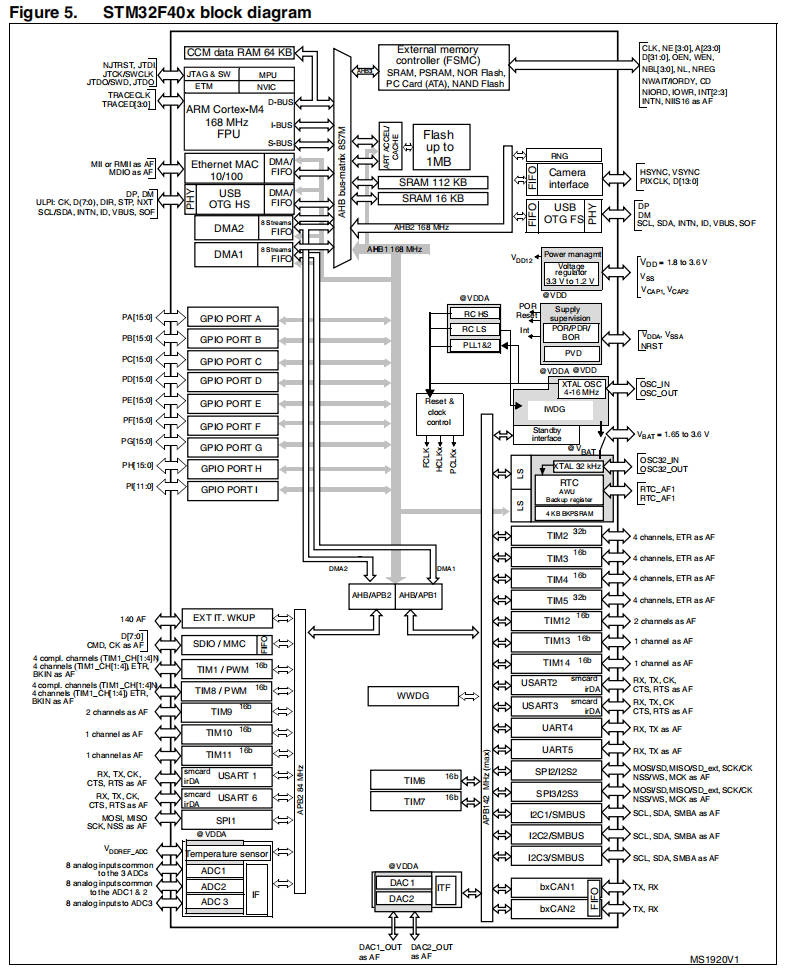
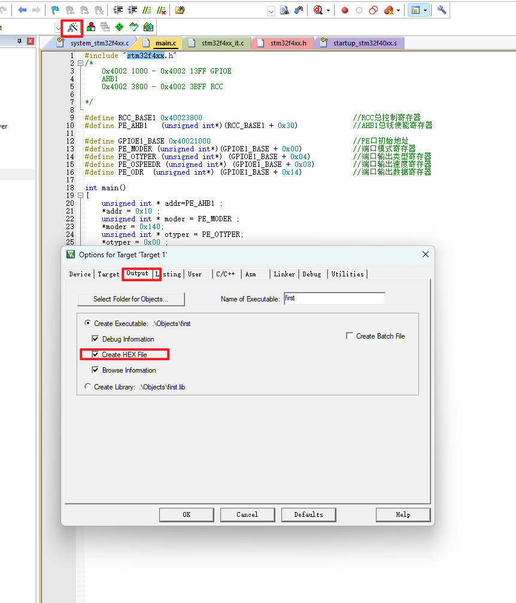
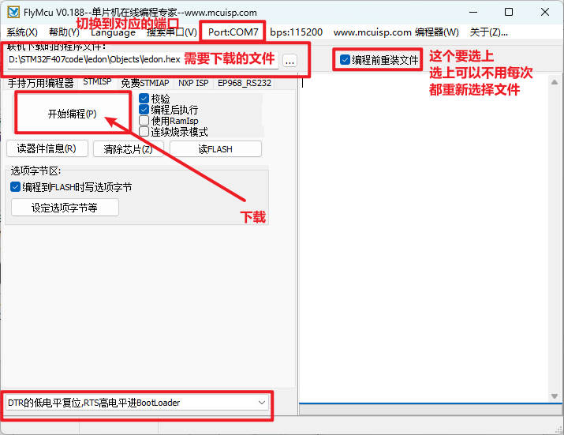

# 01 STM32内核架构-ARM指令集

> 本课整理自 `0.2STM32内核架构-ARM指令集/02.STM32内核架构-ARM指令集.pdf`(共 15 页)。返回 [[STM32学习目录|📑 STM32学习目录]]。

## 本章要点

- 指令是计算机硬件能直接识别和执行操作的最基本命令;ARM 指令集基于精简指令集(RISC)原则设计,是定义处理器如何执行操作的标准规范,而非具体芯片。
- STM32 使用的 Cortex-M 系列基于 Thumb-2 指令集:Cortex-M3 支持基础子集,M4 增加 DSP 指令与可选单精度 FPU,M7 进一步增加硬件除法与双精度 FPU 等高级功能。
- Cortex-M 内核采用三级流水线(取指 IF / 译码 ID / 执行 EX);内核寄存器包括 R0-R12 通用寄存器、SP/LR/PC,以及 APSR/IPSR/EPSR、PRIMASK/FAULTMASK/BASEPRI、CONTROL 等特殊寄存器。
- ARM 指令的写法为 `<opcode>{<cond>}{S} <Rd> ,<Rn>{,<operand2>}`;操作数有普通寄存器、立即数(12 位拆分为 8 位数值 + 4 位偶数移位)、移位寄存器三种表示方式。
- 课件给出了 STM32F40x 总线/系统框图,以及一份完整的启动汇编示例(向量表、Reset_Handler 点亮 PE3 LED)。
- 程序下载:Keil 勾选 `Create HEX File` 生成 HEX 后编译,用 FlyMcu 串口 ISP 下载,并通过板上 BOOT 跳线在下载模式与运行模式之间切换。

## 是什么

> 📄 原课件 p.1

**指令**:是计算机硬件能够直接识别和执行的操作的最基本操作命令。

**ARM指令**:ARM 架构处理器能够直接识别和执行的机器级操作命令。

**ARM指令集**:基于精简指令集计算(RISC)原则设计的处理器指令集架构(ISA),由英国 ARM 公司(现为软银旗下)开发。它不是具体芯片,而是定义了处理器如何执行操作的标准规范。

> **PS**:虽然这个指令集非常强大,可以进行各种复杂操作,但它的缺点是代码密度较低,即执行相同功能的代码比较占用空间。

**Thumb指令集**:主要由 16 位宽的指令组成,这使得程序占用的空间相对较小,但是它牺牲了一部分性能和指令的多样性。

**Thumb-2指令集**:Thumb-2 指令集是 ARM 和 Thumb 的混合体,它包含了 16 位和 32 位指令。

不同处理器对 Thumb-2 的支持范围与关键扩展指令:

| 处理器 | 架构 | Thumb-2支持范围 | 关键扩展指令 |
| --- | --- | --- | --- |
| Cortex-M3 | ARMv7-M | 基础子集 | 无DSP扩展,无硬件除法 |
| Cortex-M4 | ARMv7E-M | M3+DSP扩展 | ✅DSP指令(SMLAD, QADD等)、✅可选单精度FPU、❌仍无硬件除法(SDIV/UDIV) |
| Cortex-M7 | ARMv7E-M | M4+高级功能 | ✅硬件除法指令(SDIV/UDIV)、✅双精度FPU选项、✅更多内存屏障指令、✅更完整的位操作指令 |

### 三级流水线架构分为

> 📄 原课件 p.1

- **取指(IF)**:从指令存储器(Flash/Cache)读取下一条指令。占用的指令总线
- **译码(ID)**:解析指令操作码,确定操作类型及操作数。没有占用总线
- **执行(EX)**:完成算术逻辑运算、数据访问或状态更新。占用数据总线

> 📄 原课件 p.2

汇编程序结构说明(课件灰框):

```
//
; 开始的程序是说明部分,一般包括文件名、功能介绍等。
以 AREA 开始
以 END 结尾的代码声明段
```

一条汇编指令行由「标号 指令码 操作数」三部分构成。

**寄存器分类**:

| 寄存器分类 | 寄存器 | 功能描述 |
| --- | --- | --- |
| 通用寄存器 | R0-R12 | 用于数据操作,绝大多数16位Thumb指令只能访问R0-R7,而32位Thumb-2指令可以访问所有寄存器 |
| 通用寄存器 | SP (堆栈指针寄存器) | R13 主堆栈指针(MSP):复位后缺省使用的堆栈指针;进程堆栈指针(PSP):应用程序代码使用 |
| 通用寄存器 | LR (连接寄存器) | R14 当调用一个子程序时,由R14存储返回地址 |
| 通用寄存器 | PC (程序计数器寄存器) | R15 指向当前的程序地址。修改其值,能改变程序执行流程 |
| 特殊功能寄存器 | APSR | 应用PSR/APSRS含条件代码标志 |
| 特殊功能寄存器 | IPSR | 中断PSR/IPSRS含当前激活的异常的ISR编号 |
| 特殊功能寄存器 | EPSR | 执行PSR/EPSRS可含两个重叠的区域 |
| 特殊功能寄存器 | PRIMASK | 除能所有中断——不可屏蔽中断(NMI)除外 |
| 特殊功能寄存器 | FAULTMASK | 除能所有fault——NMI除外,被除能的fault会"上访" |
| 特殊功能寄存器 | BASEPRI | 除能所有优先级不高于某个具体数值的中断 |
| 控制寄存器 | CONTROL | 定义特权状态,决定使用哪一个堆栈指针 |

**示例汇编 `test.s`(课件 p.2-p.3,实现两个寄存器相加)**:

```asm
; 文件名:  test.s
; 功能  :  实现两个寄存器相加

    AREA Example,CODE ,READONLT ;声明代码段EXAMPLE
    ENTRY ;程序入口
    CODE32 ;声明使用的是ARM指令集
START MOV R0 , #0 ;设置参数
    MOV R1 , #10

LOOP BL ADD_SUB ;调用子程序ADD_SUB
    B LOOP ;子程序返回

ADD_SUB
    ADDS R0 , R1 , R1 ;子程序实际代码
    MOV PC , LR ;子程序的返回
    END ;子程序结束
```

### ARM指令的写法

> 📄 原课件 p.3

#### 公式

```
<opcode>{<cond>}{S} <Rd> ,<Rn>{,<operand2>}
```

#### 必要部分：

- :指令助记符,用于指定要执行的操作,如 `ADD`(加法)、`SUB`(减法)等。
- :目标寄存器,指令执行的结果将存储在这里。
- :第一个操作数的寄存器。

**可选部分:**

- :条件助记符(Condition Code),用于指定该指令在什么条件下执行(如 `EQ`、`NE`、`GT` 等)。如果省略,指令在任何条件下都会执行。
- `S`:写上 S 表示该指令会影响程序状态寄存器 CPSR 条件标志位,即 N(负数标志)、Z(零标志)、C(进位标志)和 V(溢出标志)。这些标志位会根据执行的指令和操作数的结果而改变。
- :第二个操作数,可以是寄存器或立即数。

**16 位 Thumb 指令二进制编码映射图**:

```
ADD <c> ,<Rd>,<Rn> ,#<imm3>

15 14 13 12 11 | 10 9 8 | 7 6 | 5 4 3 | 2 1 0
| OPcode | Rd | 0 0 | Rn | imm3 |
```

**32 位 Thumb 指令二进制编码映射图**(课件 p.3 标题,p.4 为图):

```
ADD{S}<c> .W <Rd>,<Rn> ,#<const>

31 30 29 28 27 26 25 24 23 22 21 20 19 18 17 16 15 14 13 12 11 10 9 8 7 6
5 4 3 2 1 0
| | | | | | | | | | | | | | | | | | | | | | | | | | | | | | | | | | | |
| | | | | |
1 1 1 1 0 i 0 0 1 0 1 S Rn3 Rn2 Rn1 Rn0 0 imm32 imm31 imm30 Rd3 Rd2 Rd1 Rd0 1 0
0 0 imm87 imm86 imm85 imm84 imm83 imm82 imm81 imm80

高位半字 = 0b11110<<11 | (i<<10) | 0b01010<<5 | (S<<4) | Rn
低位半字 = 0b0<<15 | (imm3<<12) | (Rd<<8) | 0b1000<<4 | imm8
```

**`.n` 和 `.w` 后缀**:`.N` 表示指令是 16 位的 Thumb 指令,`.W` 表示指令是 32 位的扩展的 Thumb 指令。如果没有这些后缀,处理器将根据指令的具体编码自动选择是使用 16 位还是 32 位的指令格式。

### 操作数的三种表示方式

> 📄 原课件 p.4

#### 普通寄存器

可以直接操作一个寄存器:

```c
ADD R0, R1, R2 ; 将 R1 和 R2 相加,结果存储在 R0
```

#### 立即数

立即数是直接嵌入指令中的常数值(相当于常数)。

- 立即数占用 12 位,
- 系统将 12 位拆分成两部分:
  - 低 8 位表示一个 8 位数值
  - 高 4 位表示移位次数(必须是偶数)

```c
MOV R0, #20000000 ; 将立即数 20000000 移动到 R0
```

#### 移位寄存器

移位寄存器通过移位操作生成操作数,经过移位操作后就可以看作立即数。

```c
ADD R0, R1, R2, LSL #2 ; 将 R2 左移2位后与 R1 相加,结果存储在 R0
```

### ARM指令集

> 📄 原课件 p.5-p.7

课件列出的常用 ARM 指令(三页合并,课件每页顶部重复的 ADC 行为表头样式,此处只保留一条):

| 指令 | 说明 |
| --- | --- |
| ADC | 带进位的32位数加法 |
| ADD | 32位数相加 |
| AND | 32位数的逻辑与 |
| B | 在32M空间内的相对跳转指令 |
| BEQ | 相等则跳转(Branch if EQual) |
| BNE | 不相等则跳转(Branch if Not Equal) |
| BGE | 大于或等于跳转(Branch if Greater than or Equa) |
| BGT | 大于跳转(Branch if Greater Than) |
| BIC | 32位数的逻辑位清零 |
| BKPT | 断点指令 |
| BL | 带链接的相对跳转指令 |
| BLE | 小于或等于跳转(Branch if Less than or Equal) |
| BLEQ | 带链接等于跳转(Branch with Link if EQual) |
| BLLT | 带链接小于跳转(Branch with Link if Less Than) |
| BLT | 小于跳转(Branch if Less Than) |
| BLX | 带链接的切换跳转 |
| BX | 切换跳转 |
| CDP CDP2 | 协处理器数据处理操作 |
| CLZ | 零计数 |
| CMN | 比较两个数的相反数 |
| CMP | 32位数比较 |
| EOR | 32位逻辑异或 |
| LDC LDC2 | 从协处理器取一个或多个32位值 |
| LDM | 从内存送多个32位字到ARM寄存器 |
| LDR | 从虚拟地址取一个单个的32位值 |
| MCR MCR2 MCRR | 从寄存器送数据到协处理器 |
| MLA | 32位乘累加 |
| MOV | 传送一个32位数到寄存器 |
| MRC MRC2 MRRC | 从协处理器传送数据到寄存器 |
| MRS | 把状态寄存器的值送到通用寄存器 |
| MSR | 把通用寄存器的值传送到状态寄存器 |
| MUL | 32位乘 |
| MVN | 把一个32位数的逻辑"非"送到寄存器 |
| ORR | 32位逻辑或 |
| PLD | 预装载提示指令 |
| QADD | 有符号32位饱和加 |
| QDADD | 有符号双32位饱和加 |
| QSUB | 有符号32位饱和减 |
| QDSUB | 有符号双32位饱和减 |
| RSB | 逆向32位减法 |
| RSC | 带进位的逆向32法减法 |
| SBC | 带进位的32位减法 |
| SMLAxy | 有符号乘累加(16位*16位)+32位=32位 |
| SMLAL | 64位有符号乘累加((32位*32位)+64位=64位) |
| SMALxy | 64位有符号乘累加((32位*32位)+64位=64位) |
| SMLAWy | 号乘累加((32位*16位)>>16位)+32位=32位 |
| SMULL | 64位有符号乘累加(32位*32位)=64位 |
| SMULxy | 有符号乘(16位*16位=32位) |
| SMULWy | 有符号乘(32位*16位>>16位=32位) |
| STC STC2 | 从协处理器中把一个或多个32位值存到内存 |
| STM | 把多个32位的寄存器值存放到内存 |
| STR | 把寄存器的值存到一个内存的虚地址内间 |
| SUB | 32位减法 |
| SWI | 软中断 |
| SWP | 把一个字或者一个字节和一个寄存器值交换 |
| TEQ | 等值测试 |
| TST | 位测试 |
| UMLAL | 64位无符号乘累加((32位*32位)+64位=64位) |
| UMULL | 64位无符号乘累加(32位*32位)=64位 |

**总线与时钟树**(课件 p.7 末行引入,p.8 为框图):



框图要点:ARM Cortex-M4 168 MHz FPU 内核通过 D-BUS / I-BUS / S-BUS 连接 AHB bus matrix(6×7 主),向上接 CCM data RAM 64 KB、Flash(art accelerator,最大 1MB)、SRAM 112 KB / SRAM 16 KB 与外部存储控制器 FMC(SRAM、PSRAM、NOR Flash、PC Card、NAND Flash);向下经 AHB/APB2、AHB/APB1 分频挂接 GPIO PORT A~I、TIM1~TIM14、USART1~6、UART4/5、SPI2/I2S2、SPI3/I2S3、I2C1~3、bxCAN1/2、USB OTG FS/HS、ADC1~3、DAC1/2、SDIO、以太网 MAC 10/100、IWDG/WWDG、RTC/AWK/备份寄存器等外设;左侧标注各外设复用引脚(AF),右侧为 VDD/VSS/VDDA/VSSA、VBAT、复位与时钟控制(Reset & clock control,含 RC HS/RC LS、PLL1&2、XTAL OSC 4-16 MHz、XTAL 32 kHz)等电源与时钟部分。

> 📄 原课件 p.8-p.10

**启动汇编代码示例**(课件 p.8 起,含向量表、复位处理函数与栈空间,至 p.10 顶部结束):

```asm
PRESERVE8 ; 确保堆栈保持8字节对齐,符合ARM架构要求
THUMB ; 指定使用Thumb指令集,Cortex-M4仅支持Thumb指令

; 向量表区域
AREA RESET, DATA, READONLY
EXPORT __Vectors

; 向量表起始标签
__Vectors
    DCD Stack_top ; 栈顶地址 (0x20000400)
    DCD Reset_Handler ; 复位处理函数
    DCD 0 ; NMI处理函数
    DCD 0 ; HardFault处理函数
    DCD 0 ; MemManage处理函数
    DCD 0 ; BusFault处理函数
    DCD 0 ; UsageFault处理函数
    DCD 0 ; 保留
    DCD 0 ; 保留
    DCD 0 ; 保留
    DCD 0 ; 保留
    DCD 0 ; SVC处理函数
    DCD 0 ; DebugMon处理函数
    DCD 0 ; 保留
    DCD 0 ; PendSV处理函数
    DCD 0 ; SysTick处理函数

; 特殊段,用于消除L6314W警告
AREA |InRoot$$Sections|, DATA, READONLY
; 空段,仅用于匹配scatter文件中的*(InRoot$$Sections)模式

; 代码区域
AREA |.text|, CODE, READONLY
ENTRY

; 复位处理函数起始标签
Reset_Handler
    ; 1. 使能GPIOE时钟
    LDR R0, =0x40023830 ; RCC_AHB1ENR地址
    MOV R1, #0x00000010 ; 1 << 3 (GPIOE时钟使能位)
    STR R1, [R0] ; 将R1值写入

    ; 2. 配置PE3为输出模式
    LDR R0, =0x40021000 ; GPIOE_MODER地址
    LDR R1, [R0]
    BIC R1, R1, #0xC0 ; 清除PE3模式位(位7:6)
    ORR R1, R1, #0x40 ; 设置为输出模式(01)
    STR R1, [R0] ; 将修改后的值写回GPIOE_MODER寄存器

    ; 3. 点亮LED (PE3=0)
    LDR R0, =0x40021018 ; GPIOE_BSRR地址
    MOV R1, #0x00080000 ; 1 << (16+3) 清除PE3位
    STR R1, [R0] ; 将R1值写入BSRR寄存器,PE3输出低电平,点亮LED

    ; 4. 无限循环,保持LED点亮状态
loop
    B loop

    ; 栈空间定义
AREA STACK, NOINIT, READWRITE, ALIGN=3
Stack_Mem SPACE 0x00000400 ; 1KB栈空间
Stack_top ; 栈顶指针,指向栈空间最高地址(0x20000400)

END ; 汇编代码结束标记,必须包含此行
```

### 程序的下载

> 📄 原课件 p.10

烧录过程和 51 差不多,使用的还是需要 HEX 文件,所以我们也要让工程生成 HEX 文件,然后编译一次。



截图关键信息:在 Keil µVision 中打开 `Options for Target 'Target 1'` → `Output` 选项卡,勾选 `Create HEX File`(红框标注);工程标签页可见 `system_stm32f4xx.c`、`main.c`、`stm32f4xx_it.c`、`stm32f4xx.h`、`startup_stm32f40xx.s`,可执行文件名为 `first`。截图背景中可见的 `main.c` 关键代码:

```c
/* 0x4002 1000 - 0x4002 13FF GPIOE
   AHB1
   0x4002 3800 - 0x4002 3BFF RCC */

#define RCC_BASE1   0x40023800                        //RCC总控制寄存器
#define PE_AHB1     (unsigned int*)(RCC_BASE1 + 0x30) //AHB1总线使能寄存器
#define GPIOE1_BASE 0x40021000                        //PE口初始地址
#define PE_MODER    (unsigned int*)(GPIOE1_BASE + 0x00)  //端口模式寄存器
#define PE_OTYPER   (unsigned int*)(GPIOE1_BASE + 0x04)  //端口输出类型寄存器
#define PE_OSPEEDR  (unsigned int*)(GPIOE1_BASE + 0x08)  //端口输出速度寄存器
#define PE_ODR      (unsigned int*)(GPIOE1_BASE + 0x14)  //端口输出数据寄存器

int main()
{
    unsigned int * addr=PE_AHB1 ;
    *addr = 0x10 ;
    unsigned int * moder = PE_MODER ;
    *moder = 0x140;
    unsigned int * otyper = PE_OTYPER;
    *otyper = 0x00 ;
```

**使用程序 FlyMcu**(课件 p.11):


截图关键信息:资料包路径 `二里科技VIP资料包\3.STM32环境\3.STM32环境\FlyMCU` 下有 `FlyMcu.exe`(应用程序,2015/1/13 22:58)与 `ProgramLogs.txt`(文本文档)。

**FlyMcu 界面设置**(课件 p.12):



截图关键信息(含课件红字标注):

- 软件:`FlyMcu V0.188 -- 单片机在线编程专家 -- www.mcuisp.com`。
- `Port:COM7`、`bps:115200` —— 标注:「切换到对应的端口」。
- 「联机下载时的程序文件」:`D:\STM32F407code\ledon\Objects\ledon.hex` —— 标注:「需要下载的文件」。
- ☑`编程前重装文件` —— 标注:「这个要选上,选上可以不用每次都重新选择文件」。
- 勾选项:`☑校验`、`☑编程后执行`、`☐使用RamIsp`、`☐连续烧录模式`;点击 `开始编程(P)` 即开始下载(标注「下载」)。
- 其他按钮:`读器件信息(R)`、`清除芯片(Z)`、`读FLASH`;选项字节区:`☑编程到FLASH时写选项字节`、`设定选项字节等`。
- 底部下拉框:`DTR的低电平复位,RTS高电平进BootLoader`。

开发板 BOOT 跳线特写(课件 p.13,丝印给出 MODE 启动模式选择表:FLASH / USART1 / SRAM):


### 下载模式

> 📄 原课件 p.14

下载模式下,按板上丝印的 MODE 启动模式选择表(FLASH / USART1 / SRAM)插接黄色跳线帽,使芯片从串口(USART)启动进入 ISP 下载,配合 FlyMcu 通过串口烧录程序:


### 运行模式

> 📄 原课件 p.15

运行模式下,把跳线帽改接到 FLASH 对应位置,芯片上电后从 Flash 启动,直接运行已烧录的程序:


## 小结与下一步

- ARM 指令集是基于 RISC 的处理器指令标准规范;Thumb/Thumb-2 在代码密度与性能之间取舍,Cortex-M3/M4/M7 的 Thumb-2 支持范围依次扩大(DSP、FPU、硬件除法等)。
- 内核为三级流水线(IF/ID/EX),寄存器要记住 R0-R12、R13 SP(MSP/PSP)、R14 LR、R15 PC 及 APSR/IPSR/EPSR 与 PRIMASK/FAULTMASK/BASEPRI/CONTROL。
- 指令格式 `<opcode>{<cond>}{S} <Rd>,<Rn>{,<operand2>}`;操作数可用寄存器、立即数(8 位数值+4 位偶数移位)或移位寄存器表示;常用指令见课件指令表。
- 下载三步走:Keil 勾选 `Create HEX File` 并编译 → FlyMcu 选串口、装载 HEX、勾选「编程前重装文件」后「开始编程」→ 板上 BOOT 跳线在下载模式与运行模式间切换。

➡️ 下一课:[[03-STM32外设-GPIO|STM32外设-GPIO]]
