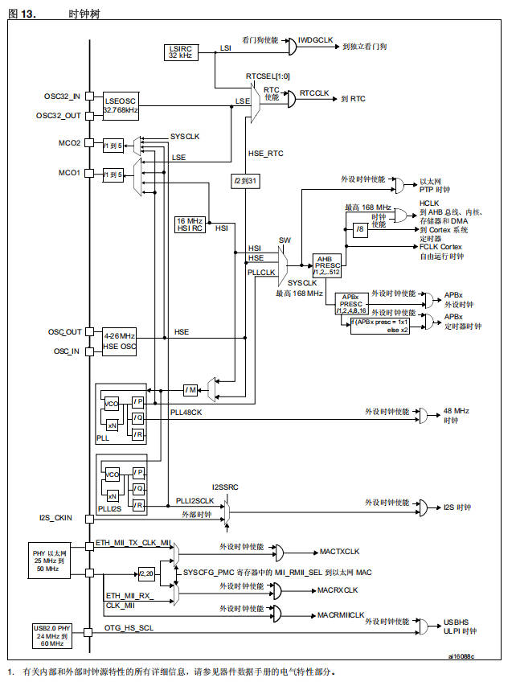
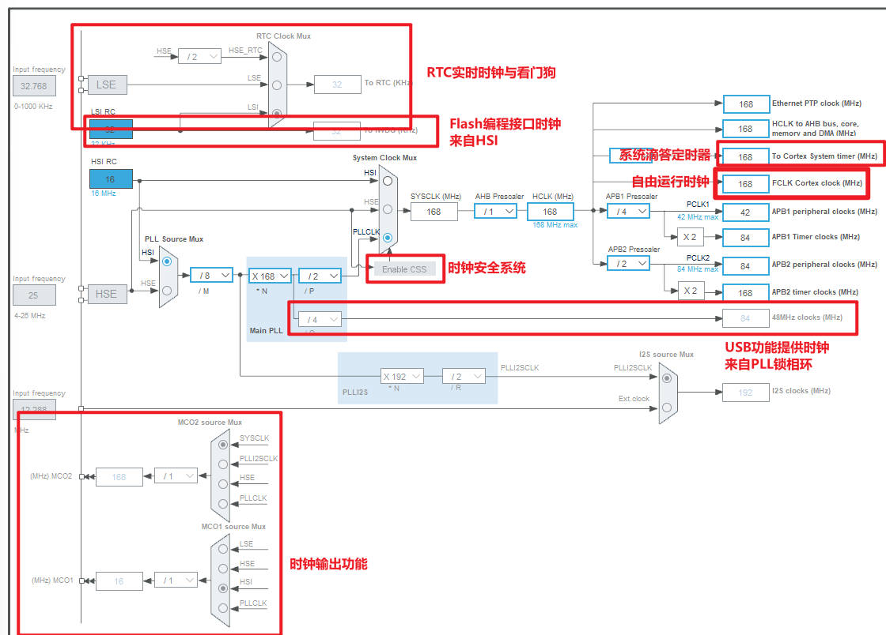
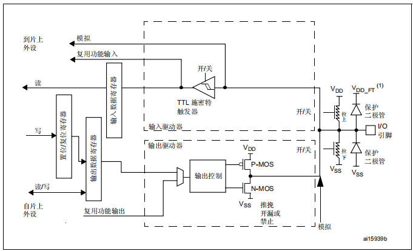
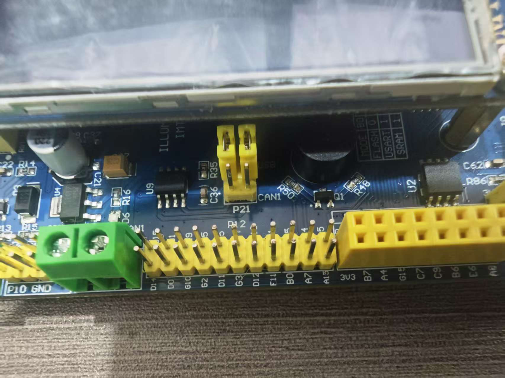

# 03 STM32外设-GPIO

> 本课整理自 `STM32/3.STM32外设-GPIO.zip → 03.GPIO/03.GPIO.pdf`(共 14 页)。返回 [[STM32学习目录|📑 STM32学习目录]]。

## 本章要点

- STM32 是基于 ARM Cortex-M 内核的 32 位片上系统(SOC),由内核、总线矩阵、片上外设、存储器、时钟与复位、电源管理和调试接口等部分构成。
- 系统时钟 SYSCLK 可由 SW[1:0] 在 HSI / HSE / PLLCLK 之间选择;PLL 经 M/N/P/Q 分频可得最高 168MHz SYSCLK 与 48MHz USB 时钟,再经 AHB、APB1/APB2 预分频分发给各外设。
- CSS(时钟安全系统)监控 HSE,失效时自动切换到 HSI 并产生 NMI 中断。
- GPIO 端口内部 = 施密特触发输入驱动器 + P-MOS/N-MOS 输出驱动器(推挽/开漏)+ 上下拉与保护二极管,由 MODER / OTYPE / ODR 等寄存器配置。
- 无库的寄存器开发:直接用地址宏操作 RCC AHB1 使能寄存器与 GPIOE 的模式/类型/输出寄存器即可控制引脚;工程需添加 `startup_stm32f407xx.s` 并在 `main.c` 补一个空的 `SystemInit`。
- 用 FlyMcu 串口下载:选对 COM 口(115200bps)、勾选"编程前重装文件"、下载前 BOOT 跳线接 3V3 进下载模式,下载后接回 GND 运行。

## 一、总体架构

> 📄 原课件 p.1

STM32 系列单片机采用基于 ARM Cortex-M 内核的 32 位处理器,具有高性能、低功耗、易于编程和扩展等特点。其总体架构包括内核、总线矩阵、片上外设、存储器等部分,共同构成了一个完整的片上系统(SOC)。

## 二、内核

STM32 系列单片机的内核主要有 Cortex-M3 和 Cortex-M4 两种。其中,STM32F1 系列采用 Cortex-M3 内核,而 STM32F4 系列则采用 Cortex-M4 内核。Cortex-M4 内核相比 Cortex-M3 具有更高的性能和更丰富的功能,如单精度浮点运算单元和增强的 DSP 指令集等。

## 三、总线矩阵

STM32 系列单片机的总线矩阵用于实现内核与外设之间的数据通信。通过总线矩阵,内核可以高效地访问各个外设的寄存器,实现数据的读写操作。同时,总线矩阵还支持多个主设备(如内核、DMA 等)同时访问外设,提高了系统的并行处理能力。

## 四、片上外设

STM32 系列单片机具有丰富的片上外设,如 GPIO(通用输入输出端口)、USART(串口通信接口)、I2C(两线串行总线)、SPI(串行外设接口)、ADC(模数转换器)、DAC(数模转换器)等。这些外设可以通过配置和编程来实现各种功能,如数据采集、通信控制、信号处理等。

## 五、存储器

STM32 系列单片机的存储器包括内部存储器和外部存储器接口。内部存储器主要有 Flash 存储器和 SRAM 存储器。Flash 存储器用于存储程序代码和常数数据,而 SRAM 存储器则用于存储变量和堆栈等动态数据。外部存储器接口可以扩展外部存储器,如 SRAM、NAND-Flash 和 NOR-Flash 等,以满足更大的存储需求。

## 六、时钟与复位电路

STM32 系列单片机的时钟电路为系统提供稳定的时钟信号,确保各个模块能够同步工作。时钟电路通常由外部晶振和内部时钟管理模块组成。复位电路用于在单片机出现故障或需要重新启动时,将系统恢复到初始状态。复位电路有手动复位和上电复位两种方式,通过复位引脚实现。

## 七、电源管理

STM32 系列单片机具有低功耗特性,可以通过电源管理模块实现功耗的优化。电源管理模块可以监控系统的电源电压和电流,并根据需要调整系统的工作模式和时钟频率,以降低功耗。

## 八、调试与编程接口

STM32 系列单片机提供多种调试与编程接口,如 JTAG 接口和 SWD 接口等。这些接口可以用于连接调试器或编程器,实现对单片机的调试和编程操作。同时,STM32 系列单片机还支持在线调试和编程功能,可以在不拆卸单片机的情况下进行调试和编程操作。

## 常用名词缩写

> 📄 原课件 p.2

| 缩写 | 含义 |
| --- | --- |
| ADC | 数模转换器 |
| BKP | 备份寄存器 |
| CAN | 控制器局域网模块 |
| DMA | 直接内存存取控制器 |
| EXTI | 外部中断时间控制器 |
| FLASH | 闪存存储器 |
| GPIO | 通用输入输出 |
| I2C | 内部集成电路 |
| IWDG | 独立看门狗 |
| NVIC | 嵌套中断向量列表控制器 |
| PWR | 电源/功耗控制 |
| RCC | 复位与时钟控制器 |
| RTC | 实时时钟 |
| SPI | 串行外设接口 |
| SysTick | 系统滴答定时器 |
| TIM | 通用定时器 |
| TIM1 | 高级控制定时器 |
| USART | 通用同步异步接收发射端 |
| WWDG | 串口看门狗 |

## 1. 时钟源（Clock Sources）

> 📄 原课件 p.3 为整页"时钟树"总览图,先看全貌,再看各时钟源细节。



图内关键通路(图内文字转写):

- 时钟源:LSIRC 32kHz、LSEOSC 32.768kHz(接 OSC32_IN/OSC32_OUT)、HSI RC 16MHz、HSE OSC 4-26MHz(接 OSC_IN/OSC_OUT);外部输入还有 I2S_CKIN、PHY 以太网 25MHz 到 50MHz、USB2.0 PHY 24MHz 到 60MHz(OTG_HS_SCL)。
- 看门狗与 RTC:LSI 经"看门狗使能"生成 IWDGCLK 到独立看门狗;LSE、LSI、HSE_RTC(经 /2到31 分频)由 RTCSEL[1:0] 选择,经"RTC 使能"生成 RTCCLK 到 RTC。
- 系统时钟:SW 在 HSI / HSE / PLLCLK 之间选择得到 SYSCLK(最高 168MHz);SYSCLK 经 AHB PRESC(/1、2...512)得到 HCLK(最高 168MHz,到 AHB 总线、内核、存储器和 DMA),经 /8 到 Cortex 系统定时器,另有 FCLK Cortex 自由运行时钟;APBx PRESC(/1、2、4、8、16)产生 APBx 外设时钟,若 APBx 预分频为 1 则 ×1、否则 ×2 得 APBx 定时器时钟;另有"外设时钟使能"门控到以太网 PTP 时钟。
- PLL:输入经 /M 分频进 PLL,VCO(×N)后由 /P、/Q、/R 分别输出 PLLCLK(最高 168MHz)、PLL48CK(48MHz 时钟)与 PLLI2SCLK;I2SSRC 在 PLLI2SCLK 与外部时钟之间选择出 I2S 时钟。
- 以太网:ETH_MII_TX_CLK_MI / ETH_MII_RX_CLK_MI,配合 /2.20 分频与"SYS_CFG_PMC 寄存器中的 MI_RMII_SEL",经外设时钟使能输出 MACTXCLK、MACRXCLK、MACRMIICLK。
- USB:OTG_HS_SCL 输出 USBHS/ULPI 时钟。
- 脚注:有关内部和外部时钟源特性的所有详细信息,请参见器件数据手册的电气特性部分。

### 内部时钟源

- **HSI (High Speed Internal)**
  - 16MHz RC 振荡器(精度 ±1%)
  - 上电后自动启用,启动速度快(约 10μs)
  - 无需外部元件,但温度稳定性较差
  - 通常用于系统启动阶段或作为 PLL 输入源
- **LSI (Low Speed Internal)**
  - 约 40kHz RC 振荡器
  - 专为低功耗设计,用于看门狗和 RTC 备用时钟
  - 精度较低(±40%),但功耗极低

### 外部时钟源

- **HSE (High Speed External)**
  - 连接 4-26MHz 晶体/陶瓷谐振器或外部时钟源
  - 通过 OSC_IN 和 OSC_OUT 引脚接入
  - 高精度(±20-50ppm),适合需要精确时序的应用
  - 启动时间较长(需要晶振稳定时间)
- **LSE (Low Speed External)**
  - 32.768kHz 晶体振荡器
  - 专为 RTC 设计,提供精确的日历/时钟功能
  - 即使在待机/关机模式下也能工作(备份域供电)

## 2. 时钟选择与切换逻辑

> 📄 原课件 p.4

### 系统时钟选择（SYSCLK）

- 通过 SW[1:0] 选择位从三个源中选择:
  - HSI(16MHz)
  - HSE(外部晶振频率)
  - PLLCLK(PLL 输出,可高达 168MHz)
- 默认使用 HSI(系统复位后)
- 时钟切换可平滑进行,不会导致系统崩溃

### 安全机制

> 📄 原课件 p.5

- **CSS (Clock Security System)**
  - 监控 HSE 失效情况
  - 当 HSE 失效时自动切换到 HSI
  - 产生 NMI 中断通知系统时钟异常

## 3. PLL（锁相环）系统

### PLL输入

- 可选择 HSI/2(8MHz)或 HSE 作为输入
- 通过 PLLM 分频器将输入调整为 1-2MHz 范围

### PLL核心

- **PLLN 倍频器**:将输入时钟倍频至 192-432MHz
- **PLLP 分频器**:生成主系统时钟(SYSCLK),通常配置为 2、4、6 或 8 分频
- **PLLQ 分频器**:为 USB、SDIO 等外设提供 48MHz 时钟
- **PLLR 分频器**:在某些型号中提供额外的时钟输出

### PLL配置示例

- HSE = 8MHz
- PLLM = 8(分频至 1MHz)
- PLLN = 336(倍频至 336MHz)
- PLLP = 2(分频至 168MHz SYSCLK)
- PLLQ = 7(分频至 48MHz USB 时钟)

## 4. 主时钟分发

### AHB总线时钟（HCLK）

- SYSCLK 通过 AHB 预分频器(HPRE)分频
- 分频系数:1、2、4、8、16、64、128、256、512
- 用于 CPU 内核、内存、DMA 控制器
- 最高 168MHz(高性能应用)
- 低功耗模式下可降低频率

### APB总线时钟

- AHB 通过 APB1/2 预分频器分频
- APB1(低速外设):最高 42MHz 或 84MHz
- APB2(高速外设):可与系统时钟同频
- 分频系数通常为 1、2、4、8、16

> 📄 原课件 p.5～p.6

## 5. 时钟监测与安全功能

> 📄 原课件 p.6

- **HSE/HSI 就绪标志**:指示振荡器是否稳定
- **PLL 就绪标志**:指示 PLL 是否锁定
- **时钟安全系统(CSS)**:监测 HSE 故障并自动切换
- **时钟输出(MCO)**:可将内部时钟输出到引脚,用于调试或驱动其他器件

### 1. PLL (Phase-Locked Loop) 部分

- **PLL48CK**:
  - 由 VCO(Voltage-Controlled Oscillator)和分频器(/P, /Q, /R)组成。
  - PLL48CK 的输出频率为 48MHz,通常用于 USB 设备的时钟源。
- **PLL (Main PLL)**:
  - 同样由 VCO 和分频器(/P, /Q, /R)组成。
  - 主 PLL 的输出(PLLCLK)可以配置为系统时钟(SYSCLK)的源,最高可达 168MHz。
- **PLL2 (Additional PLL)**:
  - 也由 VCO 和分频器(/P, /Q, /R)组成。
  - PLL2SRC 可以是 HSI、HSE 或外部时钟源。
  - PLL2 的输出(PLLI2SCLK)通常用于 I2S 音频接口的时钟源。

### 2. I2S时钟 (I2S_CKIN)

- **I2S_CKIN**:
  - 可以选择内部时钟源(PLLI2SCLK)或外部时钟源。
  - 外部时钟源通过 I2S_CKIN 输入。
  - I2S 时钟的频率通常为标准的音频采样率(如 48kHz、96kHz 等)的整数倍。

### 3. 以太网MAC时钟 (ETH_MII_TX_CLK, ETH_MII_RX_CLK)

- **ETH_MII_TX_CLK 和 ETH_MII_RX_CLK**:
  - 以太网 MAC 时钟源可以是外部时钟(PHY 提供的 25MHz 到 50MHz)或内部时钟(通过 `SYS_CFG_PMC` 寄存器配置)。
  - MACTXCLK、MACRXCLK 和 MACRMIICLK 分别用于以太网 MAC 的发送、接收和 RMII 接口。

### 4. USB时钟 (USB2.0_PHY, OTG_HS_SCL)

- **USB2.0_PHY**:
  - USB2.0 PHY 时钟源可以是外部时钟(24MHz 到 60MHz)或内部时钟(PLL48CK)。
  - USBHHS 和 ULPI 时钟分别用于 USB Host/Device 和 ULPI 接口。

### 5. SYS_CFG_PMC 寄存器

> 📄 原课件 p.7

- **SYS_CFG_PMC 寄存器**:
  - 用于配置以太网 MAC 的时钟源选择(MI_RMII_SEL)。
  - 通过该寄存器可以灵活地选择内部或外部时钟源。



图内红字标注与配置值转写:

- **RTC 实时时钟与看门狗**:LSE / LSI / HSE(经 /2)在 RTC Clock Mux 选择,输出 To RTC 32kHz。
- **Flash 编程接口时钟来自 HSI**(HSI RC 16MHz 一路)。
- **系统滴答定时器**:To Cortex System timer 168MHz。
- **自由运行时钟**:FCLK Cortex clock 168MHz。
- **时钟安全系统**:System Clock Mux 处的 Enable CSS。
- **USB 功能提供时钟来自 PLL 锁相环**:Main PLL 的 /Q 分频输出 48MHz clocks。
- **时钟输出功能**:MCO2 source Mux(SYSCLK / PLLI2SCLK / HSE / PLLCLK)与 MCO1 source Mux(LSE / HSE / HSI / PLLCLK)。
- 配置示例:HSE 输入 25MHz,PLL `/M=8`、`×N=168`、`/P=2` → SYSCLK 168MHz;HCLK 168MHz max;APB1 预分频 `/4` → PCLK1 42MHz max;APB2 预分频 `/2` → PCLK2 84MHz max(定时器时钟可 ×2);PLLI2S `×N=192`、`/R` → I2S clocks 192MHz。

#### M4数据总线与时钟线

> 📄 原课件 p.8


图内关键标注转写:

- **内核与总线**:ARM Cortex-M4 168 MHz FPU;D-BUS / I-BUS / S-BUS 经 AHB bottleneck MSTM 互联;AHB1 168MHz、AHB2 168MHz;JTAG & SW、ETM、MPU、NVIC;CCM data RAM 64KB;ART ACCEL / CACHE、Flash up to 1MB;SRAM 112KB、SRAM 16KB。
- **外部存储**:External memory controller (FSMC),支持 SRAM、PSRAM、NOR Flash、PC Card (ATA)、NAND Flash。
- **以太网与 USB**:Ethernet MAC 10/100(MII or RMII as AF)、USB OTG HS(ULPI)、USB OTG FS + PHY、RNG、Camera interface。
- **GPIO**:GPIO PORT A [15:0] ～ GPIO PORT I [11:0],共 140 AF。
- **模拟与定时器**:ADC1 / ADC2 / ADC3(各 8 路模拟输入)、Temperature sensor、DAC1 / DAC2;TIM1/PWM、TIM8/PWM、TIM2～TIM5、TIM6～TIM14。
- **通信**:USART1/2/3/6、UART4/5、SPI1、SPI2/I2S2、SPI3/I2S3、I2C1/2/3 SMBUS、bxCAN1/2、SDIO/MMC。
- **系统**:AHB/APB1(42MHz max)、AHB/APB2(84MHz max)、WWDG、IWDG、RTC / AWU / Backup register(4KB BKPSRAM)、EXT IT/WKUP、Reset & clock control(FCLK、HCLK、PCLKx)、电源管理(3.3V to 1.2V 稳压、POR/PDR BOR、PVD)、XTAL OSC 4-16MHz、XTAL 32kHz。

#### 工作原理

> 📄 原课件 p.8～p.9

GPIO 端口的内部结构(I/O 端口结构图,原课件 p.9 顶部):



图内文字转写:

- **输入路径**:I/O 引脚经保护二极管(上接 V_DD_FT / V_DD,下接 V_SS)与上拉/下拉电阻(各有"开/关"),进入 TTL 施密特触发器(开/关)→ 输入驱动器 → 输入数据寄存器,可"读"到片上总线;另有"复用功能输入"与"模拟"两路通向片上外设。
- **输出路径**:"写"经置位复位寄存器、输出数据寄存器,或复用功能输出,进入输出控制,驱动 P-MOS(接 V_DD)与 N-MOS(接 V_SS);输出驱动器可配置为"推挽、开漏或禁止"(开/关);左下标注"自片上外设"的读/写通路,右下另有"模拟"输出。

## 没有库的代码，寄存器开发

> 📄 原课件 p.9～p.10

不使用标准库/ HAL 库,直接以地址宏操作寄存器实现 GPIO 控制:

```c
#define RCC_BASE    0x40023800                          //RCC控制寄存器首地址
#define PE_AHB1     (unsigned int*)(RCC_BASE + 0x30)    //AHB1总线使能寄存器

#define GPIOE_BASE  0x40021000                          //PE口的初始地址
#define PE_MODER    (unsigned int*)(GPIOE_BASE + 0x00)  //PE端口模式寄存器
#define PE_OTYPE    (unsigned int*)(GPIOE_BASE + 0x04)  //PE输出类型寄存器
#define PE_ODR      (unsigned int*)(GPIOE_BASE + 0x14)  //PE输出数据寄存器

int main()
{
    unsigned int * addr = PE_AHB1 ;
    *addr = 0x10 ;
    unsigned int * moder = PE_MODER ;
    *moder = 0x40 ;
    unsigned int * otype = PE_OTYPE ;
    *otype = 0x00 ;
    unsigned int * odr = PE_ODR ;
    *odr = 0x00 ;

    while(1);
    return 0 ;
}

void SystemInit() {
    // 空函数，无需操作
}
```

> 问题是没有驱动文件,在工程内添加 `startup_stm32f407xx.s` 这个文件提示,没有系统时钟相关函数,在主文件 `main.c` 中补充 `SystemInit` 函数即可。

## 使用程序flymcu 下载代码

> 📄 原课件 p.10～p.12

FlyMcu 程序位于资料包的 `二里科技VIP资料包\3.STM32环境\3.STM32环境\FlyMCU` 目录,运行其中的 `FlyMcu.exe`。


FlyMcu 界面(V0.188,单片机在线编程专家,www.mcuisp.com)截图标注转写:

- 顶部 `Port:COM7` —— **切换到对应的端口**(bps:115200)。
- 联机下载时的程序文件:`D:\STM32F407code\ledon\Objects\ledon.hex` —— **需要下载的文件**。
- 右上勾选"编程前重装文件" —— **这个要选上,选上可以不用每次都重新选择文件**。
- "开始编程(P)"按钮 —— **下载**;其旁可选项:校验、编程后执行、使用 RamIsp、连续烧录模式。
- 其他按钮:读器件信息(R)、清除芯片(Z)、读 FLASH;选项字节区:编程到 FLASH 时写选项字节、设定选项字节等。
- 底部下拉框:`DTR的低电平复位,RTS高电平进BootLoader`。


下载前的开发板实拍(黄色排针、CAN1 接线端子、启动模式丝印等):



板上丝印可见 MODE 启动模式选择表(FLASH / USART / SRAM)以及 `GND B0 3V3` 跳线排针。

## 下载模式

> 📄 原课件 p.13

串口下载程序时,将启动选择跳线帽接到 `3V3` 一侧(丝印 `GND B0 3V3` 排针),配合 FlyMcu 从串口把 hex 烧录进芯片。


## 运行模式

> 📄 原课件 p.14

下载完成后,把跳线帽接回 `GND` 一侧,单片机从 FLASH 启动,进入正常运行模式。


## 小结与下一步

- STM32 = Cortex-M 内核 + 总线矩阵 + 片上外设 + 存储器 + 时钟复位/电源管理/调试接口;常用外设与缩写(RCC、GPIO、TIM、USART 等)要熟记。
- 时钟体系:HSI/LSI/HSE/LSE 四类时钟源 → PLL(M/N/P/Q)→ SYSCLK(最高 168MHz)→ HCLK / PCLK1 / PCLK2;CSS 保障 HSE 失效安全。
- GPIO 由 MODER/OTYPE/ODR 等寄存器配置输入输出方式;无库开发即"直接写寄存器地址",工程需 `startup_stm32f407xx.s` + 空 `SystemInit`。
- 下载流程:编译出 hex → FlyMcu 选 COM 口与文件、勾选"编程前重装文件" → BOOT 跳线接 3V3 下载 → 接回 GND 运行。

➡️ 下一课:[[04-STM32工程建立-程序下载原理|STM32工程建立-程序下载原理]]
