# 05 STM32-中断

> 本课整理自 `STM32/5.STM32-中断.zip → 05中断/STM32-中断.pdf`(共 16 页)。返回 [[STM32学习目录|📑 STM32学习目录]]。

## 本章要点

- 异常分为系统异常(由内核触发)和外部中断(由外设触发),统一由 NVIC(嵌套向量中断控制器)管理与仲裁。
- 每个中断源都要指定抢占优先级和响应优先级;STM32 的中断分为组 0~4,分组由 `SCB->AIRCR` 寄存器的 bit[10:8] 定义。
- 异常响应靠硬件自动压栈、出栈来保存和恢复现场;多中断场景有"末尾连锁"和"延迟到达"两种处理流程。
- NVIC 支持可嵌套中断、向量中断、运行时动态调整优先级,以及通过 `BASEPRI`/`PRIMASK`/`FAULTMASK` 屏蔽中断。
- EXTI 输入线产生的信号:走"中断"路径最终进入 NVIC 执行中断服务函数;走"事件"路径只产生脉冲信号触发外设。

## 中断与异常那些事

### 异常和中断的概念

> 📄 原课件 p.1

- 异常是程序运行中因意外事件触发的中断机制,用于处理错误或外部请求。根据 Cortex-M 内核架构,异常分为**系统异常**(由内核触发)和**外部中断**(由外设触发)。
- 系统异常(内中断)包括:复位、不可屏蔽中断(NMI)、硬错误(Hard Fault)、存储器错误(MM Fault)、总线错误(Bus Fault)和用法错误(Usage Fault)、断点指令,其中非法访问储存器(Hard Fault)是最常见类型,通常由非法操作(如除零、非法地址访问)引发。
- 外部中断包括:来自 GPIO、定时器(时钟)、串口、硬件故障等外设的异常。

### 异常

#### 碰到异常怎么处理

> 📄 原课件 p.1-p.2

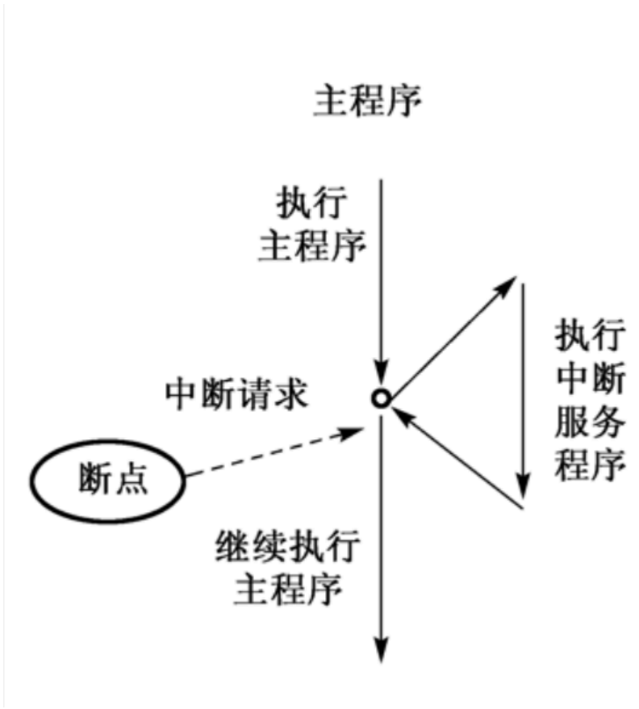

- 单片机在碰到异常的时候会挂起当前正在执行的程序,这个代码也叫做异常处理程序。如果这个异常处理函数和中断事件相关联,也可以称这个函数为中断处理函数(中断服务函数(ISR))。异常处理程序是已编译映像中的程序代码的一部分。
- 当异常处理完成后,会返回之前被挂起的程序那里,恢复执行之前被挂起的程序。

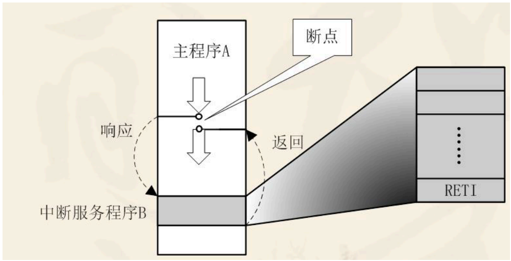

### 异常类型属性与向量表

> 📄 原课件 p.3-p.4(课件以树状图列出异常类型)

```text
├─ 系统异常 (10个) - 内核级异常
│ ├─ 1. NMI (不可屏蔽中断)
│ │ └─ 优先级固定(不可配置)
│ ├─ 2. HardFault (硬故障)
│ │ └─ 最严重异常(如栈溢出、非法指令)
│ ├─ 3. MemManage (存储器管理故障)
│ │ └─ MPU违规访问(如越界访问)
│ ├─ 4. BusFault (总线故障)
│ │ └─ 总线访问错误(如未映射地址)
│ ├─ 5. UsageFault (用法故障)
│ │ └─ 未对齐访问/除零(FPU需4字节对齐)
│ ├─ 6. SVC (系统服务调用)
│ │ └─ 软件触发的系统调用
│ ├─ 7. DebugMonitor (调试监控)
│ │ └─ 调试器触发
│ ├─ 8. PendSV (可悬起的系统调用)
│ │ └─ 任务切换(RTOS常用)
│ └─ 9. SysTick (系统滴答定时器)
│    └─ 系统时基中断(1ms精度)
│
└─ 外部中断 (82个) - 外设级中断
  ├─ EXTI线 (16个)
  │ └─ EXTI0-EXTI15 (通用外部中断线)
  │    └─ 例:EXTI0 (按键中断), EXTI15 (LED控制)
  │
  └─ 外设中断 (66个)
    ├─ 通信接口
    │ ├─ USARTx (6个: USART1-6)
    │ ├─ SPIx (3个: SPI1-3)
    │ ├─ I2Cx (3个: I2C1-3)
    │ └─ CANx (2个: CAN1-2)
    │
    ├─ 定时器
    │ ├─ TIMx (14个: TIM1-14)
    │ └─ 例:TIM1_UP (定时器溢出)
    │
    ├─ ADC/DMA
    │ ├─ ADC1-3 (3个ADC)
    │ └─ DMA1/2 (14个通道)
    │
    └─ 其他
      ├─ RTC (实时时钟)
      ├─ EXTI (外部中断扩展)
      └─ USB_OTG_FS (USB全速)
```

### 中断信号的作用

> 📄 原课件 p.4

中断信号提供了一种特殊的方式,让处理器去运行正常控制流之外的代码。如果想要实现这一点,就要在内核态堆栈保存程序计数器当前的值,并把中断类型相关的一个地址放进程序计数器。

### NVIC 嵌套向量中断控制器

> 📄 原课件 p.4-p.5

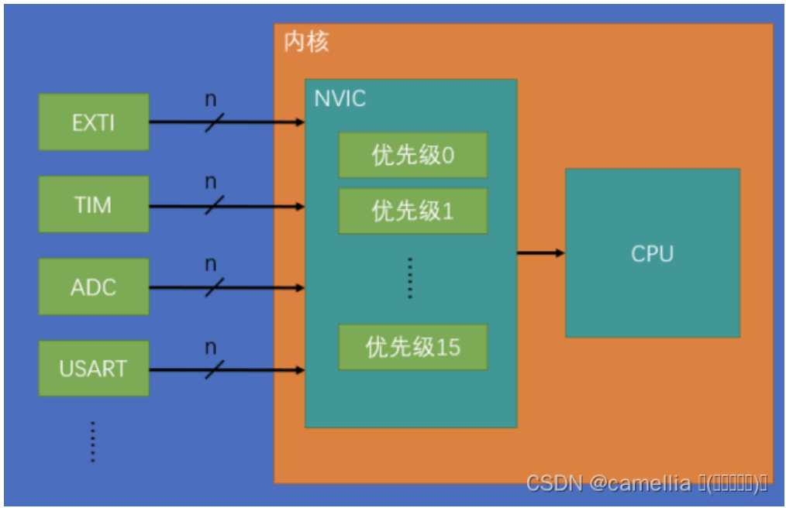

- NVIC 属于内核外设,管理着包括内核和片上所有外设的中断相关的功能。片上外设与内核外设都在芯片里面,但是内核外设在 CPU 里面,片上外设在内核之外。

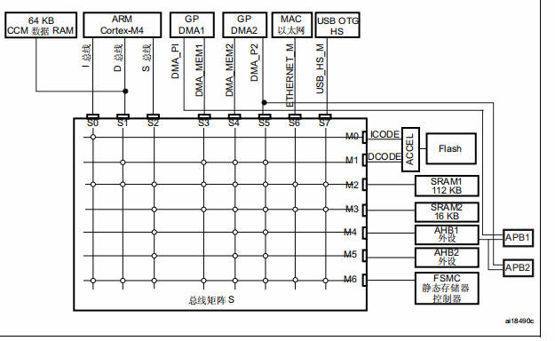

#### NVIC的中断向量表

> 📄 原课件 p.5-p.9(课件引用参考手册"表 45. STM32F405xx/07xx 和 STM32F415xx/17xx 的向量表"截图)

向量表列出每个异常/中断的抢占优先级(此处课件写作"优先级")、优先级类型(固定/可设置)、名称、说明和向量地址。前 13 项为内核异常,从"位置 0"开始为外部中断(共 82 个,位置 0~81)。

**内核异常与外部中断 0~18(原课件 p6):**

| 位置 | 优先级 | 优先级类型 | 名称 | 说明 | 地址 |
| --- | --- | --- | --- | --- | --- |
|  | - | - | - | 保留 | `0x0000 0000` |
|  | -3 | 固定 | Reset | 复位 | `0x0000 0004` |
|  | -2 | 固定 | NMI | 不可屏蔽中断。RCC 时钟安全系统(CSS)连接到 NMI 向量。 | `0x0000 0008` |
|  | -1 | 固定 | HardFault | 所有类型的错误 | `0x0000 000C` |
|  | 0 | 可设置 | MemManage | 存储器管理 | `0x0000 0010` |
|  | 1 | 可设置 | BusFault | 预取指失败,存储器访问失败 | `0x0000 0014` |
|  | 2 | 可设置 | UsageFault | 未定义的指令或非法状态 | `0x0000 0018` |
|  | - | - | - | 保留 | `0x0000 001C - 0x0000 002B` |
|  | 3 | 可设置 | SVCall | 通过 SWI 指令调用的系统服务 | `0x0000 002C` |
|  | 4 | 可设置 | Debug Monitor | 调试监控器 | `0x0000 0030` |
|  | - | - | - | 保留 | `0x0000 0034` |
|  | 5 | 可设置 | PendSV | 可挂起的系统服务 | `0x0000 0038` |
|  | 6 | 可设置 | SysTick | 系统嘀嗒定时器 | `0x0000 003C` |
| 0 | 7 | 可设置 | WWDG | 窗口看门狗中断 | `0x0000 0040` |
| 1 | 8 | 可设置 | PVD | 连接到 EXTI 线的可编程电压检测(PVD)中断 | `0x0000 0044` |
| 2 | 9 | 可设置 | TAMP_STAMP | 连接到 EXTI 线的入侵和时间戳中断 | `0x0000 0048` |
| 3 | 10 | 可设置 | RTC_WKUP | 连接到 EXTI 线的 RTC 唤醒中断 | `0x0000 004C` |
| 4 | 11 | 可设置 | FLASH | Flash 全局中断 | `0x0000 0050` |
| 5 | 12 | 可设置 | RCC | RCC 全局中断 | `0x0000 0054` |
| 6 | 13 | 可设置 | EXTI0 | EXTI 线 0 中断 | `0x0000 0058` |
| 7 | 14 | 可设置 | EXTI1 | EXTI 线 1 中断 | `0x0000 005C` |
| 8 | 15 | 可设置 | EXTI2 | EXTI 线 2 中断 | `0x0000 0060` |
| 9 | 16 | 可设置 | EXTI3 | EXTI 线 3 中断 | `0x0000 0064` |
| 10 | 17 | 可设置 | EXTI4 | EXTI 线 4 中断 | `0x0000 0068` |
| 11 | 18 | 可设置 | DMA1_Stream0 | DMA1 流 0 全局中断 | `0x0000 006C` |
| 12 | 19 | 可设置 | DMA1_Stream1 | DMA1 流 1 全局中断 | `0x0000 0070` |
| 13 | 20 | 可设置 | DMA1_Stream2 | DMA1 流 2 全局中断 | `0x0000 0074` |
| 14 | 21 | 可设置 | DMA1_Stream3 | DMA1 流 3 全局中断 | `0x0000 0078` |
| 15 | 22 | 可设置 | DMA1_Stream4 | DMA1 流 4 全局中断 | `0x0000 007C` |
| 16 | 23 | 可设置 | DMA1_Stream5 | DMA1 流 5 全局中断 | `0x0000 0080` |
| 17 | 24 | 可设置 | DMA1_Stream6 | DMA1 流 6 全局中断 | `0x0000 0084` |
| 18 | 25 | 可设置 | ADC | ADC1、ADC2 和 ADC3 全局中断 | `0x0000 0088` |

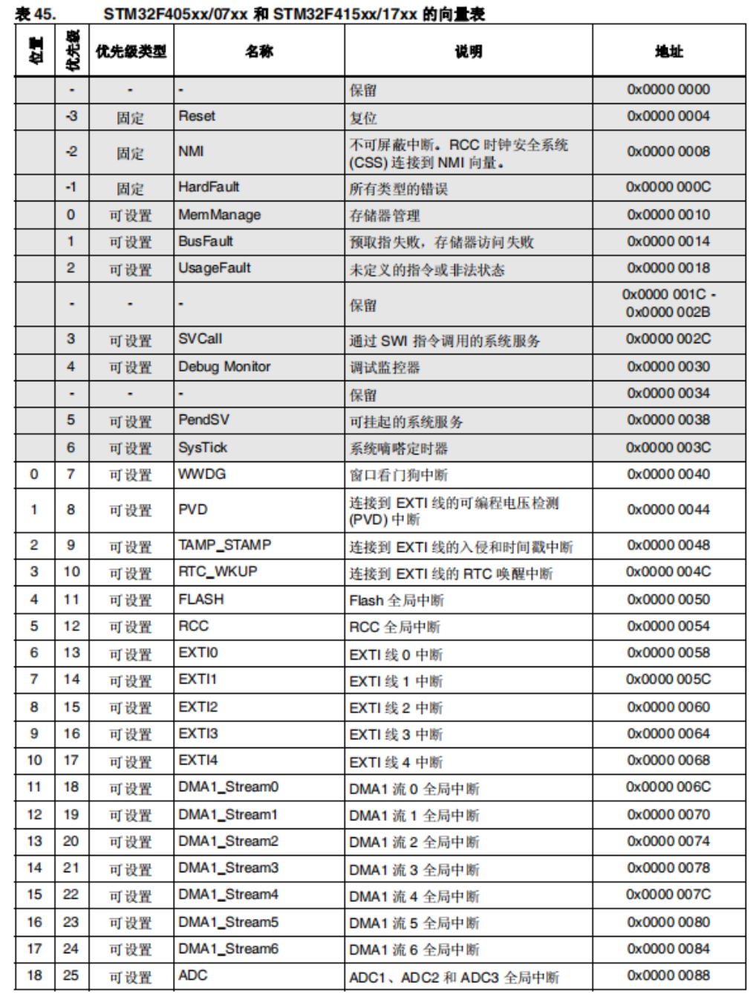

**外部中断 19~49(原课件 p7):**

| 位置 | 优先级 | 优先级类型 | 名称 | 说明 | 地址 |
| --- | --- | --- | --- | --- | --- |
| 19 | 26 | 可设置 | CAN1_TX | CAN1 TX 中断 | `0x0000 008C` |
| 20 | 27 | 可设置 | CAN1_RX0 | CAN1 RX0 中断 | `0x0000 0090` |
| 21 | 28 | 可设置 | CAN1_RX1 | CAN1 RX1 中断 | `0x0000 0094` |
| 22 | 29 | 可设置 | CAN1_SCE | CAN1 SCE 中断 | `0x0000 0098` |
| 23 | 30 | 可设置 | EXTI9_5 | EXTI 线 [9:5] 中断 | `0x0000 009C` |
| 24 | 31 | 可设置 | TIM1_BRK_TIM9 | TIM1 刹车中断和 TIM9 全局中断 | `0x0000 00A0` |
| 25 | 32 | 可设置 | TIM1_UP_TIM10 | TIM1 更新中断和 TIM10 全局中断 | `0x0000 00A4` |
| 26 | 33 | 可设置 | TIM1_TRG_COM_TIM11 | TIM1 触发和换相中断与 TIM11 全局中断 | `0x0000 00A8` |
| 27 | 34 | 可设置 | TIM1_CC | TIM1 捕获比较中断 | `0x0000 00AC` |
| 28 | 35 | 可设置 | TIM2 | TIM2 全局中断 | `0x0000 00B0` |
| 29 | 36 | 可设置 | TIM3 | TIM3 全局中断 | `0x0000 00B4` |
| 30 | 37 | 可设置 | TIM4 | TIM4 全局中断 | `0x0000 00B8` |
| 31 | 38 | 可设置 | I2C1_EV | I²C1 事件中断 | `0x0000 00BC` |
| 32 | 39 | 可设置 | I2C1_ER | I²C1 错误中断 | `0x0000 00C0` |
| 33 | 40 | 可设置 | I2C2_EV | I²C2 事件中断 | `0x0000 00C4` |
| 34 | 41 | 可设置 | I2C2_ER | I²C2 错误中断 | `0x0000 00C8` |
| 35 | 42 | 可设置 | SPI1 | SPI1 全局中断 | `0x0000 00CC` |
| 36 | 43 | 可设置 | SPI2 | SPI2 全局中断 | `0x0000 00D0` |
| 37 | 44 | 可设置 | USART1 | USART1 全局中断 | `0x0000 00D4` |
| 38 | 45 | 可设置 | USART2 | USART2 全局中断 | `0x0000 00D8` |
| 39 | 46 | 可设置 | USART3 | USART3 全局中断 | `0x0000 00DC` |
| 40 | 47 | 可设置 | EXTI15_10 | EXTI 线 [15:10] 中断 | `0x0000 00E0` |
| 41 | 48 | 可设置 | RTC_Alarm | 连接到 EXTI 线的 RTC 闹钟(A 和 B)中断 | `0x0000 00E4` |
| 42 | 49 | 可设置 | OTG_FS_WKUP | 连接到 EXTI 线的 USB On-The-Go FS 唤醒中断 | `0x0000 00E8` |
| 43 | 50 | 可设置 | TIM8_BRK_TIM12 | TIM8 刹车中断和 TIM12 全局中断 | `0x0000 00EC` |
| 44 | 51 | 可设置 | TIM8_UP_TIM13 | TIM8 更新中断和 TIM13 全局中断 | `0x0000 00F0` |
| 45 | 52 | 可设置 | TIM8_TRG_COM_TIM14 | TIM8 触发和换相中断与 TIM14 全局中断 | `0x0000 00F4` |
| 46 | 53 | 可设置 | TIM8_CC | TIM8 捕捉比较中断 | `0x0000 00F8` |
| 47 | 54 | 可设置 | DMA1_Stream7 | DMA1 流 7 全局中断 | `0x0000 00FC` |
| 48 | 55 | 可设置 | FSMC | FSMC 全局中断 | `0x0000 0100` |
| 49 | 56 | 可设置 | SDIO | SDIO 全局中断 | `0x0000 0104` |

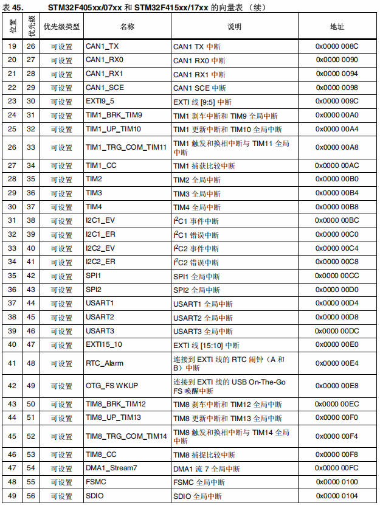

**外部中断 50~79(原课件 p8):**

| 位置 | 优先级 | 优先级类型 | 名称 | 说明 | 地址 |
| --- | --- | --- | --- | --- | --- |
| 50 | 57 | 可设置 | TIM5 | TIM5 全局中断 | `0x0000 0108` |
| 51 | 58 | 可设置 | SPI3 | SPI3 全局中断 | `0x0000 010C` |
| 52 | 59 | 可设置 | UART4 | UART4 全局中断 | `0x0000 0110` |
| 53 | 60 | 可设置 | UART5 | UART5 全局中断 | `0x0000 0114` |
| 54 | 61 | 可设置 | TIM6_DAC | TIM6 全局中断,DAC1 和 DAC2 下溢错误中断 | `0x0000 0118` |
| 55 | 62 | 可设置 | TIM7 | TIM7 全局中断 | `0x0000 011C` |
| 56 | 63 | 可设置 | DMA2_Stream0 | DMA2 流 0 全局中断 | `0x0000 0120` |
| 57 | 64 | 可设置 | DMA2_Stream1 | DMA2 流 1 全局中断 | `0x0000 0124` |
| 58 | 65 | 可设置 | DMA2_Stream2 | DMA2 流 2 全局中断 | `0x0000 0128` |
| 59 | 66 | 可设置 | DMA2_Stream3 | DMA2 流 3 全局中断 | `0x0000 012C` |
| 60 | 67 | 可设置 | DMA2_Stream4 | DMA2 流 4 全局中断 | `0x0000 0130` |
| 61 | 68 | 可设置 | ETH | 以太网全局中断 | `0x0000 0134` |
| 62 | 69 | 可设置 | ETH_WKUP | 连接到 EXTI 线的以太网唤醒中断 | `0x0000 0138` |
| 63 | 70 | 可设置 | CAN2_TX | CAN2 TX 中断 | `0x0000 013C` |
| 64 | 71 | 可设置 | CAN2_RX0 | CAN2 RX0 中断 | `0x0000 0140` |
| 65 | 72 | 可设置 | CAN2_RX1 | CAN2 RX1 中断 | `0x0000 0144` |
| 66 | 73 | 可设置 | CAN2_SCE | CAN2 SCE 中断 | `0x0000 0148` |
| 67 | 74 | 可设置 | OTG_FS | USB On The Go FS 全局中断 | `0x0000 014C` |
| 68 | 75 | 可设置 | DMA2_Stream5 | DMA2 流 5 全局中断 | `0x0000 0150` |
| 69 | 76 | 可设置 | DMA2_Stream6 | DMA2 流 6 全局中断 | `0x0000 0154` |
| 70 | 77 | 可设置 | DMA2_Stream7 | DMA2 流 7 全局中断 | `0x0000 0158` |
| 71 | 78 | 可设置 | USART6 | USART6 全局中断 | `0x0000 015C` |
| 72 | 79 | 可设置 | I2C3_EV | I²C3 事件中断 | `0x0000 0160` |
| 73 | 80 | 可设置 | I2C3_ER | I²C3 错误中断 | `0x0000 0164` |
| 74 | 81 | 可设置 | OTG_HS_EP1_OUT | USB On The Go HS 端点 1 输出全局中断 | `0x0000 0168` |
| 75 | 82 | 可设置 | OTG_HS_EP1_IN | USB On The Go HS 端点 1 输入全局中断 | `0x0000 016C` |
| 76 | 83 | 可设置 | OTG_HS_WKUP | 连接到 EXTI 线的 USB On The Go HS 唤醒中断 | `0x0000 0170` |
| 77 | 84 | 可设置 | OTG_HS | USB On The Go HS 全局中断 | `0x0000 0174` |
| 78 | 85 | 可设置 | DCMI | DCMI 全局中断 | `0x0000 0178` |
| 79 | 86 | 可设置 | CRYP | CRYP 加密全局中断 | `0x0000 017C` |

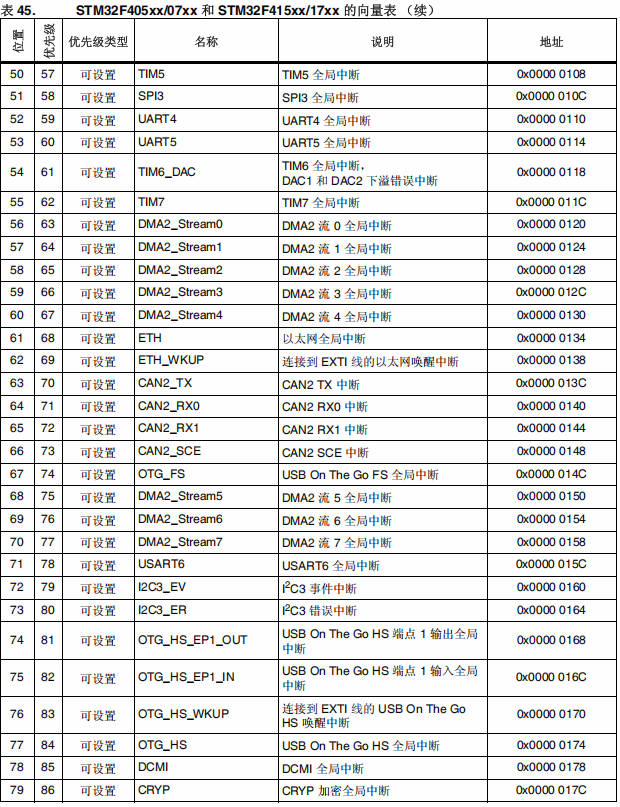

**外部中断 80~81(原课件 p9 顶部):**

| 位置 | 优先级 | 优先级类型 | 名称 | 说明 | 地址 |
| --- | --- | --- | --- | --- | --- |
| 80 | 87 | 可设置 | HASH_RNG | 哈希和随机数发生器全局中断 | `0x0000 0180` |
| 81 | 88 | 可设置 | FPU | FPU 全局中断 | `0x0000 0184` |

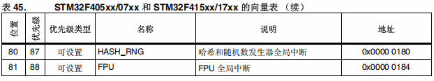

#### 优先级分类

> 📄 原课件 p.9

- 抢占优先级和响应优先级,每个中断源都要被指定这两个优先级。
- 优先顺序:
  - 抢占优先级,主要控制中断嵌套,抢占优先级高的会优先抢占优先级低的(序号越小优先级越高)。
  - 响应优先级,在抢占优先级相同的情况下,响应优先级高,优先执行。
  - 两者相同,比较硬件中断编号,中断编号越小,优先级高(硬件中断编号从中断向量表中查看,启动文件中看)。

这里简单介绍一下 STM32 的中断分组:STM32 将中断分为 5 个组,组 0~4。该分组的设置是由 `SCB->AIRCR` 寄存器的 bit[10:8] 来定义的。具体的分配关系如表 5.2.6.1 所示:

| 组 | `AIRCR[10:8]` | `bit[7:4]` 分配情况 | 分配结果 |
| --- | --- | --- | --- |
| 0 | `111` | 0:4 | 0 位抢占优先级,4 位响应优先级 |
| 1 | `110` | 1:3 | 1 位抢占优先级,3 位响应优先级 |
| 2 | `101` | 2:2 | 2 位抢占优先级,2 位响应优先级 |
| 3 | `100` | 3:1 | 3 位抢占优先级,1 位响应优先级 |
| 4 | `011` | 4:0 | 4 位抢占优先级,0 位响应优先级 |

表 5.2.6.1 AIRCR 中断分组设置表(课件截图):

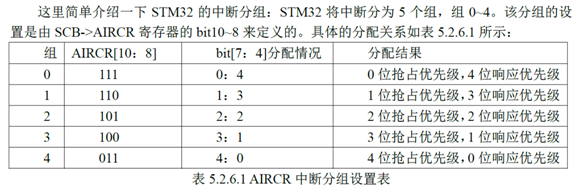

### 异常流程概述-压栈和出栈

> 📄 原课件 p.9

压栈和出栈是异常处理机制的基石:

- **压栈**:异常发生时保存当前执行状态。
- **出栈**:异常处理完成后恢复执行状态。

#### 一、什么是压栈和出栈？

> 📄 原课件 p.10

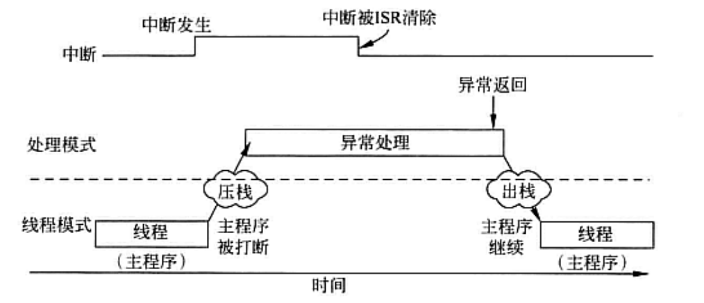

**1. 基本概念**

- **压栈(Push)**:将数据存入堆栈。
  - 在异常发生时,CPU 自动将当前执行状态(寄存器内容)压入堆栈。
  - 作用:保存当前程序运行状态,以便异常处理完成后能恢复执行。
- **出栈(Pop)**:从堆栈中取出数据。
  - 在异常处理结束时,CPU 将保存的状态从堆栈中取出。
  - 作用:恢复异常发生前的程序运行状态。

### 异常流程概述-异常连锁

> 📄 原课件 p.11

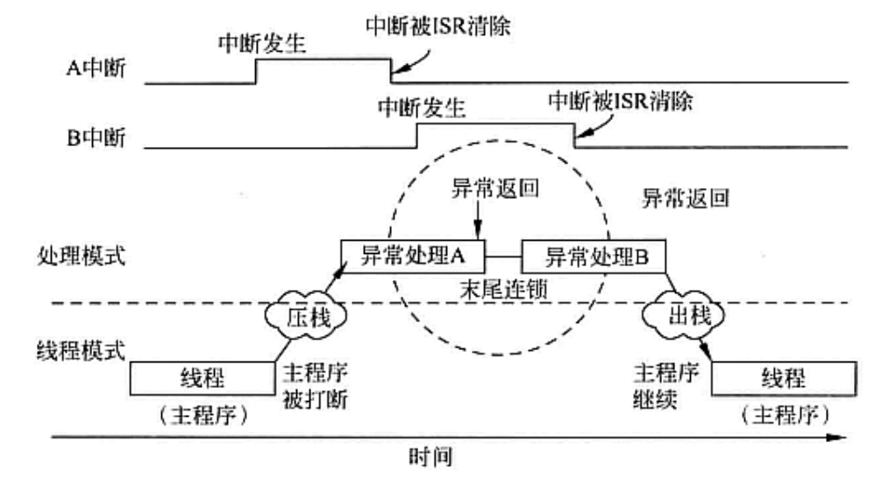

图中信号:上方为 A 中断、B 中断的"中断发生"与"中断被 ISR 清除";处理模式中依次为异常处理 A、末尾连锁、异常处理 B 和异常返回;线程模式中主程序在压栈处被打断、在出栈后继续,横轴为时间。

#### 异常处理流程-延迟到达

> 📄 原课件 p.11

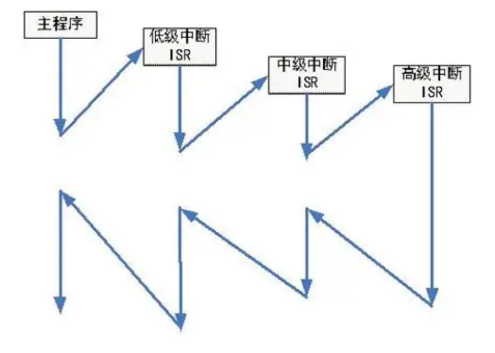

图中主程序先被低级中断打断、跳转到低级中断 ISR;低级中断 ISR 执行期间中级中断、高级中断依次到来并被响应,最后沿原路逐级返回。

### 异常处理流程

> 📄 原课件 p.12

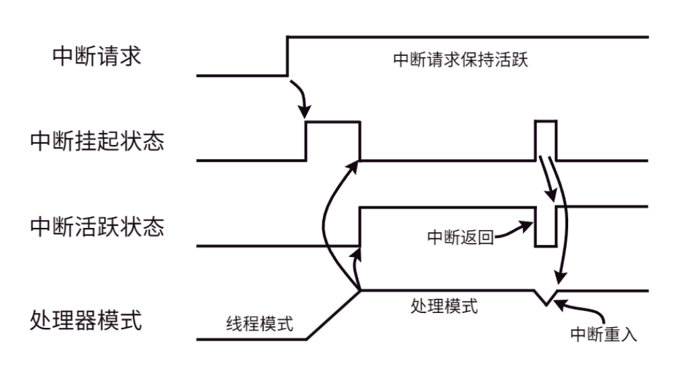

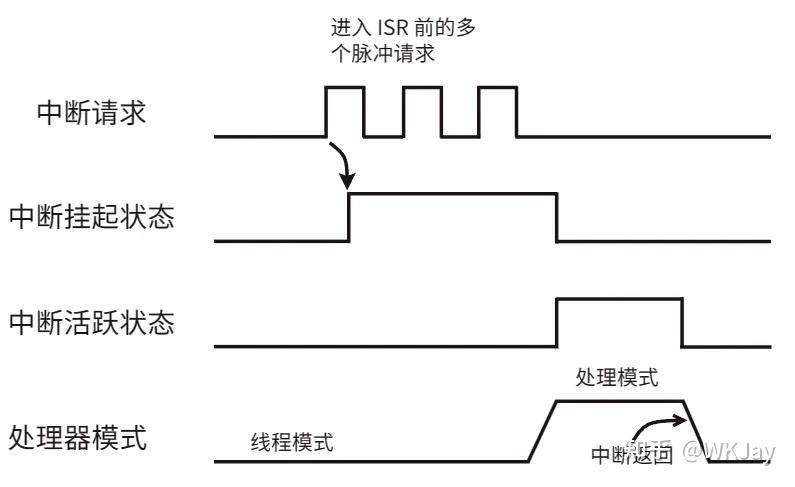

当异常发生时:

1. 产生中断信号;
2. NVIC 进行优先级仲裁,判断当前是否有更高的优先级在运行;
3. 自动压栈、更新栈指针(硬件实现异常处理的核心);
4. 处理器取出异常向量并写入 PC;
5. 更新相关的寄存器;
6. 跳转到中断服务函数;
7. 异常返回时自动出栈;
8. 恢复寄存器;
9. 回到异常发生点。

### NVIC特点

> 📄 原课件 p.13

完整的 NVIC 支持 256 个中断(16 个内核异常和 240 个外部中断),在不同的单片机当中所支持的数量是不一样的,这个支持的数量是由芯片的生产厂商来规定的,厂商根据所设计的芯片对完整的 NVIC 做部分裁剪,以节省成本。

#### 可嵌套的中断支持

可嵌套的中断支持的作用范围很广,覆盖了所有的外部中断和绝大多数的系统异常。外在表现是这些异常都可以被赋予不同的优先级。当前优先级被储存在 xPSR 的专用字段中,当一个异常发生时,硬件会自动比较该异常的优先级是否比当前的优先级更高,如果发现了更高优先级的异常,处理器就会中断当前的中断服务程序,而去服务新来的异常——也就是立即抢占。

#### 向量中断支持

向量中断与直接中断的好处:

- **向量中断**:当开始响应一个中断请求,Cortex-M3 会自动定位一张向量表,并且根据中断号从表中找出中断服务函数的入口地址,然后跳转过去执行。
- **直接中断**:需要使用软件来分辨到底是哪个中断发生了,也无需半导体厂商提供私有的中断控制器来完成这种工作。

所以也可以看出来使用向量中断的方式可以大大缩短中断延迟时间。

#### 动态优先级调整支持

软件可以在运行时期更改中断的优先级,如果在某段中断服务函数中修改了该中断所对应的优先级,而且这个中断又有新的实例处于悬起中,也不会自己打断自己,从而没有重入的风险。

#### 可屏蔽中断

可以屏蔽优先级低于某个阈值的中断/异常(设置 `BASEPRI` 寄存器,课件写作 BASEPR),也可以全体封杀(设置 `PRIMASK` 和 `FAULTMASK` 寄存器)。这是为了让时间关键的任务能在死线(deadline,最后期限)到来前完成,而不被干扰。

### 相关的寄存器

> 📄 原课件 p.13-p.16(以 EXTI 为例的中断/事件寄存器结构)

#### 中断寄存器

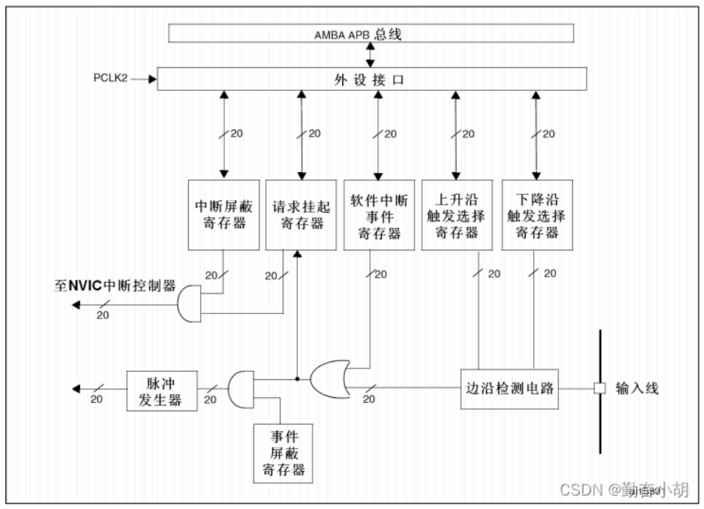

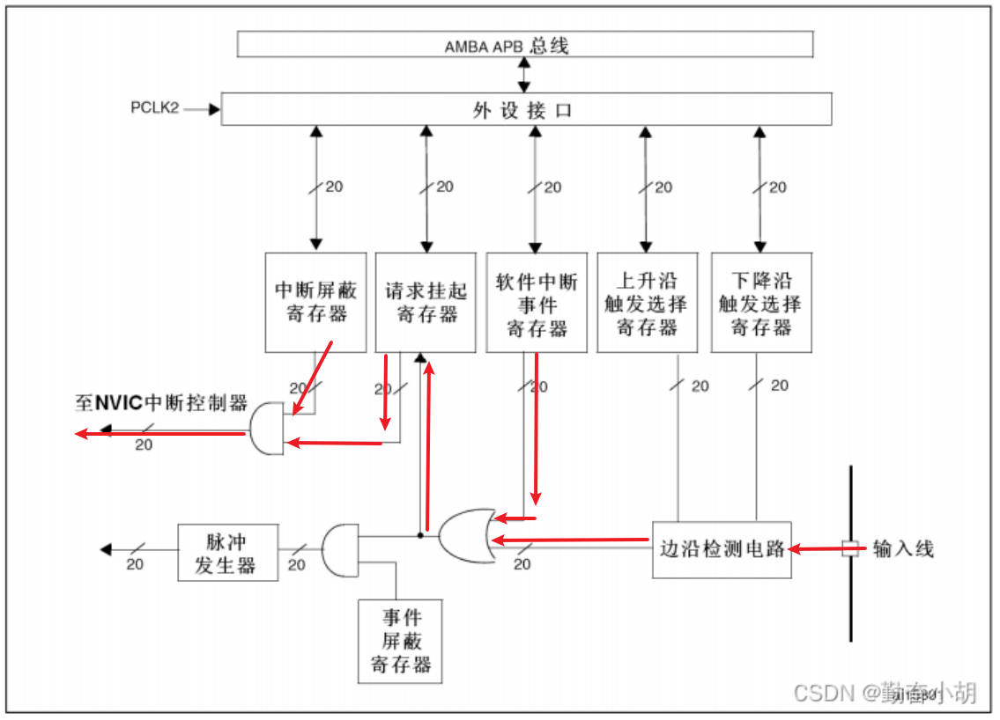

在中断寄存器的前部分和事件寄存器相同,区别在于一个与门后,会进入挂起寄存器中,就回到我们上次课讲到的内容(中断处理分析)的部分,然后同样是否会被触发也要结合中断屏蔽寄存器,最后进入到中断控制器 NVIC,然后再触发中断执行中断服务函数。

#### 事件寄存器

> 📄 原课件 p.16

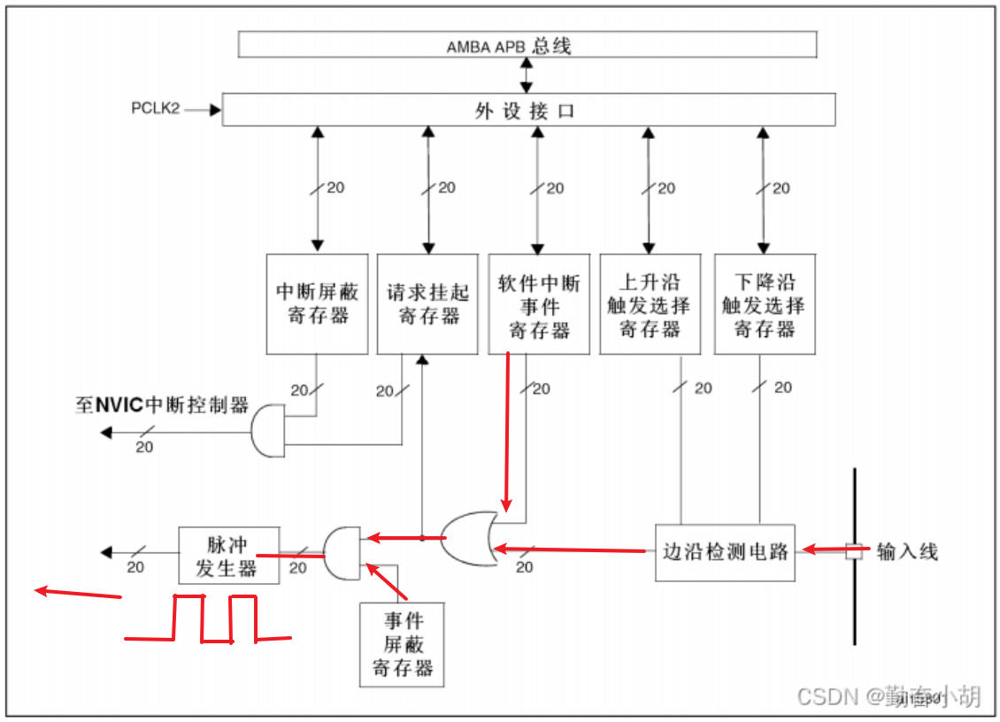

引脚产生一个上升或者下降沿的电平,然后到达边沿检测电路,检测是上升沿还是下降沿,产生的信号经过一个与门,与门另一边由中断事件控制器决定,然后再经过一个与门,看这个事件是否需要屏蔽,全部都通过后启动脉冲发生器,由脉冲发生器产生一个特定的脉冲信号,然后这个脉冲信号可以给外设,让外设做出操作。

#### 总结

> 📄 原课件 p.16

- **中断**:是检测到外部上升或者下降沿,触发中断,进入中断服务函数。
- **事件**:是检测到外部上升或者下降沿,最后产生指定频率的脉冲信号。

## 小结与下一步

- 异常 = 系统异常(内核)+ 外部中断(外设),NVIC 统一管理;每个中断源有抢占/响应两个优先级,分组由 `SCB->AIRCR` 的 bit[10:8] 决定(组 0~4)。
- 异常响应由硬件自动压栈、出栈保存与恢复现场;末尾连锁与延迟到达优化了多中断的衔接。
- NVIC 四大特点:可嵌套、向量中断(缩短中断延迟)、动态调整优先级(无重入风险)、可屏蔽(`BASEPRI`/`PRIMASK`/`FAULTMASK`)。
- EXTI 例中,中断路径最终进 NVIC 执行 ISR,事件路径只经脉冲发生器产生脉冲触发外设——这就是中断与事件的区别。

➡️ 下一课:[[06-STM32-系统滴答定时器|STM32-系统滴答定时器]]
