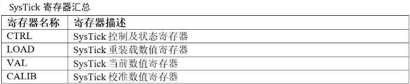
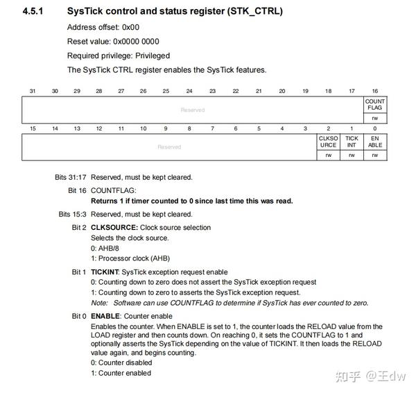
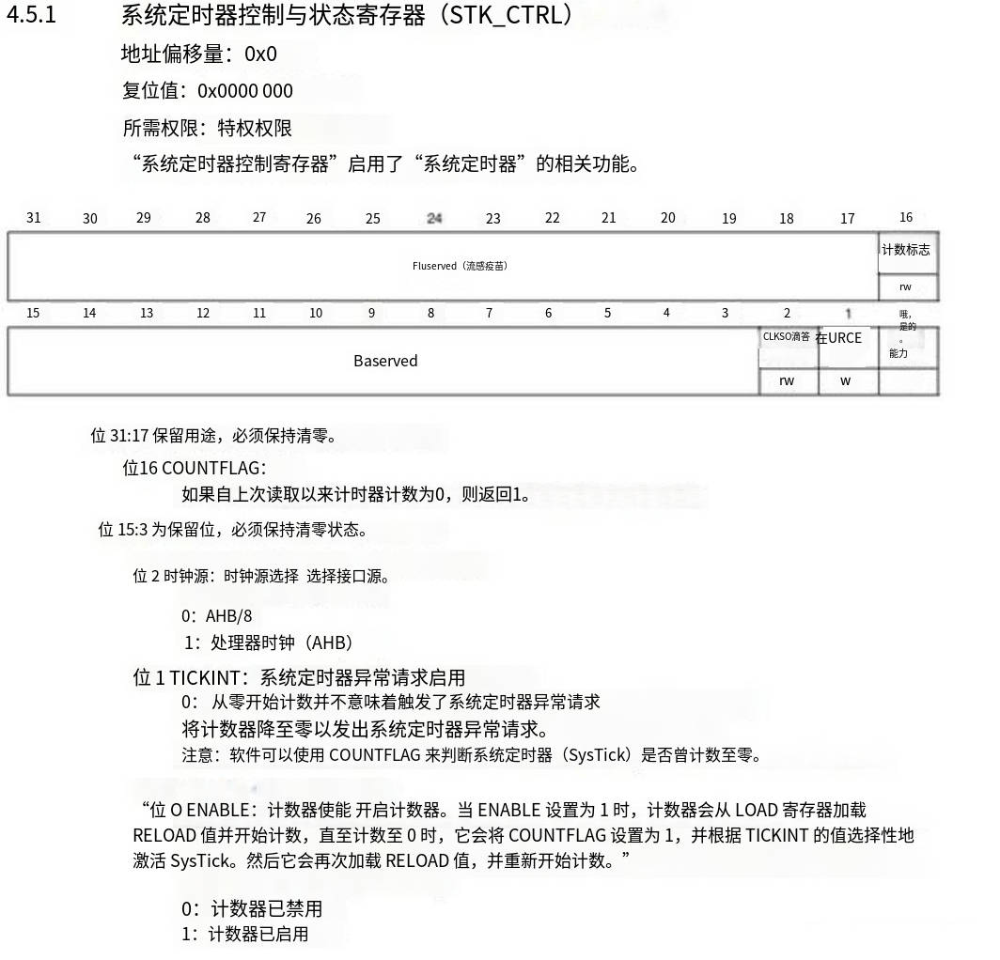
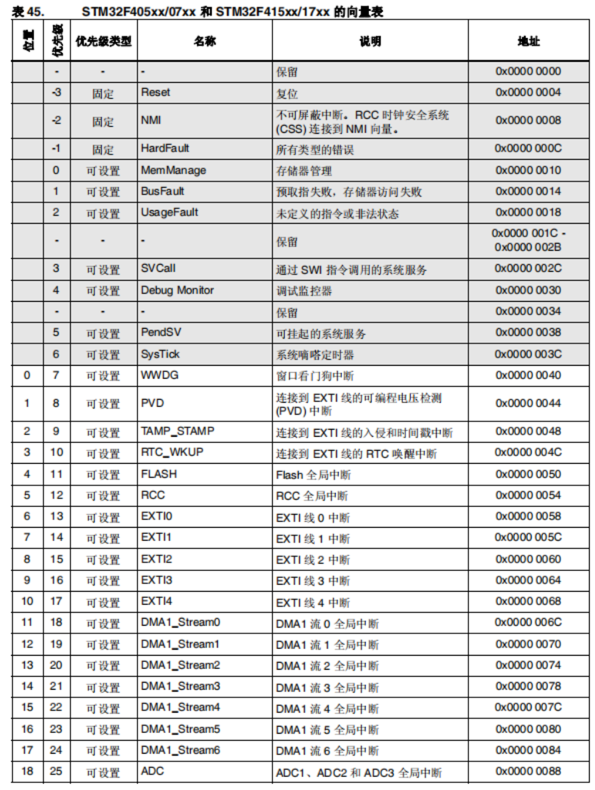

# 06 STM32-系统滴答定时器

> 本课整理自 `STM32内核架构-SYSTICK系统滴答定时器.pdf`(共 8 页)。返回 [[STM32学习目录|📑 STM32学习目录]]。

## 本章要点

- SysTick(系统滴答定时器)是 ARM Cortex-M 内核集成的 24 位递减计数器,递减到 0 时自动从 RELOAD 寄存器重装初值,为操作系统提供基本时间基准(任务调度、延时函数等)。
- SysTick 捆绑在 NVIC 中,可用作延时器或实时系统的心跳时钟,不占用片上定时器资源。
- 时钟源可选内部时钟(FCLK)或外部时钟(STCLK),由 SysTick 控制及状态寄存器的第 2 位(CLSOURCE)选择。
- SysTick 共 4 个寄存器:`CTRL/SYST_CSR`(0xE000E010)、`LOAD/SYST_RVR`(0xE000E014)、`VAL/SYST_CVR`(0xE000E018)、`CALIB/SYST_CALIB`(0xE000E01C),计数器均只有低 24 位有效。
- `COUNTFLAG`(CSR 的 bit16)在计数到 0 时置位;即使 TICKINT=0(中断关闭)该标志仍会置位,软件可据此判断是否发生过一次"滴答"。
- SysTick 在 STM32 向量表中的位置为 15(向量地址 0x0000 003C),属"可设置"优先级的内核异常。

## SYSTICK 系统滴答定时器

### SysTick简介

- SysTick(System Tick Timer,系统滴答定时器)是 ARM Cortex-M 系列处理器内核中集成的一个 **24 位递减计数器**,当递减到 0 时从 RELOAD 寄存器中自动重装定时器初值,主要用于提供操作系统所需的基本时间基准(如任务调度、延时函数等),也可用于简单的周期性中断或精确延时。
- SysTick 定时器被捆绑在 NVIC 中,是一个简单的定时器。SysTick 定时器可以用来做延时,或者作为实时系统的心跳时钟,这样可以节省 MCU 资源,不用浪费一个(片上)定时器。

**SysTick 寄存器汇总**(原课件截图中的表格):

| 寄存器名称 | 寄存器描述 |
| --- | --- |
| `CTRL` | SysTick 控制及状态寄存器 |
| `LOAD` | SysTick 重装载数值寄存器 |
| `VAL` | SysTick 当前数值寄存器 |
| `CALIB` | SysTick 校准数值寄存器 |

### 时钟源

这个定时器的时钟源可以是:

- 内部时钟(FCLK,M4 上的自由运行时钟)
- 外部时钟(M4 处理器上的 STCLK 信号)

通过 SysTick 控制及状态寄存器的第 2 位来确定。

> 📄 原课件 p.2–p.3 是参考手册中 STK_CTRL 寄存器章节的截图(英文原版 + 中文机翻版),内容与本课第 5 页的寄存器讲解对应。

原课件 p.2(英文原版)要点:

- **4.5.1 SysTick control and status register (STK_CTRL)**:Address offset: `0x00`;Reset value: `0x0000 0000`;Required privilege: Privileged。The SysTick CTRL register enables the SysTick features.
- 位域布局:bit 31:17 保留;bit 16 = `COUNTFLAG`(rw);bit 15:3 保留;bit 2 = `CLKSOURCE`(rw);bit 1 = `TICKINT`(rw);bit 0 = `ENABLE`(rw)。
- Bits 31:17 Reserved, must be kept cleared。
- Bit 16 `COUNTFLAG`:Returns 1 if timer counted to 0 since last time this was read。
- Bits 15:3 Reserved, must be kept cleared。
- Bit 2 `CLKSOURCE`(Clock source selection)Selects the clock source:
  - 0:AHB/8
  - 1:Processor clock (AHB)
- Bit 1 `TICKINT`(SysTick exception request enable):
  - 0:Counting down to zero does not assert the SysTick exception request
  - 1:Counting down to zero to asserts the SysTick exception request.
  - Note:Software can use `COUNTFLAG` to determine if SysTick has ever counted to zero.
- Bit 0 `ENABLE`(Counter enable):Enables the counter. When ENABLE is set to 1, the counter loads the RELOAD value from the LOAD register and then counts down. On reaching 0, it sets the COUNTFLAG to 1 and optionally asserts the SysTick depending on the value of TICKINT. It then loads the RELOAD value again, and begins counting.
  - 0:Counter disabled
  - 1:Counter enabled

原课件 p.3(中文机翻版,同一内容,位域图中文字有明显机翻乱码,以英文原版为准)要点:

- 4.5.1 系统定时器控制与状态寄存器(STK_CTRL):地址偏移量 `0x0`;复位值 `0x0000 0000`;所需权限:特权权限。"系统定时器控制寄存器"启用了"系统定时器"的相关功能。
- 位 31:17 保留用途,必须保持清零;位 16 `COUNTFLAG`:如果自上次读取以来计时器计数为 0,则返回 1;位 15:3 为保留位,必须保持清零状态。
- 位 2 时钟源(时钟源选择):0 = AHB/8;1 = 处理器时钟(AHB)。
- 位 1 `TICKINT`(系统定时器异常请求启用):0 = 从零开始计数并不意味着触发了系统定时器异常请求;1 = 将计数器降至零以发出系统定时器异常请求。注意:软件可以使用 `COUNTFLAG` 来判断系统定时器(SysTick)是否曾计数至零。
- 位 0 `ENABLE`(计数器使能):开启计数器。当 ENABLE 设置为 1 时,计数器会从 LOAD 寄存器加载 RELOAD 值并开始计数,直至计数至 0 时,它会将 COUNTFLAG 设置为 1,并根据 TICKINT 的值选择性地激活 SysTick。然后它会再次加载 RELOAD 值,并重新开始计数。0 = 计数器已禁用;1 = 计数器已启用。

### STM32的时钟树

> 📄 原课件 p.4(图 13. 时钟树,取自参考手册)

图中与时钟相关的主要通路:

- 时钟源:`LSIRC 32 kHz`、`LSEOSC 32.768kHz`(OSC32_IN/OSC32_OUT)、`16 MHz HSI RC`、`4-26MHz HSE OSC`(OSC_IN/OSC_OUT),以及 PLL(内部含 ÷M、×N、÷P、÷Q、÷R)和 PLL2S。
- `SW` 多路选择 HSI/HSE/PLLCLK 之一作为 `SYSCLK`,**最高 168 MHz**。
- SYSCLK 经 `AHB PRESC (/1,2..512)` 分频得到 `HCLK`(最高 168 MHz):到 AHB 总线、内核、存储器和 DMA;HCLK 再经 `/8` 输出"到 Cortex 系统定时器";另有 `FCLK Cortex` 自由运行时钟 —— 这两条支路正对应 SysTick 的外部时钟(STCLK = HCLK/8)与时钟源(FCLK)。
- `APBx PRESC (/1,2,4,8,16)` 产生 `APBx 外设时钟`;若 `APBx presc = ×1` 则定时器时钟为 ×1,否则 ×2,产生 `APBx 定时器时钟`。
- `PLL48CK` 经外设时钟使能后输出 `48 MHz 时钟`;`PLLI2SCLK`(可由 `I2SSRC` 选择外部时钟)输出 `I2S 时钟`;以太网相关时钟输出 `MACTXCLK`/`MACRXCLK`/`MACRMIICLK`(由 `SYS_CFG_PMC 寄存器中的 MII_RMII_SEL` 选择);`OTG_HS_SCL` 经外设时钟使能输出 `USBHS ULPI 时钟`。
- 注(图下文字):有关内部和外部时钟源特性的所有详细信息,请参见器件数据手册的电气特性部分。

### SysTick寄存器

#### SysTick 控制与状态寄存器（SYST_CSR）

- 地址:`0xE000E010`
- 访问权限:读/写
- 位宽:32 位,但仅低 16 位有定义,其余保留(应忽略或写 0)

#### 寄存器位定义（Cortex-M4）

| 位 | 名称 | 类型 | 描述 |
| --- | --- | --- | --- |
| 0 | `ENABLE` | R/W | **使能 SysTick 计数器** · 0 = 禁用(计数停止) · 1 = 启用(开始递减计数) |
| 1 | `TICKINT` | R/W | **使能 SysTick 异常请求**(即中断) · 0 = 不产生中断 · 1 = 计数到 0 时触发 SysTick 异常(IRQ #15) |
| 2 | `CLKSOURCE` | R/W | **选择时钟源** · 0 = 外部参考时钟(通常是 AHB/8) · 1 = 内核时钟(HCLK,即处理器时钟) |
| 3–15 | — | — | 保留,应写 0 |
| 16 | `COUNTFLAG` | R/WC | **计数标志位**(只读意义,写任意值可清零) · 0 = 自上次读取后,计数器未减到 0 · 1 = 自上次读取后,计数器已减到 0(表示发生了一次"滴答")⚠️ 注意:即使 `TICKINT=0`(中断关闭),此标志仍会置位 |

#### SysTick重装载数值寄存器

> 📄 原课件 p.5

SysTick 重装载数值寄存器(Reload Value Register,SYST_RVR)是 ARM Cortex-M 系列处理器(包括 Cortex-M3/M4/M7 等)中 SysTick 定时器的核心寄存器之一,用于设定计数器每次递减到 0 后**自动重新加载的初始值**。

**基本信息**

- 寄存器名称:SysTick Reload Value Register
- 缩写:`SYST_RVR` 或 `RVR`
- 地址:`0xE000E014`
- 访问权限:读/写(R/W)
- 位宽:32 位,但仅低 24 位有效(bit[23:0]),高 8 位保留(应写 0)

#### SysTick当前数值寄存器

> 📄 原课件 p.6

SysTick 当前数值寄存器(Current Value Register,SYST_CVR)是 ARM Cortex-M 系列处理器(包括 M3、M4 等)中 SysTick 定时器的一个关键寄存器,用于**读取当前计数器的值**或**清除计数器和状态标志**。

**基本信息**

- 寄存器名称:SysTick Current Value Register
- 缩写:`SYST_CVR` 或 `CVR`
- 地址:`0xE000E018`
- 访问权限:
  - 读操作:返回当前递减计数器的值(24 位)
  - 写操作:清零计数器,并清除 `COUNTFLAG` 标志位(任意写入值均有效,通常写 0)
- 位宽:32 位,但仅低 24 位有效(bit[23:0]),高 8 位保留(读为 0)

#### SysTick校准数值寄存器

> 📄 原课件 p.6–p.7

SysTick 校准数值寄存器(Calibration Value Register,SYST_CALIB)是 ARM Cortex-M 系列处理器(包括 Cortex-M3/M4/M7 等)中 SysTick 定时器的一个可选寄存器,用于提供一个**与系统时钟无关的、标准化的时间参考值**,主要用于简化 10 ms 周期的配置(尤其在早期 ARM 文档和部分芯片中)。

**基本信息**

- 寄存器名称:SysTick Calibration Value Register
- 缩写:`SYST_CALIB` 或 `CALIB`
- 地址:`0xE000E01C`
- 访问权限:只读(R/O)
- 位宽:32 位,但仅部分位有定义

**寄存器位定义**(最后一行"其他位"为原课件 p.7 续表):

| 位 | 名称 | 类型 | 描述 |
| --- | --- | --- | --- |
| [23:0] | `TENMS` | R/O | 表示在 **10 毫秒**(10 ms)内,SysTick 使用**外部参考时钟**(通常是 AHB/8)所需的重装载值。即:若将此值写入 LOAD 寄存器,并选择外部时钟源(`CLKSOURCE=0`),则 SysTick 周期 ≈ 10 ms。 |
| [30] | `SKEW` | R/O | 校准值是否不精确:· 0 = TENMS 值精确 · 1 = TENMS 值存在偏差(非整数周期,做了舍入) |
| [31] | `NOREF` | R/O | 是否**没有外部参考时钟**:· 0 = 存在稳定的外部参考时钟(如 AHB/8) · 1 = 无外部参考时钟,TENMS 无效 |
| 其他位 | — | — | 保留,读为 0 |

### 系统滴答定时器中断优先级设置

> 📄 原课件 p.8(表 45. STM32F405xx/07xx 和 STM32F415xx/17xx 的向量表,截图)

向量表中与内核异常相关的部分(SysTick 行即本课主角):

| 位置 | 优先级 | 优先级类型 | 名称 | 说明 | 地址 |
| --- | --- | --- | --- | --- | --- |
| — | -3 | 固定 | Reset | 复位 | 0x0000 0004 |
| — | -2 | 固定 | NMI | 不可屏蔽中断。RCC 时钟安全系统(CSS)连接到 NMI 向量 | 0x0000 0008 |
| — | -1 | 固定 | HardFault | 所有类型的错误 | 0x0000 000C |
| — | 0 | 可设置 | MemManage | 存储器管理 | 0x0000 0010 |
| — | 1 | 可设置 | BusFault | 预取指失败,存储器访问失败 | 0x0000 0014 |
| — | 2 | 可设置 | UsageFault | 未定义的指令或非法状态 | 0x0000 0018 |
| — | 3 | 可设置 | SVCall | 通过 SWI 指令调用的系统服务 | 0x0000 002C |
| — | 4 | 可设置 | Debug Monitor | 调试监控器 | 0x0000 0030 |
| — | 5 | 可设置 | PendSV | 可挂起的系统服务 | 0x0000 0038 |
| — | 6 | 可设置 | **SysTick** | **系统嘀嗒定时器** | 0x0000 003C |

表中随后的片上外设中断(优先级类型均为"可设置")从位置 0、优先级 7 起依次为:`WWDG`(窗口看门狗中断,0x0000 0040)、`PVD`(可编程电压检测中断,0x0000 0044)、`TAMP_STAMP`(入侵和时间戳中断,0x0000 0048)、`RTC_WKUP`(RTC 唤醒中断,0x0000 004C)、`FLASH`(Flash 全局中断,0x0000 0050)、`RCC`(RCC 全局中断,0x0000 0054)、`EXTI0`~`EXTI4`(EXTI 线 0~4 中断,0x0000 0058~0x0000 0068)、`DMA1_Stream0`~`DMA1_Stream6`(DMA1 流 0~6 全局中断,0x0000 006C~0x0000 0084)、`ADC`(ADC1、ADC2 和 ADC3 全局中断,0x0000 0088)。

可见 SysTick 是位置 15 的内核异常(向量地址 0x0000 003C),优先级"可设置",与前文"计数到 0 时触发 SysTick 异常(IRQ #15)"一致。

## 小结与下一步

- SysTick 是内核自带的 24 位递减计数器:递减到 0 自动重装 RELOAD 值并(可选)触发异常,适合做操作系统心跳、延时和周期性中断,不占用片上定时器。
- 配置三要素:用 `SYST_RVR`(LOAD)装重装载值、用 `SYST_CSR`(CTRL)的 `ENABLE`/`TICKINT`/`CLKSOURCE` 位使能并选时钟源、用 `COUNTFLAG` 或中断判断"滴答"是否发生;`SYST_CVR` 可随时读当前值或写任意值清零。
- 时钟源二选一:内部 FCLK(内核自由运行时钟)或外部 STCLK(AHB/8),与 STM32 时钟树中"/8 到 Cortex 系统定时器"和"FCLK Cortex"两条支路对应。
- SysTick 在向量表中位置为 15(0x0000 003C),优先级可设置。

➡️ 下一课:[[07-STM32-基本定时器|STM32-基本定时器]]
