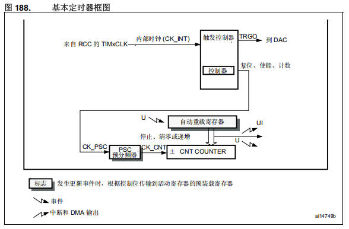
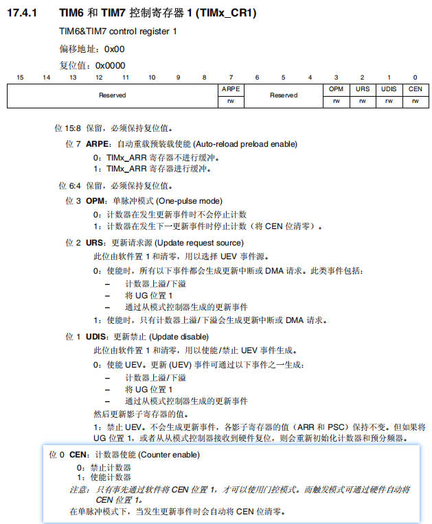
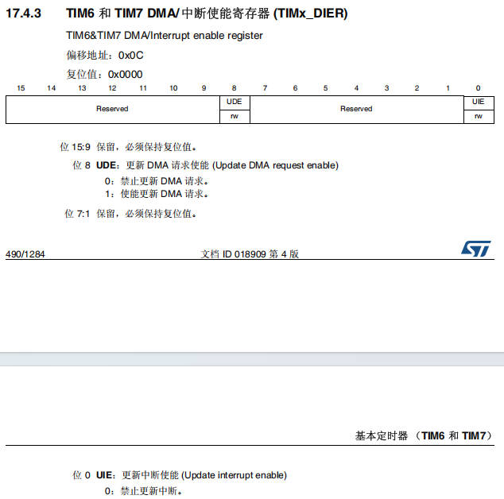
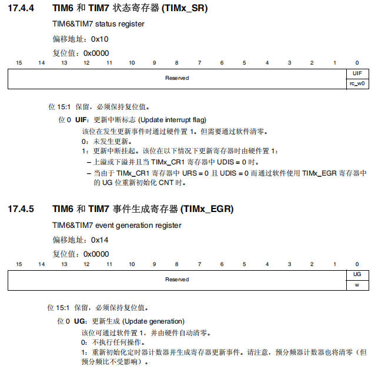
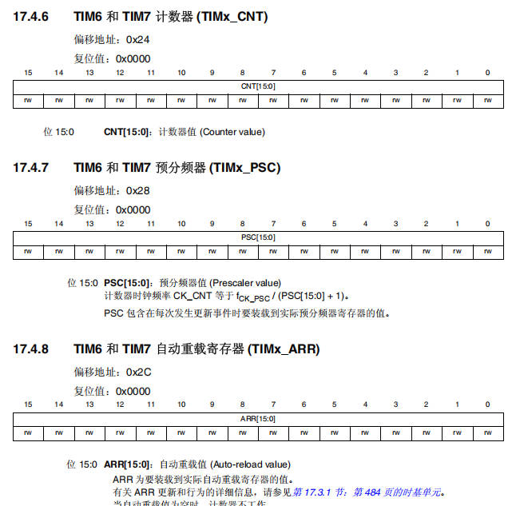
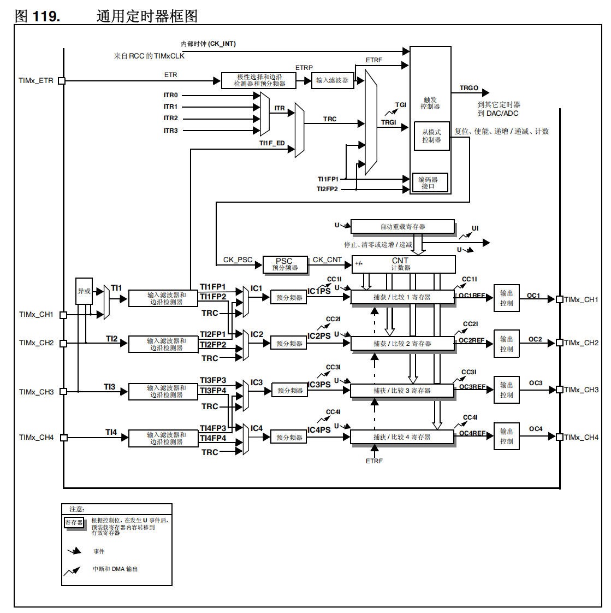
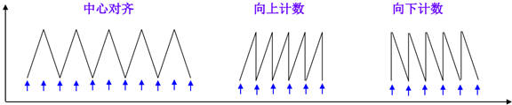
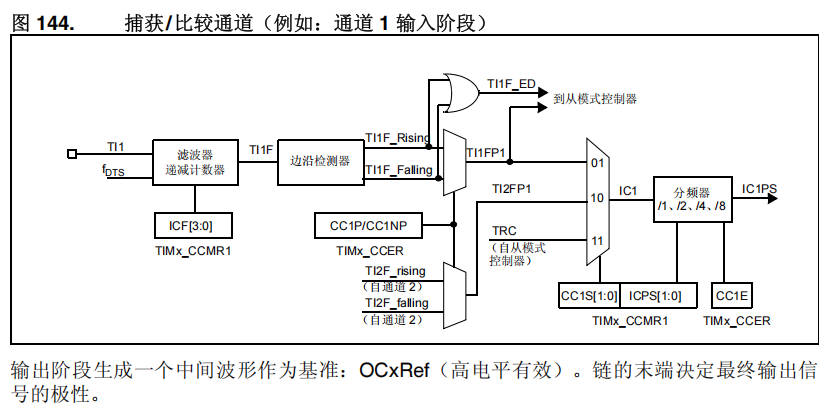
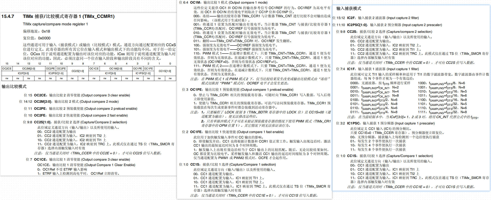

# 07 STM32-基本定时器

> 本课整理自 `07基本定时器.pdf`(共 11 页)。返回 [[STM32学习目录|📑 STM32学习目录]]。

## 本章要点

- 定时器顾名思义就是一个定时的器件:给定一个初值,计数到初值时通知 CPU 或其他处理器去做该做的事,可以理解为日常的闹钟。
- STM32F4 板载了高级控制定时器(TIM1 和 TIM8)、通用定时器(TIM2 到 TIM5、TIM9 到 TIM14)以及基本定时器(TIM6 和 TIM7)等,总共达 14 个定时器之多。
- 基本定时器由预分频器、自动重装寄存器、计数器构成最基本的计数计时电路,叫作**时基单元**;只能选择内部时钟 `CK_INT`(来源为 `RCC_TIMxCLK`,一般为系统主频 72MHz)。
- 预分频器实际分频系数 = 预分频器的值 + 1(16 位,最大可写 65535,即 65536 分频);计数器 16 位,计到自动重装值即产生中断并清零计数器,自动开启下一次计数计时。
- 基本定时器核心寄存器:`TIMx_CR1`(控制)、`TIMx_DIER`(DMA/中断使能)、`TIMx_SR`(状态)、`TIMx_EGR`(事件生成)、`TIMx_CNT`、`TIMx_PSC`、`TIMx_ARR`;HAL 库用 `HAL_TIM_Base_Init`/`HAL_TIM_Base_Start(_IT)` 初始化与启动。
- 通用定时器在时基单元之上增加 4 路捕获/比较通道,支持递增/递减/中心对齐计数与输入捕获、输出比较(PWM);输出模式由 `OC1M[2:0]` 决定,110/111 分别为 PWM 模式 1/2。基本定时器仅支持向上计数。

## 什么是定时器

定时器顾名思义就是一个定时的器件。给定定时器一个初值,当定时器达到给定的初值时,会通知 CPU 或者其他处理器去做他们该做的事。可以理解为我们日常的闹钟,设置一个时间,该事件到达后,闹钟会提醒我们去做该做的事。

### STM32定时器简介

> 📄 原课件 p.1

STM32F4 板载了高级控制定时器(TIM1 和 TIM8)、通用定时器(TIM2 到 TIM5)、通用定时器(TIM9 到 TIM14)以及基本定时器(TIM6 和 TIM7)等,总共达 14 个定时器之多。

各类定时器对比(原课件 p.1 表格):

| 定时器种类 | 相对应的寄存器位数 | 计数器模式 | 产生 DMA 请求 | 捕获/比较通道 | 互补输出 | 特殊应用场景 |
| --- | --- | --- | --- | --- | --- | --- |
| 高级定时器(TIM1、TIM8) | 16 | 向上,向下,向上/下 | 可以 | 4 | 有 | 带可编程死区的互补输出 |
| 通用定时器(TIM2,TIM5) | 32 | 向上,向下,向上/下 | 可以 | 4 | 无 | 通用。定时技术、PWM 输出、输入捕获、输出比较 |
| 通用定时器(TIM3,TIM4) | 16 | 向上,向下,向上/下 | 可以 | 4 | 无 | 通用。定时技术、PWM 输出、输入捕获、输出比较 |
| 通用定时器(TIM9-TIM14) | 16 | 向上 | 没有 | 2 | 无 | 通用。定时技术、PWM 输出、输入捕获、输出比较 |
| 基本定时器(TIM6,TIM7) | 16 | 向上,向下,向上/下 | 可以 | 0 | 无 | 主要用于驱动 DAC |

## 基本定时器

> 📄 原课件 p.2



框图要点(图 188):

- 内部时钟(`CK_INT`)来自 RCC 的 `TIMxCLK`,进入**触发控制器**,产生 `TRGO` 到 DAC;**控制器**输出复位、使能、计数等控制信号。
- 时基单元:`PSC` 预分频器(`CK_PSC` → `CK_CNT`)、`自动重装寄存器`、`±CNT COUNTER` 计数器。
- 图例:`U` 为更新事件(停止、清零或递增),`UI` 为中断和 DMA 输出;发生更新事件时,根据控制位将预装载寄存器的值传输到活动寄存器。

**预分频器、自动重装寄存器、计数器,构成了最基本的计数计时电路,叫作时基单元。**

### 预分频器

连接的是基准计数时钟的输入,因为基本定时器只能选择内部时钟,所以可以认为直接连到了输入端,即内部时钟 `CK_INT`,内部时钟的来源是 `RCC_TIMxCLK`,频率值一般都是系统的主频 72MHz,所以通向时基单元的计数基准频率为 72M。

预分频器可以对这 72MHz 的计数时钟进行预分频,比如:

- 预分频器写 0,这时输入频率 = 输出频率 = 72MHz;
- 预分频器写 1,为 2 分频,此时输出频率 = 输入频率/2 = 36MHz;
- 预分频器写 2,为 3 分频,此时输出频率 = 输入频率/3。

所以预分频器的值和实际分频系数相差 1,即**实际分频系数 = 预分频器的值 + 1**;因为为 16 位,最大可以写 65535,即 65536 分频。

### 计数器

可以对预分频后的计数时钟进行计数,因为为 16 位,所以里面的值可以从 0 一直加到 65535,再加就会从 0 重新开始。计数器的值在计时过程中会不断自增运行,当自增运行到目标值,产生中断,就完成了定时的任务。

### 自动重装寄存器

存储目标值,当计数值 = 自动重装值,也就是计数时间到了,就会产生一个中断信号,并清零计数器,计数器自动开启下一次的计数计时。

### 时钟来源

> 📄 原课件 p.3

计数器时钟可由下列时钟源提供:

- **内部时钟**:`CK_INT`
- **外部时钟模式 1**:外部输入引脚
- **外部时钟模式 2**:外部触发输入 `ETR`
- **外部触发输入(ITRx)**:使用一个定时器作为另一个定时器的预分频值。

### 相关寄存器

> 📄 原课件 p.4–p.7 是参考手册中 TIM6/TIM7 各寄存器章节的截图,以下按截图转写关键内容。

#### TIMx_CR1:控制寄存器 1

`17.4.1 TIM6 和 TIM7 控制寄存器 1 (TIMx_CR1)`,TIM6&TIM7 control register 1,偏移地址:`0x00`,复位值:`0x0000`。

位域布局:位 15:8 `Reserved`;位 7 `ARPE`(rw);位 6:4 `Reserved`;位 3 `OPM`(rw);位 2 `URS`(rw);位 1 `UDIS`(rw);位 0 `CEN`(rw)。



- **位 15:8 保留**,必须保持复位值。
- **位 7 `ARPE`**:自动重载预装载使能(Auto-reload preload enable)
  - 0:`TIMx_ARR` 寄存器不进行缓冲。
  - 1:`TIMx_ARR` 寄存器进行缓冲。
- **位 6:4 保留**,必须保持复位值。
- **位 3 `OPM`**:单脉冲模式(One-pulse mode)
  - 0:计数器在发生更新事件时不会停止计数。
  - 1:计数器在发生下一更新事件时停止计数(将 `CEN` 位清零)。
- **位 2 `URS`**:更新请求源(Update request source):此位由软件置 1 和清零,用以选择 UEV 事件源。
  - 0:使能时,所有以下事件都会生成更新中断或 DMA 请求。此类事件包括:计数器上溢/下溢;将 `UG` 位置 1;通过从模式控制器生成的更新事件。
  - 1:使能时,只有计数器上溢/下溢会生成更新中断或 DMA 请求。
- **位 1 `UDIS`**:更新禁止(Update disable):此位由软件置 1 和清零,用以使能/禁止 UEV 事件生成。
  - 0:使能 UEV。更新(UEV)事件可通过以下事件之一生成:计数器上溢/下溢;将 `UG` 位置 1;通过从模式控制器生成的更新事件;然后更新影子寄存器的值。
  - 1:禁止 UEV。不会生成更新事件,各影子寄存器的值(ARR 和 PSC)保持不变。但如果将 `UG` 位置 1,或者从从模式控制器接收到硬件复位,则会重新初始化计数器和预分频器。
- **位 0 `CEN`**:计数器使能(Counter enable)
  - 0:禁止计数器。
  - 1:使能计数器。
  - 注意:只有事先通过软件将 `CEN` 位置 1,才可以使用门控模式。而触发模式可通过硬件自动将 `CEN` 位置 1。在单脉冲模式下,当发生更新事件时会自动将 `CEN` 位清零。

#### TIMx_DIER:DMA/中断使能寄存器

`17.4.3 TIM6 和 TIM7 DMA/中断使能寄存器 (TIMx_DIER)`,TIM6&TIM7 DMA/Interrupt enable register,偏移地址:`0x0C`,复位值:`0x0000`。

位域布局:位 15:9 `Reserved`;位 8 `UDE`(rw);位 7:1 `Reserved`;位 0 `UIE`(rw)。



- **位 15:9 保留**,必须保持复位值。
- **位 8 `UDE`**:更新 DMA 请求使能(Update DMA request enable)
  - 0:禁止更新 DMA 请求。
  - 1:使能更新 DMA 请求。
- **位 7:1 保留**,必须保持复位值。
- **位 0 `UIE`**:更新中断使能(Update interrupt enable)
  - 0:禁止更新中断。

#### TIMx_SR:状态寄存器

`17.4.4 TIM6 和 TIM7 状态寄存器 (TIMx_SR)`,TIM6&TIM7 status register,偏移地址:`0x10`,复位值:`0x0000`。

位域布局:位 15:1 `Reserved`;位 0 `UIF`(rc_w0)。

- **位 15:1 保留**,必须保持复位值。
- **位 0 `UIF`**:更新中断标志(Update interrupt flag):该位在发生更新事件时通过硬件置 1。但需要通过软件清零。
  - 0:未发生更新。
  - 1:更新中断挂起。该位在以下情况下更新寄存器时由硬件置 1:上溢或下溢并且当 `TIMx_CR1` 寄存器中 `UDIS = 0` 时;当由于 `TIMx_CR1` 寄存器中 `URS = 0` 且 `UDIS = 0` 而通过软件使用 `TIMx_EGR` 寄存器中的 `UG` 位重新初始化 CNT 时。

#### TIMx_EGR:事件生成寄存器

`17.4.5 TIM6 和 TIM7 事件生成寄存器 (TIMx_EGR)`,TIM6&TIM7 event generation register,偏移地址:`0x14`,复位值:`0x0000`。

位域布局:位 15:1 `Reserved`;位 0 `UG`(w)。



- **位 15:1 保留**,必须保持复位值。
- **位 0 `UG`**:更新生成(Update generation):该位可通过软件置 1,并由硬件自动清零。
  - 0:不执行任何操作。
  - 1:重新初始化定时器计数器并生成寄存器更新事件。请注意,预分频器计数器也将清零(但预分频比不受影响)。

#### TIMx_CNT / TIMx_PSC / TIMx_ARR:计数器、预分频器与自动重载寄存器



| 寄存器 | 手册条目 | 偏移地址 | 复位值 | 位域 | 含义 |
| --- | --- | --- | --- | --- | --- |
| `TIMx_CNT` | 17.4.6 TIM6 和 TIM7 计数器 | `0x24` | `0x0000` | `CNT[15:0]`(rw) | 计数器值(Counter value) |
| `TIMx_PSC` | 17.4.7 TIM6 和 TIM7 预分频器 | `0x28` | `0x0000` | `PSC[15:0]`(rw) | 预分频器值(Prescaler value) |
| `TIMx_ARR` | 17.4.8 TIM6 和 TIM7 自动重载寄存器 | `0x2C` | `0x0000` | `ARR[15:0]`(rw) | 自动重载值(Auto-reload value) |

- `PSC[15:0]`:计数器时钟频率 `CK_CNT` 等于 f<sub>CK_PSC</sub> / (PSC[15:0] + 1)。PSC 包含在每次发生更新事件时要装载到实际预分频器寄存器的值。
- `ARR[15:0]`:ARR 为要装载到实际自动重载寄存器的值。有关 ARR 更新和行为的详细信息,请参见第 17.3.1 节(时基单元)。

### 相关的函数

> 📄 原课件 p.7–p.8

```c
//定时器使能
__HAL_RCC_TIM3_CLK_ENABLE();
//初始化定时器,配置ARR和RSC
HAL_StatusTypeDef HAL_TIM_Base_Init(TIM_HandleTypeDef *htim)
//开启定时器
HAL_StatusTypeDef HAL_TIM_Base_Start(TIM_HandleTypeDef *htim)
//开启定时器中断
HAL_StatusTypeDef_IT HAL_TIM_Base_Start_IT(TIM_HandleTypeDef *htim)
//设置中断优先级
void HAL_NVIC_SetPriority(IRQn_Type IRQn, uint32_t PreemptPriority, uint32_t SubPriority)
void HAL_NVIC_EnableIRQ(IRQn_Type IRQn)
//编写中断服务函数
void HAL_TIM_IRQHandler(TIM_HandleTypeDef *htim) //HAL库定时器中断通用处理函数
void HAL_TIM_PeriodElapsedCallback(TIM_HandleTypeDef *htim); //定时器更新中断回调函数
```

## 通用定时器

### 通用定时器结构图

> 📄 原课件 p.8



框图要点(图 119):

- 时钟与触发:`TIMx_ETR` 经"极性选择和边沿检测器和预分频器"生成 `ETRP`,再经输入滤波器生成 `ETRF`;`ITR0`~`ITR3` 经选择生成 `ITR`/`TRC`;`TI1F_ED`、`TI1FP1`、`TI2FP2` 作为内部触发,并有**编码器接口**。
- **触发控制器**与**从模式控制器**:输出 `TRGO` 到其它定时器、到 DAC/ADC,负责复位、使能、递增/递减、计数。
- 时基单元:自动重装寄存器(U 更新事件装载)、`PSC` 预分频器(`CK_PSC` → `CK_CNT`)、`CNT` 计数器,产生 `UI` 中断和 DMA 输出。
- 4 路通道:`TIMx_CH1`~`TIMx_CH4` →(异或/输入滤波器和边沿检测器)→ `IC1`~`IC4` → 预分频器 → 捕获/比较 1~4 寄存器 → 输出控制 → `OC1`~`OC4` 回到 `TIMx_CH1`~`TIMx_CH4`;各捕获/比较寄存器带预装载(`U` 事件后预装载寄存器内容转移到有效寄存器)。

### 计数器模式

> 📄 原课件 p.9

#### 递增计数模式:

在递增计数模式下,计数器从 0 计数到自动重载值(`TIMx_ARR` 寄存器的内容),然后重新从 0 开始计数并生成计数器上溢事件。

如果使用重复计数器,则当递增计数的重复次数达到重复计数器寄存器中编程的次数加一次(`TIMx_RCR`+1)后,将生成更新事件 UEV。否则将在每次计数器上溢时产生更新事件。

将 `TIMx_EGR` 寄存器的 `UG` 位置 1 时,也会产生更新事件;通过软件将 `TIMx_CR1` 寄存器中的 `UDIS` 位置 1 可禁止 UEV 事件。

发生更新事件时,将更新所有寄存器且将更新标志(`TIMx_SR` 状态寄存器中的 `UIF` 位)置 1。

#### 递减计数模式:

在递减计数模式下,计数器从自动重载值(`TIMx_ARR` 重载寄存器的内容)开始递减计数到 0,然后重新开始从自动重载值开始计数并生成计数器下溢事件。

如果使用重复计数器,则当递减计数的重复次数达到重复计数器寄存器中编程的次数加一次(`TIMx_RCR`+1)后,将生成更新事件(UEV)。否则,将在每次计数器下溢时产生更新事件。

将 `TIMx_EGR` 寄存器的 `UG` 位置 1(通过软件或使用从模式控制器)时,也将产生更新事件。通过软件将 `TIMx_CR1` 寄存器中的 `UDIS` 位置 1 可禁止 UEV 更新事件。

发生更新事件时,将更新所有寄存器且将更新标志(`TIMx_SR` 寄存器中的 `UIF` 位)置 1。

#### 中心对齐模式(递增/递减计数):

在中心对齐模式下,计数器从 0 开始计数到自动重载值(`TIMx_ARR` 寄存器的内容) - 1,生成计数器上溢事件;然后从自动重载值开始向下计数到 1 生成计数器下溢事件。之后从 0 开始重新计数。

每次发生计数器上溢和下溢时都会生成更新事件,或将 `TIMx_EGR` 寄存器中的 `UG` 位置 1(通过软件或使用从模式控制器)也可以生成更新事件。这种情况下,计数器以及预分频器计数器将重新从 0 开始计数。通过软件将 `TIMx_CR1` 寄存器中的 `UDIS` 位置 1 可禁止 UEV 更新事件。



> 注意:基本定时器仅支持向上计数模式,通用定时器和高级定时器还支持向下计数模式和中央对齐模式。

#### 输入捕获模式

> 📄 原课件 p.10

一般用于测量 PWM 波形、占空比、参数,由 4 个输入捕获通道组成,配合主从模式触发。



图 144 信号链:`TI1` →(滤波器/递减计数器,`ICF[3:0]` 于 `TIMx_CCMR1`)→ `TI1F` → 边沿检测器 → `TI1F_Rising`/`TI1F_Falling`(及 `TI1F_ED` 到从模式控制器);经 `CC1P/CC1NP`(`TIMx_CCER`)选择极性,`TI1FP1`/`TI2FP1`/`TRC` 经 `CC1S[1:0]` 选择进入 `IC1`,再经分频器(/1、/2、/4、/8,`ICPS[1:0]`)与 `CC1E` 输出使能,得到 `IC1PS`。

输出阶段生成一个中间波形作为基准:`OCxRef`(高电平有效)。链的末端决定最终输出信号的极性。

### 输出比较模式

> 📄 原课件 p.10–p.11

一般使用来控制输出一个波形,比如 PWM 波,用来进行电机角度或者速度之类的控制,并且 4 个通道的 4 个信号是独立的,其中前三个通道还拥有额外的死区生成和互补输出的功能。


图 146 要点:`OCREF_CLR`/`ETRF` 经 `OCCS`(`TIMx_SMCR`)选择;`CNT > CCR1`、`CNT = CCR1` 进入**输出模式控制器**(`OC1M[2:0]` 于 `TIMx_CCMR1`)产生 `oc1ref`,一路到主模式控制器,一路经 `CC1P`(`TIMx_CCER`)极性选择后进入**输出使能电路**,由 `CC1E`(`TIMx_CCER`)使能输出 `OC1`。

> 📄 原课件 p.11



**TIMx 捕获/比较模式寄存器 1(TIMx_CCMR1)**(15.4.7,TIMx capture/compare mode register 1):偏移地址 `0x18`,复位值 `0x0000`。

- 说明:这些通道可用于输入(捕获模式)或输出(比较模式)模式。通道方向通过配置相应的 `CCxS` 位进行定义。此寄存器的所有其它位在输入模式和输出模式下的功能均不同。对于任一给定位,`OCxx` 用于说明通道配置为输出时该位对应的功能,`ICxx` 则用于说明通道配置为输入时该位对应的功能。因此,必须注意同一个位在输入阶段和输出阶段具有不同的含义。
- 位域布局:位 15 `OC2CE`、位 14:12 `OC2M[2:0]`、位 11 `OC2PE`、位 10 `OC2FE`、位 9:8 `CC2S[1:0]`、位 7 `OC1CE`、位 6:4 `OC1M[2:0]`、位 3 `OC1PE`、位 2 `OC1FE`、位 1:0 `CC1S[1:0]`。
- 输出比较模式关键位:`OC2CE`(输出比较 2 清零使能)、`OC2M[2:0]`(输出比较 2 模式)、`OC2PE`(输出比较 2 预装载使能)、`OC2FE`(输出比较 2 快速使能)、`OC1CE`(输出比较 1 清零使能:0 = `OC1Ref` 不受 ETRF 输入影响;1 = ETRF 输入上检测到高电平时,`OC1Ref` 立即清零)、`OC1PE`(输出比较 1 预装载使能:0 = 禁止与 `TIMx_CCR1` 相关的预装载寄存器,写入后立即使用新值;1 = 使能预装载寄存器,`TIMx_CCR1` 预装载值在每次生成更新事件时装载到活动寄存器中)、`OC1FE`(输出比较 1 快速使能:0 = 触发输入出现边沿时激活 CC1 输出的最短延迟为 5 个时钟周期;1 = 延迟缩短为 3 个时钟周期,仅当通道配置为 PWM1 或 PWM2 模式时起作用)。
- `CC2S[1:0]`(捕获/比较 2 选择):00 = CC2 通道配置为输出;01 = 输入,IC2 映射到 TI2;10 = 输入,IC2 映射到 TI1;11 = 输入,IC2 映射到 TRC(仅在通过 TS 位选择内部触发输入时有效)。注意:仅当通道关闭时(`TIMx_CCER` 中的 `CC2E = 0`),才可向 `CC2S` 位写入数据。
- `CC1S[1:0]`(捕获/比较 1 选择):00 = CC1 通道配置为输出;01 = 输入,IC1 映射到 TI1;10 = 输入,IC1 映射到 TI2;11 = 输入,IC1 映射到 TRC(仅在通过 TS 位选择内部触发输入时有效)。注意:仅当通道关闭时(`TIMx_CCER` 中的 `CC1E = 0`),才可向 `CC1S` 位写入数据。
- 输入捕获模式关键位:`IC2F`(输入捕获 2 滤波器)、`IC2PSC[1:0]`(输入捕获 2 预分频器)、`IC1F[3:0]`(输入捕获 1 滤波器:数字滤波器由事件计数器组成,每 N 个事件才视为一个有效边沿,如 `0000` = 无滤波器按 f<sub>DTS</sub> 频率采样,`0001` = f<sub>SAMPLING</sub>=CK_INT、N=2,`1000` = f<sub>SAMPLING</sub>=f<sub>DTS</sub>/8、N=6 等)、`IC1PSC[1:0]`(输入捕获 1 预分频器:00 = 无预分频器,每检测到一个边沿便执行捕获;01 = 每 2 个事件;10 = 每 4 个事件;11 = 每 8 个事件)。

这里最为重要的是 `OC1M` 的配置。

配置值 `OC1M[2:0]` 位:

| 配置值 `OC1M[2:0]` 位 | 模式 | 描述 |
| --- | --- | --- |
| 000 | 冻结 | 比较寄存器 `TIMx_CCR1` 与计数器 `TIMx_CNT` 间的比较对 OC1REF 不起作用 |
| 001 | 匹配时设置通道为有效电平 | 当计数器 `TIMx_CNT` 的值与捕获/比较寄存器 1(`TIMx_CCR1`)相同时,强制 OC1REF 为高 |
| 010 | 匹配时设置通道为无效电平 | 当计数器 `TIMx_CNT` 的值与捕获/比较寄存器 1(`TIMx_CCR1`)相同时,强制 OC1REF 为低 |
| 011 | 翻转 | 当 `TIMx_CCR1 = TIMx_CNT` 时,翻转 OC1REF 的电平 |
| 100 | 强制为无效电平 | 强制 OC1REF 为低 |
| 101 | 强制为有效电平 | 强制 OC1REF 为高 |
| 110 | PWM 模式 1 | 1. 在向上计数时:一旦 `TIMx_CNT < TIMx_CCR1` 时通道 1 为有效电平,否则为无效电平;2. 在向下计数时:一旦 `TIMx_CNT > TIMx_CCR1` 时通道 1 为无效电平(OC1REF=0),否则为有效电平(OC1REF=1); |
| 111 | PWM 模式 2 | 1. 在向上计数时,一旦 `TIMx_CNT < TIMx_CCR1` 时通道 1 为无效电平,否则为有效电平;2. 在向下计数时,一旦 `TIMx_CNT > TIMx_CCR1` 时通道 1 为有效电平,否则为无效电平 |

## 小结与下一步

- 基本定时器 = 时基单元(PSC 预分频器 + ARR 自动重装寄存器 + CNT 计数器),内部时钟 72MHz 经"值 + 1"分频后计数,计满产生更新事件/中断并自动重装,主要用于驱动 DAC。
- 基本定时器寄存器主线:`TIMx_CR1`(ARPE/OPM/URS/UDIS/CEN)→ `TIMx_DIER`(UDE/UIE)使能中断与 DMA → `TIMx_EGR` 软件触发更新 → `TIMx_SR` 的 `UIF` 标志;HAL 库用 `HAL_TIM_Base_Init`/`HAL_TIM_Base_Start(_IT)` + `HAL_TIM_PeriodElapsedCallback` 完成定时中断。
- 通用定时器扩展出 4 路捕获/比较通道:输入捕获测 PWM 波形/占空比,输出比较(OC1M=110/111 的 PWM 模式 1/2)输出波形控制电机;计数模式有递增、递减、中心对齐三种。

➡️ 下一课:[[08-STM32-通用定时器|STM32-通用定时器]]
