# 08 STM32-通用定时器

> 本课整理自 `8.STM32-通用定时器.pdf`(共 14 页)。返回 [[STM32学习目录|📑 STM32学习目录]]。

## 本章要点

- PWM(脉冲宽度调制)通过调节占空比来调节脉冲宽度,占空比 = 比较寄存器的值 / (重装载值 + 1)。
- STM32 用定时器某通道的输出比较功能(PWM 模式,`OC1M[2:0]` = 110/111)输出周期性脉冲信号,典型应用是 PWM 控制舵机(SG90):周期 20 ms,脉宽 0.5–2.5 ms 对应 0–180°。
- 定时器时钟源有 4 种:内部时钟(CK_INT)、外部时钟模式 1(TIx)、外部时钟模式 2(ETR)、内部触发输入(ITRx)。
- 主从模式下,定时器可与外部触发同步(复位模式、门控模式、触发模式),也可由一个定时器作为另一个定时器的预分频器、使能、启动或由同一外部触发启动两个定时器。
- 门控模式作用于电平而非边沿,因此门控模式下 `CCxP=CCxNP=1`(同时检测上升沿和下降沿)不发挥任何作用。

## PWM

- 脉冲宽度调制(PWM),是英文"Pulse Width Modulation"的缩写,简称脉宽调制,是利用微处理器的数字输出来对模拟电路进行控制的一种非常有效的技术,广泛应用在从测量、通信到功率控制与变换的许多领域中。
- 是指1秒钟内信号从高电平到低电平再回到高电平的次数(一个周期);

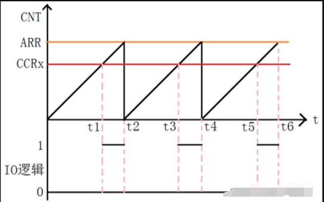

- **占空比**:是一个脉冲周期内,前半段的时间与整个周期时间的比例;单位:% (0%-100%)。

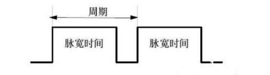

- **周期**:一个脉冲信号的时间,1s 内测周期次数等于频率。
- **脉宽时间**:高电平时间。
- 上图中脉宽时间占总周期时间的比例,就是占空比。
- 比方说周期的时间是10ms,脉宽时间是8ms,那么低电平时间就是2ms,总的占空比 8/(8+2)= 80%,这就是占空比为80%的脉冲信号。
- 而我们知道PWM就是脉冲宽度调制,通过调节占空比,就可以调节脉冲宽度(脉宽时间)。
- 以20Hz、占空比为80%举例:就是1秒钟之内输出了20次脉冲信号,那么每个周期为1/20s,1/20*80%=0.04s,所以每次的高电平时间为40ms。
- 占空比 = 比较寄存器的值 / (重装载值 + 1)
- PWM技术一般用在工业控制领域(控制电机的转速、控制舵机的角度........),所以必须掌握。

**1.2 PWM的原理**

- PWM技术的原理其实很简单,只不过是利用STM32定时器中的某个通道的输出比较功能(PWM模式)来输出周期性的脉冲信号,只不过要调节脉冲的宽度(调节占空比)。

**PWM 输出模式配置值**(原课件表格):

| 配置值 OC1M[2:0]位 | 模式 | 描述 |
| --- | --- | --- |
| 110 | PWM 模式1 | 1.在向上计数时:一旦 `TIMx_CNT` < `TIMx_CCR1` 时通道1为有效电平,否则为无效电平;2.在向下计数时:一旦 `TIMx_CNT` > `TIMx_CCR1` 时通道1为无效电平(OC1REF=0),否则为有效电平(OC1REF=1); |
| 111 | PWM 模式2 | 1.在向上计数时,一旦 `TIMx_CNT` < `TIMx_CCR1` 时通道1为无效电平,否则为有效电平;2.在向下计数时,一旦 `TIMx_CNT` > `TIMx_CCR1` 时通道1为有效电平,否则为无效电平 |

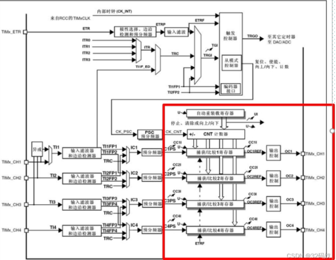

> 📄 原课件 p.1–p.3

### PWM控制舵机（SG90）

- 舵机是一种位置(角度)伺服的驱动器,适用于那些需要角度不断变化并可以保持的控制系统。目前在高档遥控玩具,如航模,包括飞机模型,潜艇模型;遥控机器人中已经使用得比较普遍。舵机是一种俗称,其实是一种伺服马达。
- 控制信号由接收机的通道进入信号调制芯片,获得直流偏置电压。它内部有一个基准电路,产生周期为 20ms,宽度为 1.5ms 的基准信号,将获得的直流偏置电压与电位器的电压比较,获得电压差输出。最后,电压差的正负输出到电机驱动芯片决定电机的正反转。当电机转速一定时,通过级联减速齿轮带动电位器旋转,使得电压差为 0,电机停止转动。当然我们可以不用去了解它的具体工作原理,知道它的控制原理就够了。

**180 度角度伺服的控制关系**(原课件 p.5 截图转写):

- 180 度角度伺服为例,那么对应的控制关系是这样的:
  - 0.5ms------------0 度;
  - 1.0ms------------45 度;
  - 1.5ms------------90 度;
  - 2.0ms------------135 度;
  - 2.5ms------------180 度;
- 请看下形象描述吧:脉冲宽度与舵机摇臂位置对应示意(横轴 0、0.5、1.0、1.5、2.0 ms 刻度)。

- 对于这个舵机而言,占空比越大舵机旋转角度越大。

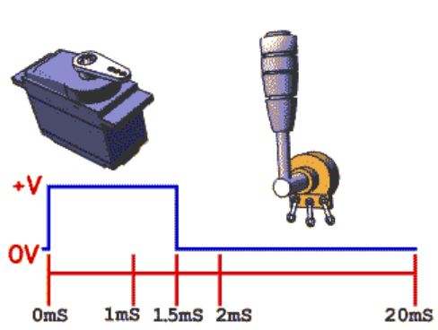

- 接线方法:
  - 红-------------------------VCC
  - 棕色----------------------GND
  - 橙色----------------------信号线

**360°舵机版本**(原课件 p.7 截图转写):

- 360°舵机版本不可控制角度,只能顺时针旋转、逆时针旋转、停止、调节转速。无角度定位,上电不会复位到 0°。因为这是 360°任意旋转的,没有 0°。通过一定参数的脉冲信号控制它的旋转,请看下表:

| 舵机状态 | 脉冲周期 | 脉冲高电平时间 | 对应占空比 |
| --- | --- | --- | --- |
| 正转 | 20ms | 0.5ms-1.5ms | 2.5%-7.5% |
| 反转 | 20ms | 1.5ms-2.5ms | 7.5%-12.5% |
| 暂停 | 20ms | 1.5ms | 7.50% |
| 转速（） | 20ms | 2.5ms | 12.50% |

- 注意:由于每一个舵机的中位可能会不一样,所以有些舵机可能是 1520us 的 PWM,舵机才会停下来。所以需要自己实际测试出舵机的中位。360度舵机就是一个普通的直流电机+一个电机驱动板的组合,所以它只能连续旋转,不能定位,也没法知道它的角度和圈数。

## 定时器的时钟源

### 内部时钟（CK_INT）

- 正常模式下使用的时钟来源,

### 外部时钟模式1(TIx)

![图140 TI2 外部时钟连接示例:TI2→滤波器→边沿检测器→TS[2:0] 选择→CK_PSC](assets/08-STM32-通用定时器/p8_1.png)

例如,要使递增计数器在 TI2 输入出现上升沿时计数,请执行以下步骤:

1. 通过在 `TIMx_CCMR1` 寄存器中写入 CC2S=“01”来配置通道 2,使其能够检测 TI2 输入的上升沿。
2. 通过在 `TIMx_CCMR1` 寄存器中写入 `IC2F[3:0]` 位来配置输入滤波时间(如果不需要任何滤波,请保持 IC2F=0000)。

注意:由于捕获预分频器不用于触发操作,因此无需对其进行配置。

3. 通过在 `TIMx_CCER` 寄存器中写入 CC2P=0 和 CC2NP=0 来选择上升沿极性。
4. 通过在 `TIMx_SMCR` 寄存器中写入 SMS=111,使定时器在外部时钟模式 1 下工作。
5. 通过在 `TIMx_SMCR` 寄存器中写入 TS=110 来选择 TI2 作为输入源。
6. 通过在 `TIMx_CR1` 寄存器中写入 CEN=1 来使能计数器。

- 当 TI2 出现上升沿时,计数器便会计数一次并且 TIF 标志置 1。
- TI2 的上升沿与实际计数器时钟之间的延迟是由于 TI2 输入的重新同步电路引起的。

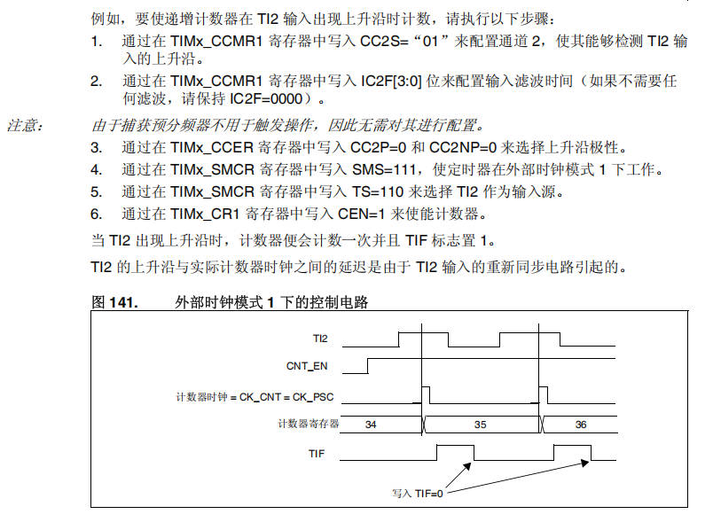

### 外部时钟模式2(ETR)

- 这个模式通过控制 ECE 这个位来开启

![图142 外部触发输入模块:ETR 引脚→ETP/ETPS[1:0]/ETF[3:0]→ETRF→CK_PSC](assets/08-STM32-通用定时器/p9_1.png)

例如,要使递增计数器在 ETR 每出现 2 个上升沿时计数,请执行以下步骤:

1. 由于此例中不需滤波器,因此在 `TIMx_SMCR` 寄存器中写入 ETF[3:0]=0000。
2. 通过在 `TIMx_SMCR` 寄存器中写入 ETPS[1:0]=01 来设置预分频器
3. 通过在 `TIMx_SMCR` 寄存器中写入 ETP=0 来选择 ETR 引脚的上升沿检测
4. 通过在 `TIMx_SMCR` 寄存器中写入 ECE=1 来使能外部时钟模式 2。
5. 通过在 `TIMx_CR1` 寄存器中写入 CEN=1 来使能计数器。

- ETR 每出现 2 个上升沿,计数器计数一次。
- ETR 的上升沿与实际计数器时钟之间的延迟是由于 ETRP 信号的重新同步电路引起的。

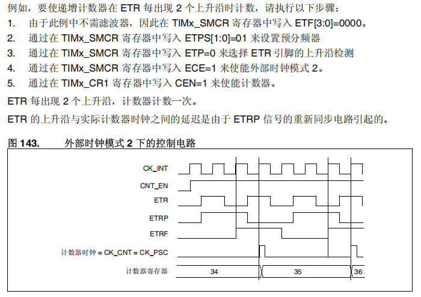

### 内部触发输入(ITRx)

- 用一个定时器作为另一个定时器的预分频器

## 定时器的主从模式

### 定时器和外部触发的同步（从模式）

- 定时器能够在多种模式下和一个外部的触发同步:复位模式、门控模式、触发模式

#### 复位模式

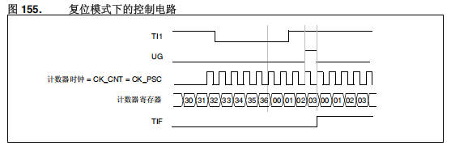

#### 门控模式

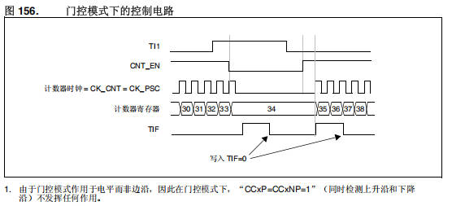

- 由于门控模式作用于电平而非边沿,因此在门控模式下,“CCxP=CCxNP=1”(同时检测上升沿和下降沿)不发挥任何作用。

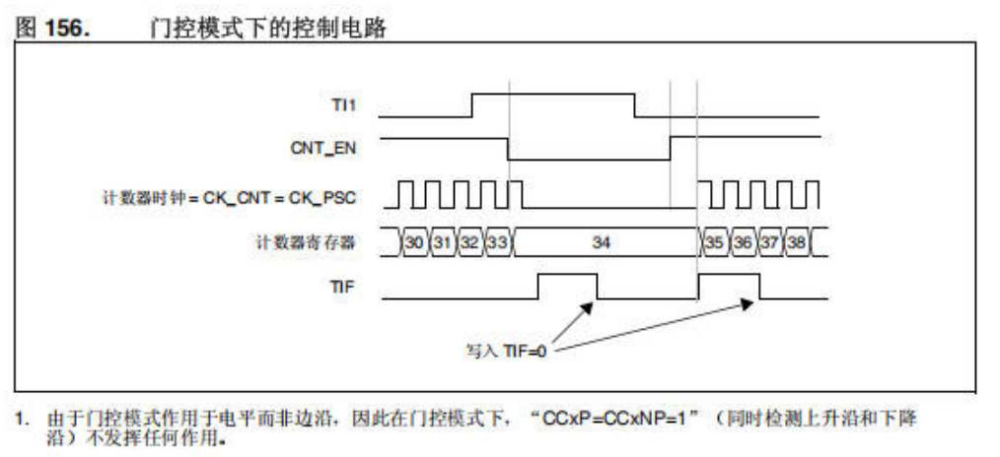

#### 时钟模式和触发模式一起使用

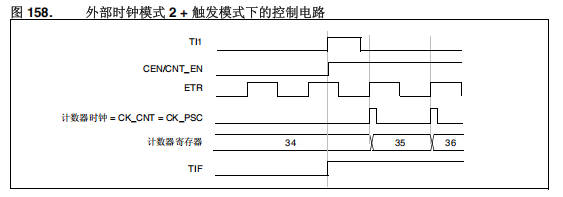

### 定时器同步（主模式）

- 把所有定时器内部相连接,通过主从模式实现复位,启动,停止,提供时钟等相关操作。
- 使用一个定时器作为另一个定时器的预分频器

#### 使用一个定时器作为另一个定时器的预分频器

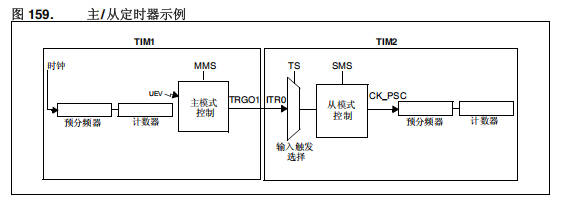

#### 用一个定时器使能另一个定时器

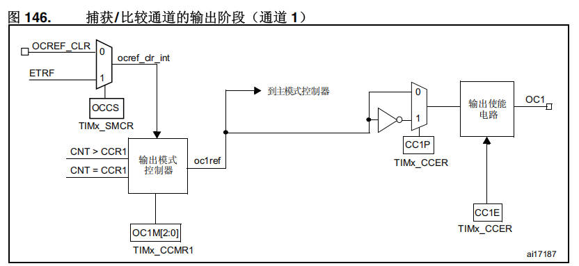

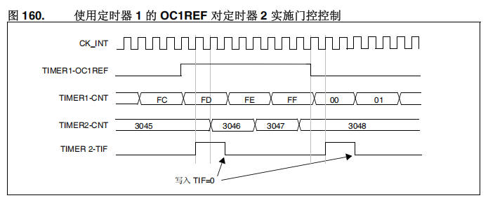

#### 用一个定时器启动另一个定时器

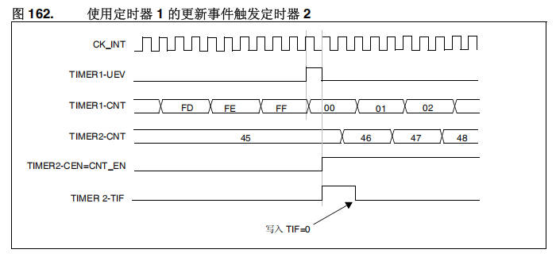

#### 用一个外部触发启动两个定时器

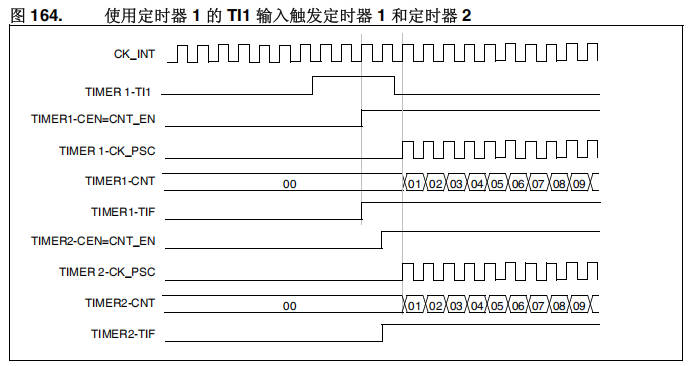

## 通用定时器总结

- 原课件 p.14 以通用定时器框图(图119)作结,框图要点:
  - 时钟来源:内部时钟(CK_INT,来自 RCC 的 TIMxCLK)、TIMx_ETR 外部触发(经极性选择和边沿检测器与预分频器→输入滤波器→ETRF)、ITR0–ITR3(内部触发输入)、TI1FP1/TI2FP2。
  - 触发控制器产生 TRGO(至其它定时器、DAC/ADC);从模式控制器负责复位、使能、递增/递减、计数;另有编码器接口。
  - 计数链路:CK_PSC→PSC 预分频器→CK_CNT→CNT 计数器,配自动重装载寄存器(U 事件更新,停止、清零或递增/递减)。
  - 4 个通道:输入滤波器和边沿检测器→预分频器→捕获/比较 1~4 寄存器→输出控制→OC1~OC4 对应 TIMx_CH1~TIMx_CH4。
  - 注意:带阴影的寄存器根据控制位,在发生 U 事件后,预装载寄存器内容转移到有效寄存器;图中另标注事件、中断和 DMA 输出。

## 小结与下一步

- PWM 靠定时器通道的输出比较(OC1M=110/111)输出周期脉冲,占空比 = 比较寄存器的值/(重装载值+1);SG90 舵机用 20ms 周期、0.5–2.5ms 脉宽控制 0–180°,360° 舵机则用脉宽控制转向与转速。
- 定时器时钟源四种:CK_INT、TIx(外部时钟模式 1)、ETR(外部时钟模式 2,`ECE=1`)、ITRx(定时器互为预分频器)。
- 主从模式:从模式让定时器与外部触发同步(复位/门控/触发),主模式让定时器之间级联——预分频、使能、启动、同一外部触发启动两个定时器。

➡️ 下一课:[[09-STM32-高级定时器|STM32-高级定时器]]
