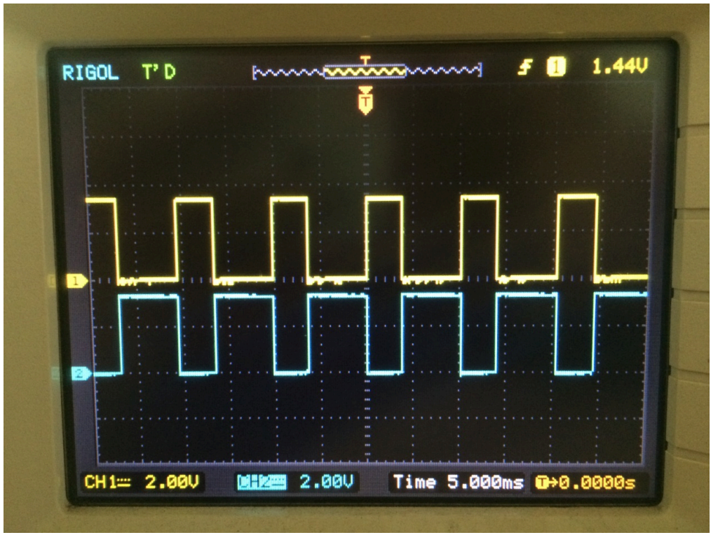
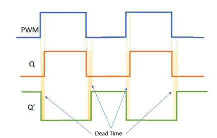
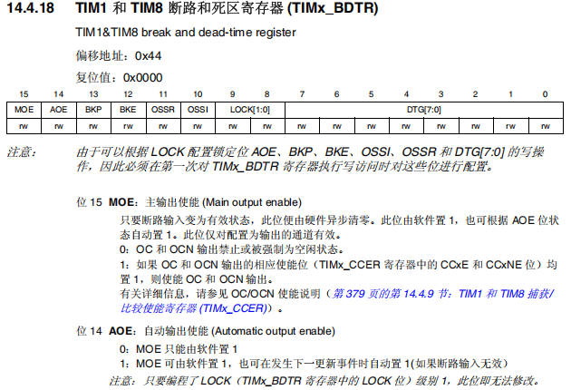
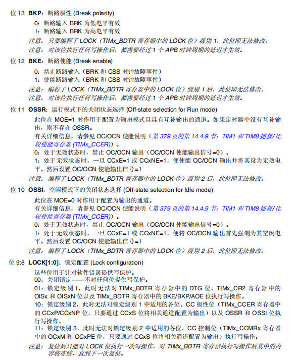
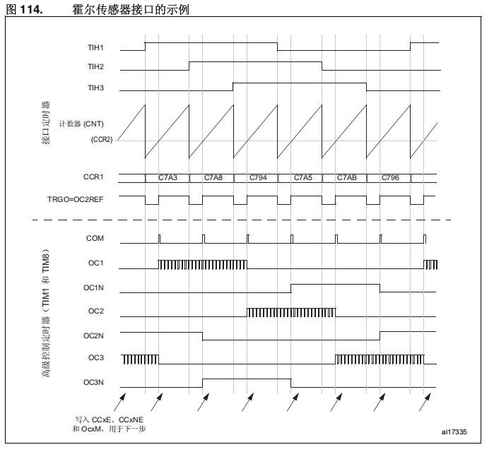
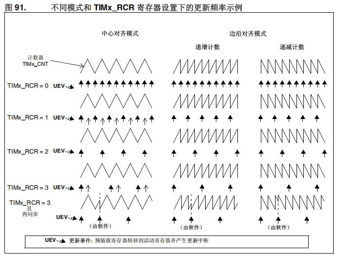

# 09 STM32-高级定时器

> 本课整理自 `STM32/9.STM32-高级定时器.zip → 07.2高级定时器/高级定时器.pdf`(共 12 页)。返回 [[STM32学习目录|📑 STM32学习目录]]。

## 本章要点

- 高级定时器在通用定时器基础上增加互补输出、可编程死区、刹车(断路)、重复计数器等电机控制专属特性
- 互补输出配合死区时间防止 H 桥上下桥臂直通;死区时间由 `TIMx_BDTR` 寄存器的 `DTG[7:0]` 按 4 个等级的公式配置
- 刹车(断路)功能在故障发生时立即关闭 PWM 输出并强制到安全状态,可用软件或 `BRK`/`BRK_ACTH`/`BRK2` 硬件信号触发
- 霍尔传感器三个输入经异或门连到接口定时器 TI1,接口定时器捕获后通过 TRGO 改变高级定时器的 PWM 换相配置
- 重复计数器 `TIMx_RCR` 决定计数器溢出多少次才产生一次更新事件,可降低更新中断频率

## 高级定时器的专属功能和特性

### 高级定时器的功能

高级定时器的功能特性如下表:

| 功能特性 | 描述 |
| --- | --- |
| 计数器 | 16 位向上、向下、向上/向下(中央对齐)自动装载计数器 |
| 预分频器 | 16 位可编程预分频器,允许对计数器时钟进行分频(也可"动态")频率乘以 1 和 65536 之间的任何因子。 |
| 4 个通道 | 1. 输入捕获;2. 输出比较;3. PWM 生成(边缘或中间对齐模式);4. 单脉冲模式输出;5. 编码器接口以及霍尔传感器电路 |
| 中断/DMA | 1. 输入捕获 2. 输出比较 3. 触发事件(计数器启动、停止、初始化或者由内部/外部触发计数) 4. 刹车信号输入 |
| 定时器同步 | 使用外部信号控制定时器和定时器互联的同步电路 |
| 互补输出 | 具有可编程死区时间的互补输出 |
| 重复计数器 | 允许在指定数目的计数器周期之后更新定时器寄存器的重复计数器 |
| 刹车 | 刹车输入信号可以将定时器输出信号置于复位状态或者一个已知状态 |
| 电流管理 | 触发输入作为外部时钟或者按周期的电流管理 |

### 互补输出和死区插入

#### 互补输出

> 📄 原课件 p.1–p.2

互补输出即一对相位相反的 PWM 输出,用于驱动 H 桥的上下两个桥臂。课件用示波器实测截图展示互补输出波形:CH1(黄)与 CH2(青)两路方波互补,边沿相互错开(可见死区);示波器设置为 CH1、CH2 各 2.00V/div,时基 5.000ms/div,触发电平 1.44V,触发位置 T→0.0000s。



#### 死区插入

> 📄 原课件 p.3

死区(Dead Time)插入在互补输出的两路信号之间:由 PWM 波形生成 Q 与 Q' 两路互补输出,Q' 是 Q 的反相,但在每个切换沿处,Q 关断之后 Q' 并不立即导通,两路同时为低的黄色阴影区间即 Dead Time,用于避免上下桥臂在切换瞬间同时导通。



#### 作用

> 📄 原课件 p.4–p.5

死区的作用以电机驱动场景说明。课件给出 L298N 双 H 桥电机驱动模块的标注图,图中各接口标注为:输出B、通道B使能、逻辑输入、通道A使能、5V 供电、供电GND、12V 供电、输出A、板载 5V 使能。


模块内部为双 H 桥电路:输入 `ENA`、`IN1`、`IN2` 控制上半桥 `T1`~`T4` 驱动右电机(OUT1/OUT2),`ENB`、`IN3`、`IN4` 控制下半桥 `T5`~`T8` 驱动左电机(OUT3/OUT4),电源为 `+VS` 与 `GND`;每个桥臂的上下管互补导通,切换时必须留出死区时间,防止上下管同时导通。


#### 死区时间计算

> 📄 原课件 p.5

死区的计算方法是 DTG 方式。课件引用参考手册 14.4.18 节:TIM1 和 TIM8 断路和死区寄存器(`TIMx_BDTR`,TIM1&TIM8 break and dead-time register),偏移地址 0x44,复位值 0x0000。位域为:位 15 `MOE`、位 14 `AOE`、位 13 `BKP`、位 12 `BKE`、位 11 `OSSR`、位 10 `OSSI`、位 9:8 `LOCK[1:0]`、位 7:0 `DTG[7:0]`(均为 rw)。

注意:由于可以根据 `LOCK` 配置锁定位 `AOE`、`BKP`、`BKE`、`OSSI`、`OSSR` 和 `DTG[7:0]` 的写操作,因此必须在第一次对 `TIMx_BDTR` 寄存器执行写访问时对这些位进行配置。

- **位 15 `MOE`:主输出使能 (Main output enable)** —— 只要断路输入变为有效状态,此位便由硬件异步清零。此位由软件置 1,也可根据 `AOE` 位状态自动置 1;此位仅对配置为输出的通道有效。
  - 0:OC 和 OCN 输出禁止或被强制为空闲状态
  - 1:如果 OC 和 OCN 输出的相应使能位(`TIMx_CCER` 寄存器中的 `CCxE` 和 `CCxNE` 位)均置 1,则使能 OC 和 OCN 输出
- **位 14 `AOE`:自动输出使能 (Automatic output enable)**
  - 0:`MOE` 只能由软件置 1
  - 1:`MOE` 可由软件置 1,也可在发生下一更新事件时自动置 1(如果断路输入无效)
  - 注意:只要编程了 `LOCK`(`TIMx_BDTR` 寄存器中的 `LOCK` 位)级别 1,此位即无法修改



> 📄 原课件 p.6

`TIMx_BDTR` 其余位的说明(原课件截图转写):

- **位 13 `BKP`:断路极性 (Break polarity)**
  - 0:断路输入 `BRK` 为低电平有效;1:断路输入 `BRK` 为高电平有效
  - 注意:编程了 `LOCK` 级别 1 后此位即无法修改;对该位执行任何写操作后,都需要经过 1 个 APB 时钟周期的延迟才生效
- **位 12 `BKE`:断路使能 (Break enable)**
  - 0:禁止断路输入(`BRK` 和 CSS 时钟故障事件);1:使能断路输入(`BRK` 和 CSS 时钟故障事件)
  - 注意:编程了 `LOCK` 级别 1 后此位即无法修改;写操作后需经过 1 个 APB 时钟周期的延迟才生效
- **位 11 `OSSR`:运行模式下的关闭状态选择 (Off-state selection for Run mode)** —— 此位在 `MOE=1` 时作用于配置为输出模式且具有互补输出的通道;如果定时器中没有互补输出,则不存在 `OSSR`。
  - 0:处于无效状态时,禁止 OC/OCN 输出(OC/OCN 使能输出信号=0)
  - 1:处于无效状态时,一旦 `CCxE=1` 或 `CCxNE=1`,便使能 OC/OCN 输出并将其设为无效电平,然后设置 OC/OCN 使能输出信号=1
  - 注意:编程了 `LOCK` 级别 2 后此位即无法修改
- **位 10 `OSSI`:空闲模式下的关闭状态选择 (Off-state selection for idle mode)** —— 此位在 `MOE=0` 时作用于配置为输出的通道。
  - 0:处于无效状态时,禁止 OC/OCN 输出(OC/OCN 使能输出信号=0)
  - 1:处于无效状态时,一旦 `CCxE=1` 或 `CCxNE=1`,便将 OC/OCN 输出首先强制为其空闲电平,然后设置 OC/OCN 使能输出信号=1
  - 注意:编程了 `LOCK` 级别 2 后此位即无法修改
- **位 9:8 `LOCK[1:0]`:锁定配置 (Lock configuration)** —— 这些位用于针对软件错误提供写保护。
  - 00:关闭锁定——不对任何位提供写保护
  - 01:锁定级别 1,此时无法对 `TIMx_BDTR` 寄存器中的 `DTG` 位、`TIMx_CR2` 寄存器中的 `OISx` 和 `OISxN` 位以及 `TIMx_BDTR` 寄存器中的 `BKE/BKP/AOE` 位执行写操作
  - 10:锁定级别 2,此时无法对锁定级别 1 中适用的各位、CC 极性位(`TIMx_CCER` 寄存器中的 `CCxP/CCxNP` 位,只要通过 `CCxS` 将相关通道配置为输出)以及 `OSSR` 和 `OSSI` 位执行写操作
  - 11:锁定级别 3,此时无法对锁定级别 2 中适用的各位、CC 控制位(`TIMx_CCMRx` 寄存器中的 `OCxM` 和 `OCxPE` 位,只要通过 `CCxS` 位将相关通道配置为输出)执行写操作
  - 注意:复位后只能对 `LOCK` 位执行一次写操作。对 `TIMx_BDTR` 寄存器执行写操作后其中的内容将冻结,直到下一次复位



> 📄 原课件 p.7

**位 7:0 `DTG[7:0]`:配置死区发生器 (Dead-time generator setup)** —— 此位域定义插入到互补输出之间的死区持续时间,DT 与该持续时间相对应(原课件截图转写):

```
DTG[7:5]=0xx => DT=DTG[7:0]×t_dtg ,其中 t_dtg=t_DTS
DTG[7:5]=10x => DT=(64+DTG[5:0])×t_dtg ,其中 T_dtg=2×t_DTS
DTG[7:5]=110 => DT=(32+DTG[4:0])×t_dtg ,其中 T_dtg=8×t_DTS
DTG[7:5]=111 => DT=(32+DTG[4:0])×t_dtg ,其中 T_dtg=16×t_DTS
```

示例:如果 T_DTS=125ns(8MHz),则可能的死区值为:0 到 15875 ns(步长为 125 ns)、16 us 到 31750 ns(步长为 250 ns)、32 us 到 63us(步长为 1 us)、64 us 到 126 us(步长为 2 us)。注意:只要编程了 `LOCK`(`TIMx_BDTR` 寄存器中的 `LOCK` 位)级别 1、2 或 3,此位域即无法修改。

![DTG[7:0] 死区发生器位域定义与公式示例(原课件截图)](assets/09-STM32-高级定时器/p7_1.png)

`t_DTS` 来自 `TIMx_CR1` 的时钟分频位(参考手册 14.4.1 节:TIM1 和 TIM8 控制寄存器 1 `TIMx_CR1`,偏移地址 0x00,复位值 0x0000;位域 Reserved、`CKD[1:0]`、`ARPE`、`CMS[1:0]`、`DIR`、`OPM`、`URS`、`UDIS`、`CEN`):

- **位 9:8 `CKD[1:0]`:时钟分频 (Clock division)** —— 此位域指示定时器时钟(`CK_INT`)频率与死区发生器以及数字滤波器(ETR、TIx)所使用的死区及采样时钟(`t_DTS`)之间的分频比:
  - 00:`t_DTS = t_CK_INT`
  - 01:`t_DTS = 2 × t_CK_INT`
  - 10:`t_DTS = 4 × t_CK_INT`
  - 11:保留,不要设置成此值


课件按 DTG[7:5] 高 3 位给出 4 个等级的死区时间范围与公式(以 t_DTS=13.89ns 为例):

| 等级 | DTG[7:5] | 范围 | 公式 |
| --- | --- | --- | --- |
| 1 | 0xx | DT=(0～127)×13.89ns=0～1763.89ns=0～1.76us | DT=DTG[7:0]×Tdtg,Tdtg=TDTs |
| 2 | 10x | DT=(64+(0～63))×2×13.89ns=1777.92ns～3528.06ns=1.78us～3.5us | DT=(64+DTG[5:0])×Tdtg,Tdtg=2×TDTs |
| 3 | 110 | DT=(32+(0～31))×8×13.89ns=3555.84ns～7000.56ns=3.56us～7us | DT=(32+DTG[4:0])×Tdtg,Tdtg=8×TDTs |
| 4 | 111 | DT=(32+(0～31))×16×13.89ns=7111.68ns～14001.12ns=7.11168us～14us | DT=(32+DTG[4:0])×Tdtg,Tdtg=16×TDTs |

### 刹车(断路)功能

> 📄 原课件 p.8

- **目的**:保护由定时器生成的 PWM 信号所驱动的功率电器
- **原理**:当被故障触发的时候,这个刹车电路会关闭 PWM 的输出,并且强制设为预定的安全状态

#### 方法

- **方法一:软件控制** —— 使用 HAL 库函数停止 PWM 输出:

```c
HAL_StatusTypeDef HAL_TIM_PWM_Stop(TIM_HandleTypeDef *htim, uint32_t Channel);
```

- **信号控制(Break)** —— 信号输入 `BRK`、`BRK_ARTH`、`BRK2`

#### 具体原理

TIM1 和 TIM8 有三个刹车输入:`BRK`、`BRK_ACTH`、`BRK2`。

1. **BRK**
   1. BRK 的输入信号为 BKIN 引脚上输入信号。所用比较器(4/87)输出的逻辑或。
   2. 禁止 PWM 模式或者设置为预定定义安全状态。
   3. 极性选择和滤波特性可用。
2. **BRK_ACTH**
   1. 可以选至比较器(1, 2, 3, 5, 6)输出、CSS、PVD 输出、SRAM 奇偶校验错误。
   2. 极性选择和滤波特性不可用。
   3. 它始终为高电平有效。
3. **BRK2**
   1. 输入信号为 BKIN2 引脚上输入信号和所选比较器输出(COMP1, 2, 3, 4, 5, 6, 7)的逻辑或。
   2. 极性选择和滤波特性可用。
   3. 禁止 PWM 模式。

#### 时序图

> 📄 原课件 p.9

参考手册图 108「输出的断路响应行为」:`BREAK(MOE 下降沿)`一到,`OCxREF` 立即拉低;各通道输出 `OCx`/`OCxN` 按各自的 `CCxP`、`OISx`、`CCxNP`、`OISxN` 配置被强制为无效/空闲电平,互补输出对在切换处标出「延迟」(即死区)。图中列出的配置组合依次为:

- `OCx`(OCxN 未使用,`CCxP=0`,`OISx=1`)
- `OCx`(OCxN 未使用,`CCxP=0`,`OISx=0`)
- `OCx`(OCxN 未使用,`CCxP=1`,`OISx=1`)
- `OCx`(OCxN 未使用,`CCxP=1`,`OISx=0`)
- `OCx`/`OCxN`(`CCxE=1`,`CCxP=0`,`OISx=0`,`CCxNE=1`,`CCxNP=0`,`OISxN=1`)
- `OCx`/`OCxN`(`CCxE=1`,`CCxP=0`,`OISx=1`,`CCxNE=1`,`CCxNP=1`,`OISxN=1`)
- `OCx`/`OCxN`(`CCxE=1`,`CCxP=0`,`OISx=0`,`CCxNE=0`,`CCxNP=0`,`OISxN=1`)
- `OCx`/`OCxN`(`CCxE=1`,`CCxP=0`,`OISx=1`,`CCxNE=0`,`CCxNP=0`,`OISxN=0`)
- `OCx`/`OCxN`(`CCxE=1`,`CCxP=0`,`CCxNE=0`,`CCxNP=0`,`OISx=OISxN=0` 或 `OISx=OISxN=1`)


#### 霍尔传感器的接口

> 📄 原课件 p.9–p.10

**霍尔传感器**:一种能实现磁电转换的传感器,可以将磁场信号转换为电压信号,可以实现对电机速度的测量。

参考手册图 114「霍尔传感器接口的示例」:接口定时器一侧由 `TIH1`、`TIH2`、`TIH3` 输入驱动计数器(CNT)锯齿计数,`CCR1` 依次捕获到换相值 `C7A3`、`C7A8`、`C794`、`C7A5`、`C7AB`、`C796`,`TRGO=OC2REF` 产生触发脉冲;高级控制定时器(TIM1 和 TIM8)一侧由 `COM` 换相脉冲依次切换 `OC1`/`OC1N`、`OC2`/`OC2N`、`OC3`/`OC3N`,底部标注「写入 `CCxE`、`CCxNE` 和 `OCxM`,用于下一步」。



接口的使用步骤(课件原文):

1. 使用高级控制定时器(TIM1 或 TIM8)产生 PWM 信号驱动马达时:
2. 用另一个通用定时器(TIM2、TIM3、TIM4 或 TIM5)定时器作为"接口定时器"来连接霍尔传感器。
3. 三个定时器输入(CI1、CI2、CI3)通过一个"异或门"连接到 TIM1 输入通道(设置 `TIMx_CR2` 寄存器中的 `TI1S` 位连接选)。"接口定时器"捕捉这个信号。

**通过霍尔输入变化改变固定定时器 PWM 的配置:**

1. `TIMx_CR2` 寄存器的 `TI1S` 位为 '1',配置三个定时器输入被逻辑或到 TI1 输入。
2. 设置 `TIMx_ARR` 为最大值(用于传统模式两次变化可调即可)。
3. 设置 `TIMx_CCR1` 为最大值(置 `TIMx_CCMR1` 寄存器中的 `OC2M=111` 和 `CC2S=00`)。
4. 选择 `OC2REF` 作为 TRGO 的触发输出(置 `TIMx_CR2` 寄存器中的 `MMS=101`)。

### 重复计数器

> 📄 原课件 p.11

重复计数器:每多少次计数后向上/向下溢出的时候(决定更新事件的频率)。参考手册图 91「不同模式和 `TIMx_RCR` 寄存器设置下的更新频率示例」对比了中心对齐模式与边沿对齐模式(递增计数、递减计数)下,`TIMx_RCR=0/1/2/3` 时更新事件 `UEV` 的间隔随 RCR 增大逐档拉长,并给出 `TIMx_RCR=3` 加 `H` 位「再同步」由软件触发 `UEV` 的示例。图注:`UEV` 更新事件——预装载寄存器转移到活动寄存器并产生更新中断。



**时基单元包含:**

- 计数器寄存器(`TIMx_CNT`)
- 预分频寄存器(`TIMx_PSC`)
- 自动装载寄存器(`TIMx_ARR`)
- 重复次数寄存器(`TIMx_RCR`)

**重复计数器在下述任一条件成立时递减:**

- 向上计数模式下每次计数器溢出时,
- 向下计数模式下每次计数器溢出时,
- 中央对齐模式下每次上溢和每次下溢时。

## 高级定时器的运行逻辑和结构

> 📄 原课件 p.12

高级定时器完整框图,关键通路如下:

- **时钟与触发**:内部时钟 `CK_INT`(来自 RCC)从顶部进入触发控制器;外部引脚 `TIMx_ETR` 经极性选择和边沿检测器与预分频器(`ETRP`)、输入滤波器(`ETRF`)送入触发控制器与从模式控制器;内部触发 `ITR0`~`ITR3`、`TRC`、`TI1FP1`/`TI2FP2` 进入从模式控制器与编码器接口。触发控制器输出 `TRGO`(到其它定时器、到 DAC/ADC),从模式控制器负责复位、使能、递增/递减、计数。
- **时基单元**:`CK_PSC` 经 `PSC` 预分频器分频为 `CK_CNT` 驱动 `CNT` 计数器,计数器与自动重载寄存器(停止、清零或递增/递减)配合;`REP 寄存器`→`重复计数器`输出 `UR`、`U` 更新信号。
- **输入通道**:4 个通道 `TIMx_CH1`~`TIMx_CH4` 的信号 `TI1`~`TI4` 经输入滤波器和边沿检测器,`TI1` 输入前还有 `XOR`(即霍尔接口的三输入异或),再经 `IC1`~`IC4`、预分频器(`IC1PS`~`IC4PS`)写入捕获/比较 1~4 寄存器。
- **输出通道**:捕获/比较寄存器输出 `OC1REF`~`OC4REF`,经 `DTG`(`DTG[7:0]` 寄存器,生成死区)与输出控制,输出 `OC1`/`OC1N`、`OC2`/`OC2N`、`OC3`/`OC3N`、`OC4`,对应引脚 `TIMx_CH1`~`TIMx_CH4` 与 `TIMx_CH1N`~`TIMx_CH3N`。
- **刹车通路**:`TIMx_BKIN` 引脚输入 `BRK`,经极性选择得到 `BI`,与时钟控制器的时钟故障事件 CSS(时钟安全系统)一起作用于输出控制。


## 小结与下一步

- 高级定时器 = 通用定时器 + 互补输出/死区插入、刹车(断路)、重复计数器等电机控制专属特性
- 死区时间用 `TIMx_BDTR` 的 `DTG[7:0]` 按 4 档公式计算,且这些位必须在首次写 `TIMx_BDTR` 时配置(受 `LOCK` 锁定级别约束)
- 刹车功能可软件触发(`HAL_TIM_PWM_Stop`)或经 `BRK`/`BRK_ACTH`/`BRK2` 硬件触发,故障时把 PWM 强制到预定安全状态
- 霍尔接口用异或门 + 接口定时器捕获换相时刻,经 `TRGO`(如 `MMS=101` 选 `OC2REF`)同步高级定时器的 PWM;重复计数器 `TIMx_RCR` 用来降低更新事件频率

➡️ 下一课:[[10-STM32-定时器使用|STM32-定时器使用]]
