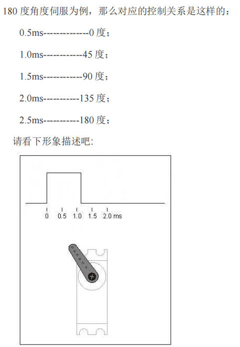
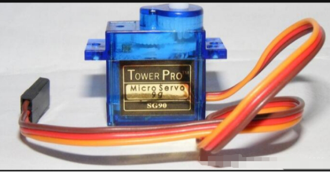
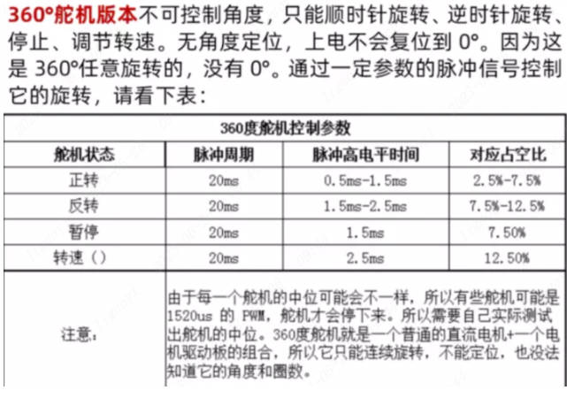
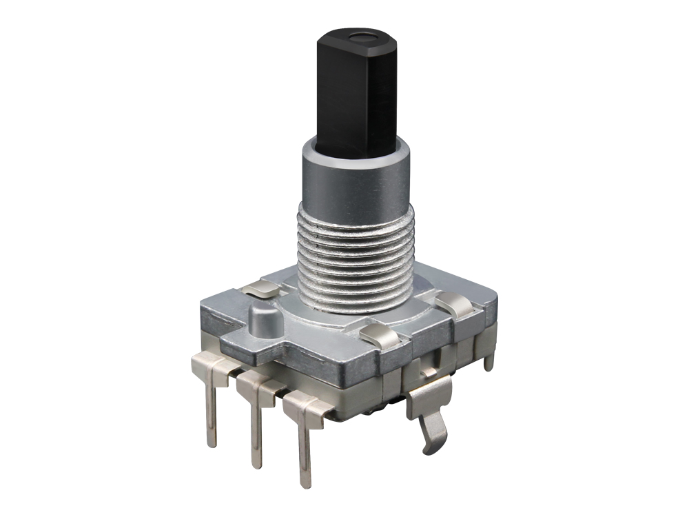
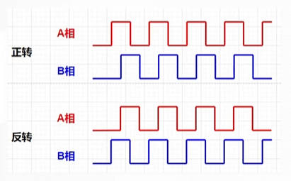
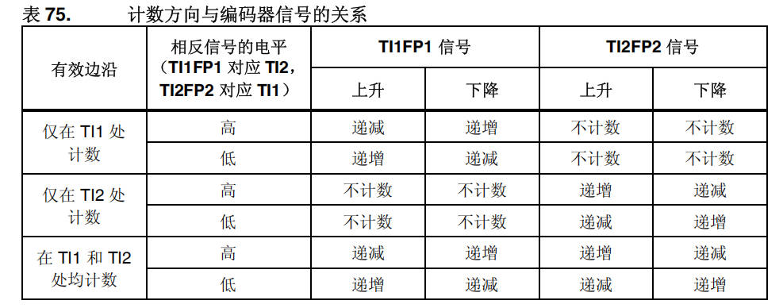
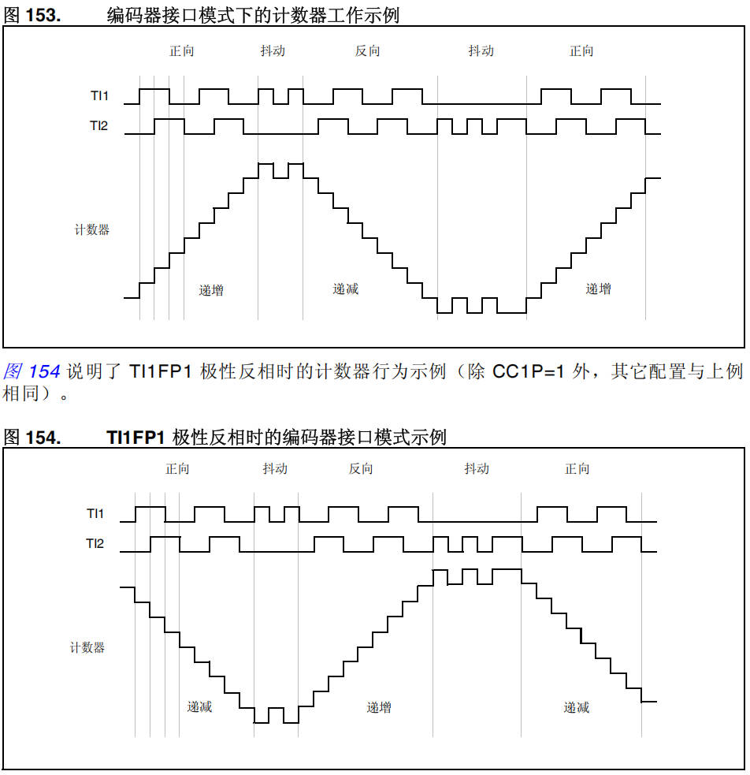

# 10 STM32-定时器使用

> 本课整理自 `STM32/10.STM32-定时器使用.zip → 07.4定时器使用/定时器的使用.pdf`(共 10 页)。返回 [[STM32学习目录|📑 STM32学习目录]]。

## 本章要点

- PWM 控制 SG90 舵机:周期 20ms,高电平 0.5ms~2.5ms 对应 0~180 度,占空比 = (占空比初值 + 角度 ×(上下限差值)/180)。
- 360° 舵机版本不可控角度,只能正转/反转/暂停/调转速,无角度定位,中位需实测(有的约 1520us)。
- 旋转增量编码器工作电压 5V,旋转一圈产生 20 个脉冲,5 个引脚(电源正负极、A 相、B 相、按键 C 脚),可正反向旋转。
- 通用/高级定时器的编码器模式由外部 A/B 相脉冲自主控制 CNT 增减,可测位置、方向、速度,需占用输入捕获通道 1 和通道 2。
- M 测速法按单位时间内的脉冲数计算转速:`rps = M0 / (MULTIPLE x MOTOR_SPEED_RERATIO x PULSE_PRE_ROUND x T)`。

## 定时器实际使用

### PWM控制舵机(SG90)

> 📄 原课件 p.1

舵机是一种位置(角度)伺服的驱动器,适用于那些需要角度不断变化并可以保持的控制系统。目前在高档遥控玩具,如航模,包括飞机模型、潜艇模型;遥控机器人中已经使用得比较普遍。舵机是一种俗称,其实是一种伺服马达。

控制信号由接收机的通道进入信号调制芯片,获得直流偏置电压。它内部有一个基准电路,产生周期为 20ms,宽度为 1.5ms 的基准信号,将获得的直流偏置电压与电位器的电压比较,获得电压差输出。最后,电压差的正负输出到电机驱动芯片决定电机的正反转。当电机转速一定时,通过级联减速齿轮带动电位器旋转,使得电压差为 0,电机停止转动。当然我们可以不用去了解它的具体工作原理,知道它的控制原理就够了。

> 📄 原课件 p.2

以 180 度角度伺服为例,那么对应的控制关系是这样的:

- 0.5ms------------0 度;
- 1.0ms-----------45 度;
- 1.5ms-----------90 度;
- 2.0ms----------135 度;
- 2.5ms----------180 度;

请看下形象描述吧(脉宽与角度的对应关系):



> 📄 原课件 p.3

对于这个舵机而言,占空比越大舵机旋转角度越大。



在这里我们还可以加一个占空比和角度的旋转公式:目标输入角度就可以直接控制舵机旋转过去,就需要一个占空比与角度之间的转换公式:

`占空比 =(占空比初值 + 角度 *(上下限差值)/180)`


接线方法:

- 红-------------------------VCC
- 棕色----------------------GND
- 橙色----------------------信号线

360°舵机版本不可控制角度,只能顺时针旋转、逆时针旋转、停止、调节转速。无角度定位,上电不会复位到 0°。因为这是 360°任意旋转的,没有 0°。通过一定参数的脉冲信号控制它的旋转,请看下表:



| 舵机状态 | 脉冲周期 | 脉冲高电平时间 | 对应占空比 |
| --- | --- | --- | --- |
| 正转 | 20ms | 0.5ms-1.5ms | 2.5%-7.5% |
| 反转 | 20ms | 1.5ms-2.5ms | 7.5%-12.5% |
| 暂停 | 20ms | 1.5ms | 7.50% |
| 转速() | 20ms | 2.5ms | 12.50% |

> 注意:由于每一个舵机的中位可能会不一样,所以有些舵机可能是 1520us 的 PWM,舵机才会停下来。所以需要自己实际测试出舵机的中位。360 度舵机就是一个普通的直流电机+一个电机驱动板的组合,所以它只能连续旋转,不能定位,也没法知道它的角度和圈数。

### 180 500-2500

> 📄 原课件 p.4

180 度角度对应的高电平范围是 500~2500,角度换算式(课件原式):

`（2000）/180+500`

即上一节公式中"占空比初值"取 500、"上下限差值"取 2000 的形式:`500 + 角度*(2000)/180`。

### 编码器

> 📄 原课件 p.4-p.5

旋转增量编码器。



这种编码器是一种将旋转位移转化为数字脉冲信号的旋转式传感器,工作电压为 5V,旋转一圈会产生 20 个脉冲信号,并且因为设计,我们可以正向旋转也可以反向旋转,也可以一直旋转下去,这个传感器有 5 个引脚,分别是电源的正负极,a 相引脚还有 b 相引脚,还有垂直按下的 C 脚。

### 通用/高级定时器编码器模式

> 📄 原课件 p.5

1. 通过接收到的脉冲信号,自主控制 CNT 的计数器的增减,可以测量位置、方向、速度相关的信息
2. 自动化电机闭环控制
3. 编码器有两个引脚,A 相和 B 相,对应定时器输入捕获通道 1 和通道 2
4. 每个高级和通用定时器,都有一个编码器接口

> 📄 原课件 p.6



在这个模式下,CNT 计数器,会因为外部传进来的信号来自主控制计数器的增减,可以获取到,编码器的旋转方向以及旋转速度等信息。

那么在这里我们就可以发现,如果我们想要使用编码器这个东西,就需要占用 2 个通道。

表 75 计数方向与编码器信号的关系(原课件截图):



| 有效边沿 | 相反信号的电平(TI1FP1 对应 TI2,TI2FP2 对应 TI1) | TI1FP1 信号 上升 | TI1FP1 信号 下降 | TI2FP2 信号 上升 | TI2FP2 信号 下降 |
| --- | --- | --- | --- | --- | --- |
| 仅在 TI1 处计数 | 高 | 递减 | 递增 | 不计数 | 不计数 |
| 仅在 TI1 处计数 | 低 | 递增 | 递减 | 不计数 | 不计数 |
| 仅在 TI2 处计数 | 高 | 不计数 | 不计数 | 递增 | 递减 |
| 仅在 TI2 处计数 | 低 | 不计数 | 不计数 | 递减 | 递增 |
| 在 TI1 和 TI2 处均计数 | 高 | 递减 | 递增 | 递增 | 递减 |
| 在 TI1 和 TI2 处均计数 | 低 | 递增 | 递减 | 递减 | 递增 |

> 📄 原课件 p.7

图 153 编码器接口模式下的计数器工作示例:TI1、TI2 两路脉冲在"正向、抖动、反向、抖动、正向"各段中,计数器相应地递增、递减。



图 154 说明了 TI1FP1 极性反相时的计数器行为示例(除 CC1P=1 外,其它配置与上例相同)。

#### M测速法

专门用来做速度计算的公式。这种计数法就是通过单位时间内获取到了多少个脉冲,来计算速度。


`n = M0 /(C * T0)`

- 设转速为 n(r/s);
- 测量时间为 T₀(s);
- T₀ 时间内的脉冲数为 M₀;
- 电机转一圈产生的脉冲数为 C;

每秒多少转(工程中的配置取值):

- `MULTIPLE`:倍频系数,这个倍频配置写 2。
- `MOTOR_SPEED_RERATIO`:减速比,这个配置写 1。
- `PULSE_PRE_ROUND`:编码器一圈脉冲数,写 20。
- `T`:计时周期,这个配置写 1。
- `RADIUS`:轮胎半径,随意填写,用来模拟车子轮子半径。

转速公式:`rps = M0 / (MULTIPLE x MOTOR_SPEED_RERATIO x PULSE_PRE_ROUND x T )`

线速公式:`speed = rps×(RADIUS×2×3.14)`

> 📄 原课件 p.8-p.10(代码实现)

`tim.c`:

```c
Motor motor1 ;

void Motor_Init()
{
    HAL_TIM_Encoder_Start(&htim4,TIM_CHANNEL_ALL);
    __HAL_TIM_ENABLE_IT(&htim7,TIM_IT_UPDATE);
    HAL_TIM_Base_Start(&htim7);
    motor1.LastCount  = 0 ;
    motor1.totalCount =0 ;
    motor1.overflowNum = 0 ;
    motor1.rps =0 ;
    motor1.direct = 0 ;
}

void Get_Pluse()
{
    motor1.Pulse = COUNTERNUM/MULTIPLE ;
}
```

`tim.h`:

```c
#define RELOASVALUE __HAL_TIM_GetAutoreload(&htim4)
#define COUNTERNUM __HAL_TIM_GetCounter(&htim4)
#define MOTOR_SPEED_RERATIO 1
#define PULSE_PRE_ROUND   20
#define RADIUS_OF_TYRE  34
#define LINE_SPEED_C RADIUS_OF_TYRE*2*3.14
#define MULTIPLE 2


typedef struct _Motor
{
    int32_t LastCount ;   //上一次计数值
    int32_t totalCount ;  //总计数值
    int16_t overflowNum;  //溢出次数
    int16_t Pulse;        //本周期脉冲次数
    float rps ;           //秒转速
    float speed;          //线速度
    uint8_t direct ;      //旋转方向
}Motor;

extern Motor motor1 ;

void Motor_Init();
void Get_Pluse();
```

`main.c`:

```c
    Motor_Init();

HAL_Delay(1000);
    Get_Pluse();
    printf("转速： %f ； 线速度 ：%f m/s ； 当前脉冲数：%d ；
\r\n",motor1.rps,motor1.speed,motor1.Pulse);


//回调函数
void HAL_TIM_PeriodElapsedCallback(TIM_HandleTypeDef *htim)
{
    if(htim ->Instance == htim7.Instance)
    {
        motor1.direct = __HAL_TIM_IS_TIM_COUNTING_DOWN(&htim4);
        motor1.totalCount = COUNTERNUM + motor1.overflowNum * RELOASVALUE ;
        if(motor1.LastCount - motor1.totalCount > 19000)
        {
            motor1.overflowNum ++ ;
            motor1.totalCount = COUNTERNUM + motor1.overflowNum * RELOASVALUE ;
        }
        else if(motor1.totalCount - motor1.LastCount > 19000)
        {
            motor1.overflowNum -- ;
            motor1.totalCount = COUNTERNUM + motor1.overflowNum * RELOASVALUE ;
        }
        motor1.rps = (float) (motor1.totalCount - motor1.LastCount) / (MULTIPLE * MOTOR_SPEED_RERATIO * PULSE_PRE_ROUND ) ;

        motor1.speed = (float) motor1.rps * LINE_SPEED_C /1000 ;
        motor1.LastCount = motor1.totalCount ;
    }
}
```

## 小结与下一步

- PWM 舵机控制:20ms 周期、高电平 500~2500(0.5ms~2.5ms)对应 0~180 度,`占空比 =(占空比初值 + 角度*(上下限差值)/180)`;360° 舵机只能调速与正反转,中位需实测。
- 编码器接口:通用/高级定时器的 CNT 由 A/B 相脉冲自主增减(占用通道 1、通道 2),可得位置、方向、速度,用于电机闭环控制。
- M 测速法:统计时间窗 T 内的脉冲数 M0,配合倍频、减速比、每圈脉冲数换算转速与线速度,溢出用 `overflowNum` 累加修正 `totalCount`。

➡️ 下一课:[[11-STM32-高级定时器的使用-RTC实时时钟|STM32-高级定时器的使用-RTC实时时钟]]
