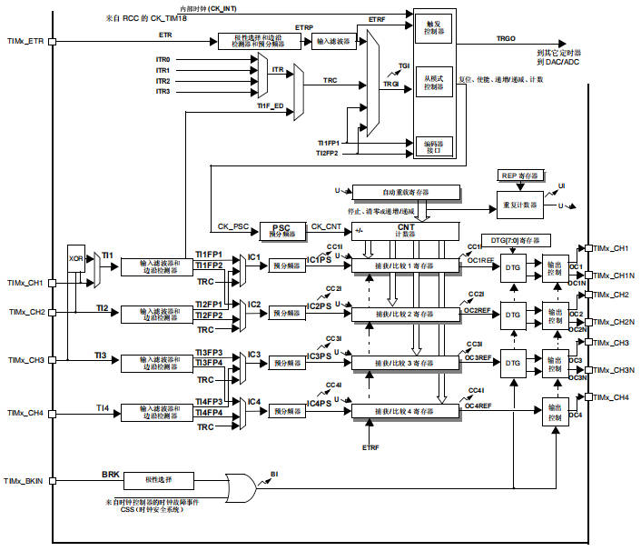
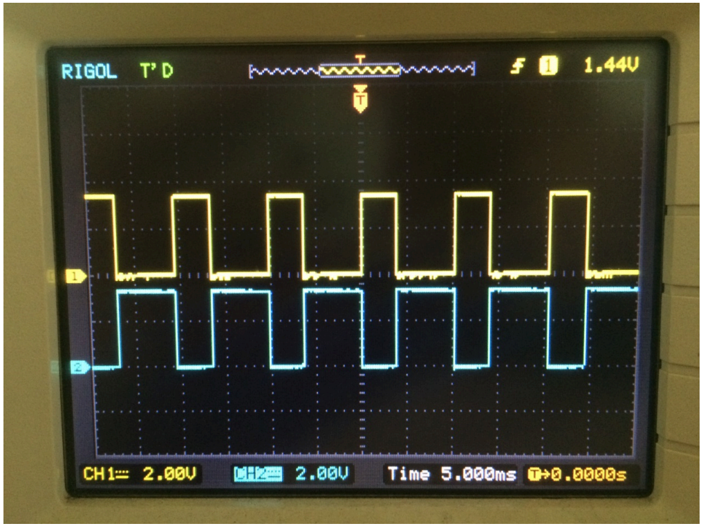
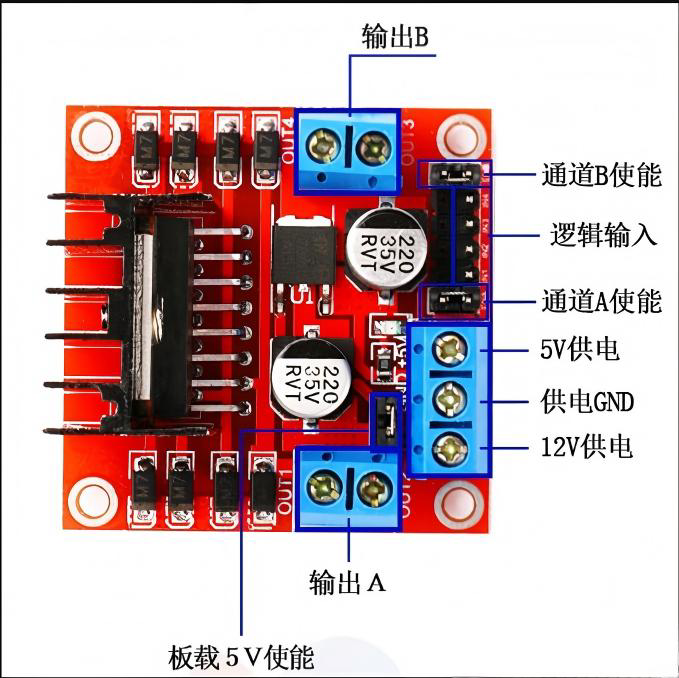
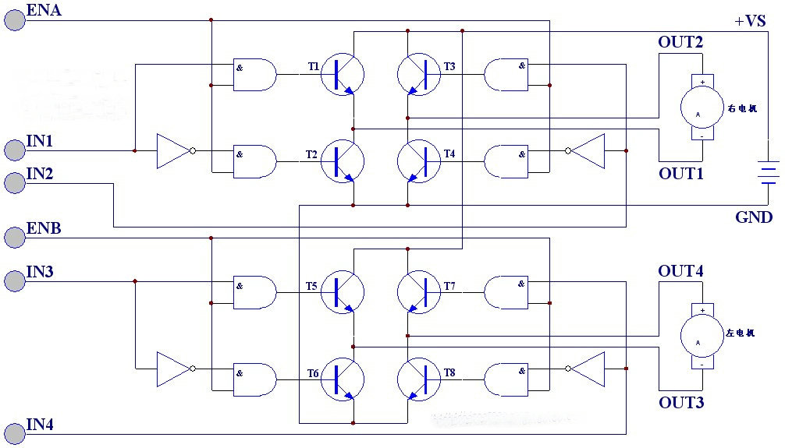
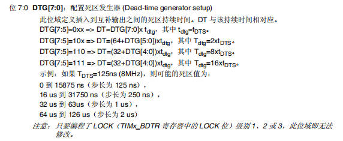
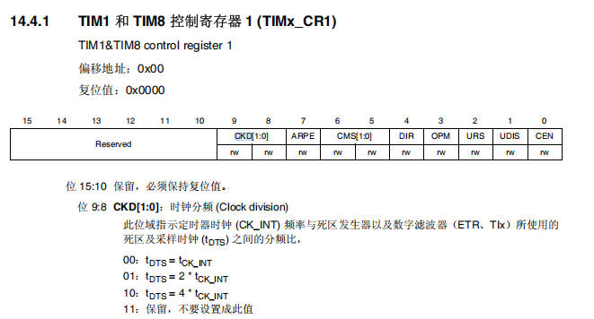
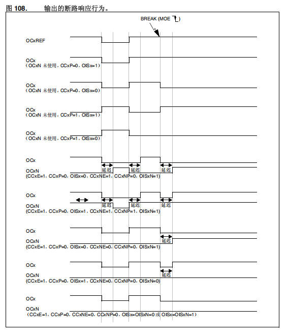
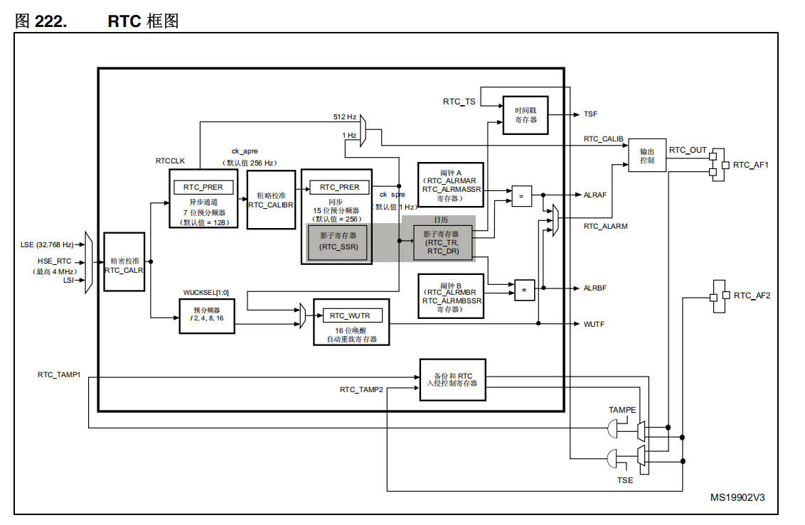

# 11 STM32-高级定时器的使用-RTC实时时钟

> 本课整理自 `高级定时器的使用-RTC实时时钟.pdf`(共 15 页)。返回 [[STM32学习目录|📑 STM32学习目录]]。

## 本章要点

- 高级控制定时器(TIM1/TIM8)在通用定时器基础上增加互补输出(OCx/OCxN)、死区发生器(DTG)与断路(BRK)输入,专门用于驱动功率电路。
- 互补输出用于驱动 H 桥(如 L298N 直流电机驱动模块);插入死区时间可防止上下桥臂直通,保护电路。
- 死区时间由 `TIMx_BDTR` 寄存器的 `DTG[7:0]` 位域配置,按 `DTG[7:5]` 分 4 个等级、配合法则各不相同;先算系统时钟周期 T,也可由目标死区时间反推参数。
- 刹车(断路)功能在故障触发时关闭 PWM 输出并强制为预定安全状态;触发源可以是软件 `HAL_TIM_PWM_Stop()`,也可以是 BRK、BRK_ACTH、BRK2 三个刹车输入(BRK 做过压保护,优先级高于做过流保护的 BRK2)。
- HAL 库关键函数:`HAL_TIM_PWM_Start()`(正常输出使能)、`HAL_TIMEx_PWMN_Start()`(互补输出使能)、`__HAL_TIM_SET_COMPARE()`(占空比设置)、`HAL_TIMEx_ConfigBreakDeadTime()`(配置刹车、死区)。
- RTC 与 BKP 同属备份域:RTC 提供年月日时分秒(三种时钟源、三种中断、双电源供电),BKP 提供 84 字节备份数据、侵入检测与 RTC 校准两大功能。

本课先看高级控制定时器的整体结构——相较通用定时器,其框图中增加了死区发生器(DTG)、断路(BRK)输入以及互补输出通道 OCx/OCxN:



## 互补输出和死区插入

### 互补输出

示波器实测的两路互补 PWM 波形(通道 1 黄色、通道 2 青色,CH1/CH2 均为 2.00V/格,时基 5.000ms,触发电平 1.44V):通道 2 与通道 1 相位相反,一路为高电平时另一路为低电平,即为一对互补输出信号。



### 死区插入

> 📄 原课件 p.3(整页为波形示意图)

图示为 PWM 信号与其互补输出 Q、Q′ 的波形:Q 跟随 PWM,Q′ 与 Q 相位相反;在每次切换沿处,两路输出同时保持低电平(无效)的一段阴影区间即为 **Dead Time(死区时间)**,用来保证 H 桥上下桥臂不会同时导通。


### 作用

> 📄 原课件 p.4

互补输出 + 死区插入的作用是安全驱动直流电机 H 桥模块。下图为 L298N 电机驱动模块的接口标注:



- 输出 A / 输出 B:两路电机接线端子。
- 通道 A 使能 / 通道 B 使能:各通道使能端(可接 PWM 做调速)。
- 逻辑输入:IN1~IN4 方向控制信号。
- 5V 供电、供电 GND、12V 供电:电源接口;板载 5V 使能可启用模块自带的 5V 稳压输出。

> 📄 原课件 p.5



- 互补输出和死区插入用于驱动直流电机模块的 H 桥电路。
- 这么设计的主要原因是,为了保护电路(防止上下桥臂直通短路)。

### 死区时间计算

- 死区的计算方法是 DTG 方式。
- `T`:系统时钟周期时长。

> 📄 原课件 p.6–p.8(参考手册 `TIMx_BDTR`、`TIMx_CR1` 寄存器章节截图)

**断路和死区寄存器 `TIMx_BDTR`**(TIM1&TIM8 break and dead-time register):偏移地址 `0x44`,复位值 `0x0000`。

| 位 | 15 | 14 | 13 | 12 | 11 | 10 | 9:8 | 7:0 |
| --- | --- | --- | --- | --- | --- | --- | --- | --- |
| 名称 | MOE | AOE | BKP | BKE | OSSR | OSSI | LOCK[1:0] | DTG[7:0] |

> 注意:由于可以根据 `LOCK` 配置锁定位 `AOE`、`BKP`、`BKE`、`OSSI`、`OSSR` 和 `DTG[7:0]` 的写操作,因此必须在第一次对 `TIMx_BDTR` 寄存器执行写访问时对这些位进行配置。


- **位 15 MOE:主输出使能(Main output enable)**
  - 只要断路输入变为有效状态,此位便由硬件异步清零。此位由软件置 1,也可根据 `AOE` 位状态自动置 1。此位仅对配置为输出的通道有效。
  - 0:OC 和 OCN 输出禁止或被强制为空闲状态。
  - 1:如果 OC 和 OCN 输出的相应使能位(`TIMx_CCER` 寄存器中的 `CCxE` 和 `CCxNE` 位)均置 1,则使能 OC 和 OCN 输出。
- **位 14 AOE:自动输出使能(Automatic output enable)**
  - 0:MOE 只能由软件置 1。
  - 1:MOE 可由软件置 1,也可在发生下一更新事件时自动置 1(如果断路输入无效)。
  - 注意:只要编程了 `LOCK`(`TIMx_BDTR` 寄存器中的 `LOCK` 位)级别 1,此位即无法修改。


- **位 13 BKP:断路极性(Break polarity)**
  - 0:断路输入 BRK 为低电平有效。
  - 1:断路输入 BRK 为高电平有效。
  - 注意:只要编程了 `LOCK` 级别 1,此位即无法修改;对该位执行任何写操作后,都需要经过 1 个 APB 时钟周期的延迟才生效。
- **位 12 BKE:断路使能(Break enable)**
  - 0:禁止断路输入(BRK 和 CSS 时钟故障事件)。
  - 1:使能断路输入(BRK 和 CSS 时钟故障事件)。
  - 注意:编程了 `LOCK` 级别 1 后,此位即无法修改;对该位执行任何写操作后,都需要经过 1 个 APB 时钟周期的延迟才生效。
- **位 11 OSSR:运行模式下的关闭状态选择(Off-state selection for Run mode)**
  - 此位在 `MOE=1` 时作用于配置为输出模式且具有互补输出的通道。如果定时器中没有互补输出,则不存在 OSSR。
  - 0:处于无效状态时,禁止 OC/OCN 输出(OC/OCN 使能输出信号 = 0)。
  - 1:处于无效状态时,一旦 `CCxE=1` 或 `CCxNE=1`,便使能 OC/OCN 输出并将其设为无效电平,然后设置 OC/OCN 使能输出信号 = 1。
  - 注意:编程了 `LOCK` 级别 2 后,此位即无法修改。
- **位 10 OSSI:空闲模式下的关闭状态选择(Off-state selection for idle mode)**
  - 此位在 `MOE=0` 时作用于配置为输出的通道。
  - 0:处于无效状态时,禁止 OC/OCN 输出(OC/OCN 使能输出信号 = 0)。
  - 1:处于无效状态时,一旦 `CCxE=1` 或 `CCxNE=1`,便将 OC/OCN 输出首先强制为其空闲电平,然后设置 OC/OCN 使能输出信号 = 1。
  - 注意:编程了 `LOCK` 级别 2 后,此位即无法修改。
- **位 9:8 LOCK[1:0]:锁定配置(Lock configuration)**——这些位用于针对软件错误提供写保护:
  - 00:关闭锁定——不对任何位提供写保护。
  - 01:锁定级别 1,此时无法对 `TIMx_BDTR` 寄存器中的 `DTG` 位、`TIMx_CR2` 寄存器中的 `OISx` 和 `OISxN` 位以及 `TIMx_BDTR` 寄存器中的 `BKE/BKP/AOE` 位执行写操作。
  - 10:锁定级别 2,此时无法对锁定级别 1 中适用的各位、CC 极性位(`TIMx_CCER` 寄存器中的 `CCxP/CCxNP` 位,只要通过 `CCxS` 将相关通道配置为输出)以及 `OSSR` 和 `OSSI` 位执行写操作。
  - 11:锁定级别 3,此时无法对锁定级别 2 中适用的各位、CC 控制位(`TIMx_CCMRx` 寄存器中的 `OCxM` 和 `OCxPE` 位,只要通过 `CCxS` 位将相关通道配置为输出)执行写操作。
  - 注意:复位后只能对 `LOCK` 位执行一次写操作。对 `TIMx_BDTR` 寄存器执行写操作后其中的内容将冻结,直到下一次复位。



- **位 7:0 DTG[7:0]:配置死区发生器(Dead-time generator setup)**——此位域定义插入到互补输出之间的死区持续时间,DT 与该持续时间相对应:
  - `DTG[7:5]=0xx` ⇒ `DT = DTG[7:0] × t_dtg`,其中 `t_dtg = t_DTS`;
  - `DTG[7:5]=10x` ⇒ `DT = (64+DTG[5:0]) × t_dtg`,其中 `t_dtg = 2 × t_DTS`;
  - `DTG[7:5]=110` ⇒ `DT = (32+DTG[4:0]) × t_dtg`,其中 `t_dtg = 8 × t_DTS`;
  - `DTG[7:5]=111` ⇒ `DT = (32+DTG[4:0]) × t_dtg`,其中 `t_dtg = 16 × t_DTS`。
  - 示例:如果 `T_DTS = 125ns`(8MHz),则可能的死区值为:0 到 15875 ns(步长为 125 ns)、16 us 到 31750 ns(步长为 250 ns)、32 us 到 63 us(步长为 1 us)、64 us 到 126 us(步长为 2 us)。
  - 注意:只要编程了 `LOCK`(`TIMx_BDTR` 寄存器中的 `LOCK` 位)级别 1、2 或 3,此位域即无法修改。
- **使用方法**:先计算系统时钟周期时长,然后配置死区发生器,也就是相应的寄存器的 0-7 位。



控制寄存器 1 `TIMx_CR1`(TIM1&TIM8 control register 1):偏移地址 `0x00`,复位值 `0x0000`;位 15:10 保留,必须保持复位值。位 9:8 `CKD[1:0]`(时钟分频 Clock division)指示定时器时钟(CK_INT)频率与死区发生器以及数字滤波器(ETR、TIlx)所使用的死区及采样时钟(`t_DTS`)之间的分频比:

- `00`:`t_DTS = t_CK_INT`
- `01`:`t_DTS = 2 × t_CK_INT`
- `10`:`t_DTS = 4 × t_CK_INT`
- `11`:保留,不要设置成此值

**DTG 各等级死区时间范围与公式**(按 `DTG[7:5]` 划分,13.89ns 为示例中的时钟周期):

| 等级 | DTG[7:5] | 范围 | 公式 |
| --- | --- | --- | --- |
| 1 | 0xx | DT=(0～127)×13.89ns=0～1763.89ns=**0～1.76us** | `DT=DTG[7:0]×Tdtg`,`Tdtg=TDTs` |
| 2 | 10x | DT=(64+(0～63))×2×13.89ns=1777.92ns～3528.06ns=**1.78us～3.5us** | `DT=(64+DTG[5:0])×Tdtg`,`Tdtg=2×TDTs` |
| 3 | 110 | DT=(32+(0～31))×8×13.89ns=3555.84ns～7000.56ns=**3.56us～7us** | `DT=(32+DTG[4:0])×Tdtg`,`Tdtg=8×TDTs` |
| 4 | 111 | DT=(32+(0～31))×16×13.89ns=7111.68ns～14001.12ns=**7.11168us～14us** | `DT=(32+DTG[4:0])×Tdtg`,`Tdtg=16×TDTs` |

> 📄 原课件 p.9 顶部

当然我们也可以反推这个参数,根据我们需要的死区时间然后反推即可。

## 刹车(断路)功能

- **目的**:保护由定时器生成的 PWM 信号所驱动的功率电器。
- **原理**:当被故障触发的时候,这个刹车电路会关闭 PWM 的输出,并且强制设为预定的安全状态。

### 方法:

- **方法一**
  - 软件控制:使用

    ```c
    HAL_StatusTypeDef HAL_TIM_PWM_Stop(TIM_HandleTypeDef *htim, uint32_t Channel);
    ```

  - 信号控制(Break):信号输入 `BRK`、`BRK_ARTH`、`BRK2`。

### 具体原理:

TIM1 和 TIM8 有三个刹车输入:`BRK`、`BRK_ACTH`、`BRK2`。

**1. BRK**

1. BRK 的输入信号为 BKIN 引脚上输入信号、所用比较器(4/87)输出的逻辑或。
2. 禁止 PWM 模式或者设置为预定定义安全状态。
3. 极性选择和滤波特性可用。

> 依靠外部引脚 BKIN,比较器 4 和 7 输入的刹车信号,这个模式可以停止 PWM,也可以设置为预定义的安全状态。

**2. BRK_ACTH**

1. 可以选至比较器(1, 2, 3, 5, 6)输出、CSS、PVD 输出、SRAM 奇偶校验错误。
2. 极性选择和滤波特性不可用。
3. 它始终为高电平有效。

> ACTH 输出,主要是内部输出,包含 1-6 的比较器输出;PVD 输出指的是,电源管理的部分,比如掉电保护检测;CSS 时钟故障;SRAM 奇偶校验错误。当然如果要用它,就必须要配置成高电平才可以。

**3. BRK2**

1. 输入信号为 BKIN2 引脚上输入信号和所选比较器输出(COMP1, 2, 3, 4, 5, 6, 7)的逻辑或。
2. 极性选择和滤波特性可用。
3. 禁止 PWM 模式。

> 这个模式是只能禁用 PWM 输出,信号从 BKM2 引脚和 1-7 的比较器得到,但是要注意 BRK 要优先于 BRK2,且是覆盖关系,同时发生的结果就是 BRK 覆盖 BRK2 的信号。BRK2 在具体使用上来说是作为电流的过流保护来使用的,而 BRK 是作为电压的过压保护使用。

### 时序图

> 📄 原课件 p.11



## 使用到的函数

| 函数 | 说明 |
| --- | --- |
| `HAL_TIM_PWM_Start()` | 正常输出的使能 |
| `HAL_TIMEx_PWMN_Start()` | 互补输出的使能 |
| `__HAL_TIM_SET_COMPARE()` | 占空比设置 |
| `HAL_TIMEX_ConfigBreakDeadTime()` | 配置刹车、死区 |

> 📄 原课件 p.12(示例代码:使能通道 1 的正常与互补 PWM 输出,并在 EXTI 按键回调中切换占空比/控制刹车)

```c
HAL_TIM_PWM_Start(&htim1,TIM_CHANNEL_1);
HAL_TIMEx_PWMN_Start(&htim1,TIM_CHANNEL_1);

void HAL_GPIO_EXTI_Callback(uint16_t GPIO_Pin)
{
    HAL_Delay(10);
    if(HAL_GPIO_ReadPin(GPIOF,GPIO_PIN_9) == 0)
    {
        direction = !direction;
        if(direction)
        {
            pulse = 900;
        }else
        {
            pulse = 100;
        }
        __HAL_TIM_SET_COMPARE(&htim1, TIM_CHANNEL_1, pulse);
        while(HAL_GPIO_ReadPin(GPIOF,GPIO_PIN_9) == 0);
    }

    if(HAL_GPIO_ReadPin(GPIOF,GPIO_PIN_8) == 0)
    {
        HAL_GPIO_WritePin(GPIOE,GPIO_PIN_15,1);
        while(HAL_GPIO_ReadPin(GPIOF,GPIO_PIN_8) == 0)
            HAL_GPIO_WritePin(GPIOE,GPIO_PIN_15,0);
    }

}
```

## BKP后备定时器与RTC实时时钟

> 📄 原课件 p.13



### RTC

#### 基本概述

- RTC(Real Time Clock)实时时钟。
- 提供时钟:提供年月日时分秒。
- 独立低电:归属备份区,系统复位和待机唤醒模式下,RTC 不受影响。
- 双电源供电:`VDD` 供电以及 `VBAT` 电池供电。
- 分频系数 2～20。
- 32 位可编程计数器。

#### 三种时钟源

- 外部高速时钟(HES)经 1/128 分频
- 内部低速时钟(LSI)
- 外部低速时钟(LSE)

> 📄 原课件 p.14

#### 三种中断

- 闹钟中断:用来产生一个软件可编程的闹钟中断。
- 秒中断:用来产生一个可编程的周期性中断信号(最长可达 1 秒)。
- 溢出中断:指示内部可编程计数器溢出并回转为 0 的状态。

#### 两个独立复位位

- APB1 接口总线复位位。
- RTC 核心(振荡器、闹钟、计算器和分频器)只能由后台寄存器复位。

### BKP

#### 基本介绍

- 42 个 16 位寄存器构成,存储 84 个字节的用户应用程序数据。
- 归属备份域里面,由 VBAT 供电,不受系统复位和待机唤醒影响。
- 两大功能:
  1. BKP 做入侵检测
  2. RTC 校准功能

#### 侵入检测

- **检测方式**:侵入引脚 TAMPER(PC13),检测(高电平)或者 0(低电平)获得侵入事件(由寄存器 `BKP_CR` 的 `TPAL` 位来设置)。
- **清空数据**:侵入事件清空所有数据备份寄存器里面的数据。
- **防侵入事件丢失**:系统自动进入侵入检测信号和允许计数器锁与运算。
- **当 `BKP_CR` 寄存器 `TPAL` 位为 0**:得到 PC13 高电平,启动检测之后,产生侵入事件。
- **当 `BKP_CR` 寄存器 `TPAL` 位为 1**:得到 PC13 低电平,启动检测之后,产生侵入事件。
- **开启方式**:通过 MCSR 寄存器的 TPIE 位为 1。
- **使用流程**:侵入事件被检测到并已被清除之后,那么 PC13 引脚被禁止,在下次写入数据备份寄存器之前,需重新用 TIE 位来启动侵入功能。

> 📄 原课件 p.15

#### 初始化使用配置

- 通过设置寄存器 `RCC_APB1ENR` 的 `PWREN` 和 `BKPR` 位来打开电源和备份接口的时钟。
- 电源控制寄存器(`PWR_CR`)的 `DBP` 位来使能对备份寄存器和 RTC。

#### RTC校准功能

- **意义**:防止时间出现误差,经过 64 分频后,输出到 TAMPER(PC13)侵入引脚。
- **开启方式**:可从通过 RTC 的 `COO` 位来启动这个功能。
- **误差值**:可调整的校准误差对应为 0～121ppm,相当于每隔 30 天可调整秒数为 0～314。

#### 具体使用场景与后续实验安排

具体使用场景需要结合屏幕功能更为直观,相关实验放置到 通信协议 IIC 与 OLED 屏 具体展现。

## 小结与下一步

- 互补输出 + DTG 死区 + 刹车(BRK/BRK_ACTH/BRK2)是高级定时器驱动功率电路的三重保护;`TIMx_BDTR` 必须在首次写入时配置好被 `LOCK` 锁定的各位。
- 死区时间按 `DTG[7:5]` 划分的 4 级公式计算(时钟周期 T 已知即可查表),也可以由需要的死区时间反推 DTG 参数。
- RTC 与 BKP 同属备份域:RTC 提供日历与闹钟/秒/溢出三种中断,可选 HSE/128、LSI、LSE 三种时钟源;BKP 提供 84 字节备份数据、TAMPER(PC13)侵入检测与 0～121ppm 的 RTC 校准。
- 使用前需打开 `RCC_APB1ENR` 的 `PWREN`/`BKPR` 时钟并置 `PWR_CR` 的 `DBP` 位;RTC 带时间显示的完整实验将在 IIC 与 OLED 屏课程中呈现。

➡️ 下一课:[[12-STM32-同步异步通信-半主机模式|STM32-同步异步通信-半主机模式]]
