# 12 STM32-同步异步通信-半主机模式

> 本课整理自 `同步异步通信，半主机模式.pdf`（共 15 页）。返回 [[STM32学习目录|📑 STM32学习目录]]。

## 本章要点

- 通信按传输方式分并行/串行，按传输方向分单工/半双工/全双工，按串行通信方式分同步/异步；UART 属于异步串行通信。
- RS-232 采用负逻辑电平（-15V~-3V 为逻辑 1），与 TTL 电平不兼容，需 MAX3232 等电平转换芯片；现代设备更多用 USB 转串口（CH340G 等）方案。
- UART 一帧数据由起始位、数据位、奇偶校验位、停止位组成，通信双方需提前约定通信格式与波特率（4800、9600、115200 等）。
- HAL 库提供轮询方式的 `HAL_UART_Transmit`/`HAL_UART_Receive` 与中断方式的 `HAL_UART_Transmit_IT`/`HAL_UART_Receive_IT`，配合发送/接收完成回调函数实现定长数据收发。
- 半主机模式（Semihosting）借用 PC 实现 printf 等基本 I/O 调试；正式产品需禁用半主机模式，勾选 Use MicroLIB 并把 printf 重定义（`fputc`）到串口输出。

## 通信

### 通信的概念

通信指的是 CPU 和外部设备之间或者计算机与计算机之间的数据交互。

### 通信种类

#### 按照数据的传输方式分类

#### 并行通信：

- 传输原理：数据各个位同时传输。（以字节或字节的倍数进行传输）
- 优点：速度快。
- 缺点：占用引脚资源多。传输成本高、传输距离近、抗干扰能力弱（串扰）
- 应用领域：一般大量数据传输，并且传输距离较近 如计算机总线

#### 串行通信：

- 传输原理：数据按位顺序传输。（每一位都占据固定的时间长度）
- 优点：占用引脚资源少。（最少一根线）、传输成本低、传输距离远
- 缺点：速度相对较慢
- 应用领域：一般用于工控设备、测量设备、少部分通信设备 USB COM口

#### 按照数据的传输方向分类

#### 单工：

- 数据传输只支持数据在一个方向上传输。如收音机、无线电台

#### 半双工：

- 允许数据在两个方向上传输，但是，在某一时刻，只允许数据在一个方向上传输，它实际上是一种切换方向的单工通信；如对讲机

> 📄 原课件 p.2

#### 全双工：

- 允许数据同时在两个方向上传输，因此，全双工通信是两个单工通信方式的结合，它要求发送设备和接收设备都有独立的接收和发送能力。如移动电话

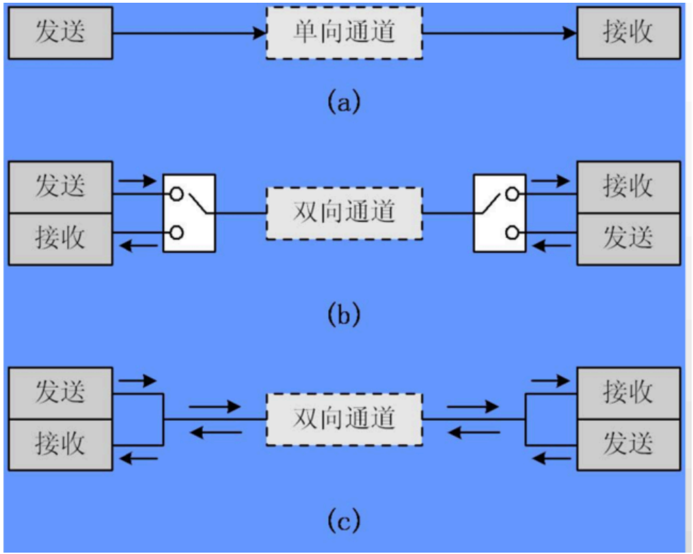

#### 按照串行通信方式分类

#### 同步通信：

- 带时钟同步信号传输。例如：SPI, IIC通信接口。要求通信双方必须使用同一个时钟，相当于发送数据的同时接收数据，同步通信属于连续串行传输数据，一次只传输一帧数据，相比于异步通信而言，传输效率更高，缺点是时钟必须一致。

#### 异步通信：

- 不带时钟同步信号。UART(通用异步收发器),单总线；如 UART 接口属于异步通信，要求通信双方具有发送端和接收端，由于不要求时钟同步，所以在通信的时候，通信双方必须提前约定好通信格式（字符格式）以及通信速率，异步通信以字符为单位进行传输，在传输一个字符的时候会添加起始位和停止位，通过起始位以及停止位来达到同步的功能。

## 具体实现的硬件

> 📄 原课件 p.3

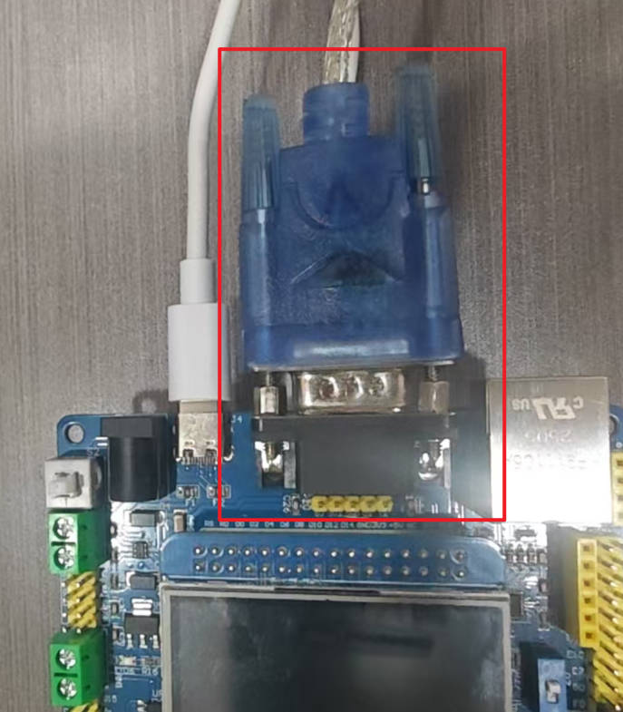

> 📄 原课件 p.4

下图为 DB9 标准串口通讯接口（公头与母头引脚定义）：

- 公头：上排 1 DCD、2 RXD、3 TXD、4 DTR、5 GND；下排 6 DSR、7 RTS、8 CTS、9 RI
- 母头：上排 5 GND、4 DTR、3 RXD、2 TXD、1 DCD；下排 9 RI、8 CTS、7 RTS、6 DSR

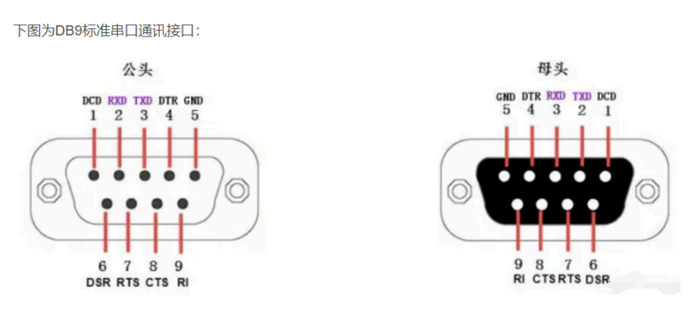

DB9 引脚说明：

| 序号 | 名称 | 符号 | 说明 |
| --- | --- | --- | --- |
| 1 | 载波检测 | DCD | Data Carrier Detect，数据载波检测，用于 DTE 告知对方，本机是否收到对方的载波信号 |
| 2 | 接收数据 | RXD | Receive Data，数据接收信号，即输入。 |
| 3 | 发送数据 | TXD | Transmit Data，数据发送信号，即输出。两个设备之间的 TXD 与 RXD 应交叉相连 |
| 4 | 数据终端(DTE) 就绪 | DTR | Data Terminal Ready，数据终端就绪，用于 DTE 向对方告知本机是否已准备好 |
| 5 | 信号地 | GND | 地线，两个通讯设备之间的地电位可能不一样，这会影响收发双方的电平信号，所以两个串口设备之间必须要使用地线连接，即共地。 |
| 6 | 数据设备(DCE)就绪 | DSR | Data Set Ready，数据发送就绪，用于 DCE 告知对方本机是否处于待命状态 |
| 7 | 请求发送 | RTS | Request To Send，请求发送，DTE 请求 DCE 本设备向 DCE 端发送数据 |
| 8 | 允许发送 | CTS | Clear To Send，允许发送，DCE 回应对方的 RTS 发送请求，告知对方是否可以发送数据 |
| 9 | 响铃指示 | RI | Ring Indicator，响铃指示，表示 DCE 端与线路已接通 |

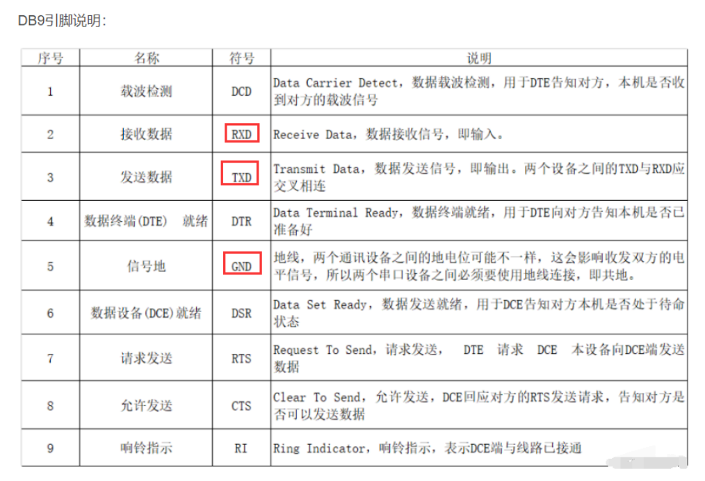

### 硬件设备与计算机之间的通信

- 硬件设备和计算机在通信的时候，需要用到电气转换芯片（如 MAX232），因为硬件平台一般采用 TTL 电平信号（采用正逻辑电平，+5V 等价于逻辑 1，0V 等价于逻辑 0），但是计算机采用 RS232 电平信号（采用负逻辑电平，-15V~-3V 表示逻辑 1，+3V~+15V 表示逻辑 0）。
- 一般现在的计算机（笔记本电脑）和硬件设备（STM32）都不集成 DB-9 或者 DB-25 接口，提供了另外的一种方案来实现数据交互，就是利用 USB 口和开发板的串口（4 针的拓展串口）进行通信（利用 USB 转串口），就必须在 STM32 开发板集成 USB 转串口芯片（CH340G）。

> 📄 原课件 p.5

通讯标准与电平标准（发送端）对照：

| 通讯标准 | 电平标准（发送端） |
| --- | --- |
| 5V TTL | 逻辑 1：2.4V-5V；逻辑 0：0~0.5V |
| RS-232 | 逻辑 1：-15V~-3V；逻辑 0：+3V~+15V |

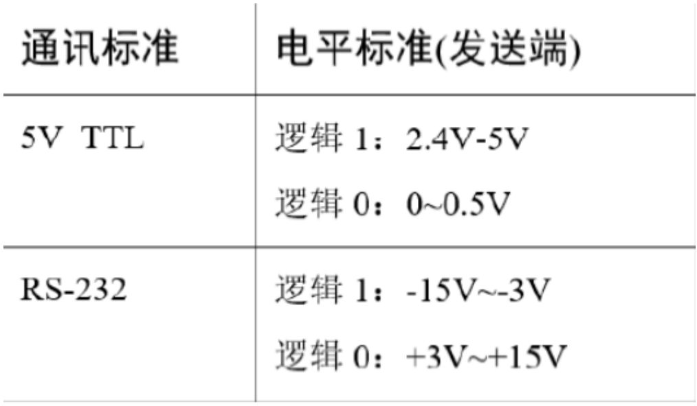

### RS232硬件接口特性

- RS-232 接口以 9 个引脚（DB-9）或是 25 个引脚（DB-25）的型态出现，一般个人计算机上会有两组 RS-232 接口，分别称为 COM1 和 COM2。

#### RS232的缺点

- 接口信号电平高，容易损坏接口电路的芯片。RS232 接口上任何信号线的电压都处于负逻辑关系中。即：逻辑"1"为 -3 ~ -15V；逻辑为"0"：+3 ~ +15V，噪声裕量为 2V。也就是说，接收器需要将高于 +3V 的信号识别为逻辑"0"，将低于 -3V 的信号识别为逻辑"1"，将 5V 的 TTL 电平识别为逻辑 0，将 0 识别为 1。与 TTL 电平不兼容，需要一个电平转换电路来连接到 TTL 电路。MAX3232。
- 传输速率低。在异步传输中，比特率为 20Kbps；因此，在 51CPLD 开发板中，集成程序波特率只能是 19200，这也是原因。
- 接口采用信号线和信号回波串，形成共同的接地传输形式。这种标准的接地传输容易受到共模干扰，因此抗噪性较弱。
- 传输距离有限。最大传输距离为 50 英尺。它只能达到大约 15 米。

### 一般RS232使用场景

> 📄 原课件 p.6

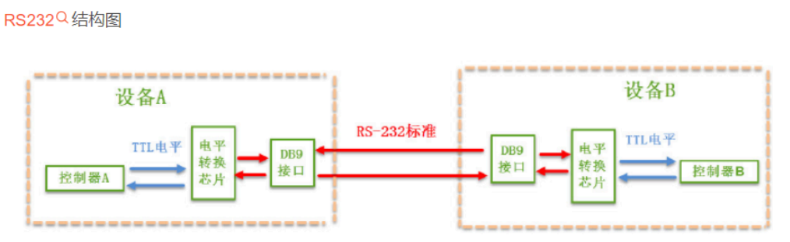

- 1、RS232 标准串口主要用于工业设备直接通信
- 2、电平转换芯片一般有 MAX3232，SP3232 //TTL - RS232电平

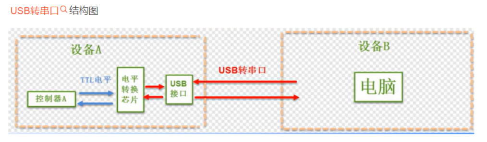

- 1、USB 转串口主要用于设备跟电脑通信
- 2、电平转换芯片一般有 CH340、PL2303、CP2102、FT232 //TTL -> USB接口电平
- 3、使用的时候电脑端需要安装电平转换芯片的驱动
- 4、USB接口：通用串行总线（英语：Universal Serial Bus，缩写：USB）是一种串口总线标准，也是一种输入输出接口的技术规范，被广泛地应用于个人电脑和移动设备等信息通讯产品，并扩展至摄影器材、数字电视（机顶盒）、游戏机等其它相关领域。最新一代是 USB4，传输速度为 40Gbit/s，三段式电压 5V/12V/20V，最大供电 100W，新型 Type C 接口允许正反盲插。


- 1、原生的串口通信主要是控制器跟串口的设备或者传感器通信，不需要经过电平转换芯片来转换电平，直接就用 TTL 电平通信
- 2、GPS 模块、GSM 模块、串口转 WIFI 模块、HC05 蓝牙模块都是使用的串口通信。

## UART 通用异步接收发送器

> 📄 原课件 p.7

- 通用异步收发传输器（Universal Asynchronous Receiver/Transmitter，UART）是一种全双工、异步串行通信方式，它在发送数据时将并行数据转换成串行数据来传输，在接收数据时将接收到的串行数据转换成并行数据，可以实现全双工传输和接收。

图中引脚说明：

- -RXD：数据输入引脚。数据接收。
- -TXD：数据发送引脚。数据发送。

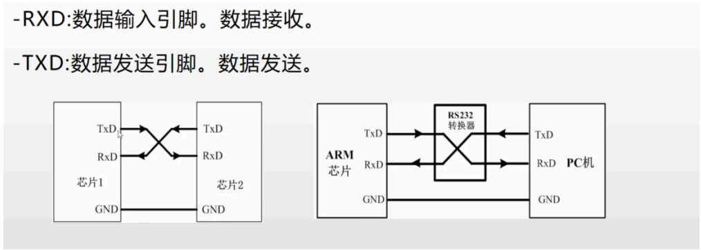

- UART 串口通信需要两根信号线来实现，一根用于串口发送，另外一根负责串口接收。 TXD RXD GND

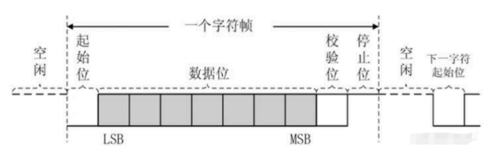

一个字符帧从左到右依次为：空闲 → 起始位 → 数据位（LSB → MSB）→ 校验位 → 停止位 → 空闲 → 下一字符起始位。

- UART 在发送或接收过程中的一帧数据由 4 部分组成，起始位(低电平)、数据位、奇偶校验位和停止位(高电平)。
- 起始位标志着一帧数据的开始，停止位标志着一帧数据的结束，数据位是一帧数据中的有效数据。

### 数据校验：

- 在有效数据之后，有一个可选的数据校验位。由于数据通信相对更容易受到外部干扰导致传输数据出现偏差，可以在传输过程加上校验位来解决这个问题。校验方法有奇校验(odd)、偶校验(even)、0 校验(space)、1 校验(mark)以及无校验(noparity)，它们介绍如下：
- 奇校验要求有效数据和校验位中"1"的个数为奇数，比如一个 8 位长的有效数据为：01101001，此时总共有 4 个"1"，为达到奇校验效果，校验位为"1"，最后传输的数据将是 8 位的有效数据加上 1 位的校验位总共 9 位。
- 偶校验与奇校验要求刚好相反，要求帧数据和校验位中"1"的个数为偶数，比如数据帧：11001010，此时数据帧"1"的个数为 4 个，所以偶校验位为"0"。

> 📄 原课件 p.8

- 0 校验是不管有效数据中的内容是什么，校验位总为"0"，1 校验是校验位总为"1"。

### 波特率：

- 串口异步通讯中由于没有时钟信号(如前面讲解的 DB9 接口中是没有时钟信号的)，所以两个通讯设备之间需要约定好波特率，即每个码元的长度，以便对信号进行解码，下图中分开的每一格就是代表一个码元。常见的波特率为 4800、9600、115200 等。

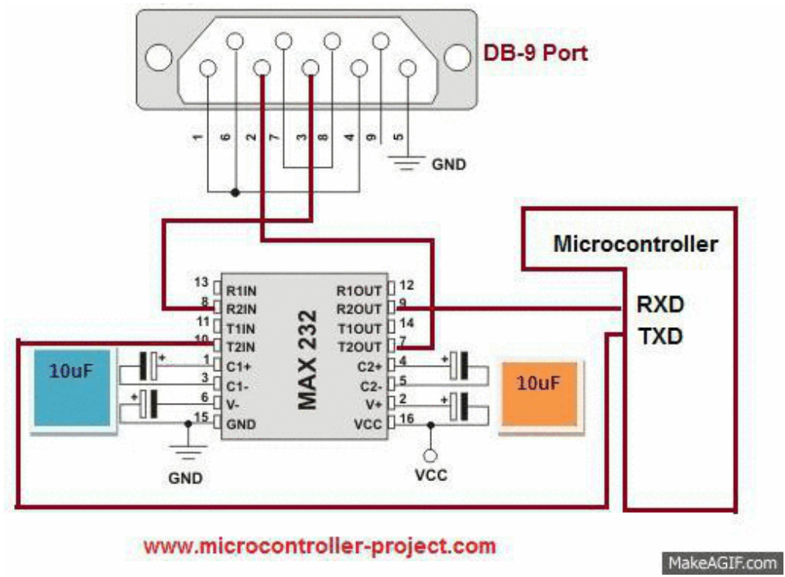

### 硬件流控制

- （1）为什么需要流控？
  - 流控的目的是让串口通信非常可靠，可以保证发送和接收不会漏掉东西。
- （2）现在为什么不用流控？
  - 现在计算机之间有更好更高级(usb、internet)的通讯方式，串口在发送方速率比接收方快的时候流控经基本被废弃了。现在串口的用途更多是用来输出调试信息的。而且现在的硬件已经基本不需要这个了，收发速度完全可以协调得过来

### 具体每一个位的传输

> 📄 原课件 p.9

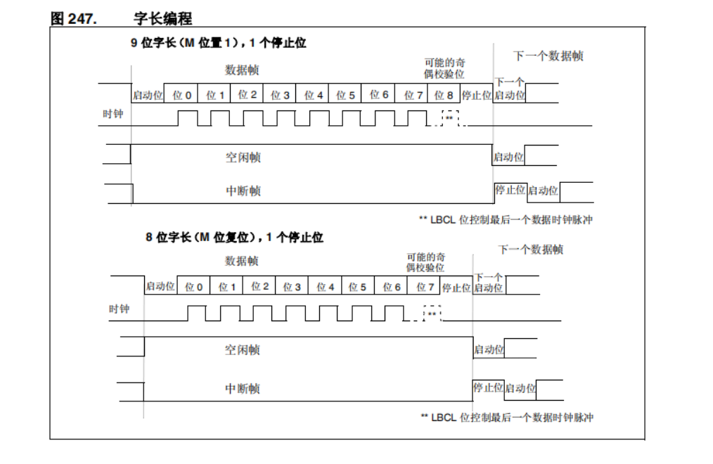

图中关键内容：

- 9 位字长（M 位置 1），1 个停止位：数据帧 = 启动位 + 位 0 ~ 位 7 + 位 8（可能的奇偶校验位）+ 停止位，之后是下一个数据帧的启动位；时钟信号随数据帧出现；另有空闲帧（后接启动位）与中断帧（停止位后接下一个启动位）。** LBCL 位控制最后一个数据时钟脉冲
- 8 位字长（M 位复位），1 个停止位：数据帧 = 启动位 + 位 0 ~ 位 7 + 停止位，之后是下一个数据帧的启动位；同样有空闲帧与中断帧。** LBCL 位控制最后一个数据时钟脉冲

## USART-定长数据的发送与接收

> 📄 原课件 p.10

### 定长数据的发送与接收-轮询方式

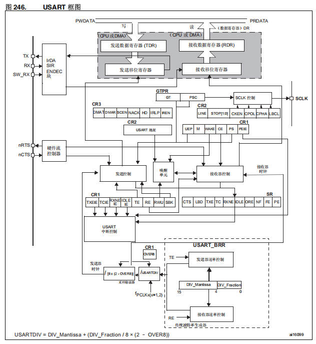

#### 相关函数

```c
//发送
/*******************************************
参数1：huart，串口实例的指针。
参数2：*pData，待发送数据缓冲区的指针。
参数3：Size，待发送数据的字节数。
参数4：Timeout，超时间间值。
返回值：HAL_StatusTypeDef,函数执行状态。
*******************************************/
HAL_StatusTypeDef HAL_UART_Transmit(UART_HandleTypeDef *huart , (uint8_t) * pData, uint16_t Size, uint32_t Timeout);
```

> 📄 原课件 p.11（续）

```c
//接收
/********************************************
参数1：huart，串口实例的指针。
参数2：*pData，数据接收数据缓冲区的指针。
参数3：Size，待接收数据的字节数。
参数4：Timeout，超时间间值。
返回值：HAL_StatusTypeDef,函数执行状态。
********************************************/
HAL_StatusTypeDef HAL_UART_Receive(UART_HandleTypeDef *huart , uint8_t * pData, uint16_t Size, uint32_t Timeout);
```

#### 程序编写

```c
uint8_t rxbuffer[20] ;
HAL_UART_Receive(&huart1,rxbuffer,8,1000);
HAL_UART_Transmit(&huart1,rxbuffer,10,1000);
```

### 定长数据的发送与接收—中断方式

- Uart 轮询收发方式是用于简单的、对实时性要求不高的低速通信场景。但在对于实时性、效率和灵活性要求较高的应用中，中断或 DMA 方式可能更加合适。在选择 Uart 通信方式时，需要根据具体应用需求进行权衡和选择。

#### 相关函数

```c
//发送函数
/***************************************
参数1：huart，串口实例的指针。
参数2：*pData，待发送数据缓冲区的指针。
参数3：Size，待发送数据的字节数。
返回值：HAL_StatusTypeDef,函数执行状态。
***************************************/
HAL_StatusTypeDef HAL_UART_Transmit_IT(UART_HandleTypeDef *huart , uint8_t * pData, uint16_t Size);

//接收函数
/***************************************
参数1：huart，串口实例的指针。
参数2：*pData，待接收数据缓冲区的指针。
参数3：Size，待发送数据的字节数。
返回值：HAL_StatusTypeDef,函数执行状态。
***************************************/
HAL_StatusTypeDef HAL_UART_Receive_IT(UART_HandleTypeDef *huart , uint8_t * pData, uint16_t Size);

//串口发送完毕中断回调函数
/***************************************
这是一个回调函数，它是HAL库中用于串口传输完成后自动调用的函数。
当串口数据发送完毕后，HAL库会自动调用该函数，以便用户可以在其中执行一些特定的操作
***************************************/
void HAL_UART_TxCpltCallback(UART_HandleTypeDef *huart);

//串口接收完毕中断回调函数
/***************************************
这是一个回调函数，它是HAL库中用于串口传输完成后自动调用的函数。
当串口数据发送完毕后，HAL库会自动调用该函数，以便用户可以在其中执行一些特定的操作
***************************************/
void HAL_UART_RxCpltCallback(UART_HandleTypeDef *huart);
```

#### 程序编写

> 📄 原课件 p.12

```c
uint8_t rxbuffer[20] ;
HAL_UART_Receive_IT(&huart1,rxbuffer,8);

void HAL_UART_RxCpltCallback(UART_HandleTypeDef *huart)
{
  if(huart->Instance == USART1)
  {
    HAL_UART_Transmit_IT(&huart1,rxbuffer,8);
  }
}
```

## 半主机模式

### 什么是半主机模式

- "半主机模式"（Semihosting）是一种在嵌入式系统开发中常用的调试技术，主要用于在没有完整操作系统或标准输入/输出设备（如屏幕、键盘、文件系统）的目标硬件上，借助宿主机（通常是开发用的 PC）来实现基本的 I/O 操作。
- 简单的说，就是我们嵌入式程序中，类似 printf 的接口是会与我们 PC 进行通讯，以方便我们借助我们调试板的仿真器在 PC 上用开发工具进行调试。

### 为什么要禁用半主机模式

> 📄 原课件 p.13

- 在嵌入式系统编程中是避免不了使用 printf、fopen、fclose 等函数的，但是因为嵌入式的程序中并没有对这些函数的底层实现，使得设备运行时会进入软件中断 BAEB 处，这时就需要 `_use_no_semihosting_swi` 这个声明，使程序遇到这些文件操作函数时不停在此中断处。

### 半主机机制的作用

- 半主机是用于 ARM 目标的一种机制，可将来自 STM32 单片机应用程序的输入输出请求传送至运行仿真器的 PC 主机。使用这个机制可以启用 C 库中的函数，如 printf() 和 scanf()，来使用 PC 主机的屏幕和键盘。这样就可以看到单片机的输入输出，方便进行调试。注意：这种机制的运行需要仿真器，否则无法运行。
- 简单来说，半主机模式就是通过仿真器实现开发板在电脑上的输入和输出。
- 开发时单片机需要独立运行，开发者就应该去掉仿真器，把 printf() 函数通过单片机的外设来实现，例如通过开发板的串口。

### 为什么需要串口重定向

- 硬件资源限制：在某些情况下，STM32 的硬件资源可能无法满足所有串口通信的需求。通过串口重定向，我们可以将有限的串口资源进行合理分配，实现多路串口通信。
- 调试和测试需求：在开发过程中，我们可能需要将 STM32 的串口输出重定向到上位机或者其他调试设备，以便实时查看和记录串口数据。
- 系统集成需求：在将 STM32 集成到更大的系统中时，可能需要与其他设备或模块进行串口通信。通过串口重定向，我们可以将 STM32 的串口与其他设备的串口进行连接，实现数据交互。

### Use MicroLIR（微库）

- 因为使用微库的话，不会使用半主机模式。

（原课件此节标题写作 MicroLIR，对应 Keil 工程选项中的 Use MicroLIB，见下页截图。）

### 在主程序中添加重定向代码解释

> 📄 原课件 p.14

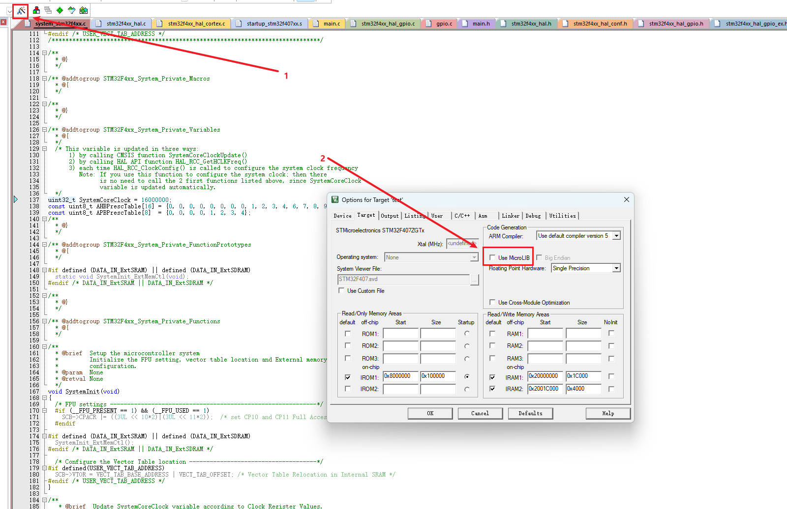

截图操作说明：点击工具栏的 Options for Target 图标（标注 ①），在弹出对话框的 Target 页签、Code Generation 区勾选 **Use MicroLIB**（标注 ②），即可让程序不使用半主机模式。

**6 代编译器**

```c
__ASM(".global __use_no_semihosting") ; //禁用半主机模式

struct FILE
{
    int handle ; //占位
};

FILE __stdout ;

void _sys_exit(int x )
{
    NVIC_SystemReset(); //硬件复位
    x = x ;
}

void __ttywrch(int ch)
{
    ch = ch ;
}

int fputc ( int ch , FILE *f)
{
    uint8_t temp[1] = {ch} ;
    HAL_UART_Transmit(&huart1, temp , 1 , 2);
    return ch ;
}
```

> 📄 原课件 p.15

注：原课件第 14~15 页代码块中 `FILE __stdout ;`、`ch = ch ;` 以及 `int fputc` 行的中文注释在 PDF 中字形缺失（显示为乱码），无法可靠还原，故未转写；其余注释已还原。

**5 代编译器**

```c
#pragma import (__use_no_semihosting) //关闭半主机模式
//标准库需要的支持函数
struct __FILE
{
    int handle ;
};
FILE __stdout;
//定义_sys_exit()以避免使用半主机模式
void _sys_exit(int x)
{
    x = x ;
}
//重定义fputc函数
int fputc ( int ch , FILE *f)
{
    uint8_t temp[1] = {ch};
    HAL_UART_Transmit(&huart1 , temp , 1, 2 );
    return ch ;
}
```

## 小结与下一步

- 通信分类三条主线：并行/串行、单工/半双工/全双工、同步/异步；UART 是全双工异步串行接口，帧格式为起始位+数据位+校验位+停止位，需约定波特率。
- RS-232 与 TTL 电平互不兼容，实际开发中常用 MAX3232 做电平转换，或直接用 CH340G 等 USB 转串口芯片与电脑通信。
- HAL 库串口收发有轮询与中断两种方式：轮询用 `HAL_UART_Transmit/Receive`（带 Timeout），中断用 `HAL_UART_Transmit_IT/Receive_IT` 加完成回调。
- 半主机模式依赖仿真器实现 printf 输出；产品代码应禁用半主机（Use MicroLIB），并重定义 `fputc` 把字符经 `HAL_UART_Transmit` 从串口发出。

➡️ 下一课：[[13-STM32-IIC通信协议|STM32-IIC通信协议]]
