# 13 STM32-IIC通信协议

> 本课整理自 `IIC通信协议.pdf`（共 9 页）。返回 [[STM32学习目录|📑 STM32学习目录]]。

## 本章要点

- 串口空闲中断（IDLE）：通信线路空闲超过一个字节传输时间时硬件置位 IDLE 标志，若 CR1 中的 IDLE 位为 1 即触发空闲中断，可实现不定长数据收发。
- 不定长接收链路：`HAL_UART_Receive_IT` 逐字节中断接收并存入 `DataBuff`，空闲中断到来时用 `HAL_UART_AbortReceive_IT` 中止接收，在回调中把整段数据发出。
- I2C（IIC）是 PHILIPS 公司开发的两线式（SDA + SCL）串行总线，半双工、可一主多从或多主多从，标准速度 100 kHz、快速 400 kHz。
- I2C 器件有 7 位/10 位器件地址（如 OV7670 地址 0x42，EEPROM 高 4 位固定为 1010），一条总线最多能连 8 个 EEPROM 芯片。
- I2C 三类信号：开始信号（必需）、结束信号与应答信号；数据 MSB 先出，只在 SCL 高电平期间读取、低电平期间修改，第 9 位低电平为 ACK、高电平为 NACK。

## 串口通信-同步异步通信-不定长数据收发

### 空闲中断

1. 在一种数据传输结束后，通信线路将会维持高电平，这个状态称为空闲状态；

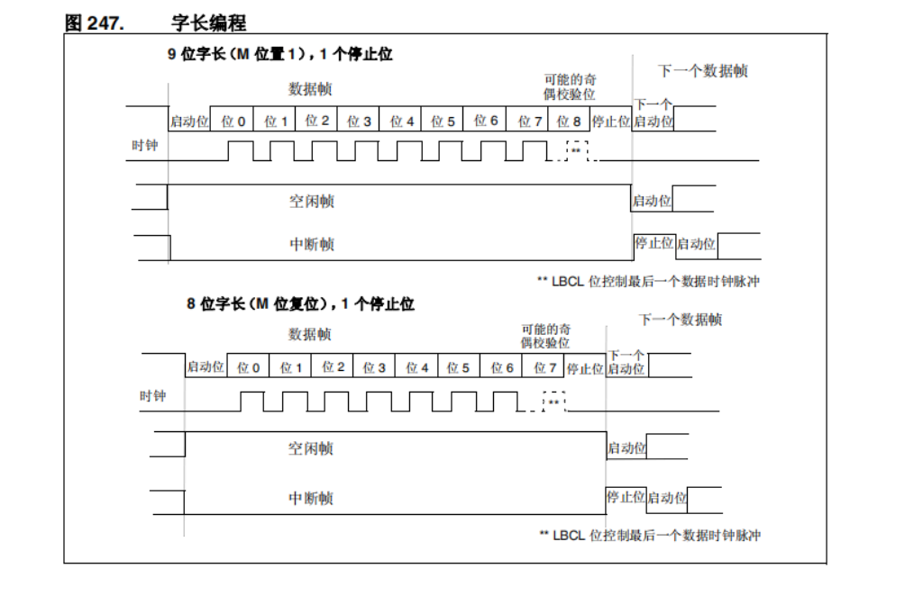

2. 当 CPU 检测到通信线路处于空闲状态时，且空闲状态持续时间大于一个字节传输时间时，空闲状态标志 IDLE 将由硬件置 1。如果串口控制寄存器 CR1 中的 IDLE 位为 1，将会触发空闲中断（IDLE 中断）；
3. 由于空闲标志是在一帧数据传输完成后才置位，在有效数据传输过程中不会置位，因此借助空闲中断，可以实现不定长数据的收发。

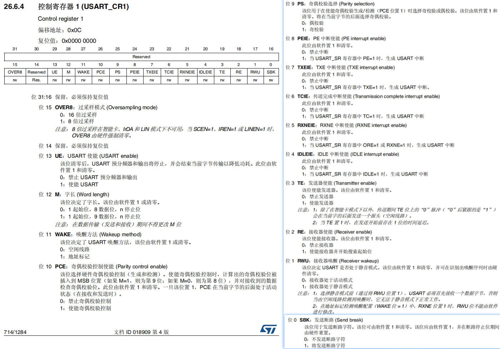

#### 空闲中断时序图

> 📄 原课件 p.2

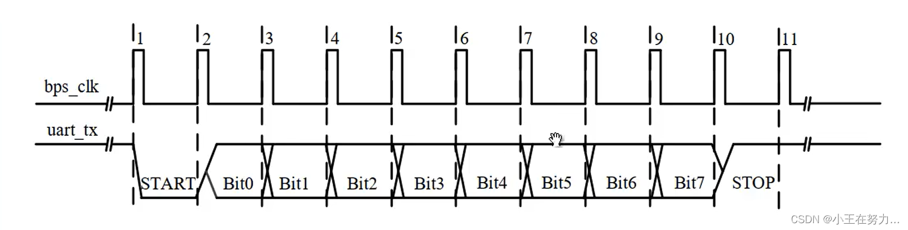

### 不定长数据发送与接收

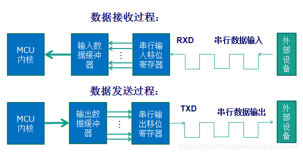

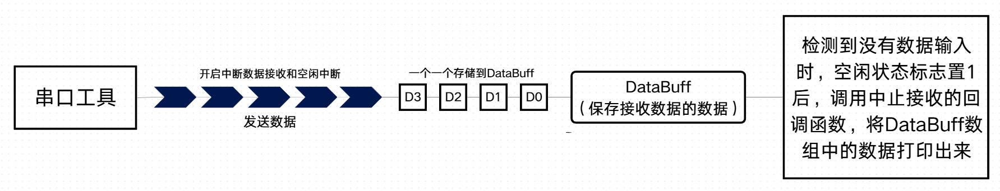

### 用到的函数

> 📄 原课件 p.3

```c
//中断接收函数
HAL_StatusTypeDef HAL_UART_Receive_IT(&huart1,(uint8_t *)rxbuffer, 1 );
//清除中断空闲标志位
    __HAL_UART_CLEAR_IDLEFLAG(__HANDLE__);
//使能空闲中断
    __HAL_UART_ENABLE_IT(__HANDLE__, __INTERRUPT__);
//空闲中断回调函数
void HAL_UART_AbortReceiveCpltCallback(UART_HandleTypeDef* huart)
```

### 具体代码

> 📄 原课件 p.3–p.5

**main.c**

```c
/* USER CODE BEGIN PV */
//不定长数据发送和接收的相关变量
uint8_t RxBuff[1]; //一位数据接收缓冲区
uint8_t DataBuff[1024]; //数据接收缓冲区
uint8_t DataNum; //用来记录DataBuff中数据个数
/* USER CODE END PV */

/* USER CODE BEGIN 0 */
/**************************关闭标准库下的半主机模式****************************/
__ASM (".global __use_no_semihosting"); //AC6编译器

//标准库需要的支持函数
struct FILE
{
    int handle;
};
FILE __stdout;
//定义_sys_exit()以避免使用半主机模式
void _sys_exit(int x)
{
    x = x;
}
void _ttywrch(int ch)
{
    ch = ch;
}
//printf实现重定向
int fputc(int ch, FILE *f)
{
    uint8_t temp[1] = {ch};
    HAL_UART_Transmit(&huart1, temp, 1, 2);
    return ch;
}
/* USER CODE END 0 */

/* USER CODE BEGIN 2 */
printf("二里科技\r\n");
HAL_UART_Receive_IT(&huart1,RxBuff,1);
__HAL_UART_CLEAR_IDLEFLAG(&huart1);//清除空闲中断标志位
__HAL_UART_ENABLE_IT(&huart1,UART_IT_IDLE);//使能空闲中断
/* USER CODE END 2 */

/* USER CODE BEGIN 4 */
//用来接收数据的--以中断方式
void HAL_UART_RxCpltCallback(UART_HandleTypeDef *huart)
{
    if(huart->Instance == USART1)//判断是不是串口1收的数据
    {
        DataBuff[DataNum++] = RxBuff[0];
        HAL_UART_Receive_IT(&huart1,RxBuff,1); //接收下一个数
    }
}

//中止接收回调--数据发完了然后呢做什么？
void HAL_UART_AbortReceiveCpltCallback(UART_HandleTypeDef *huart)
{
    if(huart->Instance == USART1)//判断是不是串口1收的数据
    {
        HAL_UART_Transmit(&huart1,DataBuff,DataNum,1000);

        HAL_UART_Receive_IT(&huart1,RxBuff,1); //接收下一个数
        DataNum = 0;
    }
}
/* USER CODE END 4 */
```

**在 `stm32f4xx_it.c` 中，最后一个函数添加下面代码：**

```c
/* USER CODE BEGIN USART1_IRQn 1 */
if(__HAL_UART_GET_FLAG(&huart1,UART_FLAG_IDLE)!=RESET)
{
    __HAL_UART_CLEAR_IDLEFLAG(&huart1); //清除空闲标志位
    HAL_UART_AbortReceive_IT(&huart1); //接收中断
}
/* USER CODE END USART1_IRQn 1 */
```

## IIC通信协议

> 📄 原课件 p.5

### 基本内容

I2C（IIC, Inter-Integrated Circuit），两线式串行总线，由 PHILIPS 公司开发用于连接微控制器及其外围设备。它是由数据线 SDA 和时钟 SCL 构成的串行总线，可发送和接收数据。在 CPU 与被控 IC 之间、IC 与 IC 之间进行双向传送，高速 IIC 总线一般可达 400kbps 以上。（400000bits，115200bits）IIC 是半双工通信方式。

可以一主多从或者多主多从的方式。多用于主控制器和从器件间的主从通信，在小数据量场合使用，传输距离短，任意时刻只能有一个主机等特性。

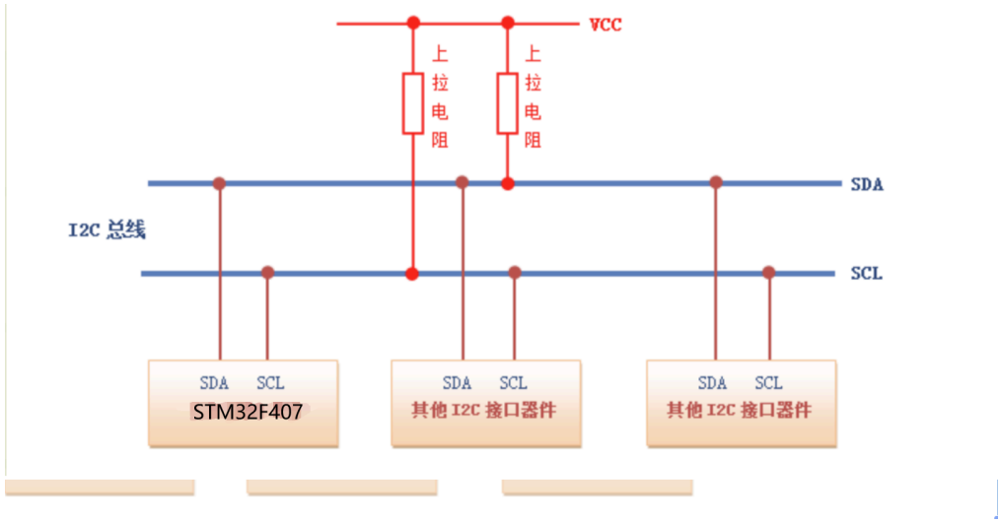

**注意：IIC 是为了与低速设备通信而发明的。**

| 功能特性 | 说明 |
| --- | --- |
| 模式选择(主/从模式) | 从发送器/从接收器/主发送器/主接收器 |
| 设备地址 | 产生和检测7位/10位地址和广播呼叫 |
| 仲裁机制 | 支持多个主机，同时通过仲裁机制防止多主机同时发起数据传输 |
| 通讯错误 | 总线错误/应答错误/仲裁丢失/过载/欠载错误 |
| 通讯速度 | 标准速度(高达100 kHz)，快速(高达400 kHz) |
| 中断和DMA | 2个中断，通讯成功和错误；单字节缓冲器的DMA |
| 兼容SMBus 2.0 | 系统管理总线(SMBus)是一个双线接口，它基于IIC操作原理 |

### 协议信号基本内容

> 📄 原课件 p.6

I2C 总线在传送数据过程中共有三种类型信号，它们分别是：开始信号、结束信号和应答信号。

- **开始信号**：SCL 为高电平时，SDA 由高电平向低电平跳变，开始传送数据。
- **结束信号**：SCL 为高电平时，SDA 由低电平向高电平跳变，结束传送数据。
- **应答信号**：接收数据的 IC 在接收到 8bit 数据后，向发送数据的 IC 发出特定的低电平脉冲，表示已收到数据，这个低电平就是 ACK 信号。CPU 向受控单元发出一个信号后，等待受控单元发出一个应答信号，CPU 接收到应答信号后，根据实际情况作出是否继续传递信号的判断。若未收到应答信号，由判断为受控单元出现故障。
- 这些信号中，起始信号是必需的，结束信号和应答信号，都可以不要。

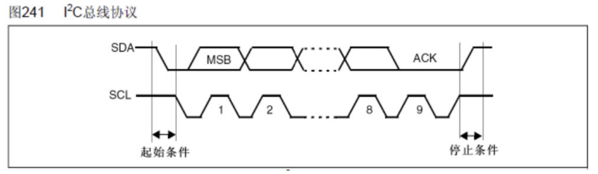

#### 地址

每一个 IIC 器件都有一个器件地址，有的器件地址在出厂时地址就设定好了，用户不可以更改，比如 OV7670 的地址为 0x42。有的器件例如 EEPROM，前四个地址已经确定为 1010，后三个地址是由硬件连接确定的，所以一 IIC 总线最多能连 8 个 EEPROM 芯片。

#### 主机从机

主机就是负责整个系统的任务协调与分配，从机一般是通过接收主机的指令从而完成某些特定的任务，主机和从机之间通过总线连接，进行数据通讯。

- 发布主要命令的称为主机。
- 接受命令的称为从机。

#### 时序与信号

> 📄 原课件 p.7

#### 空闲状态

指的是不传输任何数据的时候就被称为空闲状态，IIC 总线规定 SDA 数据线和 SCL 时钟线在不传输数据的时候都应该设置高电平，表示空闲。

#### 开始信号

SCL 保持高电平，SDA 由高电平变为低电平后，延时(>4.7us)，SCL 变为低电平。

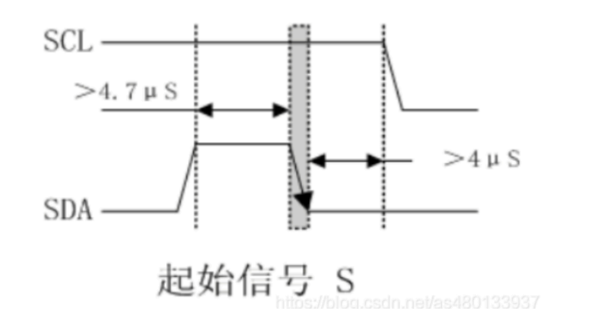

#### 停止信号

SCL 保持高电平。SDA 由低电平变为高电平。

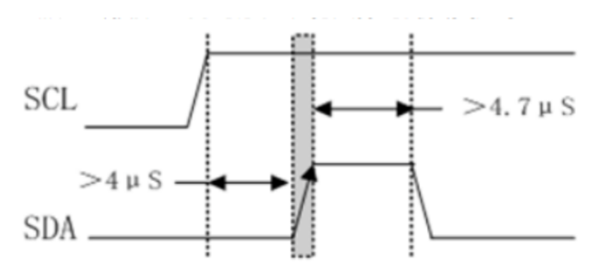

#### 数据信号

> 📄 原课件 p.8

在主机发送开始信号后，就可以发送数据或者地址，IIC 总线规定数据的收发都是 MSB（高位先出），由于只有一个数据线，所以 IIC 采用串行方式把数据的每个 bit 位发出去。

由于 SCL 提供的脉冲周期是有规律的，所以 IIC 总线规定只能在 SCL 脉冲周期的高电平期间进行数据的读取或者写入，在 SCL 脉冲周期的低电平期间可以进行数据的修改。

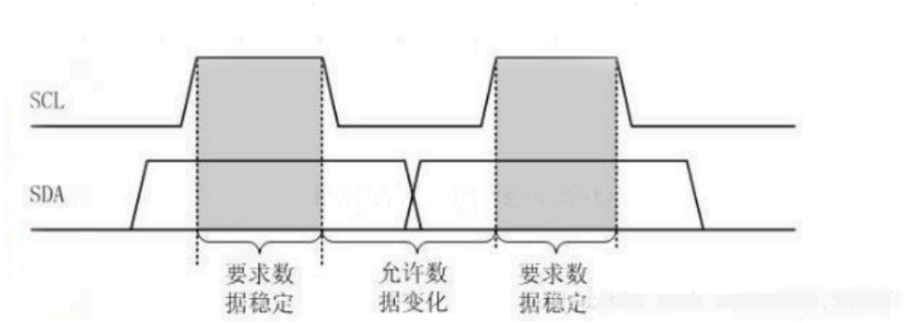

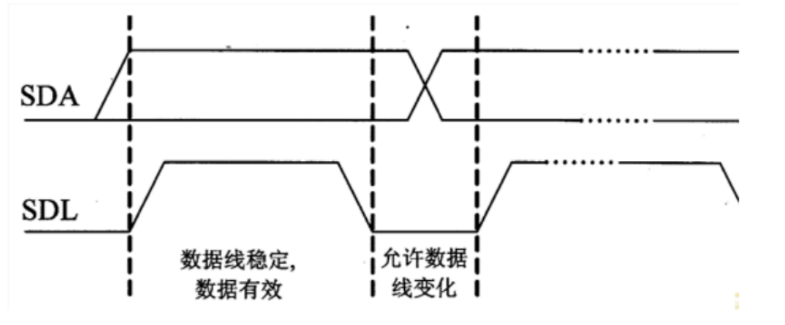

#### 应答信号

每当主机向从机发送完一个字节的数据，主机总是需要等待从机给出一个应答信号，以确认从机是否成功接收到了数据，

- 应答信号：主机 SCL 拉高，读取从机 SDA 的电平，为低电平表示产生应答。
- 应答信号为低电平时，规定为有效应答位（ACK，简称应答位），表示接收器已经成功地接收了该字节；
- 应答信号为高电平时，规定为非应答位（NACK），一般表示接收器接收该字节没有成功。

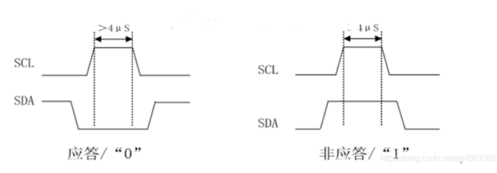

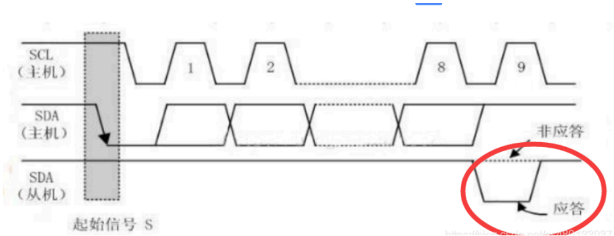

#### 一条完整的数据

> 📄 原课件 p.9

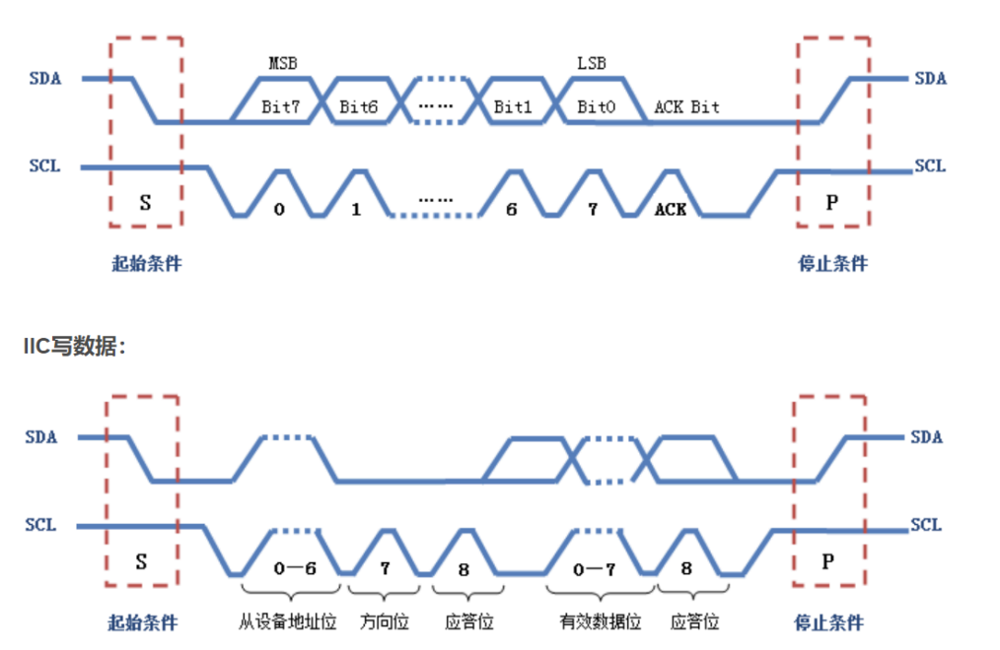

图中关键内容：

- 一条完整的数据：S（起始条件）→ Bit7（MSB）~ Bit0（LSB）共 8 位数据 → ACK Bit → P（停止条件）；SCL 依次给出 0、1 … 6、7、ACK 共 9 个时钟脉冲。
- IIC 写数据：S（起始条件）→ 从设备地址位（0–6）→ 方向位（7）→ 应答位（8）→ 有效数据位（0–7）→ 应答位（8）→ P（停止条件）。

## 小结与下一步

- 空闲中断 + 逐字节中断接收 + 中止接收回调构成串口不定长数据收发的完整链路，关键宏/函数：`__HAL_UART_CLEAR_IDLEFLAG`、`__HAL_UART_ENABLE_IT`、`HAL_UART_AbortReceive_IT`。
- I2C 以 SDA/SCL 两线实现半双工通信：空闲时两线均为高电平，S 为开始条件、P 为停止条件，7/10 位器件地址后跟 MSB 先出的数据位与第 9 位 ACK。
- 时序规定：数据只在 SCL 高电平期间读取，低电平期间允许修改；应答为低电平 ACK，非应答为高电平 NACK。

➡️ 下一课：[[14-STM32-IIC通信协议2-数据传输流程|STM32-IIC通信协议2-数据传输流程]]
