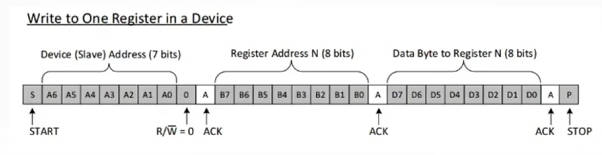
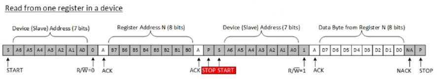
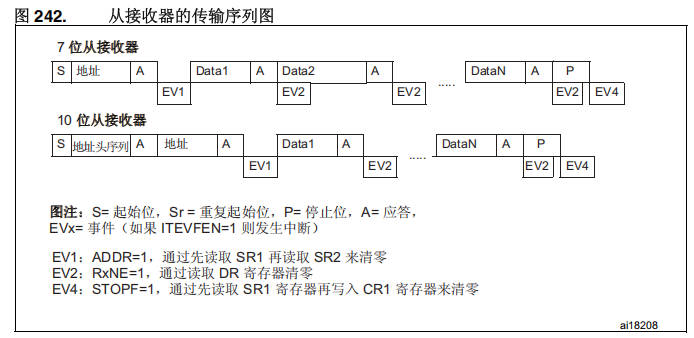
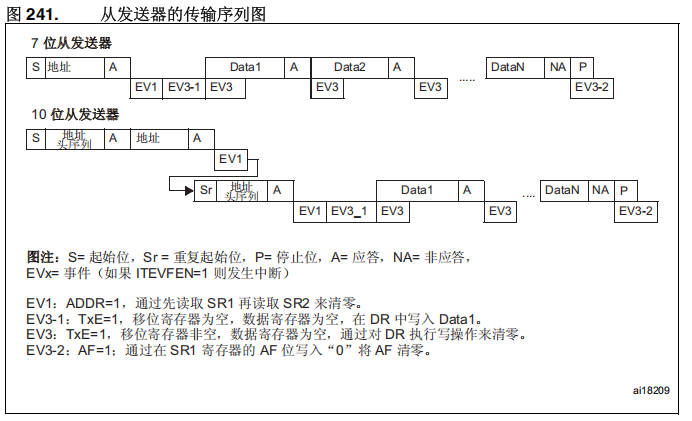
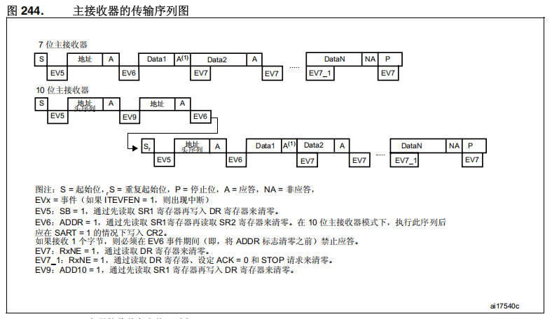
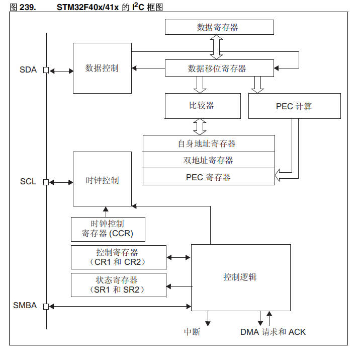

# 14 STM32-IIC通信协议2-数据传输流程

> 本课整理自 `STM32/14.STM32-IIC通信协议2-数据传输流程.pdf`（共 12 页）。返回 [[STM32学习目录|📑 STM32学习目录]]。

## 本章要点

- IIC 数据传输分"主机写、从机读"与"主机读、从机写"两种基本时序：START 起始 → 设备地址（7 bits）+ 读写位 → 逐字节 ACK → STOP 结束，读操作中间用重复起始（Sr）切换方向。
- IIC 默认工作在从模式（从接收/从发送），主模式是从模式主动切换过去的：需先配置时钟频率（标准 2MHz、快速 4MHz），再配置 `IIC_CCR`、`IIC_TRISE`，最后置 `IIC_CR1` 的 START 位产生起始条件。
- 常见通信错误：总线错误（BERR）、应答错误（AF）、仲裁丢失、过载/欠载错误，各有明确的触发条件、处理方式与中断标志。
- HAL 库以 `HAL_I2C_Mem_Write` / `HAL_I2C_Mem_Read` 阻塞模式完成内存读写，内部处理总线等待、地址阶段、1/2/3 字节接收的特殊 ACK/POS 时序与 STOP 生成。

## IIC通信协议-OLED屏幕

> 📄 原课件 p.1

### 细讲IIC通信流程

#### 主机写，从机读

主机向设备中的某一个寄存器写入数据（课件图：**Write to One Register in a Device**），一帧的组成如下：

| 阶段 | 位序列 | 说明 |
| --- | --- | --- |
| START | S | 起始条件 |
| 设备（从机）地址 | A6 A5 A4 A3 A2 A1 A0 + 0 | 7 bits 地址，R/W = 0（写） |
| 应答 | A | ACK |
| 寄存器地址 N | B7 B6 B5 B4 B3 B2 B1 B0 | 8 bits |
| 应答 | A | ACK |
| 数据字节 | D7 D6 D5 D4 D3 D2 D1 D0 | 写入寄存器 N 的数据，8 bits |
| 应答 | A | ACK |
| STOP | P | 停止条件 |



#### 主机读，从机写

主机从设备的某个寄存器读出数据（课件图：**Read from one register in a device**），先写寄存器地址、再重新起始读数据：

| 阶段 | 位序列 | 说明 |
| --- | --- | --- |
| START | S | 起始条件 |
| 设备（从机）地址 | A6…A0 + 0 | R/W = 0（写方向），随后 ACK |
| 寄存器地址 N | B7…B0 | 8 bits，随后 ACK |
| 停止 + 重复起始 | P → Sr | 图中标红 "STOP START" |
| 设备（从机）地址 | A6…A0 + 1 | R/W = 1（读方向），随后 ACK |
| 数据字节 | D7…D0 | 从寄存器 N 读出，8 bits |
| 非应答 | NA | NACK |
| STOP | P | 停止条件 |



### 从模式

从模式分为从发送模式和从接收模式，在默认情况下 IIC 就是在从模式下工作。主模式是从从模式主动切换过去的。

#### 从模式的工作模式

从模式的工作模式包括以下几种：

#### 标准模式

- 时钟配置：2MHz

#### 快速模式

- 时钟配置：4MHz

#### 从接收模式



图内文字转写（图 242 从接收器的传输序列图）：

- 7 位从接收器：`S 地址 A` → `Data1 A` → `Data2 A` → … → `DataN A P`，对应事件 EV1、EV2、…、EV2、EV4。
- 10 位从接收器：`S 地址头序列 A 地址 A` → `Data1 A` → … → `DataN A P`，对应事件 EV1、EV2、…、EV2、EV4。
- 图注：S = 起始位，Sr = 重复起始位，P = 停止位，A = 应答，EVx = 事件（如果 ITEVFEN = 1 则发生中断）。
- EV1：ADDR = 1，通过先读取 SR1 再读取 SR2 来清零。
- EV2：RxNE = 1，通过读取 DR 寄存器清零。
- EV4：STOPF = 1，通过先读取 SR1 寄存器再写入 CR1 寄存器来清零。

#### 从发送模式

若想确定当前设备是处于从发送还是从接收模式，可以获取 TRA 位来确定。



图内文字转写（图 241 从发送器的传输序列图）：

- 7 位从发送器：`S 地址 A` → `Data1 A` → `Data2 A` → … → `DataN NA P`，对应事件 EV1、EV3-1、EV3、EV3、…、EV3、EV3-2。
- 10 位从发送器：先 `S 地址头序列 A 地址 A`（EV1），重复起始后 `Sr 地址头序列 A` → `Data1 A` → … → `DataN NA P`，对应事件 EV1、EV3_1、EV3、…、EV3、EV3-2。
- 图注：S = 起始位，Sr = 重复起始位，P = 停止位，A = 应答，NA = 非应答，EVx = 事件（如果 ITEVFEN = 1 则发生中断）。
- EV1：ADDR = 1，通过先读取 SR1 再读取 SR2 来清零。
- EV3-1：TxE = 1，移位寄存器为空，数据寄存器为空，在 DR 中写入 Data1。
- EV3：TxE = 1，移位寄存器非空，数据寄存器为空，通过对 DR 执行写操作来清零。
- EV3-2：AF = 1；通过在 SR1 寄存器的 AF 位写入 "0" 将 AF 清零。

#### 如何切换到从发送模式

- 在进入到从接收模式后，就会匹配我们的 **主设备读，从设备写** 的信号流程，然后看是否能匹配上。
- 也就是先接收到一个与设备地址匹配的头序列并且读写位为 1，然后又接收到一个相同的起始条件，那么就会切换到从发送模式。

> 📄 原课件 p.3

### 主模式

当配置到主模式中，IIC 接口就会启动数据传输，同时产生时钟信号；当 start 位在总线上产生了起始条件，那么设备就进入到了主模式。主模式下一样，要先配置时钟频率。

#### 标准模式

- 时钟配置：2MHz

#### 快速模式

- 时钟配置：4MHz

#### 主模式的配置步骤

时钟频率配置完成后，按课件顺序继续配置：

1. 配置时钟控制寄存器（`IIC_CCR`）：这个寄存器就是区分当前模式是标准模式还是快速模式的，还有占空比、时钟配置、分频系数这些内容。
2. 之后配置上升事件寄存器（`IIC_TRISE`）：这个寄存器是用来配置 SCL 时钟引脚等，如果是标准模式下，那就是 1us。
3. 然后启动外设：通过 `IIC_CR1` 寄存器来启动外设，之后把 `IIC_CR1` 寄存器的 START 位设置为 1，产生起始条件。
4. 那么此时主模式的配置才算完成。

#### 主接收器接收流程

> 📄 原课件 p.4



图内文字转写（图 244 主接收器的传输序列图）：

- 7 位主接收器：`S 地址 A`（EV5、EV6）→ `Data1 A⁽¹⁾`（EV7）→ `Data2 A`（EV7）→ … → `DataN NA P`（EV7_1、EV7）。
- 10 位主接收器：先 `S 地址头序列 A`（EV5、EV9）→ `地址 A`（EV6），重复起始后 `Sr 地址头序列 A`（EV5、EV6）→ `Data1 A⁽¹⁾`（EV7）→ … → `DataN NA P`（EV7_1、EV7）。
- 图注（课件原文）：S = 起始位，S = 重复起始位（图中重复起始标为 Sᵣ），P = 停止位，A = 应答，NA = 非应答，EVx = 事件（如果 ITEVFEN = 1，则出现中断）。
- EV5：SB = 1，通过先读取 SR1 寄存器再写入 DR 寄存器来清零。
- EV6：ADDR = 1，通过先读取 SR1 寄存器再读取 SR2 寄存器来清零。在 10 位主接收器模式下，执行此序列后应在 SART = 1 的情况下写入 CR2。
- 如果接收 1 个字节，则必须在 EV6 事件期间（即，将 ADDR 标志清零之前）禁止应答。
- EV7：RxNE = 1，通过读取 DR 寄存器来清零。
- EV7_1：RxNE = 1，通过读取 DR 寄存器，设定 ACK = 0 和 STOP 请求来清零。
- EV9：ADD10 = 1，通过先读取 SR1 寄存器再写入 DR 寄存器来清零。

## IIC通信错误信息

### 总线错误

- **触发条件**：传输期间，检测到外部停止或总线错误。
- **处理方式**：
  - 从模式：
    - 开始信号：从设备认为是一个重启，等待地址或停止条件。
    - 停止信号：从设备按正常的停止条件操作，同时硬件释放总线。
    - 数据被丢弃，硬件释放总线。
  - 主模式：硬件不释放总线，同时不影响当前的传输状态。此时由软件决定是否要中止当前的传输。
  - 中断处理：BERR 位被置为 '1'；如果设置了 ITERREN 位，则产生一个中断。

### 应答错误

- **触发条件**：当接口检测到一个无应答位时，产生应答错误。
- **处理方式**：
  - AF 位被置位，如果设置了 ITERREN 位，则产生一个中断。
  - 收到一个 NACK 时，必须复位通讯：
    - 从模式：硬件释放总线。
    - 主模式：软件必须生成一个停止条件。

> 📄 原课件 p.5

### 仲裁丢失

- **触发条件**：当 IIC 接口检测到仲裁丢失时，产生仲裁丢失错误。
- **处理方式**：
  - 如果设置了 ITERREN 位，则产生一个中断。
  - 硬件释放总线。
  - 自动回到从模式。
  - 无法在同一个传输中响应它的从地址。

### 过载/欠载错误

#### 过载错误

- **触发条件**：在从模式下，IIC 接口正在接收数据时，当它已经接收到一个字节（RxNE = 1），但在 DR 寄存器中前一个字节数据还没有被读出，则发生过载错误。
- **处理方式**：
  - 最后接收的数据被丢弃。
  - 在过载错误时，软件应清除 RxNE 位，发送器应该重新发送最后一次发送的字节。

#### 欠载错误

- **触发条件**：在下一个字节到达之前，新的数据还没写入 DR 寄存器。
- **处理方式**：
  - 前一个字节将被重复发出。
  - 接收端应丢弃重复接收到的数据。

## IIC组成结构框图与工作流程

> 📄 原课件 p.6



框图（图 239）的组成：

- 左侧引脚：`SDA`、`SCL`、`SMBA` 三条总线接口。
- 数据通路：`数据寄存器` ↔ `数据移位寄存器`，移位寄存器向左经 `数据控制` 接到 SDA，向下接 `比较器` 与 `PEC 计算`。
- 地址与校验：`自身地址寄存器`、`双地址寄存器`、`PEC 寄存器`（与比较器、PEC 计算相连）。
- 时钟：`时钟控制`（接 SCL），由 `时钟控制寄存器（CCR）` 提供配置。
- 控制与状态：`控制寄存器（CR1 和 CR2）`、`状态寄存器（SR1 和 SR2）` 与 `控制逻辑` 交互。
- 输出：`中断`、`DMA 请求和 ACK`。

## 具体读写流程

课件给出 HAL 库中两个阻塞式内存读写函数的完整实现（带逐行注释），即 IIC 具体读写流程的落地代码：先完成总线等待、加锁、使能外设、状态与传输参数初始化，再发起地址阶段，最后按字节搬运数据并产生 STOP。

以下为 `HAL_I2C_Mem_Write`（原课件 p.6–p.8）：

```c
/**
@brief 以阻塞模式向指定内存地址写入指定长度的数据
@param hi2c 指向I2C_HandleTypeDef结构体的指针，该结构体包含指定I2C外设的配置信息
@param DevAddress 目标设备地址：数据手册中提供的7位设备地址值在调用本接口前必须左移一位（最低位补0，例如
0x3C设备地址应传入0x78）
@param MemAddress 内部内存地址（从设备寄存器地址）
@param MemAddSize 内存地址位宽（I2C_MEMADD_SIZE_8BIT：8位地址；I2C_MEMADD_SIZE_16BIT：16位地址）
@param pData 指向待发送数据缓冲区的指针
@param Size 需要发送的数据字节数
@param Timeout 超时等待时间（单位：毫秒）
@retval HAL状态（HAL_OK：操作成功；HAL_ERROR：通信错误；HAL_BUSY：外设忙；HAL_TIMEOUT：操作超时）
*/
// I2C内存写操作函数：向指定I2C设备的内部寄存器地址写入数据（阻塞模式）
HAL_StatusTypeDef HAL_I2C_Mem_Write(I2C_HandleTypeDef *hi2c, uint16_t DevAddress, uint16_t
MemAddress, uint16_t MemAddSize, uint8_t *pData, uint16_t Size, uint32_t Timeout)
{
    uint32_t tickstart = HAL_GetTick(); // 记录操作起始时间戳，用于后续超时判断
    assert_param(IS_I2C_MEMADD_SIZE(MemAddSize)); // 参数校验：检查内存地址尺寸是否合法（8/16位）

    if (hi2c->State == HAL_I2C_STATE_READY) // 检查I2C外设是否处于空闲状态
    {
        // 等待总线空闲（BUSY标志清零），防止总线冲突
        if (I2C_WaitOnFlagUntilTimeout(hi2c, I2C_FLAG_BUSY, SET, I2C_TIMEOUT_BUSY_FLAG,
tickstart) != HAL_OK)
        {
            return HAL_BUSY; // 总线忙超时，返回忙状态
        }

        __HAL_LOCK(hi2c); // 加锁：防止多任务/中断中重复调用导致状态混乱

        // 检查I2C外设是否已使能，未使能则开启
        if ((hi2c->Instance->CR1 & I2C_CR1_PE) != I2C_CR1_PE)
        {
            __HAL_I2C_ENABLE(hi2c); // 使能I2C外设
        }

        CLEAR_BIT(hi2c->Instance->CR1, I2C_CR1_POS); // 清除POS位：配置为标准模式（非10位地址模
式）

        hi2c->State = HAL_I2C_STATE_BUSY_TX; // 更新外设状态为“发送中”
        hi2c->Mode = HAL_I2C_MODE_MEM; // 设置操作模式为“内存操作”
        hi2c->ErrorCode = HAL_I2C_ERROR_NONE; // 清除错误标志

        // 初始化数据传输参数
        hi2c->pBuffPtr = pData; // 指向用户数据缓冲区
        hi2c->XferCount = Size; // 总传输字节数
        hi2c->XferSize = hi2c->XferCount; // 剩余待传字节数
        hi2c->XferOptions = I2C_NO_OPTION_FRAME; // 无特殊帧选项

        // 发送从设备地址 + 内存地址（写方向）
        if (I2C_RequestMemoryWrite(hi2c, DevAddress, MemAddress, MemAddSize, Timeout,
tickstart) != HAL_OK)
        {
            return HAL_ERROR; // 地址阶段失败，返回错误
        }

        // 主数据传输循环：逐字节发送用户数据
        while (hi2c->XferSize > 0U)
        {
            // 等待发送寄存器空（TXE=1），准备写入新数据
            if (I2C_WaitOnTXEFlagUntilTimeout(hi2c, Timeout, tickstart) != HAL_OK)
            {
                if (hi2c->ErrorCode == HAL_I2C_ERROR_AF) // 检测到应答失败（NACK）
                {
                    SET_BIT(hi2c->Instance->CR1, I2C_CR1_STOP); // 产生STOP条件终止传输
                }
                return HAL_ERROR;
            }

            hi2c->Instance->DR = *hi2c->pBuffPtr; // 将数据写入I2C数据寄存器（触发发送）
            hi2c->pBuffPtr++; // 缓冲区指针后移
            hi2c->XferSize--; // 剩余字节数减1
            hi2c->XferCount--; // 总计数减1

            // 双字节优化：若BTF标志置位（上一字节已移出且DR为空）且仍有数据
            if ((__HAL_I2C_GET_FLAG(hi2c, I2C_FLAG_BTF) == SET) && (hi2c->XferSize != 0U))
            {
                hi2c->Instance->DR = *hi2c->pBuffPtr; // 立即写入下一字节（减少等待）
                hi2c->pBuffPtr++;
                hi2c->XferSize--;
                hi2c->XferCount--;
            }
        }

        // 等待最后一个字节传输完成（BTF标志置位）
        if (I2C_WaitOnBTFFlagUntilTimeout(hi2c, Timeout, tickstart) != HAL_OK)
        {
            if (hi2c->ErrorCode == HAL_I2C_ERROR_AF)
            {
                SET_BIT(hi2c->Instance->CR1, I2C_CR1_STOP); // 应答失败时产生STOP
            }
            return HAL_ERROR;
        }

        SET_BIT(hi2c->Instance->CR1, I2C_CR1_STOP); // 产生STOP条件，结束I2C事务

        hi2c->State = HAL_I2C_STATE_READY; // 恢复外设为空闲状态
        hi2c->Mode = HAL_I2C_MODE_NONE; // 清除操作模式
        __HAL_UNLOCK(hi2c); // 解锁外设，允许后续操作
        return HAL_OK; // 操作成功
    }
    else
    {
        return HAL_BUSY; // 外设非空闲状态，直接返回忙
    }
}
```

> 📄 原课件 p.8–p.11

以下为 `HAL_I2C_Mem_Read`（原课件 p.8–p.11）：

```c
/**
@brief 以阻塞模式从指定内存地址读取指定长度的数据
@param hi2c 指向I2C_HandleTypeDef结构体的指针，该结构体包含指定I2C外设的配置信息
@param DevAddress 目标设备地址：数据手册中的7位设备地址值在调用本接口前必须左移一位（最低位补0）
@param MemAddress 内部内存地址（从设备寄存器地址）
@param MemAddSize 内存地址的位宽（8位或16位）
@param pData 指向数据缓冲区的指针（用于存储读取的数据）
@param Size 需要读取的数据字节数
@param Timeout 超时等待时间（单位：毫秒）
@retval HAL状态（HAL_OK：操作成功；HAL_ERROR：错误；HAL_BUSY：外设忙；HAL_TIMEOUT：超时）
*/
// I2C内存读操作函数：从指定I2C设备的内部寄存器地址读取数据（阻塞模式）
HAL_StatusTypeDef HAL_I2C_Mem_Read(I2C_HandleTypeDef *hi2c, uint16_t DevAddress, uint16_t
MemAddress, uint16_t MemAddSize, uint8_t *pData, uint16_t Size, uint32_t Timeout)
{
    uint32_t tickstart = HAL_GetTick(); // 记录操作起始时间戳，用于超时管理
    assert_param(IS_I2C_MEMADD_SIZE(MemAddSize)); // 参数校验：验证内存地址尺寸（8/16位）合法性

    if (hi2c->State == HAL_I2C_STATE_READY) // 检查I2C外设是否处于空闲状态
    {
        // 等待总线空闲（BUSY标志清零），防止总线冲突
        if (I2C_WaitOnFlagUntilTimeout(hi2c, I2C_FLAG_BUSY, SET, I2C_TIMEOUT_BUSY_FLAG,
tickstart) != HAL_OK)
        {
            return HAL_BUSY; // 总线忙超时，返回忙状态
        }

        __HAL_LOCK(hi2c); // 加锁：防止多任务/中断中重复调用导致状态混乱

        // 检查I2C外设是否已使能，未使能则开启
        if ((hi2c->Instance->CR1 & I2C_CR1_PE) != I2C_CR1_PE)
        {
            __HAL_I2C_ENABLE(hi2c); // 使能I2C外设
        }

        CLEAR_BIT(hi2c->Instance->CR1, I2C_CR1_POS); // 清除POS位：初始化为标准模式（后续根据数据
长度动态调整）

        hi2c->State = HAL_I2C_STATE_BUSY_RX; // 更新外设状态为"接收中"
        hi2c->Mode = HAL_I2C_MODE_MEM; // 设置操作模式为"内存操作"
        hi2c->ErrorCode = HAL_I2C_ERROR_NONE; // 清除错误标志

        // 初始化数据传输参数
        hi2c->pBuffPtr = pData; // 指向用户接收缓冲区
        hi2c->XferCount = Size; // 总接收字节数
        hi2c->XferSize = hi2c->XferCount; // 剩余待接收字节数
        hi2c->XferOptions = I2C_NO_OPTION_FRAME; // 无特殊帧选项

        // 发送从设备地址 + 内存地址（写方向），建立读取上下文
        if (I2C_RequestMemoryRead(hi2c, DevAddress, MemAddress, MemAddSize, Timeout,
tickstart) != HAL_OK)
        {
            return HAL_ERROR; // 地址阶段失败，返回错误
        }

        // ===== 关键：根据剩余接收字节数配置ACK/NACK和POS位（符合I2C协议时序要求）=====
        if (hi2c->XferSize == 0U) // 无数据需接收（异常情况）
        {
            __HAL_I2C_CLEAR_ADDRFLAG(hi2c); // 清除ADDR标志（释放总线）
            SET_BIT(hi2c->Instance->CR1, I2C_CR1_STOP); // 产生STOP条件
        }
        else if (hi2c->XferSize == 1U) // 仅接收1字节
        {
            CLEAR_BIT(hi2c->Instance->CR1, I2C_CR1_ACK); // 禁用ACK：接收前即发送NACK（协议要
求）
            __HAL_I2C_CLEAR_ADDRFLAG(hi2c); // 清除ADDR标志（触发NACK发送）
            SET_BIT(hi2c->Instance->CR1, I2C_CR1_STOP); // 清除ADDR后立即产生STOP
        }
        else if (hi2c->XferSize == 2U) // 接收2字节（特殊时序）
        {
            CLEAR_BIT(hi2c->Instance->CR1, I2C_CR1_ACK); // 禁用ACK（为最后一个字节准备）
            SET_BIT(hi2c->Instance->CR1, I2C_CR1_POS); // 启用POS位：使NACK在第二个字节移出后
发送
            __HAL_I2C_CLEAR_ADDRFLAG(hi2c); // 清除ADDR标志（启动接收）
        }
        else // 接收≥3字节
        {
            __HAL_I2C_CLEAR_ADDRFLAG(hi2c); // 清除ADDR标志（启动接收，保持ACK使能）
        }

        // ===== 主数据接收循环 =====
        while (hi2c->XferSize > 0U)
        {
            // 处理剩余1～3字节的特殊接收流程（协议关键时序）
            if (hi2c->XferSize <= 3U)
            {
                if (hi2c->XferSize == 1U) // 接收最后1字节
                {
                    if (I2C_WaitOnRXNEFlagUntilTimeout(hi2c, Timeout, tickstart) != HAL_OK)
                    return HAL_ERROR; // 等待数据寄存器非空超时
                    *hi2c->pBuffPtr = (uint8_t)hi2c->Instance->DR; // 读取数据（自动触发STOP）
                    hi2c->pBuffPtr++; hi2c->XferSize--; hi2c->XferCount--;
                }
                else if (hi2c->XferSize == 2U) // 接收最后2字节
                {
                    // 等待BTF（字节传输完成）：表示第一个字节已移入DR，第二个字节在移位寄存器
                    if (I2C_WaitOnFlagUntilTimeout(hi2c, I2C_FLAG_BTF, RESET, Timeout,
tickstart) != HAL_OK)
                    return HAL_ERROR;
                    SET_BIT(hi2c->Instance->CR1, I2C_CR1_STOP); // 产生STOP（在读取第二个字节
前）
                    *hi2c->pBuffPtr++ = (uint8_t)hi2c->Instance->DR; // 读取第一个字节
                    hi2c->XferSize--; hi2c->XferCount--;
                    *hi2c->pBuffPtr++ = (uint8_t)hi2c->Instance->DR; // 读取第二个字节（触发
STOP生效）
                    hi2c->XferSize--; hi2c->XferCount--;
                }
                else // 接收最后3字节
                {
                    // 等待BTF：前两个字节已传输完成
                    if (I2C_WaitOnFlagUntilTimeout(hi2c, I2C_FLAG_BTF, RESET, Timeout,
tickstart) != HAL_OK)
                    return HAL_ERROR;
                    CLEAR_BIT(hi2c->Instance->CR1, I2C_CR1_ACK); // 禁用ACK（为最后一个字节准
备）
                    *hi2c->pBuffPtr++ = (uint8_t)hi2c->Instance->DR; // 读取第一个字节
                    hi2c->XferSize--; hi2c->XferCount--;

                    // 等待BTF：第二个字节已移入DR
                    if (I2C_WaitOnFlagUntilTimeout(hi2c, I2C_FLAG_BTF, RESET, Timeout,
tickstart) != HAL_OK)
                    return HAL_ERROR;
                    SET_BIT(hi2c->Instance->CR1, I2C_CR1_STOP); // 产生STOP（在读取第三个字节
前）
                    *hi2c->pBuffPtr++ = (uint8_t)hi2c->Instance->DR; // 读取第二个字节
                    hi2c->XferSize--; hi2c->XferCount--;
                    *hi2c->pBuffPtr++ = (uint8_t)hi2c->Instance->DR; // 读取第三个字节（触发
STOP生效）
                    hi2c->XferSize--; hi2c->XferCount--;
                }
            }
            else // 接收≥4字节的常规流程
            {
                // 等待RXNE：数据寄存器非空
                if (I2C_WaitOnRXNEFlagUntilTimeout(hi2c, Timeout, tickstart) != HAL_OK)
                return HAL_ERROR;
                *hi2c->pBuffPtr++ = (uint8_t)hi2c->Instance->DR; // 读取数据（自动发送ACK）
                hi2c->XferSize--; hi2c->XferCount--;

                // BTF优化：当移位寄存器和DR均满时，预读取下一字节提升效率
                if (__HAL_I2C_GET_FLAG(hi2c, I2C_FLAG_BTF) == SET)
                {
                    // 若剩余3字节，提前禁用ACK（为最后字节做准备）
                    if (hi2c->XferSize == 3U)
                    CLEAR_BIT(hi2c->Instance->CR1, I2C_CR1_ACK);
                    *hi2c->pBuffPtr++ = (uint8_t)hi2c->Instance->DR; // 读取预载数据
                    hi2c->XferSize--; hi2c->XferCount--;
                }
            }
        }

        // 恢复外设状态
        hi2c->State = HAL_I2C_STATE_READY; // 恢复为空闲状态
        hi2c->Mode = HAL_I2C_MODE_NONE; // 清除操作模式
        __HAL_UNLOCK(hi2c); // 解锁外设
        return HAL_OK; // 操作成功
    }
    else
    {
        return HAL_BUSY; // 外设非空闲状态，直接返回忙
    }
}
```

## 小结与下一步

- 两种基本时序：写操作为 `S → 设备地址+0 → ACK → 寄存器地址 → ACK → 数据 → ACK → P`；读操作先写寄存器地址，再以重复起始按 R/W = 1 读数据，最后 NACK + STOP。
- 主从模式切换：默认从模式，通过匹配"主设备读、从设备写"的头序列与重复起始条件切入从发送模式；主模式靠配置 `IIC_CCR`/`IIC_TRISE` 并置 START 位进入。
- 四类错误（BERR、AF、仲裁丢失、过载/欠载）都有明确触发条件与恢复动作，收到 NACK 必须复位通讯。
- 代码层面，`HAL_I2C_Mem_Write`/`HAL_I2C_Mem_Read` 用 BUSY/TXE/RXNE/BTF 等标志 + 超时管理完成读写，接收时按剩余字节数（0/1/2/3/≥4）配置 ACK、POS 与 STOP。

➡️ 下一课：[[15-STM32-IIC通信-at24c02-OLED屏幕-RTC实时时钟|STM32-IIC通信-at24c02-OLED屏幕-RTC实时时钟]]
