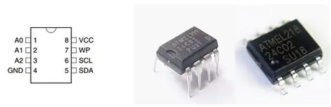
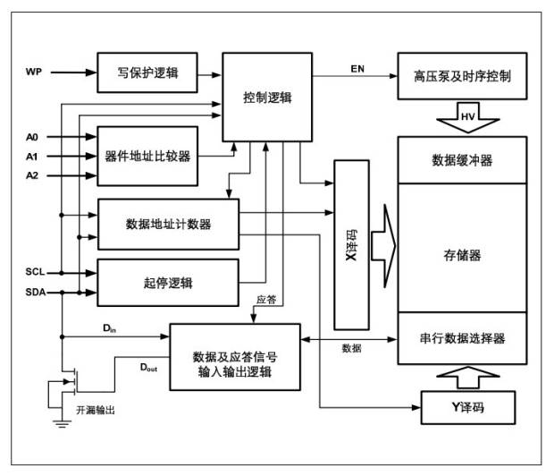
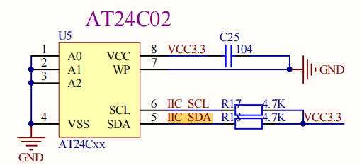
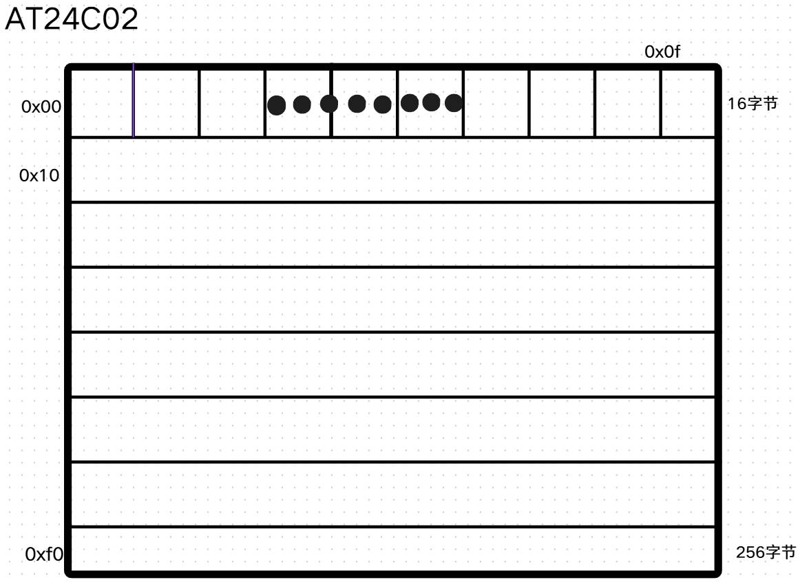
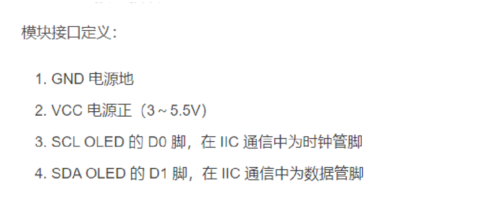
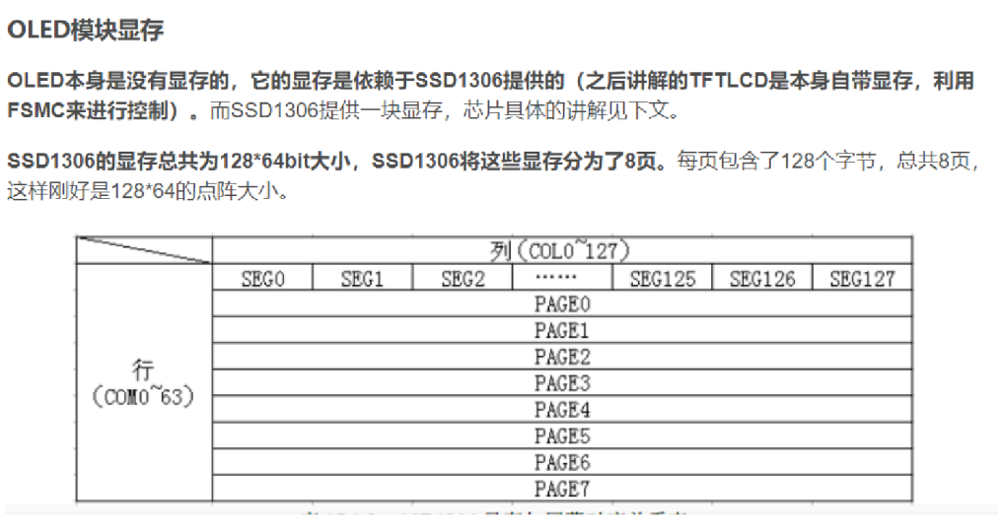

# 15 STM32-IIC通信-at24c02-OLED屏幕-RTC实时时钟

> 本课整理自 `实践课-IIC通信-at24c02-OLED屏幕-RTC实时时钟.pdf`(共 13 页)。返回 [[STM32学习目录|📑 STM32学习目录]]。

## 本章要点

- 24C02 是 2K Bit 的串行 EEPROM 存储器(掉电不丢失),内部含 256 个字节与一个 8 字节页写缓冲器;芯片地址为 1010 A2 A1 A0,写命令 `0xa0`、读命令 `0xa1`。
- A0/A1/A2 为硬件地址引脚,一个 IIC 总线上能挂载的 AT24C02 数量为 8 个;片内寻址范围 00~FF,共 256 个寻址单位。
- OLED 由 SSD1306 驱动,显存共 128*64bit、分为 8 页(每页 128 字节);模块接口为 GND/VCC/SCL/SDA 四线。
- OLED 驱动的底层是 `HAL_I2C_Mem_Write`:写命令用设备地址 `0x78`+寄存器地址 `0x00`,写数据用 `0x78`+`0x40`,其上再封装初始化、清屏与字符/汉字/数字/位图显示函数。
- RTC 部分用 `HAL_RTC_GetTime`/`HAL_RTC_GetDate` 获取时间日期,格式化后用 `OLED_ShowString` 显示,完成电子钟效果。
- 两道作业:实现 AT24C02 跨页写函数 `AT24C02_WriteBytesPro`,以及用 OLED 屏幕显示自己的名字。

## EEPROM - AT24C02

24C02 是一个 2K Bit 的串行 EEPROM 存储器(掉电不丢失),内部含有 256 个字节。在 24C02 里面有一个 8 字节的页写缓冲器。




- A0,A1,A2:硬件地址引脚
- WP:写保护引脚,接高电平只读,接地允许读和写
- SCL和SDA:IIC总线
- VCC和GND:电源线和地线



### AT24C02地址

> 📄 原课件 p.2

AT24C02的芯片地址为1010,其地址控制字格式为1 0 1 0 A2 A1 A0。



所以我们的地址为1 0 1 0 0 0 0

写命令:1 0 1 0 0 0 0 0 -> 0xa0

读命令:1 0 1 0 0 0 0 1 -> 0xa1

> 📄 原课件 p.3

从这里也能看出来一个IIC总线上,能够挂载的AT24C02的数量为8个

### 读写方式

> 📄 原课件 p.3

#### 片内寻址

芯片寻址可对内部256B中的任一个进行读/写操作,其寻址范围为00~FF,共256个寻址单位。

24C02是一个2K Bit的串行EEPROM存储器(掉电不丢失),内部含有256个字节。在24C02里面有一个8字节的页写缓冲器。

2 * 1024 / 8 = 256字节。



## OLED屏幕

> 📄 原课件 p.3 起

OLED,即有机发光二极管(Organic Light-Emitting Diode),又称为有机电激光显示(Organic Electroluminesence Display,OELD)。OLED由于同时具备自发光,不需背光源、对比度高、厚度薄、视角广、反应速度快、可用于挠曲性面板、使用温度范围广、构造及制程较简单等优异之特性,被认为是下一代的平面显示器新兴应用技术。

引脚说明:



图中文字:

1. GND 电源地
2. VCC 电源正(3~5.5V)
3. SCL OLED 的 D0 脚,在 IIC 通信中为时钟管脚
4. SDA OLED 的 D1 脚,在 IIC 通信中为数据管脚

**OLED模块显存**

OLED本身是没有显存的,它的显存是依赖于SSD1306提供的(之后讲解的TFTLCD是本身自带显存,利用FSMC来进行控制)。而SSD1306提供一块显存,芯片具体的讲解见下文。

SSD1306的显存总共为128*64bit大小,SSD1306将这些显存分为了8页。每页包含了128个字节,总共8页,这样刚好是128*64的点阵大小。



### OLED屏幕驱动详解

> 📄 原课件 p.4–p.11(以下为贯穿多页的驱动源码截图转写)

```c
#include "oled.h"
#include "oledfont.h"

// 初始化命令序列（注释掉未使用的数组）
uint8_t CMD_Data[] = {
    0xAE, 0x00, 0x10, 0x40, 0x81, 0xCF, 0xA1, 0xC8, 0xA6, 0xA8, 0x3f,
    0xD3, 0x00, 0xD5, 0x80, 0xD9, 0xF1, 0xDA, 0x12, 0xDB, 0x40, 0x20,
    0x02, 0x8D, 0x14, 0xA4, 0xA6, 0xAF
};

// 内置汉字字模数据（16x16点阵，每个汉字32字节）
unsigned char Hzk[][16] = {
    {0x04,0xE4,0xA4,0xA4,0xBF,0xA4,0xA6,0xE4,0x48,0x48,0xFF,0x48,0x68,0x4C,0x08,0x00},
    {0x10,0x13,0x12,0x12,0xFE,0x12,0x12,0x1B,0x12,0x02,0xFF,0x02,0x12,0x22,0x1E,0x00},
    {0x00,0x80,0xC0,0xBC,0x84,0x84,0x84,0xF4,0x82,0x82,0x83,0x82,0x80,0xC0,0x80,0x00},
    {0x00,0x40,0x20,0x10,0x0C,0x40,0x80,0x7F,0x00,0x00,0x04,0x08,0x30,0x60,0x00,0x00},
    {0x00,0xFE,0x22,0xFE,0x00,0xFE,0x22,0xFE,0x00,0xFC,0x06,0x55,0x84,0x7E,0x04,0x00},
    {0x40,0x3F,0x02,0x3F,0x40,0x3F,0x42,0x7F,0x10,0x13,0x12,0x12,0x5A,0x92,0x7E,0x00},
};

// OLED初始化命令配置函数
void WriteCmd()
{
    // 以下为OLED模块初始化命令序列（SSD1306控制器）
    OLED_WR_CMD(0xAE); // 关闭OLED显示
    OLED_WR_CMD(0x20); // 设置内存寻址模式
    OLED_WR_CMD(0x10); // 水平寻址模式
    OLED_WR_CMD(0xb0); // 设置页起始地址0
    OLED_WR_CMD(0xc8); // 设置COM输出扫描方向：从下到上
    OLED_WR_CMD(0x00); // 设置低列地址
    OLED_WR_CMD(0x10); // 设置高列地址
    OLED_WR_CMD(0x40); // 设置显示起始行地址
    OLED_WR_CMD(0x81); // 设置对比度控制寄存器
    OLED_WR_CMD(0xff); // 设置最高对比度
    OLED_WR_CMD(0xa1); // 设置段重映射：列地址127映射到SEG0
    OLED_WR_CMD(0xa6); // 设置正常显示（非反色）
    OLED_WR_CMD(0xa8); // 设置多路复用比率
    OLED_WR_CMD(0x3f); // 设置多路复用比率为64
    OLED_WR_CMD(0xa4); // 显示遵循GRAM内容
    OLED_WR_CMD(0xd3); // 设置显示偏移
    OLED_WR_CMD(0x00); // 无偏移
    OLED_WR_CMD(0xd5); // 设置显示时钟分频因子
    OLED_WR_CMD(0x80); // 设置分频比
    OLED_WR_CMD(0xd9); // 设置预充电周期
    OLED_WR_CMD(0xf1); // 设置预充电值
    OLED_WR_CMD(0xda); // 设置COM引脚硬件配置
    OLED_WR_CMD(0x12); // 设置COM配置
    OLED_WR_CMD(0xdb); // 设置VCOMH电平
    OLED_WR_CMD(0x40); // 设置VCOMH电平值
    OLED_WR_CMD(0x8d); // 设置电荷泵
    OLED_WR_CMD(0x14); // 启用电荷泵
    OLED_WR_CMD(0xaf); // 开启OLED显示
}

// 设置OLED垂直滚动
void OLED_ver_scroll()
{
    OLED_WR_CMD(0x2e); // 禁用滚动
    OLED_WR_CMD(0x27); // 设置向右水平滚动
    OLED_WR_CMD(0x00); // 虚拟字节
    OLED_WR_CMD(0x02); // 水平滚动起始页
    OLED_WR_CMD(0x07); // 滚动速度
    OLED_WR_CMD(0x03); // 水平滚动结束页
    OLED_WR_CMD(0x00); // 垂直滚动位移0
    OLED_WR_CMD(0xFF); // 垂直滚动位移最大
    OLED_WR_CMD(0x2f); // 启用滚动
}
```

```c
// 通过I2C向OLED写入命令
void OLED_WR_CMD(uint8_t cmd)
{
    // I2C写命令：设备地址0x78，寄存器地址0x00，命令值cmd
    HAL_I2C_Mem_Write(&hi2c1, 0x78, 0x00, I2C_MEMADD_SIZE_8BIT, &cmd, 1, 0x100);
}

// 通过I2C向OLED写入数据
void OLED_WR_DATA(uint8_t data)
{
    // I2C写数据：设备地址0x78，寄存器地址0x40，数据值data
    HAL_I2C_Mem_Write(&hi2c1, 0x78, 0x40, I2C_MEMADD_SIZE_8BIT, &data, 1, 0x100);
}

// OLED初始化函数
void OLED_Init(void)
{
    HAL_Delay(500); // 延时500ms等待电源稳定
    WriteCmd(); // 发送初始化命令序列
}

// 清除整个OLED屏幕
void OLED_Clear()
{
    uint8_t i, n;
    // 8页全部清零（128x64 OLED共有8页）
    for(i = 0; i < 8; i++)
    {
        OLED_WR_CMD(0xb0 + i); // 设置页地址
        OLED_WR_CMD(0x00); // 设置列低地址
        OLED_WR_CMD(0x10); // 设置列高地址
        // 128列全部写入0（清除）
        for(n = 0; n < 128; n++)
            OLED_WR_DATA(0x00);
    }
}

// 清除单行（页）
void OLED_Clearrow(uint8_t i)
{
    uint8_t n;
    OLED_WR_CMD(0xb0 + i); // 设置页地址
    OLED_WR_CMD(0x20); // 设置列起始地址低字节
    OLED_WR_CMD(0x00); // 设置列起始地址高字节
    // 128列全部写入0（清除）
    for(n = 0; n < 128; n++)
        OLED_WR_DATA(0x00);
}

// 开启OLED显示
void OLED_Display_On(void)
{
    OLED_WR_CMD(0X8D); // 电荷泵配置命令
    OLED_WR_CMD(0X14); // 开启电荷泵
    OLED_WR_CMD(0XAF); // 开启显示
}

// 关闭OLED显示
void OLED_Display_Off(void)
{
    OLED_WR_CMD(0X8D); // 电荷泵配置命令
    OLED_WR_CMD(0X10); // 关闭电荷泵
    OLED_WR_CMD(0XAE); // 关闭显示
}

// 设置OLED显示位置
void OLED_Set_Pos(uint8_t x, uint8_t y)
{
    OLED_WR_CMD(0xb0 + y); // 设置页地址（0-7）
    OLED_WR_CMD(((x & 0xf0) >> 4) | 0x10); // 设置列高地址
    OLED_WR_CMD((x & 0x0f) | 0x01); // 设置列低地址
}

// 全屏初始化（清屏）
void OLED_On(void)
{
    uint8_t i, n;
    // 8页全部清零
    for(i = 0; i < 8; i++)
    {
        OLED_WR_CMD(0xb0 + i); // 设置页地址
        OLED_WR_CMD(0x00); // 设置列低地址
        OLED_WR_CMD(0x10); // 设置列高地址
        // 128列全部写入0
        for(n = 0; n < 128; n++)
            OLED_WR_DATA(0x00);
    }
}

// 全屏填充指定数据
void OLED_Fill(unsigned char fill_Data)
{
    unsigned char m, n;
    // 遍历所有8页
    for(m = 0; m < 8; m++)
    {
        OLED_WR_CMD(0xb0 + m); // 设置页地址
        OLED_WR_CMD(0x00); // 设置列低地址
        OLED_WR_CMD(0x10); // 设置列高地址
        // 128列全部写入fill_Data
        for(n = 0; n < 128; n++)
        {
            OLED_WR_DATA(fill_Data);
        }
    }
}
```

```c
// 显示字符串
void OLED_ShowStr(unsigned char x, unsigned char y, unsigned char ch[], unsigned char TextSize)
{
    unsigned char c = 0, i = 0, j = 0;
    // 根据字体大小选择显示模式
    switch(TextSize)
    {
        case 1: // 6x8字体
        {
            while(ch[j] != '\0')
            {
                c = ch[j] - 32; // 获取ASCII字符在字库中的索引
                // 自动换行处理
                if(x > 126)
                {
                    x = 0;
                    y++;
                }
                OLED_Set_Pos(x, y); // 设置显示位置
                // 逐列显示6x8字符
                for(i = 0; i < 6; i++)
                    OLED_WR_DATA(F6x8[c][i]);
                x += 6; // 水平移动6像素
                j++; // 下一个字符
            }
        } break;
        case 2: // 8x16字体
        {
            while(ch[j] != '\0')
            {
                c = ch[j] - 32; // 获取ASCII字符在字库中的索引
                // 自动换行处理
                if(x > 120)
                {
                    x = 0;
                    y++;
                }
                OLED_Set_Pos(x, y); // 设置上半部分位置
                // 显示8x16字符的上半部分
                for(i = 0; i < 8; i++)
                    OLED_WR_DATA(F8x16[c * 16 + i]);
                OLED_Set_Pos(x, y + 1); // 设置下半部分位置
                // 显示8x16字符的下半部分
                for(i = 0; i < 8; i++)
                    OLED_WR_DATA(F8x16[c * 16 + i + 8]);
                x += 8; // 水平移动8像素
                j++; // 下一个字符
            }
        } break;
    }
}
```

```c
// 显示16x16汉字
void OLED_ShowCN(unsigned char x, unsigned char y, unsigned char N)
{
    unsigned char wm = 0;
    unsigned int adder = 32 * N; // 计算汉字在字库中的起始位置
    OLED_Set_Pos(x, y); // 设置上半部分位置
    // 显示汉字上半部分
    for(wm = 0; wm < 16; wm++)
    {
        OLED_WR_DATA(F16x16[adder]);
        adder += 1;
    }
    OLED_Set_Pos(x, y + 1); // 设置下半部分位置
    // 显示汉字下半部分
    for(wm = 0; wm < 16; wm++)
    {
        OLED_WR_DATA(F16x16[adder]);
        adder += 1;
    }
}

// 显示BMP位图
void OLED_DrawBMP(unsigned char x0, unsigned char y0, unsigned char x1, unsigned char y1,
unsigned char BMP[])
{
    unsigned int j = 0;
    unsigned char x, y;
    // 计算需要处理的页数
    if(y1 % 8 == 0)
        y = y1 / 8;
    else
        y = y1 / 8 + 1;
    // 从起始页到结束页
    for(y = y0; y < y1; y++)
    {
        OLED_Set_Pos(x0, y); // 设置起始位置
        // 逐列显示位图数据
        for(x = x0; x < x1; x++)
        {
            OLED_WR_DATA(BMP[j++]);
        }
    }
}

// 清屏（调用填充函数）
void OLED_CLS(void)
{
    OLED_Fill(0x00); // 全屏填充0（黑色）
}

// 计算幂函数（用于数字显示）
unsigned int oled_pow(uint8_t m, uint8_t n)
{
    unsigned int result = 1;
    // 计算m的n次方
    while(n--)
        result *= m;
    return result;
}

// 在指定位置显示单个字符
void OLED_ShowChar(uint8_t x, uint8_t y, uint8_t chr, uint8_t Char_Size)
{
    unsigned char c = 0, i = 0;
    c = chr - ' '; // 获取字符在字库中的索引
    // 边界检查，超出右边界则换行
    if(x > 128 - 1)
    {
        x = 0;
        y = y + 2;
    }
    // 根据字体大小选择显示方式
    if(Char_Size <= 16) // 8x16字体
    {
        OLED_Set_Pos(x, y); // 设置上半部分位置
        // 显示上半部分
        for(i = 0; i < 8; i++)
            OLED_WR_DATA(F8x16[c * 16 + i]);
        OLED_Set_Pos(x, y + 1); // 设置下半部分位置
        // 显示下半部分
        for(i = 0; i < 8; i++)
            OLED_WR_DATA(F8x16[c * 16 + i + 8]);
    }
    else // 6x8字体
    {
        OLED_Set_Pos(x, y); // 设置位置
        // 显示6x8字符
        for(i = 0; i < 6; i++)
            OLED_WR_DATA(F6x8[c][i]);
    }
}

// 显示数字
void OLED_ShowNum(uint8_t x, uint8_t y, unsigned int num, uint8_t len, uint8_t size2)
{
    uint8_t t, temp;
    uint8_t enshow = 0; // 标志是否已显示非零数字
    // 从高位到低位显示数字
    for(t = 0; t < len; t++)
    {
        // 获取当前位的数字
        temp = (num / oled_pow(10, len - t - 1)) % 10;
        // 前导零处理
        if(enshow == 0 && t < (len - 1))
        {
            if(temp == 0)
            {
                // 前导零显示为空格
                OLED_ShowChar(x + (size2 / 2) * t, y, ' ', size2);
                continue;
            }
            else
                enshow = 1; // 遇到非零数字，设置标志
        }
        // 显示当前位数字
        OLED_ShowChar(x + (size2 / 2) * t, y, temp + '0', size2);
    }
}

// 显示字符串
void OLED_ShowString(uint8_t x, uint8_t y, uint8_t *chr, uint8_t Char_Size)
{
    unsigned char j = 0;
    // 遍历字符串直到结束符
    while(chr[j] != '\0')
    {
        OLED_ShowChar(x, y, chr[j], Char_Size); // 显示当前字符
        x += 8; // 水平移动8像素（字符宽度）
        // 自动换行处理
        if(x > 120)
        {
            x = 0;
            y += 2; // 移动到下两行（8x16字体高度）
        }
        j++; // 下一个字符
    }
}

// 显示内置汉字
void OLED_ShowCHinese(uint8_t x, uint8_t y, uint8_t no)
{
    uint8_t t, adder = 0;
    OLED_Set_Pos(x, y); // 设置上半部分位置
    // 显示汉字上半部分
    for(t = 0; t < 16; t++)
    {
        OLED_WR_DATA(Hzk[2 * no][t]);
        adder += 1;
    }
    OLED_Set_Pos(x, y + 1); // 设置下半部分位置
    // 显示汉字下半部分
    for(t = 0; t < 16; t++)
    {
        OLED_WR_DATA(Hzk[2 * no + 1][t]);
        adder += 1;
    }
}
```

## RTC时钟

> 📄 原课件 p.12

下面这段代码先初始化并清屏 OLED,再读取 RTC 时间/日期,串口打印并格式化后显示到 OLED 屏幕:

```c
OLED_Init();
OLED_Clear();

HAL_RTC_GetTime(&hrtc,&RtcTime,RTC_FORMAT_BIN);//获取时间
    HAL_RTC_GetDate(&hrtc,&RtcData,RTC_FORMAT_BIN);//获取日期

    printf("time:%2d:%2d:%2d \r\n",RtcTime.Hours,RtcTime.Minutes,RtcTime.Seconds);
    printf("data:%4d.%2d.%2d ",2000+RtcData.Year,RtcData.Month,RtcData.Date);

    sprintf((char*)RTtim,"%02d:%02d:%02d",RtcTime.Hours,RtcTime.Minutes,RtcTime.Seconds);
    sprintf((char*)RTday,"%02d:%02d:%02d",2000+RtcData.Year,RtcData.Month,RtcData.Date);

    OLED_ShowString(1,1,RTtim,2);
    OLED_ShowString(1,3,RTday,2);

    HAL_Delay(10);
```

## 作业

- 作业1:at24c02,跨页写,的函数实现

```c
void AT24C02_WriteBytesPro(uint8_t innerAddr ,uint8_t* byte ,uint8_t size);
```

- 作业2:OLED屏幕显示自己的名字

## 小结与下一步

- 本课以 IIC 总线为主线:AT24C02 的器件地址(写 `0xa0`/读 `0xa1`)、片内 256 字节寻址与 8 字节页写缓冲,一片总线上最多挂 8 片。
- OLED 驱动自底向上分层:I2C 写命令(`0x78`/`0x00`)与写数据(`0x78`/`0x40`)→ SSD1306 初始化命令序列 → 清屏/定位 → 字符、汉字、数字、位图显示接口。
- RTC 实时时间经 `HAL_RTC_GetTime`/`HAL_RTC_GetDate` 读取并格式化,用 `OLED_ShowString` 显示;两道作业分别巩固 AT24C02 跨页写与 OLED 显示。

➡️ 下一课:[[16-STM32-SPI-通信接口|STM32-SPI-通信接口]]
