# 16 STM32-SPI-通信接口

> 本课整理自 `16、STM32-SPI-通信接口.pdf`（共 10 页）。返回 [[STM32学习目录|📑 STM32学习目录]]。

## 本章要点

- SPI 是高速、全双工、同步的串行外围设备接口，芯片引脚上只占四根线（`NSS/CS`、`SCK`、`MISO`、`MOSI`），STM32F4 有 3 个 SPI 接口，时钟最高 37.5MHz，支持 DMA，可配置为 SPI 或 I2S 协议。
- SPI 通信结构为一主多从：时钟由主机产生，每个从机都有独立片选；既支持全双工，也支持单工、半双工通信。
- CPOL 决定空闲时时钟线电平（0 低 / 1 高），CPHA 决定在第几个时钟边沿采样数据，两者共同决定 SPI 的工作时序。
- 收发过程围绕 `SPI_DR` 与 `TXE`/`RXNE`/`BSY` 标志展开：软件等 `TXE=1` 写发送缓冲，等 `RXNE=1` 读接收缓冲，`BSY` 由硬件置位/复位。
- 按用线数量不同分为 Standard SPI、Dual SPI（DSPI）、Quad SPI（QSPI）；SPI 的缺陷是占用 IO 多、没有流控制与应答机制。

## SPI的功能、特性、原理

### SPI整体介绍

- SPI 顾名思义就是串行外围设备接口。SPI 接口主要应用在 EEPROM，FLASH，实时时钟，AD 转换器，还有数字信号处理器和数字信号解码器之间。
- SPI，是一种高速的，全双工，同步的通信总线，并且在芯片的引脚上只占用四根线，节约了芯片的管脚，同时为 PCB 的布局上节省空间，提供方便，正是出于这种简单易用的特性，现在越来越多的芯片集成了这种通信协议，STM32F4 也有 3 个 SPI 接口。
- SPI 速度：几兆到几十兆不等。STM32F4 的 SPI 功能很强大，SPI 时钟最高可以到 37.5MHz，支持 DMA，可以配置为 SPI 协议或者 I2S 协议（支持全双工 I2S）。
- SPI 是一种适用于短距离、设备到设备的高速全双工通信接口，同时支持单工、半双工通信，通信结构为一主多从，硬件接口上通常由 4 根信号线组成。

4 条线（4 个信号）：

- `NSS/CS`：主机片选从机使能信号，通常低电平有效由主机控制（软件/硬件两种方式）；
- `SCK`：时钟信号，主设备输出，产生用于控制数据交换的时基以及速率；
- `MISO`：主机输入，从机输出，用于主设备接收数据；
- `MOSI`：主机输出，从机输入，用于主设备发送数据。

### 通讯接口

#### 单设备与单设备

主设备与单个从设备四线直连，`SCK`、`MISO`、`MOSI`、`NSS/CS` 一一对应相连：

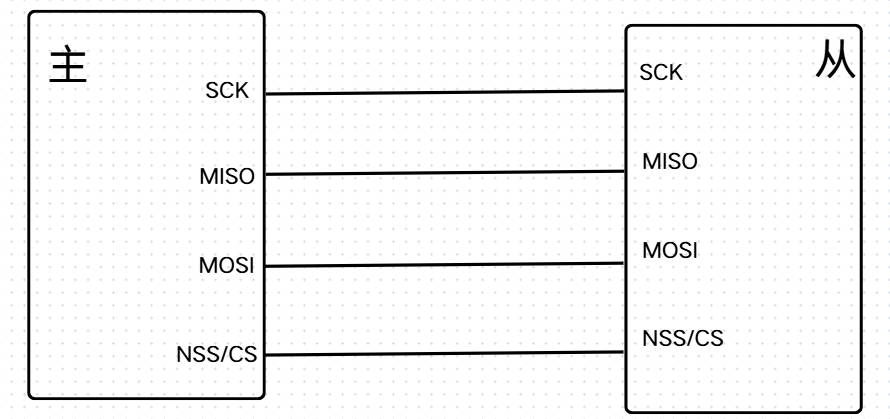

> 📄 原课件 p.2

#### 单设备与多设备之间通信

主机的 `SCK`、`MISO`、`MOSI` 并联到所有从机；每个从机各占一根片选线（`NSS/CS1` 选中从 1、`NSS/CS2` 选中从 2），主机通过独立片选决定与哪个从机通信。

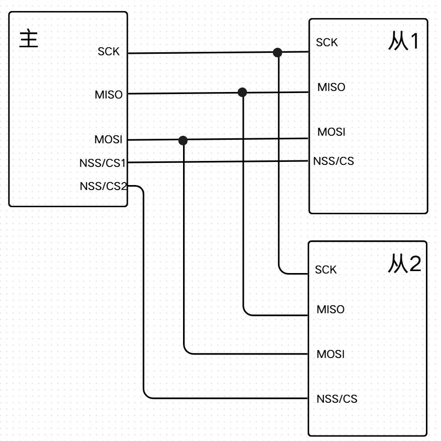

> 📄 原课件 p.3

### 工作时序关系

- **时钟相位（CPHA）**：时钟线在第几个时钟边沿采样数据。
  - `0`：SCK 的第一个（奇数）边沿进行数据位采样，数据在第一个时钟边沿被锁存。
  - `1`：SCK 的第二个（偶数）边沿进行数据位采样，数据在第二个时钟边沿被锁存。
- **时钟极性（CPOL）**：控制在没有数据传输时时钟线的空闲状态电平。
  - `0`：SCK 在空闲状态保持低电平。
  - `1`：SCK 在空闲状态保持高电平。

> 📄 原课件 p.4（CPOL 取值说明）

#### 时序图

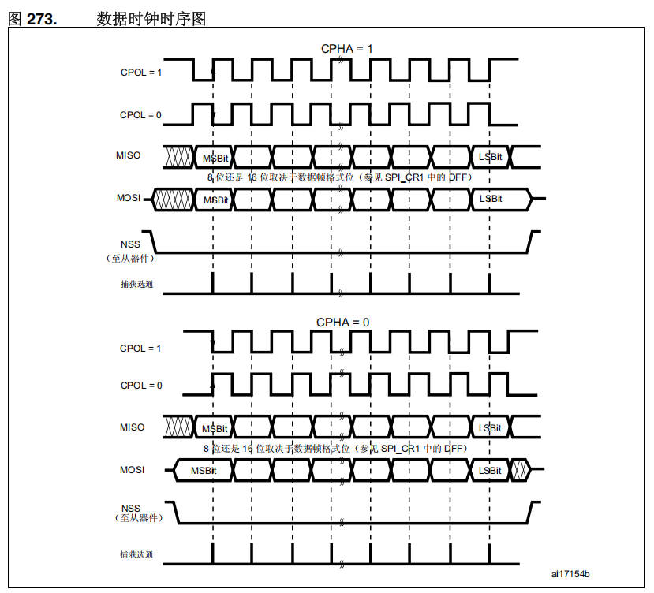

图中关键内容（原课件图 273 数据时钟时序图，编号 ai17154b）：

- 上半部分为 `CPHA = 1`，下半部分为 `CPHA = 0`；每部分各给出 `CPOL = 1` 与 `CPOL = 0` 两条 SCK 时钟波形。
- 数据线 `MISO`、`MOSI` 按 `MSBit → LSBit` 顺序传输，交叉阴影段表示数据切换/无效区。
- `NSS（至从器件）` 在整帧传输期间保持低电平，其下方的"捕获选通"给出每个数据位的采样时刻。
- 图中注释：**8 位还是 16 位取决于数据帧格式位（参见 `SPI_CR1` 中的 `DFF`）**。

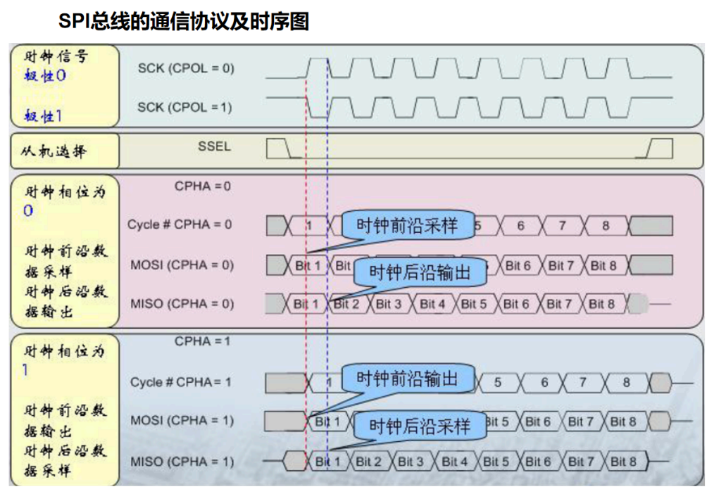

> 📄 原课件 p.5（上半页）

手写图要点（SPI 总线的通信协议及时序图）：

| 分组 | 信号/标注 | 波形说明 |
| --- | --- | --- |
| 时钟信号 极性 0 / 极性 1 | `SCK (CPOL = 0)`、`SCK (CPOL = 1)` | 分别给出空闲低、空闲高两种时钟 |
| 从机选择 | `SSEL` | 片选拉低后开始一帧传输 |
| 时钟相位为 0 | `Cycle # CPHA = 0`、`MOSI (CPHA = 0)`、`MISO (CPHA = 0)` | 时钟前沿数据采样、时钟后沿数据输出（气泡标注"时钟前沿采样""时钟后沿输出"） |
| 时钟相位为 1 | `Cycle # CPHA = 1`、`MOSI (CPHA = 1)`、`MISO (CPHA = 1)` | 时钟前沿数据输出、时钟后沿数据采样（气泡标注"时钟前沿输出""时钟后沿采样"） |

#### 作为主机发送和接收的时序分析

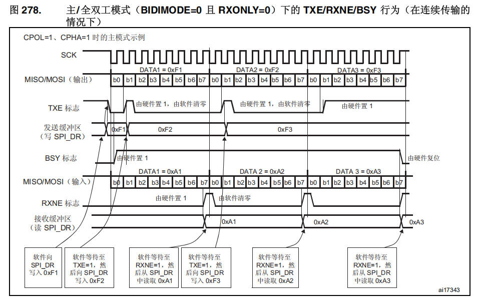

图 278 主/全双工模式（`BIDIMODE=0` 且 `RXONLY=0`）下的 `TXE`/`RXNE`/`BSY` 行为（在连续传输的情况下），即 `CPOL=1`、`CPHA=1` 时的主模式示例：

- **SCK** 连续输出时钟；**MISO/MOSI（输出）** 依次发送 `DATA1 = 0xF1`、`DATA2 = 0xF2`、`DATA3 = 0xF3`（b0~b7）。
- **TXE 标志**：由硬件置 1，由软件清零；软件向 `SPI_DR` 写入 0xF1 后，等待至 `TXE=1` 再写入 0xF2、0xF3。
- **发送缓冲区（写 `SPI_DR`）**：依次装入 0xF1、0xF2、0xF3。
- **BSY 标志**：由硬件置 1，整帧结束后由硬件复位。
- **MISO/MOSI（输入）**：依次收到 `DATA1 = 0xA1`、`DATA2 = 0xA2`、`DATA3 = 0xA3`。
- **RXNE 标志**：由硬件置 1，由软件清零；软件等待至 `RXNE=1`，然后从 `SPI_DR` 中读取 0xA1、0xA2、0xA3。

#### 作为从机发送和接收时序分析

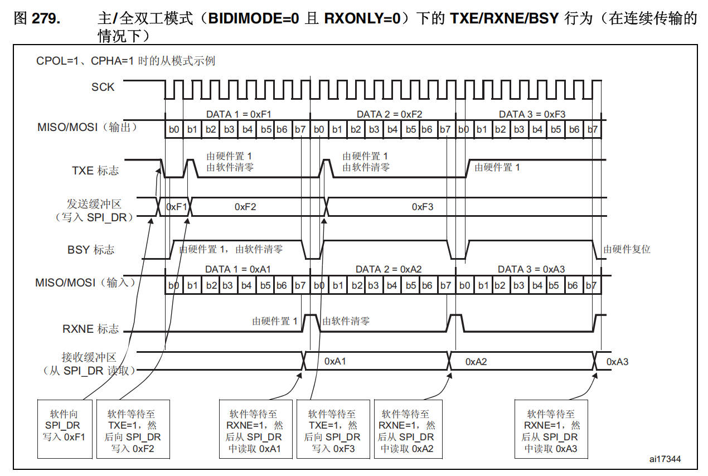

> 📄 原课件 p.6

图 279 主/全双工模式（`BIDIMODE=0` 且 `RXONLY=0`）下的 `TXE`/`RXNE`/`BSY` 行为（在连续传输的情况下），图内标注为 **CPOL=1、CPHA=1 时的从模式示例**：

- 发送方向：软件向 `SPI_DR` 写入 0xF1 → 等待 `TXE=1` 后写入 0xF2 → 等待 `RXNE=1` 后从 `SPI_DR` 读取 0xA1 → 等待 `TXE=1` 后写入 0xF3 → 等待 `RXNE=1` 后读取 0xA2 → 最后读取 0xA3。
- `TXE` 由硬件置 1、由软件清零；`RXNE` 由硬件置 1、由软件清零；`BSY` 由硬件置 1、由软件清零，传输结束由硬件复位。
- 收发数据同全双工示例：发送 0xF1/0xF2/0xF3，接收 0xA1/0xA2/0xA3。

#### 主/从只发送模式时序图

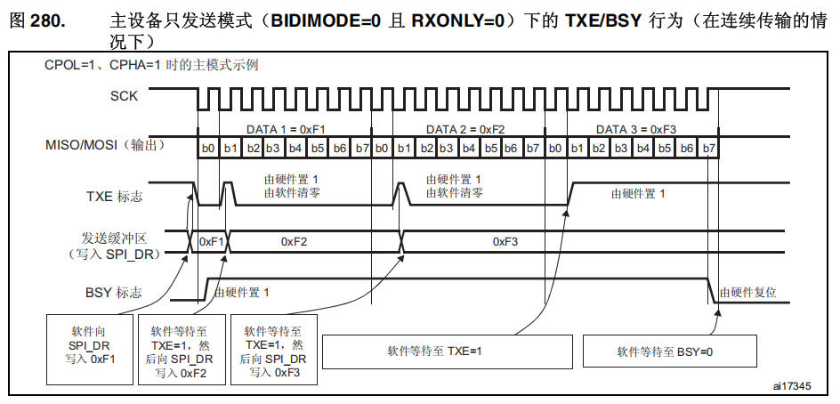

图 280 主设备只发送模式（`BIDIMODE=0` 且 `RXONLY=0`）下的 `TXE`/`BSY` 行为（在连续传输的情况），即 `CPOL=1`、`CPHA=1` 时的主模式示例：

- 只有发送方向的信号：**MISO/MOSI（输出）** 依次发送 `DATA1 = 0xF1`、`DATA2 = 0xF2`、`DATA3 = 0xF3`。
- **TXE 标志** 由硬件置 1、由软件清零；**发送缓冲区（写入 `SPI_DR`）** 依次为 0xF1、0xF2、0xF3；**BSY 标志** 由硬件置 1，结束时由硬件复位。
- 软件动作：软件向 `SPI_DR` 写入 0xF1 → 软件等待至 `TXE=1`，然后向 `SPI_DR` 写入 0xF2 → 再写入 0xF3 → 软件等待至 `TXE=1` → 软件等待至 `BSY=0`。

> 📄 原课件 p.7（续）

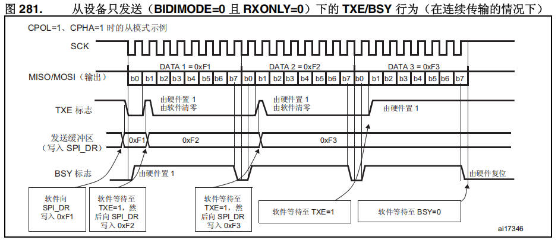

图 281 从设备只发送（`BIDIMODE=0` 且 `RXONLY=0`）下的 `TXE`/`BSY` 行为（在连续传输的情况），即 `CPOL=1`、CPHA=1 时的从模式示例：信号与软件动作同图 280，区别仅在于此为从模式（发送数据同样为 0xF1、0xF2、0xF3，`TXE` 由硬件置 1、由软件清零，`BSY` 由硬件置 1、由硬件复位）。

#### 单向只接收模式

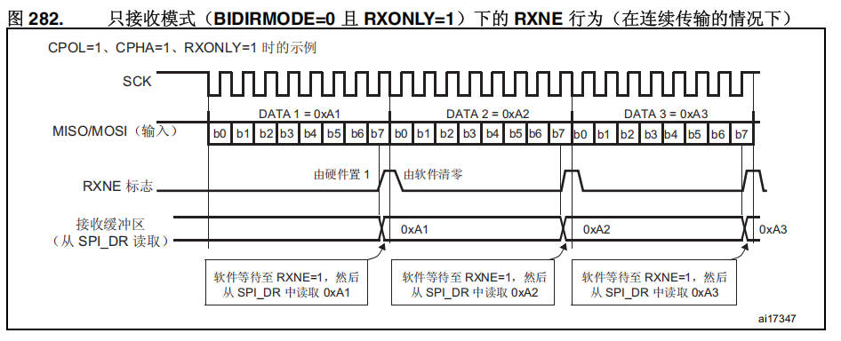

图 282 只接收模式（`BIDIRMODE=0` 且 `RXONLY=1`）下的 `RXNE` 行为（在连续传输的情况），即 `CPOL=1`、`CPHA=1`、`RXONLY=1` 时的示例：

- 只有接收方向的信号：**MISO/MOSI（输入）** 依次收到 `DATA1 = 0xA1`、`DATA2 = 0xA2`、`DATA3 = 0xA3`。
- **RXNE 标志** 由硬件置 1、由软件清零；**接收缓冲区（从 `SPI_DR` 读取）** 依次出现 0xA1、0xA2、0xA3。
- 软件动作：软件等待至 `RXNE=1`，然后从 `SPI_DR` 中读取 0xA1 → 0xA2 → 0xA3。

#### 连续和非连续传输

> 📄 原课件 p.7（标题）～ p.8

#### 非连续传输时序图

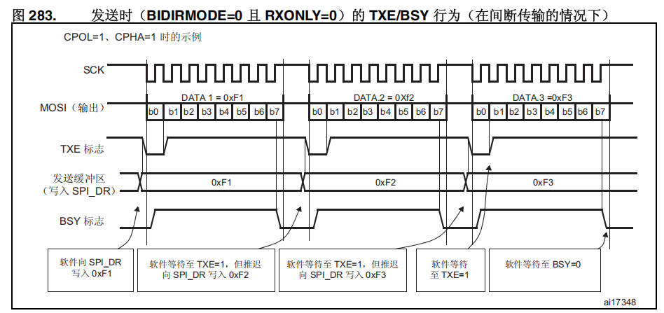

> 📄 原课件 p.8

图 283 发送时（`BIDIRMODE=0` 且 `RXONLY=0`）的 `TXE`/`BSY` 行为（在**间断传输**的情况下），即 `CPOL=1`、CPHA=1 时的示例：

- **MOSI（输出）** 依次发送 `DATA1 = 0xF1`、`DATA2 = 0xF2`、`DATA3 = 0xF3`，各字节之间时钟停顿（间断）。
- **TXE 标志**、**发送缓冲区（写入 `SPI_DR`：0xF1、0xF2、0xF3）**、**BSY 标志** 在每段传输期间变化，`BSY` 由硬件置 1、由硬件复位。
- 软件动作：软件向 `SPI_DR` 写入 0xF1 → 软件等待至 `TXE=1`，但**推迟**向 `SPI_DR` 写入 0xF2 → 软件等待至 `TXE=1`，但推迟写入 0xF3 → 软件等待至 `TXE=1` → 软件等待至 `BSY=0`。

#### 连续传输时序图

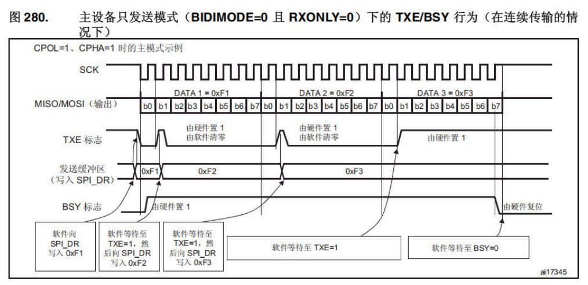

图 280 主设备只发送模式（`BIDIMODE=0` 且 `RXONLY=0`）下的 `TXE`/`BSY` 行为（在连续传输的情况下），即 `CPOL=1`、CPHA=1 时的主模式示例：与非连续传输相比，SCK 连续不断、0xF1/0xF2/0xF3 紧密连续发送，`TXE` 置 1 后立即写入下一字节，最后等待 `TXE=1` 再等待 `BSY=0`。

#### SPI通讯的特点

1. 主机控制外设选择串行时钟
2. SPI 总线只能有一个主设备，多个从设备
3. 每个从设备都有一个独立的控制的片选
4. 数据可以从主设备传输到从设备，或者从从设备传输到主设备，可以用作全双工通信

**缺陷**

- 使用 IO 口很多，会占用更多的资源
- 没有指定的流控制，没有应答机制确认是否接收到数据

### QSPI

- SPI 根据其所使用的线的数量不同有所区分。
- Standard SPI（标准 SPI）、Dual SPI（双线 SPI）和 Quad SPI（四线 SPI）等，只不过平时最常用的是 Standard SPI 标准 SPI。
- 产生来源：在某些使用情况下，不需要使用 SPI 的全双工传输特性，从而让 MOSI 与 MISO 同时向相同的方向传输数据，增加了线的数量从而使加倍了数据传输的速度。
- 也由此产生了双线 SPI（DSPI）与四线 SPI（QSPI）。

> 📄 原课件 p.9

## SPI的整体组成结构

### 系统框图

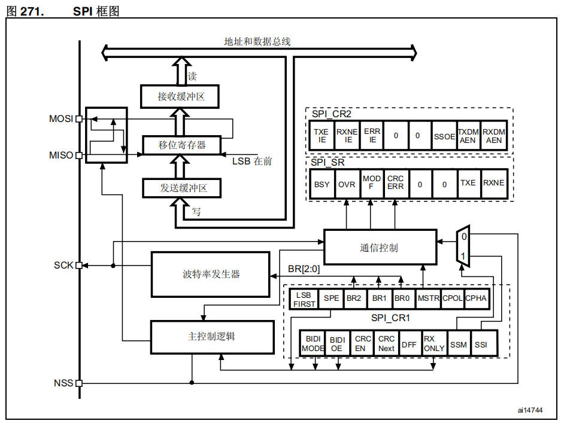

图 271 SPI 框图（编号 ai14744）关键组成：

- **数据通路**：顶部为地址和数据总线；`发送缓冲区`（写入）→ `移位寄存器`（标注 **LSB 在前**）→ `接收缓冲区`（读出），外部引脚 `MOSI`、`MISO` 经收发切换与移位寄存器相连。
- **时钟与控制**：`SCK` 由 `波特率发生器` 产生，分频由 `BR[2:0]` 控制；`主控制逻辑` 接收 `NSS` 输入；`通信控制` 负责收发时序（右侧有 0/1 选择开关）。
- **`SPI_CR2`** 位域：`TXEIE`、`RXNEIE`、`ERRIE`、`0`、`0`、`SSOE`、`TXDMAEN`、`RXDMAEN`。
- **`SPI_SR`** 位域：`BSY`、`OVR`、`MODF`、`CRCERR`、`0`、`0`、`TXE`、`RXNE`。
- **`SPI_CR1`** 位域：`LSB FIRST`、`SPE`、`BR2`、`BR1`、`BR0`、`MSTR`、`CPOL`、`CPHA`；`BIDIMODE`、`BIDIOE`、`CRCEN`、`CRCNext`、`DFF`、`RXONLY`、`SSM`、`SSI`。

#### SPI的中断

| 中断事件 | 事件标志 | 使能控制位 |
| --- | --- | --- |
| 发送缓冲器非空标志 | `TXE` | `TXEIE` |
| 接收缓冲器非空标志 | `RXNE` | `RXNEIE` |
| 主模式失效率事件 | `MODF` | `ERRIE` |
| 溢出错误 | `OVR` | `ERRIE` |
| CRC 错误标志 | `CRCERR` | `ERRIE` |

> 📄 原课件 p.10（表格后两行）

## 作业：

手动画出，通用异步收发器、IIC、SPI 硬件连接的区别，并总结整理。

## 小结与下一步

- SPI 是四线制（`NSS/CS`、`SCK`、`MISO`、`MOSI`）高速全双工同步总线，一主多从、每个从机独立片选；STM32F4 有 3 个 SPI，最高 37.5MHz，支持 DMA 与 I2S。
- `CPOL` 决定空闲电平、`CPHA` 决定采样边沿；主/从收发、只发送、只接收、连续与非连续传输的时序都围绕 `SPI_DR` 与 `TXE`/`RXNE`/`BSY` 标志展开。
- SPI 框图核心是移位寄存器加收发缓冲与波特率发生器；中断事件包括 `TXE`、`RXNE`、`MODF`、`OVR`、`CRCERR`，对应使能位 `TXEIE`/`RXNEIE`/`ERRIE`。
- 本课作业：手动画出通用异步收发器（UART）、IIC、SPI 硬件连接的区别并总结整理。

➡️ 下一课：[[17-STM32-SPI通信实现-W25Q系列存储芯片|STM32-SPI通信实现-W25Q系列存储芯片]]
