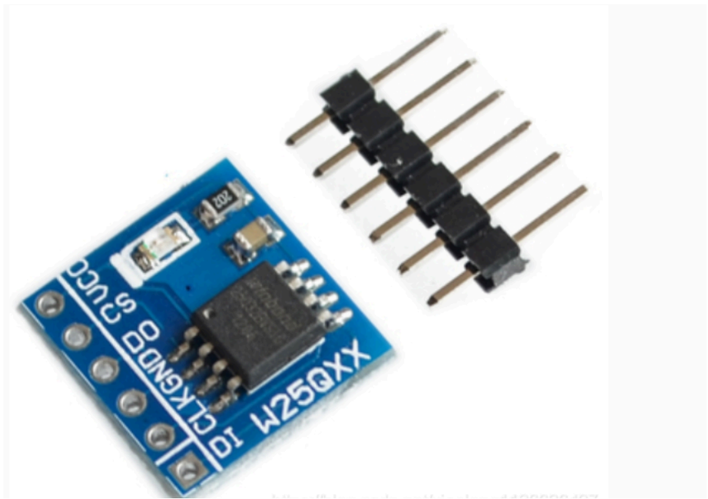
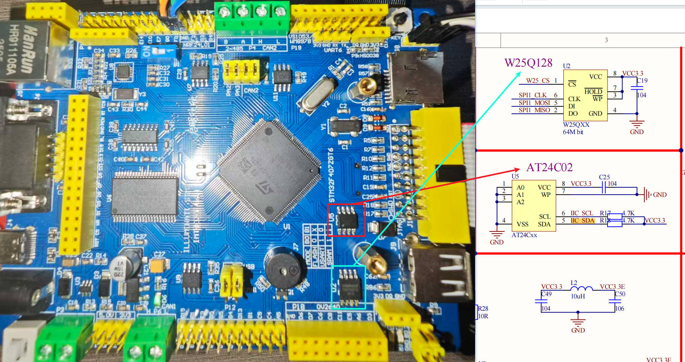
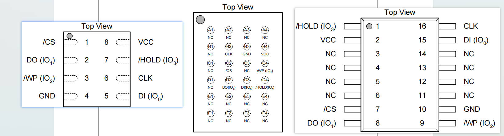
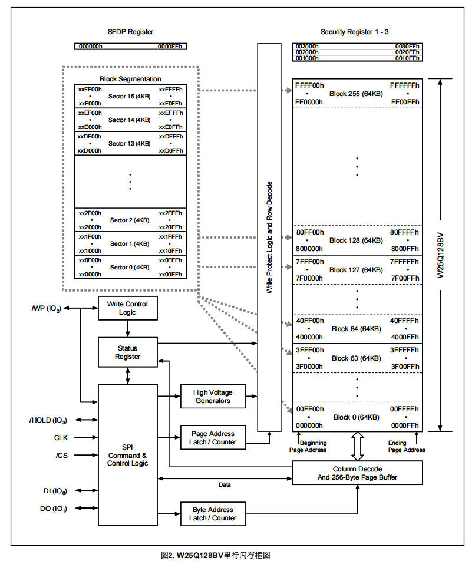
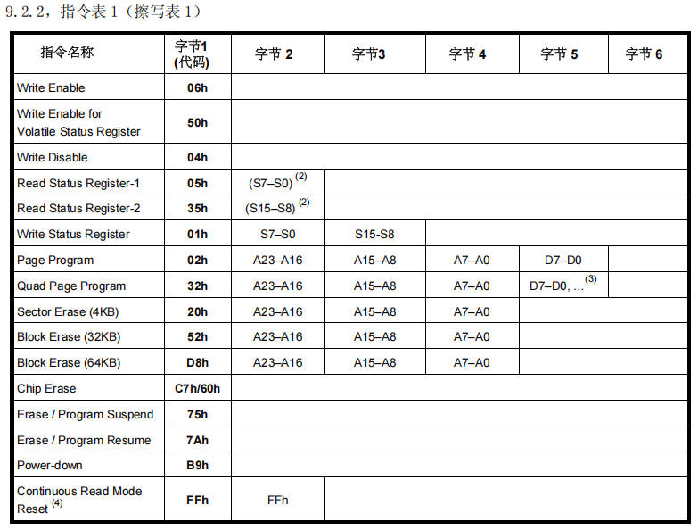
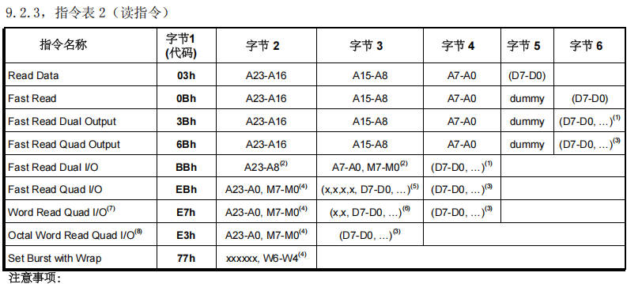
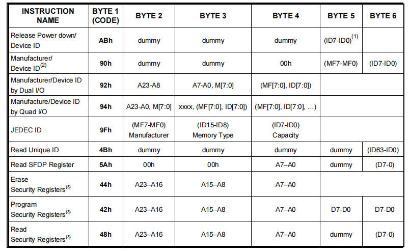

# 17 STM32-SPI通信实现-W25Q系列存储芯片

> 本课整理自 `STM32/17、STM32-SPI通信实现-W25Q系列存储芯片.zip → 10.1SPI通信实现-W25Q系列存储芯片/SPI通信实现-W25Q储存.pdf`(共 19 页)。返回 [[STM32学习目录|📑 STM32学习目录]]。

## 本章要点

- 本课逐段讲解 HAL 库 SPI 的三个阻塞 API:`HAL_SPI_Transmit`、`HAL_SPI_Receive`、`HAL_SPI_TransmitReceive`,并给出源码级实现。
- 三个函数骨架一致:状态检查 → 参数校验 → 加锁 → 设置事务信息 → 使能 SPI → 按 8/16 位数据宽轮询 TXE/RXNE 标志 → 超时管理 → 收尾(CRC/BSY/OVR)→ 解锁返回。
- 主机 + 双线(SPI_DIRECTION_2LINES)模式下,`HAL_SPI_Receive` 内部转调 `HAL_SPI_TransmitReceive`,靠发送伪数据产生时钟脉冲来接收。
- `HAL_SPI_TransmitReceive` 用 `txallowed` 标志交替收发,直到发送、接收计数均归零。
- W25Q 系列是 Winbond SPI NOR Flash:VCC 2.7V~3.6V,时钟标准 80MHz / 双倍 160MHz / 四倍 320MHz,24 位地址系列产品容量 4Mbit~256Mbit。
- 访问芯片靠设备查询指令(Manufacturer ID = `EFh`)与操作指令表(擦写表 1、读指令表 2 等)。

## 与SPI相关的函数

| 函数 | 说明 |
| --- | --- |
| `HAL_SPI_Transmit(SPI_HandleTypeDef *hspi, const uint8_t *pData, uint16_t Size, uint32_t Timeout)` | SPI发送数据:`SPI_HandleTypeDef *hspi` SPI句柄;`uint8_t *pData` 发送数据的存储地址;`uint16_t Size` 发送的数据量大小;`uint32_t Timeout` 超时时间 |
| `HAL_StatusTypeDef HAL_SPI_Receive(SPI_HandleTypeDef *hspi, uint8_t *pData, uint16_t Size, uint32_t Timeout)` | SPI接收数据:`SPI_HandleTypeDef *hspi` SPI句柄;`uint8_t *pData` 接收数据的存储地址;`uint16_t Size` 接收的数据量大小;`uint32_t Timeout` 超时时间 |
| `HAL_StatusTypeDef HAL_SPI_TransmitReceive(SPI_HandleTypeDef *hspi, const uint8_t *pTxData, uint8_t *pRxData, uint16_t Size, uint32_t Timeout)` | SPI发送接收数据:`SPI_HandleTypeDef *hspi` SPI句柄;`uint8_t *pTxData` 发送数据的存储地址;`uint8_t *pRxData` 接收数据的存储地址;`uint16_t Size` 发送和接收的数据量大小;`uint32_t Timeout` 超时时间 |

### 以阻塞模式发送指定数量的数据

> 📄 原课件 p.1–p.4(`HAL_SPI_Transmit` 源码)

函数原型:

```c
HAL_StatusTypeDef HAL_SPI_Transmit(SPI_HandleTypeDef *hspi, const uint8_t *pData, uint16_t Size, uint32_t Timeout)
```

```c
/**
 * @brief 以阻塞模式发送指定数量的数据。
 * @param hspi 指向SPI_HandleTypeDef结构体的指针，包含SPI模块的配置信息。
 * @param pData 指向数据缓冲区的指针（数据元素为uint8_t或uint16_t类型）
 * @param Size 要发送的数据元素数量（uint8_t或uint16_t）
 * @param Timeout 超时时间，单位为毫秒
 * @retval HAL状态（HAL_OK, HAL_ERROR, HAL_BUSY, HAL_TIMEOUT）
 */
HAL_StatusTypeDef HAL_SPI_Transmit(SPI_HandleTypeDef *hspi, const uint8_t *pData, uint16_t Size, uint32_t Timeout)
{
  uint32_t tickstart; // 超时计时基准（记录函数开始执行的系统滴答值）
  uint16_t initial_TxXferCount; // 保存初始发送数据计数（用于特殊场景判断）

  /* 检查SPI方向参数：必须为双线模式(SPI_DIRECTION_2LINES)或单线模式(SPI_DIRECTION_1LINE) */
  assert_param(IS_SPI_DIRECTION_2LINES_OR_1LINE(hspi->Init.Direction));

  /* 初始化tickstart用于超时管理 */
  tickstart = HAL_GetTick();
  initial_TxXferCount = Size; // 保存原始发送数据长度

  // 检查SPI外设状态：非空闲状态则返回忙
  if (hspi->State != HAL_SPI_STATE_READY)
  {
    return HAL_BUSY;
  }

  // 参数有效性校验：数据缓冲区非空且数据长度有效
  if ((pData == NULL) || (Size == 0U))
  {
    return HAL_ERROR;
  }

  /* 进程加锁（防止多任务/中断重入） */
  __HAL_LOCK(hspi);

  /* 设置事务信息 */
  hspi->State = HAL_SPI_STATE_BUSY_TX; // 设置状态为发送忙
  hspi->ErrorCode = HAL_SPI_ERROR_NONE; // 清除错误标志
  hspi->pTxBuffPtr = (const uint8_t *)pData; // 发送缓冲区指针
  hspi->TxXferSize = Size; // 发送总大小
  hspi->TxXferCount = Size; // 剩余发送计数

  /* 初始化句柄中未使用的接收字段为零（本函数仅发送） */
  hspi->pRxBuffPtr = (uint8_t *)NULL; // 接收缓冲区置空
  hspi->RxXferSize = 0U; // 接收大小清零
  hspi->RxXferCount = 0U; // 接收计数清零
  hspi->TxISR = NULL; // 清空中断回调（阻塞模式不使用）
  hspi->RxISR = NULL;

  /* 配置单线通信方向（仅发送） */
  if (hspi->Init.Direction == SPI_DIRECTION_1LINE)
  {
    /* 设置单线方向前必须先禁用SPI外设（修改BIDIOE位需在SPE=0时） */
    __HAL_SPI_DISABLE(hspi);
    SPI_1LINE_TX(hspi); // 配置为单线发送模式（设置BIDIOE=1）
  }

#if (USE_SPI_CRC != 0U)
  /* 重置CRC计算单元（清除历史CRC值） */
  if (hspi->Init.CRCCalculation == SPI_CRCCALCULATION_ENABLE)
  {
    SPI_RESET_CRC(hspi);
  }
#endif /* 启用SPI CRC功能 */

  /* 检查SPI外设是否已使能 */
  if ((hspi->Instance->CR1 & SPI_CR1_SPE) != SPI_CR1_SPE)
  {
    /* 使能SPI外设 */
    __HAL_SPI_ENABLE(hspi);
  }

  /* 以16位数据模式发送数据 */
  if (hspi->Init.DataSize == SPI_DATASIZE_16BIT)
  {
    // 从机模式或仅1个数据时：立即发送首数据（避免从机无时钟触发）
    if ((hspi->Init.Mode == SPI_MODE_SLAVE) || (initial_TxXferCount == 0x01U))
    {
      hspi->Instance->DR = *((const uint16_t *)hspi->pTxBuffPtr); // 写入16位数据
      hspi->pTxBuffPtr += sizeof(uint16_t); // 指针后移2字节
      hspi->TxXferCount--; // 发送计数减1
    }
    /* 主循环：持续发送剩余数据 */
    while (hspi->TxXferCount > 0U)
    {
      /* 等待TXE标志置位（发送寄存器为空，可写入新数据） */
      if (__HAL_SPI_GET_FLAG(hspi, SPI_FLAG_TXE))
      {
        hspi->Instance->DR = *((const uint16_t *)hspi->pTxBuffPtr);
        hspi->pTxBuffPtr += sizeof(uint16_t);
        hspi->TxXferCount--;
      }
      else
      {
        /* 超时管理：检查是否超时（含Timeout=0的立即超时情况） */
        if ((((HAL_GetTick() - tickstart) >= Timeout) && (Timeout != HAL_MAX_DELAY)) || (Timeout == 0U))
        {
          hspi->State = HAL_SPI_STATE_READY; // 恢复状态
          __HAL_UNLOCK(hspi); // 解锁
          return HAL_TIMEOUT; // 返回超时错误
        }
      }
    }
  }
  /* 以8位数据模式发送数据 */
  else
  {
    // 从机模式或仅1字节时：立即发送首字节
    if ((hspi->Init.Mode == SPI_MODE_SLAVE) || (initial_TxXferCount == 0x01U))
    {
      *((__IO uint8_t *)&hspi->Instance->DR) = *((const uint8_t *)hspi->pTxBuffPtr); // 写入8位数据
      hspi->pTxBuffPtr += sizeof(uint8_t);
      hspi->TxXferCount--;
    }
    while (hspi->TxXferCount > 0U)
    {
      /* 等待TXE标志置位 */
      if (__HAL_SPI_GET_FLAG(hspi, SPI_FLAG_TXE))
      {
        *((__IO uint8_t *)&hspi->Instance->DR) = *((const uint8_t *)hspi->pTxBuffPtr);
        hspi->pTxBuffPtr += sizeof(uint8_t);
        hspi->TxXferCount--;
      }
      else
      {
        /* 超时管理 */
        if ((((HAL_GetTick() - tickstart) >= Timeout) && (Timeout != HAL_MAX_DELAY)) || (Timeout == 0U))
        {
          hspi->State = HAL_SPI_STATE_READY;
          __HAL_UNLOCK(hspi);
          return HAL_TIMEOUT;
        }
      }
    }
  }

#if (USE_SPI_CRC != 0U)
  /* 启用CRC传输：设置CRCNEXT位，使下一次写DR触发CRC发送 */
  if (hspi->Init.CRCCalculation == SPI_CRCCALCULATION_ENABLE)
  {
    SET_BIT(hspi->Instance->CR1, SPI_CR1_CRCNEXT);
  }
#endif /* 启用SPI CRC功能 */

  /* 检查事务是否完全结束（等待BSY标志清零，确保所有数据移出） */
  if (SPI_EndRxTxTransaction(hspi, Timeout, tickstart) != HAL_OK)
  {
    hspi->ErrorCode = HAL_SPI_ERROR_FLAG; // 标记标志错误
  }

  /* 双线模式下清除溢出标志（OVR）：因未读取接收数据，硬件可能置位该标志 */
  if (hspi->Init.Direction == SPI_DIRECTION_2LINES)
  {
    __HAL_SPI_CLEAR_OVRFLAG(hspi);
  }

  // 恢复SPI状态为空闲
  hspi->State = HAL_SPI_STATE_READY;
  /* 进程解锁 */
  __HAL_UNLOCK(hspi);

  // 最终错误检查
  if (hspi->ErrorCode != HAL_SPI_ERROR_NONE)
  {
    return HAL_ERROR;
  }
  else
  {
    return HAL_OK; // 操作成功完成
  }
}
```

### 以阻塞模式接收指定数量的数据

> 📄 原课件 p.5–p.8(`HAL_SPI_Receive` 源码)

函数原型:

```c
HAL_StatusTypeDef HAL_SPI_Receive(SPI_HandleTypeDef *hspi, uint8_t *pData, uint16_t Size, uint32_t Timeout)
```

```c
/**
 * @brief 以阻塞模式接收指定数量的数据。
 * @param hspi 指向SPI_HandleTypeDef结构体的指针，包含SPI模块的配置信息。
 * @param pData 指向数据缓冲区的指针（用于存储接收到的uint8_t或uint16_t数据）
 * @param Size 要接收的数据元素数量（uint8_t或uint16_t）
 * @param Timeout 超时时间，单位为毫秒
 * @retval HAL状态（HAL_OK, HAL_ERROR, HAL_BUSY, HAL_TIMEOUT）
 * @note 在主机模式下，若方向设置为SPI_DIRECTION_2LINES（双线全双工）：
 *       需向数据寄存器写入伪数据以产生时钟脉冲，从而接收数据。
 *       此时函数内部会调用HAL_SPI_TransmitReceive实现该机制。
 */
HAL_StatusTypeDef HAL_SPI_Receive(SPI_HandleTypeDef *hspi, uint8_t *pData, uint16_t Size, uint32_t Timeout)
{
#if (USE_SPI_CRC != 0U)
  __IO uint32_t tmpreg = 0U; // 用于读取CRC寄存器的临时变量（避免编译器警告）
#endif /* 启用SPI CRC功能 */
  uint32_t tickstart; // 超时计时基准（记录函数开始执行的系统滴答值）

  // 检查SPI外设状态：非空闲状态则返回忙
  if (hspi->State != HAL_SPI_STATE_READY)
  {
    return HAL_BUSY;
  }

  // 参数有效性校验：接收缓冲区非空且数据长度有效
  if ((pData == NULL) || (Size == 0U))
  {
    return HAL_ERROR;
  }

  // 【主机+双线模式特殊处理】：需发送伪数据产生时钟
  if ((hspi->Init.Mode == SPI_MODE_MASTER) && (hspi->Init.Direction == SPI_DIRECTION_2LINES))
  {
    hspi->State = HAL_SPI_STATE_BUSY_RX; // 设置状态为接收忙
    /* 调用收发函数：将同一缓冲区同时作为发送（伪数据）和接收缓冲区
       发送pData内容（实际为伪数据）以产生时钟，同时接收有效数据到pData */
    return HAL_SPI_TransmitReceive(hspi, pData, pData, Size, Timeout);
  }

  /* 初始化tickstart用于超时管理（仅非主机双线模式路径执行） */
  tickstart = HAL_GetTick();

  /* 进程加锁（防止多任务/中断重入） */
  __HAL_LOCK(hspi);

  /* 设置事务信息 */
  hspi->State = HAL_SPI_STATE_BUSY_RX; // 设置状态为接收忙
  hspi->ErrorCode = HAL_SPI_ERROR_NONE; // 清除错误标志
  hspi->pRxBuffPtr = (uint8_t *)pData; // 接收缓冲区指针
  hspi->RxXferSize = Size; // 接收总大小
  hspi->RxXferCount = Size; // 剩余接收计数

  /* 初始化句柄中未使用的发送字段为零（本函数仅接收） */
  hspi->pTxBuffPtr = (uint8_t *)NULL; // 发送缓冲区置空
  hspi->TxXferSize = 0U; // 发送大小清零
  hspi->TxXferCount = 0U; // 发送计数清零
  hspi->RxISR = NULL; // 清空中断回调（阻塞模式不使用）
  hspi->TxISR = NULL;

#if (USE_SPI_CRC != 0U)
  /* 重置CRC计算单元，并预减接收计数（为CRC预留位置） */
  if (hspi->Init.CRCCalculation == SPI_CRCCALCULATION_ENABLE)
  {
    SPI_RESET_CRC(hspi);
    /* 预留最后一个数据位置用于CRC：实际接收Size-1个有效数据 + 1个CRC */
    hspi->RxXferCount--;
  }
#endif /* 启用SPI CRC功能 */

  /* 配置单线通信方向（仅接收） */
  if (hspi->Init.Direction == SPI_DIRECTION_1LINE)
  {
    /* 修改BIDIOE位前必须先禁用SPI外设（SPE=0） */
    __HAL_SPI_DISABLE(hspi);
    SPI_1LINE_RX(hspi); // 配置为单线接收模式（清除BIDIOE=0）
  }

  /* 检查SPI外设是否已使能 */
  if ((hspi->Instance->CR1 & SPI_CR1_SPE) != SPI_CR1_SPE)
  {
    /* 使能SPI外设 */
    __HAL_SPI_ENABLE(hspi);
  }

  /* 以8位数据模式接收数据 */
  if (hspi->Init.DataSize == SPI_DATASIZE_8BIT)
  {
    /* 接收主循环 */
    while (hspi->RxXferCount > 0U)
    {
      /* 检查RXNE标志（接收寄存器非空） */
      if (__HAL_SPI_GET_FLAG(hspi, SPI_FLAG_RXNE))
      {
        /* 读取接收到的8位数据 */
        (*(uint8_t *)hspi->pRxBuffPtr) = *(__IO uint8_t *)&hspi->Instance->DR;
        hspi->pRxBuffPtr += sizeof(uint8_t); // 缓冲区指针后移
        hspi->RxXferCount--; // 接收计数减1
      }
      else
      {
        /* 超时管理：检查是否超时（含Timeout=0的立即超时情况） */
        if ((((HAL_GetTick() - tickstart) >= Timeout) && (Timeout != HAL_MAX_DELAY)) || (Timeout == 0U))
        {
          hspi->State = HAL_SPI_STATE_READY; // 恢复状态
          __HAL_UNLOCK(hspi); // 解锁
          return HAL_TIMEOUT; // 返回超时错误
        }
      }
    }
  }
  else // 16位数据模式接收
  {
    /* 接收主循环 */
    while (hspi->RxXferCount > 0U)
    {
      /* 检查RXNE标志 */
      if (__HAL_SPI_GET_FLAG(hspi, SPI_FLAG_RXNE))
      {
        *((uint16_t *)hspi->pRxBuffPtr) = (uint16_t)hspi->Instance->DR; // 读取16位数据
        hspi->pRxBuffPtr += sizeof(uint16_t);
        hspi->RxXferCount--;
      }
      else
      {
        /* 超时管理 */
        if ((((HAL_GetTick() - tickstart) >= Timeout) && (Timeout != HAL_MAX_DELAY)) || (Timeout == 0U))
        {
          hspi->State = HAL_SPI_STATE_READY;
          __HAL_UNLOCK(hspi);
          return HAL_TIMEOUT;
        }
      }
    }
  }

#if (USE_SPI_CRC != 0U)
  /* CRC校验收尾处理 */
  if (hspi->Init.CRCCalculation == SPI_CRCCALCULATION_ENABLE)
  {
    /* 冻结CRC计算：设置CRCNEXT位，使下一次接收为CRC值（而非数据） */
    SET_BIT(hspi->Instance->CR1, SPI_CR1_CRCNEXT);

    /* 等待并接收最后一个有效数据（Size-1位置） */
    if (SPI_WaitFlagStateUntilTimeout(hspi, SPI_FLAG_RXNE, SET, Timeout, tickstart) != HAL_OK)
    {
      /* 最后一个有效数据未收到 */
      __HAL_UNLOCK(hspi);
      return HAL_TIMEOUT;
    }
  }

  /* 接收最后一个有效数据（16位模式） */
  if (hspi->Init.DataSize == SPI_DATASIZE_16BIT)
  {
    *((uint16_t *)hspi->pRxBuffPtr) = (uint16_t)hspi->Instance->DR;
  }
  /* 接收最后一个有效数据（8位模式） */
  else
  {
    (*(uint8_t *)hspi->pRxBuffPtr) = *(__IO uint8_t *)&hspi->Instance->DR;
  }

  /* 等待CRC值到达（硬件自动计算并移入DR） */
  if (SPI_WaitFlagStateUntilTimeout(hspi, SPI_FLAG_RXNE, SET, Timeout, tickstart) != HAL_OK)
  {
    SET_BIT(hspi->ErrorCode, HAL_SPI_ERROR_CRC); // 标记CRC错误
    hspi->State = HAL_SPI_STATE_READY;
    __HAL_UNLOCK(hspi);
    return HAL_TIMEOUT;
  }

  /* 读取CRC值（清空DR并清除RXNE标志） */
  tmpreg = READ_REG(hspi->Instance->DR);
  UNUSED(tmpreg); // 避免GCC编译器警告“未使用变量”
}
#endif /* 启用SPI CRC功能 */

  /* 检查接收事务是否完全结束（等待BSY标志清零） */
  if (SPI_EndRxTransaction(hspi, Timeout, tickstart) != HAL_OK)
  {
    hspi->ErrorCode = HAL_SPI_ERROR_FLAG; // 标记标志错误
  }

#if (USE_SPI_CRC != 0U)
  /* 检查是否发生CRC校验错误 */
  if (__HAL_SPI_GET_FLAG(hspi, SPI_FLAG_CRCERR))
  {
    SET_BIT(hspi->ErrorCode, HAL_SPI_ERROR_CRC);
    __HAL_SPI_CLEAR_CRCERRFLAG(hspi); // 清除CRC错误标志
  }
#endif /* 启用SPI CRC功能 */

  // 恢复SPI状态为空闲
  hspi->State = HAL_SPI_STATE_READY;
  /* 解锁进程 */
  __HAL_UNLOCK(hspi);

  // 最终错误检查
  if (hspi->ErrorCode != HAL_SPI_ERROR_NONE)
  {
    return HAL_ERROR;
  }
  else
  {
    return HAL_OK; // 操作成功完成
  }
}
```

### 以阻塞模式同时发送和接收指定数量的数据(全双工通信)

> 📄 原课件 p.9–p.14(`HAL_SPI_TransmitReceive` 源码)

函数原型:

```c
HAL_StatusTypeDef HAL_SPI_TransmitReceive(SPI_HandleTypeDef *hspi, const uint8_t *pTxData, uint8_t *pRxData, uint16_t Size, uint32_t Timeout)
```

```c
/**
 * @brief 以阻塞模式同时发送和接收指定数量的数据（全双工通信）。
 * @param hspi 指向SPI_HandleTypeDef结构体的指针，包含SPI模块配置信息。
 * @param pTxData 指向发送数据缓冲区的指针（数据元素为uint8_t或uint16_t）。
 * @param pRxData 指向接收数据缓冲区的指针（数据元素为uint8_t或uint16_t）。
 * @param Size 要发送和接收的数据元素数量（uint8_t或uint16_t）。
 * @param Timeout 超时时间，单位为毫秒。
 * @retval HAL状态（HAL_OK, HAL_ERROR, HAL_BUSY, HAL_TIMEOUT）。
 */
HAL_StatusTypeDef HAL_SPI_TransmitReceive(SPI_HandleTypeDef *hspi, const uint8_t *pTxData,
uint8_t *pRxData,
uint16_t Size, uint32_t Timeout)
{
  uint16_t initial_TxXferCount; // 保存初始发送数据计数（用于特殊场景判断）
  uint32_t tmp_mode; // 临时保存SPI工作模式（主/从）
  HAL_SPI_StateTypeDef tmp_state; // 临时保存SPI当前状态
  uint32_t tickstart; // 超时计时基准（记录函数开始执行的系统滴答值）
#if (USE_SPI_CRC != 0U)
  __IO uint32_t tmpreg = 0U; // 用于读取CRC寄存器的临时变量（避免编译器警告）
#endif /* 启用SPI CRC功能 */

  /* 用于在传输过程中交替控制发送与接收的标志：1=允许发送，0=等待接收（实现收发时序协调） */
  uint32_t txallowed = 1U;

  /* 检查SPI方向参数：必须为双线全双工模式（SPI_DIRECTION_2LINES） */
  assert_param(IS_SPI_DIRECTION_2LINES(hspi->Init.Direction));

  /* 初始化tickstart用于超时管理 */
  tickstart = HAL_GetTick();

  /* 初始化临时变量（避免状态在检查过程中被中断修改） */
  tmp_state = hspi->State;
  tmp_mode = hspi->Init.Mode;
  initial_TxXferCount = Size;

  // 检查SPI状态合法性：
  // 仅允许：空闲状态(HAL_SPI_STATE_READY)
  // 或 主机模式+双线模式+当前处于接收忙状态（用于连续操作优化）
  if (!((tmp_state == HAL_SPI_STATE_READY) || \
        ((tmp_mode == SPI_MODE_MASTER) && (hspi->Init.Direction == SPI_DIRECTION_2LINES) &&
         (tmp_state == HAL_SPI_STATE_BUSY_RX))))
  {
    return HAL_BUSY; // 状态冲突，返回忙
  }

  // 参数有效性校验：发送/接收缓冲区非空，数据长度>0
  if ((pTxData == NULL) || (pRxData == NULL) || (Size == 0U))
  {
    return HAL_ERROR; // 参数错误
  }

  /* 进程加锁（防止多任务/中断环境下重入） */
  __HAL_LOCK(hspi);

  /* 若当前处于接收忙状态（连续操作场景），保留原状态；否则设为收发忙 */
  if (hspi->State != HAL_SPI_STATE_BUSY_RX)
  {
    hspi->State = HAL_SPI_STATE_BUSY_TX_RX;
  }

  /* 设置事务信息 */
  hspi->ErrorCode = HAL_SPI_ERROR_NONE; // 清除错误标志
  hspi->pRxBuffPtr = (uint8_t *)pRxData; // 接收缓冲区指针
  hspi->RxXferCount = Size; // 接收计数
  hspi->RxXferSize = Size; // 接收总大小
  hspi->pTxBuffPtr = (const uint8_t *)pTxData; // 发送缓冲区指针
  hspi->TxXferCount = Size; // 发送计数
  hspi->TxXferSize = Size; // 发送总大小

  /* 初始化句柄中未使用的中断字段为NULL（本函数为阻塞模式，不使用中断） */
  hspi->RxISR = NULL;
  hspi->TxISR = NULL;

#if (USE_SPI_CRC != 0U)
  /* 重置CRC计算单元（清除历史CRC值） */
  if (hspi->Init.CRCCalculation == SPI_CRCCALCULATION_ENABLE)
  {
    SPI_RESET_CRC(hspi);
  }
#endif /* 启用SPI CRC功能 */

  /* 检查SPI外设是否已使能（SPE位） */
  if ((hspi->Instance->CR1 & SPI_CR1_SPE) != SPI_CR1_SPE)
  {
    /* 使能SPI外设 */
    __HAL_SPI_ENABLE(hspi);
  }

  /* 【16位数据模式处理分支】 */
  if (hspi->Init.DataSize == SPI_DATASIZE_16BIT)
  {
    // 从机模式或仅1个数据时：立即发送首数据（避免从机无时钟触发）
    if ((hspi->Init.Mode == SPI_MODE_SLAVE) || (initial_TxXferCount == 0x01U))
    {
      hspi->Instance->DR = *((const uint16_t *)hspi->pTxBuffPtr); // 写入16位数据
      hspi->pTxBuffPtr += sizeof(uint16_t); // 指针后移2字节
      hspi->TxXferCount--; // 发送计数减1

#if (USE_SPI_CRC != 0U)
      /* 准备CRC传输：发送完毕后下一次写DR将发送CRC值 */
      if ((hspi->TxXferCount == 0U) && (hspi->Init.CRCCalculation == SPI_CRCCALCULATION_ENABLE))
      {
        SET_BIT(hspi->Instance->CR1, SPI_CR1_CRCNEXT);
      }
#endif /* 启用SPI CRC功能 */
    }
    // 主循环：持续处理发送与接收，直至收发计数均归零
    while ((hspi->TxXferCount > 0U) || (hspi->RxXferCount > 0U))
    {
      /* 检查TXE标志（发送寄存器空）且允许发送时：写入新数据 */
      if ((__HAL_SPI_GET_FLAG(hspi, SPI_FLAG_TXE)) && (hspi->TxXferCount > 0U) && (txallowed == 1U))
      {
        hspi->Instance->DR = *((const uint16_t *)hspi->pTxBuffPtr);
        hspi->pTxBuffPtr += sizeof(uint16_t);
        hspi->TxXferCount--;
        txallowed = 0U; // 标记：下一次应处理接收（实现收发交替）

#if (USE_SPI_CRC != 0U)
        /* 准备CRC传输 */
        if ((hspi->TxXferCount == 0U) && (hspi->Init.CRCCalculation == SPI_CRCCALCULATION_ENABLE))
        {
          SET_BIT(hspi->Instance->CR1, SPI_CR1_CRCNEXT);
        }
#endif /* 启用SPI CRC功能 */
      }

      /* 检查RXNE标志（接收寄存器非空）：读取接收数据 */
      if ((__HAL_SPI_GET_FLAG(hspi, SPI_FLAG_RXNE)) && (hspi->RxXferCount > 0U))
      {
        *((uint16_t *)hspi->pRxBuffPtr) = (uint16_t)hspi->Instance->DR;
        hspi->pRxBuffPtr += sizeof(uint16_t);
        hspi->RxXferCount--;
        txallowed = 1U; // 标记：下一次可发送（实现收发交替）
      }
      // 超时检测：非无限等待模式下检查是否超时
      if (((HAL_GetTick() - tickstart) >= Timeout) && (Timeout != HAL_MAX_DELAY))
      {
        hspi->State = HAL_SPI_STATE_READY; // 恢复状态
        __HAL_UNLOCK(hspi); // 解锁
        return HAL_TIMEOUT; // 返回超时错误
      }
    }
  }
  /* 【8位数据模式处理分支】逻辑同16位，但按字节操作 */
  else
  {
    // 从机模式或仅1字节时：立即发送首字节
    if ((hspi->Init.Mode == SPI_MODE_SLAVE) || (initial_TxXferCount == 0x01U))
    {
      // 通过类型转换确保写入8位（避免编译器警告）
      *((__IO uint8_t *)&hspi->Instance->DR) = *((const uint8_t *)hspi->pTxBuffPtr);
      hspi->pTxBuffPtr += sizeof(uint8_t);
      hspi->TxXferCount--;

#if (USE_SPI_CRC != 0U)
      /* 准备CRC传输 */
      if ((hspi->TxXferCount == 0U) && (hspi->Init.CRCCalculation == SPI_CRCCALCULATION_ENABLE))
      {
        SET_BIT(hspi->Instance->CR1, SPI_CR1_CRCNEXT);
      }
#endif /* 启用SPI CRC功能 */
    }
    while ((hspi->TxXferCount > 0U) || (hspi->RxXferCount > 0U))
    {
      /* 检查TXE标志且允许发送时：写入新数据 */
      if ((__HAL_SPI_GET_FLAG(hspi, SPI_FLAG_TXE)) && (hspi->TxXferCount > 0U) && (txallowed == 1U))
      {
        *(__IO uint8_t *)&hspi->Instance->DR = *((const uint8_t *)hspi->pTxBuffPtr);
        hspi->pTxBuffPtr++;
        hspi->TxXferCount--;
        txallowed = 0U; // 标记：下一次应处理接收

#if (USE_SPI_CRC != 0U)
        /* 准备CRC传输 */
        if ((hspi->TxXferCount == 0U) && (hspi->Init.CRCCalculation == SPI_CRCCALCULATION_ENABLE))
        {
          SET_BIT(hspi->Instance->CR1, SPI_CR1_CRCNEXT);
        }
#endif /* 启用SPI CRC功能 */
      }

      /* 检查RXNE标志（接收寄存器非空）：读取接收数据（注：原注释"reset"有误，实际检测置位） */
      if ((__HAL_SPI_GET_FLAG(hspi, SPI_FLAG_RXNE)) && (hspi->RxXferCount > 0U))
      {
        (*(uint8_t *)hspi->pRxBuffPtr) = hspi->Instance->DR; // 读取8位数据
        hspi->pRxBuffPtr++;
        hspi->RxXferCount--;
        txallowed = 1U; // 标记：下一次可发送
      }
      // 超时检测：增加Timeout==0U的立即超时判断
      if ((((HAL_GetTick() - tickstart) >= Timeout) && ((Timeout != HAL_MAX_DELAY))) || (Timeout == 0U))
      {
        hspi->State = HAL_SPI_STATE_READY;
        __HAL_UNLOCK(hspi);
        return HAL_TIMEOUT;
      }
    }
  }

#if (USE_SPI_CRC != 0U)
  /* CRC校验收尾：读取CRC值以完成校验流程 */
  if (hspi->Init.CRCCalculation == SPI_CRCCALCULATION_ENABLE)
  {
    // 等待RXNE标志（CRC值已移入数据寄存器）
    if (SPI_WaitFlagStateUntilTimeout(hspi, SPI_FLAG_RXNE, SET, Timeout, tickstart) != HAL_OK)
    {
      SET_BIT(hspi->ErrorCode, HAL_SPI_ERROR_CRC); // 标记CRC接收错误
      hspi->State = HAL_SPI_STATE_READY;
      __HAL_UNLOCK(hspi);
      return HAL_TIMEOUT;
    }
    tmpreg = READ_REG(hspi->Instance->DR); // 读取CRC值（丢弃）
    UNUSED(tmpreg); // 避免GCC编译器警告“未使用变量”
  }

  /* 检查是否发生CRC校验错误 */
  if (__HAL_SPI_GET_FLAG(hspi, SPI_FLAG_CRCERR))
  {
    SET_BIT(hspi->ErrorCode, HAL_SPI_ERROR_CRC);
    __HAL_SPI_CLEAR_CRCERRFLAG(hspi); // 清除CRC错误标志
    __HAL_UNLOCK(hspi);
    return HAL_ERROR; // 返回错误
  }
#endif /* 启用SPI CRC功能 */

  /* 检查事务是否完全结束（等待BSY标志清零，确保所有数据移出） */
  if (SPI_EndRxTxTransaction(hspi, Timeout, tickstart) != HAL_OK)
  {
    hspi->ErrorCode = HAL_SPI_ERROR_FLAG; // 标记标志错误
    __HAL_UNLOCK(hspi);
    return HAL_ERROR;
  }

  /* 双线模式下清除溢出标志（OVR）：阻塞模式已读取所有数据，但硬件可能因时序置位该标志 */
  if (hspi->Init.Direction == SPI_DIRECTION_2LINES)
  {
    __HAL_SPI_CLEAR_OVRFLAG(hspi);
  }

  // 恢复SPI状态为空闲
  hspi->State = HAL_SPI_STATE_READY;
  /* 解锁进程 */
  __HAL_UNLOCK(hspi);

  // 最终错误检查
  if (hspi->ErrorCode != HAL_SPI_ERROR_NONE)
  {
    return HAL_ERROR;
  }
  else
  {
    return HAL_OK; // 操作成功完成
  }
}
```

## W25Q系列

### 实物图

> 📄 原课件 p.14



### 引脚

> 📄 原课件 p.15–p.16

开发板上 W25Q128 与 AT24C02 的位置及原理图局部(W25Q128 接 `W25_CS`、`SPI1_CLK`、`SPI1_MOSI`、`SPI1_MISO`;AT24C02 挂 `IIC_SCL`/`IIC_SDA`,4.7K 上拉):



- VCC:2.7V 到 3.6V
- CS:片选信号线
- DO:数据输出(接单片机 MISO 引脚)
- GND:接地
- CLK:时钟信号线
- DI:数据输入(接单片机 MOSI 引脚)

常见封装引脚排列(SOIC-8 / WSON-8 / TSSOP-16 顶视图):



- CS:片选端输入
- DO(IO1) I/O:数据输出(数据输入输出 1)
- WP(IO2) I/O:写保护输入(数据输入输出 2)
- GND:地
- DI(IO0) I/O:数据输入(数据输入输出 0)
- CLK:串行时钟输入
- HOLD(IO3) I/O:保持端输入(数据输入输出 3)
- VCC:电源

### 时钟频率

> 📄 原课件 p.15

- 标准 80MHz / 双倍 160MHz / 四倍 320MHz

24 位地址系列产品:

- W25Q40:4Mbit / 512KByte
- W25Q80:8Mbit / 1MByte
- W25Q16:16Mbit / 2MByte
- W25Q32:32Mbit / 4MByte
- W25Q64:64Mbit / 8MByte
- W25Q128:128Mbit / 16MByte
- W25Q256:256Mbit / 32MByte

### 工作模式与储存空间和划分

> 📄 原课件 p.17



图中要点(原课件图2.W25Q128BV 串行闪存框图):

- 右侧为 16MB 主存储阵列:Block 0~Block 255,每块 64KB(`000000h`~`FFFFFFh`),块内再分 Sector 0~15,每扇区 4KB。
- 左上为 SFDP Register(`000000h`~`0000FFh`),右上为 Security Register 1~3(`001000h`~`0030FFh`)。
- 控制通路:SPI Command & Control Logic ← `/CS`、`CLK`、`DI(IO0)`、`DO(IO1)`、`/HOLD(IO3)`、`/WP(IO2)`;配合 Status Register、Write Control Logic、High Voltage Generators。
- 地址通路:Page Address Latch/Counter、Byte Address Latch/Counter,以及 Column Decode And 256-Byte Page Buffer(256 字节页缓存),写保护经 Write Protect Logic and Row Decode 作用于阵列。

#### 设备查询指令

| MANUFACTURER ID | (MF7 - MF0) |
| --- | --- |
| Winbond Serial Flash | EFh |

> 📄 原课件 p.18(续)

| Device ID | (ID7 - ID0) | (ID15 - ID0) |
| --- | --- | --- |
| Instruction | ABh, 90h, 92h, 94h | 9Fh |
| W25Q64DW | 16h | 6017h |

### 操作指令

> 📄 原课件 p.18–p.19

9.2.2,指令表 1(擦写表 1):



| 指令名称 | 字节1(代码) | 字节2 | 字节3 | 字节4 | 字节5 | 字节6 |
| --- | --- | --- | --- | --- | --- | --- |
| Write Enable | **06h** | | | | | |
| Write Enable for Volatile Status Register | **50h** | | | | | |
| Write Disable | **04h** | | | | | |
| Read Status Register-1 | **05h** | (S7–S0)⁽²⁾ | | | | |
| Read Status Register-2 | **35h** | (S15–S8)⁽²⁾ | | | | |
| Write Status Register | **01h** | S7–S0 | S15–S8 | | | |
| Page Program | **02h** | A23–A16 | A15–A8 | A7–A0 | D7–D0 | |
| Quad Page Program | **32h** | A23–A16 | A15–A8 | A7–A0 | D7–D0,…⁽³⁾ | |
| Sector Erase (4KB) | **20h** | A23–A16 | A15–A8 | A7–A0 | | |
| Block Erase (32KB) | **52h** | A23–A16 | A15–A8 | A7–A0 | | |
| Block Erase (64KB) | **D8h** | A23–A16 | A15–A8 | A7–A0 | | |
| Chip Erase | **C7h/60h** | | | | | |
| Erase / Program Suspend | **75h** | | | | | |
| Erase / Program Resume | **7Ah** | | | | | |
| Power-down | **B9h** | | | | | |
| Continuous Read Mode Reset⁽⁴⁾ | **FFh** | FFh | | | | |

9.2.3,指令表 2(读指令):



| 指令名称 | 字节1(代码) | 字节2 | 字节3 | 字节4 | 字节5 | 字节6 |
| --- | --- | --- | --- | --- | --- | --- |
| Read Data | **03h** | A23–A16 | A15–A8 | A7–A0 | (D7–D0) | |
| Fast Read | **0Bh** | A23–A16 | A15–A8 | A7–A0 | dummy | (D7–D0) |
| Fast Read Dual Output | **3Bh** | A23–A16 | A15–A8 | A7–A0 | dummy | (D7–D0, …)⁽¹⁾ |
| Fast Read Quad Output | **6Bh** | A23–A16 | A15–A8 | A7–A0 | dummy | (D7–D0, …)⁽³⁾ |
| Fast Read Dual I/O | **BBh** | A23–A8⁽²⁾ | A7–A0, M7–M0⁽²⁾ | (D7–D0, …)⁽¹⁾ | | |
| Fast Read Quad I/O | **EBh** | A23–A0, M7–M0⁽⁴⁾ | (x,x,x,x, D7–D0, …)⁽⁵⁾ | (D7–D0, …)⁽³⁾ | | |
| Word Read Quad I/O⁽⁷⁾ | **E7h** | A23–A0, M7–M0⁽⁴⁾ | (x,x, D7–D0, …)⁽⁶⁾ | (D7–D0, …)⁽³⁾ | | |
| Octal Word Read Quad I/O⁽⁸⁾ | **E3h** | A23–A0, M7–M0⁽⁴⁾ | (D7–D0, …)⁽³⁾ | | | |
| Set Burst with Wrap | **77h** | xxxxxx, W6–W4⁽⁴⁾ | | | | |

注意事项:



| INSTRUCTION NAME | BYTE 1 (CODE) | BYTE 2 | BYTE 3 | BYTE 4 | BYTE 5 | BYTE 6 |
| --- | --- | --- | --- | --- | --- | --- |
| Release Power down/Device ID | **ABh** | dummy | dummy | dummy | (ID7-ID0)⁽¹⁾ | |
| Manufacturer/Device ID⁽²⁾ | **90h** | dummy | dummy | 00h | (MF7-MF0) | (ID7-ID0) |
| Manufacturer/Device ID by Dual I/O | **92h** | A23-A8 | A7-A0, M[7:0] | (MF[7:0], ID[7:0]) | | |
| Manufacture/Device ID by Quad I/O | **94h** | A23-A0, M[7:0] | xxxx, (MF[7:0], ID[7:0]) | (MF[7:0], ID[7:0], …) | | |
| JEDEC ID | **9Fh** | (MF7-MF0) Manufacturer | (ID15-ID8) Memory Type | (ID7-ID0) Capacity | | |
| Read Unique ID | **4Bh** | dummy | dummy | dummy | dummy | (ID63-ID0) |
| Read SFDP Register | **5Ah** | 00h | 00h | A7-A0 | dummy | (D7-0) |
| Erase Security Registers⁽³⁾ | **44h** | A23-A16 | A15-A8 | A7-A0 | | |
| Program Security Registers⁽³⁾ | **42h** | A23-A16 | A15-A8 | A7-A0 | D7-D0 | D7-D0 |
| Read Security Registers⁽³⁾ | **48h** | A23-A16 | A15-A8 | A7-A0 | dummy | (D7-0) |

## 小结与下一步

- 三个阻塞 API 形参一致(`hspi`/`pData`/`Size`/`Timeout`),返回 `HAL_OK`、`HAL_ERROR`、`HAL_BUSY`、`HAL_TIMEOUT` 四种 HAL 状态。
- 发送/接收/全双工收发共用同一骨架:状态与参数检查 → `__HAL_LOCK` → 填充句柄事务字段 → 使能 SPI → 按 8/16 位轮询 `TXE`/`RXNE` → `tickstart` 超时管理 → CRC/BSY/OVR 收尾 → 解锁返回。
- 主机双线模式下接收必须发伪数据造时钟,因此 `HAL_SPI_Receive` 转调 `HAL_SPI_TransmitReceive`;全双工路径用 `txallowed` 协调收发交替。
- W25Q 系列按 64KB 块 / 4KB 扇区 / 256 字节页组织,厂商 ID `EFh`,擦写与读取分别遵循指令表 1(擦写表)与指令表 2(读指令)。

➡️ 下一课:[[18-STM32-通信协议-SPI实践-w25q128|STM32-通信协议-SPI实践-w25q128]]
