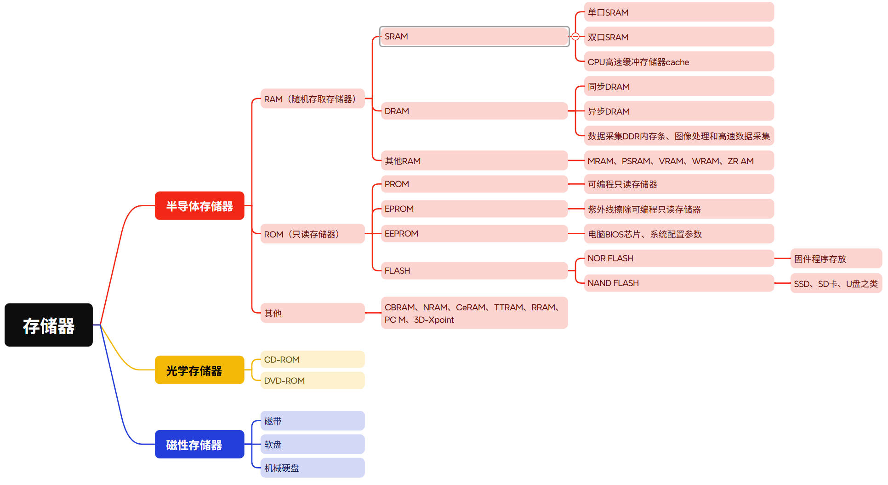
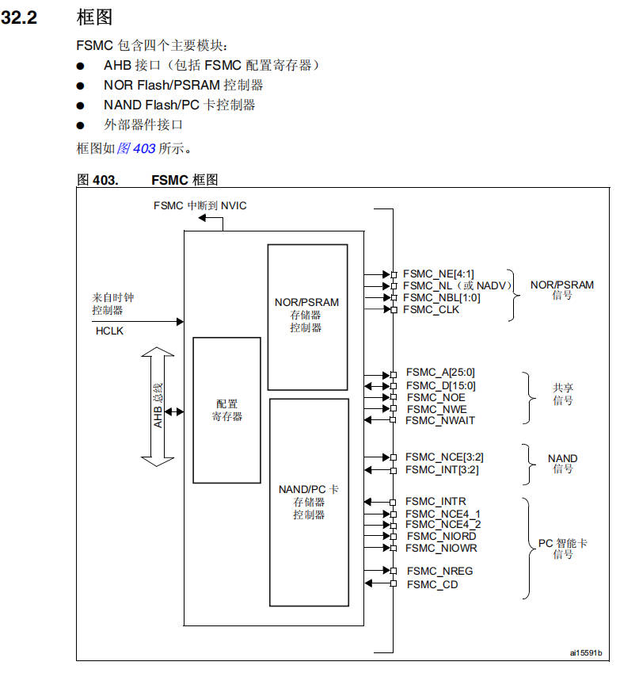
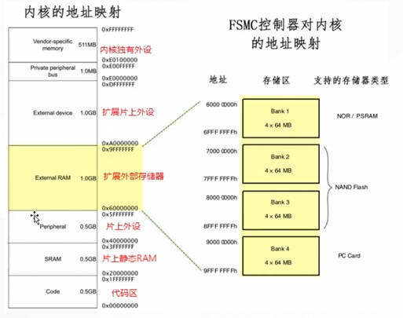
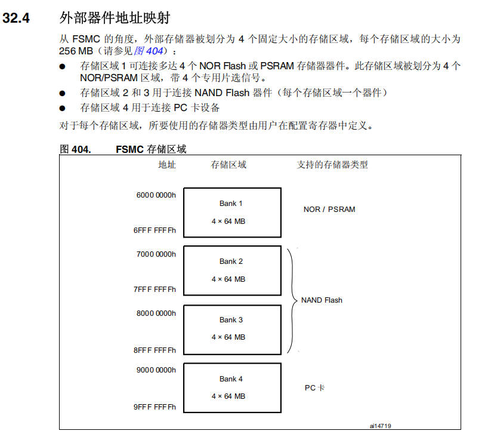
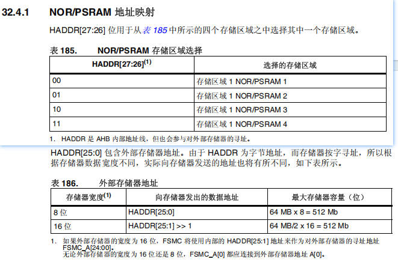
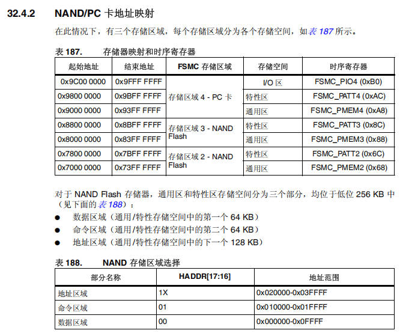

# 19 STM32-FSMC灵活的静态储存器控制器

> 本课整理自 `STM32-FSMC灵活的静态储存器控制器.pdf`(共 8 页)。返回 [[STM32学习目录|📑 STM32学习目录]]。

## 本章要点

- FSMC 在多台外部设备间共享地址、数据和控制信号,每台设备由唯一的片选信号区分,可连接同步或异步存储器及 16 位 PC 存储卡。
- FSMC 包含四个主要模块:AHB 接口(包括 FSMC 配置寄存器)、NOR Flash/PSRAM 控制器、NAND Flash/PC 卡控制器、外部器件接口。
- 从 FSMC 角度看,外部存储器被划分为 4 个固定大小的存储区域,每个 256 MB:存储区域 1 接 NOR Flash/PSRAM,区域 2、3 接 NAND Flash,区域 4 接 PC 卡。
- AHB 数据宽度与存储器宽度不一致时,FSMC 自动把 AHB 操作分割成较小宽度的存储器操作,或通过字节通道 `BL[1:0]` 访问正确数据。
- TFTLCD(ILI9341)的 GRAM 本质上是一片 153,600 字节的"内存区域",用 FSMC 以存储器映射方式访问,可取代软件模拟 8080 时序的低效刷屏。
- ILI9341 用 RGB565(R 5 位/G 6 位/B 5 位)16 位数据表示一个像素,内部自动扩展为 18 位并按 Gamma 校正曲线输出。

## FSMC功能概述

> 📄 原课件 p.1

FSMC 的功能概览如下表所示:

| 功能 | 描述 |
| --- | --- |
| 共享功能 | 共享地址,还有数据和控制信号 |
| 访问方式 | 每台设备唯一一个片选信号区分,每次只能访问一个设备 |
| 通讯类型 | 可以连接同步或者异步存储器和 16 位 PC 存储卡 |
| 支持的元器件 | 静态随机存储器(SRAM) 只读存储器(ROM) NOR Flash 和 NAND Flash PSRAM(4 个存储器块) |
| 可编程时序 | 等待周期可编程(多达 15 个周期) 线恢复周期可编程(多达 15 个周期) 输出使能与写使能延迟可编程(多达 15 周期) 独立的读写时序和协议,可支持宽范围的存储器和时序 |
| 32 位转 16 或者 8 位存储操作 | 将 32 位的 AHB 访问请求,转换到连续的 16 位或 8 位的,对外部 16 位或 8 位器件的访问 |
| FIFO 操作 | 具有 16 个字,每个字 32 位宽的写入 FIFO,允许在写入较慢存储器时释放 AHB 进行其它操作。在开始一次新的 FSMC 操作前,FIFO 要先被清空 |

## 储存器相关的分类介绍

FSMC 涉及的储存器主要有以下几类:

- 静态随机存储器(Static Random-Access Memory, SRAM)
- 只读存储器(ROM)
- NOR Flash 和 NAND Flash
- PSRAM(4 个存储器块,伪静态随机存储器)

### 储存器分类

> 📄 原课件 p.2

课件用一张思维导图梳理了储存器分类:

导图内容整理如下:

- 半导体存储器
  - RAM(随机存取存储器)
    - SRAM:单口 SRAM、双口 SRAM、CPU 高速缓冲存储器 cache
    - DRAM:同步 DRAM、异步 DRAM、数据采集 DDR 内存条、图像处理和高速数据采集
    - 其他 RAM:MRAM、PSRAM、VRAM、WRAM、ZR AM
  - ROM(只读存储器)
    - PROM:可编程只读存储器
    - EPROM:紫外线擦除可编程只读存储器
    - EEPROM:电脑 BIOS 芯片、系统配置参数
    - FLASH:NOR FLASH(固件程序存放)、NAND FLASH(SSD、SD 卡、U 盘之类)
  - 其他:CBRAM、NRAM、CeRAM、TTRAM、RRAM、PCM、3D-Xpoint
- 光学存储器:CD-ROM、DVD-ROM
- 磁性存储器:磁带、软盘、机械硬盘

## FSMC系统框图，结构讲解

> 📄 原课件 p.3

FSMC 包含四个主要模块:

- AHB 接口(包括 FSMC 配置寄存器)
- NOR Flash/PSRAM 控制器
- NAND Flash/PC 卡控制器
- 外部器件接口

框图如图 403 所示:

框图左侧是来自时钟控制器的 `HCLK` 与 AHB 总线,FSMC 中断送往 NVIC;右侧的外部信号按功能分组:

- NOR/PSRAM 信号:`FSMC_NE[4:1]`、`FSMC_NL`(或 `NADV`)、`FSMC_NBL[1:0]`、`FSMC_CLK`
- 共享信号:`FSMC_A[25:0]`、`FSMC_D[15:0]`、`FSMC_NOE`、`FSMC_NWE`、`FSMC_NWAIT`
- NAND 信号:`FSMC_NCE[3:2]`、`FSMC_INT[3:2]`
- PC 智能卡信号:`FSMC_INTR`、`FSMC_NCE4_1`、`FSMC_NCE4_2`、`FSMC_NIORD`、`FSMC_NIOWR`、`FSMC_NREG`、`FSMC_CD`

### 一般操作规则

- AHB 操作的数据宽度与存储器数据宽度相同:无数据传输一致性的问题。
- AHB 操作的数据宽度大于存储器的数据宽度:此时 FSMC 将 AHB 操作分割成几个连续的较小数据宽度的存储器操作,以适应外部设备的数据宽度。
- AHB 操作的数据宽度小于存储器的数据宽度:
  - 与具有字节选择功能的存储器(SRAM、ROM、PSRAM 等)进行异步传输时,FSMC 执行读写操作并通过它的字节通道 `BL[1:0]` 访问正确的数据。
  - 与不具有字节选择功能的存储器(NOR 和 16 位 NAND 等)进行异步传输时,即需要对 16 位宽的闪存存储器进行字节访问。

### 外部储存设备的地址映射

> 📄 原课件 p.4

左图"内核的地址映射"自 `0x00000000` 向上划分:

| 区域 | 地址范围 | 大小 |
| --- | --- | --- |
| Code(代码区) | 0x00000000 ~ 0x1FFFFFFF | 0.5GB |
| SRAM(片上静态 RAM) | 0x20000000 ~ 0x3FFFFFFF | 0.5GB |
| Peripheral(片上外设) | 0x40000000 ~ 0x5FFFFFFF | 0.5GB |
| External RAM(扩展外部存储器) | 0x60000000 ~ 0x9FFFFFFF | 1.0GB |
| External device(扩展片上外设) | 0xA0000000 ~ 0xDFFFFFFF | 1.0GB |
| Private peripheral bus | 0xE0000000 ~ 0xE00FFFFF | 1.0MB |
| Vendor-specific memory(内核独有外设) | 0xE0100000 ~ 0xFFFFFFFF | 511MB |

其中 FSMC 控制器占用"扩展外部存储器"这一段,右图给出它对内核的地址映射——4 个存储区,每区 4 × 64 MB:

| 地址 | 存储区 | 支持的存储器类型 |
| --- | --- | --- |
| 6000 0000h ~ 6FFF FFFh | Bank 1(4 × 64 MB) | NOR / PSRAM |
| 7000 0000h ~ 7FFF FFFh | Bank 2(4 × 64 MB) | NAND Flash |
| 8000 0000h ~ 8FFF FFFh | Bank 3(4 × 64 MB) | NAND Flash |
| 9000 0000h ~ 9FFF FFFh | Bank 4(4 × 64 MB) | PC Card |

> 📄 原课件 p.5

从 FSMC 的角度,外部存储器被划分为 4 个固定大小的存储区域,每个存储区域的大小为 256 MB:

- 存储区域 1 可连接多达 4 个 NOR Flash 或 PSRAM 存储器器件。此存储区域被划分为 4 个 NOR/PSRAM 区域,带 4 个专用片选信号。
- 存储区域 2 和 3 用于连接 NAND Flash 器件(每个存储区域一个器件)。
- 存储区域 4 用于连接 PC 卡设备。

对于每个存储区域,所要使用的存储器类型由用户在配置寄存器中定义。

> 📄 原课件 p.6

NOR/PSRAM 地址映射:`HADDR[27:26]` 位用于从四个存储区域之中选择其中一个存储区域。

**表 185 NOR/PSRAM 存储区域选择**

| HADDR[27:26](1) | 选择的存储区域 |
| --- | --- |
| 00 | 存储区域 1 NOR/PSRAM 1 |
| 01 | 存储区域 1 NOR/PSRAM 2 |
| 10 | 存储区域 1 NOR/PSRAM 3 |
| 11 | 存储区域 1 NOR/PSRAM 4 |

(1) HADDR 是 AHB 内部地址线,但也会参与对外部存储器的寻址。

`HADDR[25:0]` 包含外部存储器地址。由于 HADDR 为字节地址,而存储器按字寻址,所以根据存储器数据宽度不同,实际向存储器发送的地址也将有所不同,如下表所示。

**表 186 外部存储器地址**

| 存储器宽度(1) | 向存储器发出的数据地址 | 最大存储器容量(位) |
| --- | --- | --- |
| 8 位 | `HADDR[25:0]` | 64 MB x 8 = 512 Mb |
| 16 位 | `HADDR[25:1] >> 1` | 64 MB/2 x 16 = 512 Mb |

(1) 如果外部存储器的宽度为 16 位,FSMC 将使用内部的 `HADDR[25:1]` 地址来作为对外部存储器的寻址地址 `FSMC_A[24:00]`。无论外部存储器的宽度是 16 位还是 8 位,`FSMC_A[0]` 都应连接到外部存储器地址 `A[0]`。

#### NAND Flash 和PC卡地址映像

> 📄 原课件 p.7

在此情况下,有三个存储区域,每个存储区域分为各个存储空间,如表 187 所示。

**表 187 存储器映射和时序寄存器**

| 起始地址 | 结束地址 | FSMC 存储区域 | 存储空间 | 时序寄存器 |
| --- | --- | --- | --- | --- |
| 0x9C00 0000 | 0x9FFF FFFF | 存储区域 4 - PC 卡 | I/O 区 | `FSMC_PIO4 (0xB0)` |
| 0x9800 0000 | 0x9BFF FFFF | 存储区域 4 - PC 卡 | 特性区 | `FSMC_PATT4 (0xAC)` |
| 0x9000 0000 | 0x93FF FFFF | 存储区域 4 - PC 卡 | 通用区 | `FSMC_PMEM4 (0xA8)` |
| 0x8800 0000 | 0x8BFF FFFF | 存储区域 3 - NAND Flash | 特性区 | `FSMC_PATT3 (0x8C)` |
| 0x8000 0000 | 0x83FF FFFF | 存储区域 3 - NAND Flash | 通用区 | `FSMC_PMEM3 (0x88)` |
| 0x7800 0000 | 0x7BFF FFFF | 存储区域 2 - NAND Flash | 特性区 | `FSMC_PATT2 (0x6C)` |
| 0x7000 0000 | 0x73FF FFFF | 存储区域 2 - NAND Flash | 通用区 | `FSMC_PMEM2 (0x68)` |

对于 NAND Flash 存储器,通用区和特性区存储空间分为三个部分,均位于低位 256 KB 中(见表 188):

- 数据区域(通用/特性存储空间中的第一个 64 KB)
- 命令区域(通用/特性存储空间中的第二个 64 KB)
- 地址区域(通用/特性存储空间中的下一个 128 KB)

**表 188 NAND 存储区域选择**

| 部分名称 | HADDR[17:16] | 地址范围 |
| --- | --- | --- |
| 地址区域 | 1X | 0x020000-0x03FFFF |
| 命令区域 | 01 | 0x010000-0x01FFFF |
| 数据区域 | 00 | 0x000000-0x0FFFF |

## 用FSMC驱动TFTLCD

TFT-LCD 本身不具备智能处理能力,其显示内容完全依赖外部控制器持续供给像素数据及控制指令。一块典型的 320×240 分辨率屏幕,其物理像素点总数达 76,800 个,每个像素点需独立控制 RGB 三原色强度。若由 CPU 逐点模拟时序写入,以 16 位 RGB565 格式计算,仅刷新一帧全屏即需传输 153,600 字节数据。在 72MHz 主频下,即使不计总线竞争与中断开销,纯软件模拟 8080 时序的吞吐率也难以突破 2MB/s,导致刷屏延迟显著,动态画面出现撕裂。因此,工业级设计必然采用专用显示控制器或利用 MCU 内置的 FSMC 等硬件加速单元。

### TFTLCD（ILI9341）

这是一款高度集成的 16 位并行接口 LCD 控制器。其内部架构可划分为三个关键域:主机接口域(Host Interface)、显示 RAM 域(GRAM)和 LCD 驱动域(LCD Driver)。主机接口域负责解析来自 MCU 的命令与数据流,将其转换为 GRAM 地址指针与像素值;GRAM 域是一块容量为 320×240×2=153,600 字节的显存,用于缓存当前待显示的全部像素数据;LCD 驱动域则根据 GRAM 内容,以固定时序驱动 TFT 面板的行列电极,完成光电转换。这种分离式架构意味着,MCU 对屏幕的所有操作,本质上都是对 GRAM 这一片"内存区域"的读写访问,而 FSMC 正是为此类存储器映射访问而优化的硬件通道。

#### ILI9341颜色显示原理

> 📄 原课件 p.8

RGB565 格式通过 16 位数据表示一个像素,其位分配为:

- 红色(R):5 位(32 级)
- 绿色(G):6 位(64 级)
- 蓝色(B):5 位(32 级)

这种分配并非随意,而是基于人眼视锥细胞对不同波长光的敏感度差异——对绿色最为敏感,故分配最多位数以提供更细腻的亮度过渡。

#### 色彩转换原理

- 24 位真彩色(RGB888)通过截取高位转换为 RGB565
- ILI9341 内部自动将 16 位数据扩展为 18 位(6 位/色)
- 显示时根据 Gamma 校正曲线调整实际输出

## 小结与下一步

- FSMC 把外部存储器映射到内核 0x60000000~0x9FFFFFFF 的 1GB 空间,划分为 4 个 256MB 存储区域:Bank 1 接 NOR/PSRAM(带 4 个专用片选),Bank 2/3 接 NAND Flash,Bank 4 接 PC 卡。
- AHB 与存储器数据宽度不同时,FSMC 自动分割操作或经 `BL[1:0]` 字节通道匹配;16 位存储器用 `HADDR[25:1] >> 1` 生成实际地址,`FSMC_A[0]` 始终接外部地址 `A[0]`。
- TFTLCD(ILI9341)的 GRAM 就是一片"内存区域",用 FSMC 按存储器映射方式读写即可实现高速刷屏,避免软件模拟 8080 时序导致的撕裂。
- ILI9341 以 RGB565(5:6:5)16 位编码像素,内部扩展为 18 位(6 位/色)并按 Gamma 校正曲线输出。

➡️ 下一课:[[20-STM32-ADC数模转换|STM32-ADC数模转换]]
