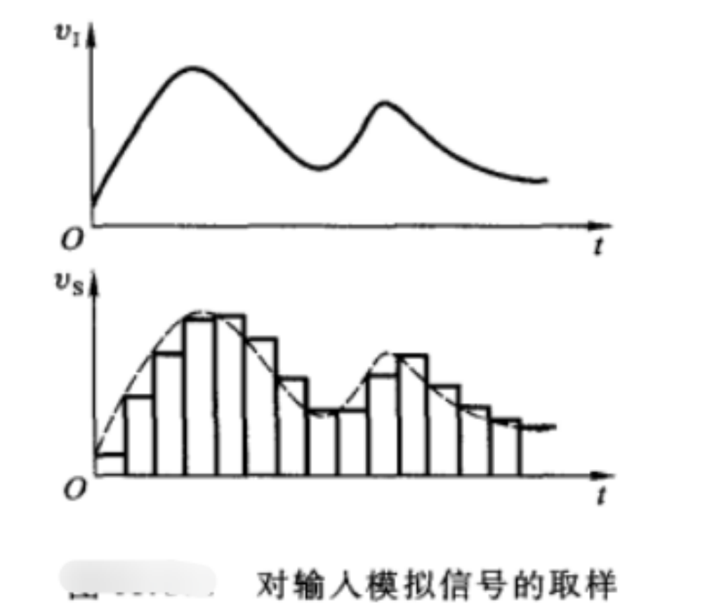
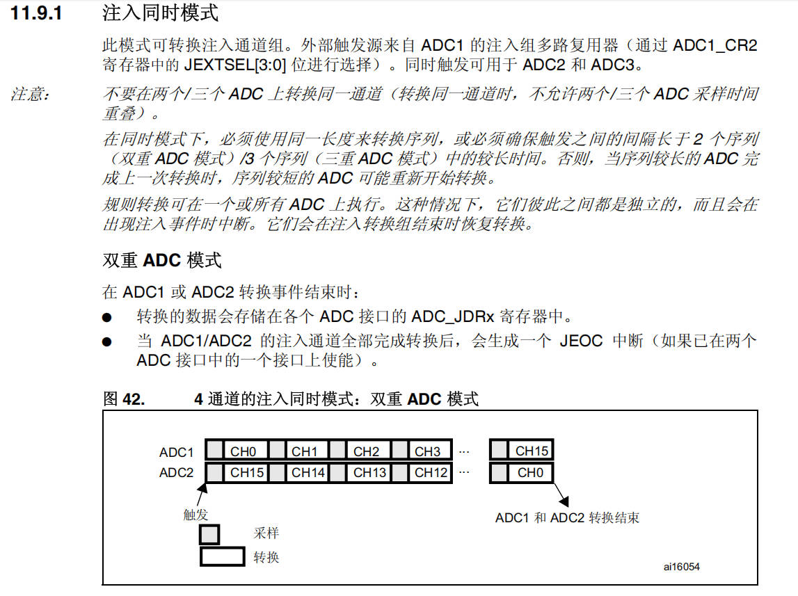
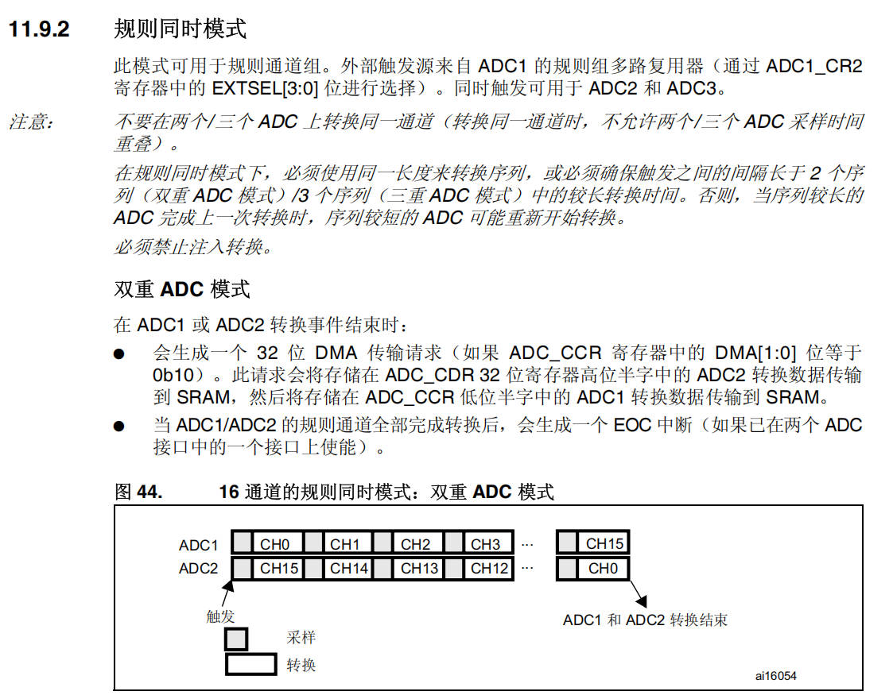
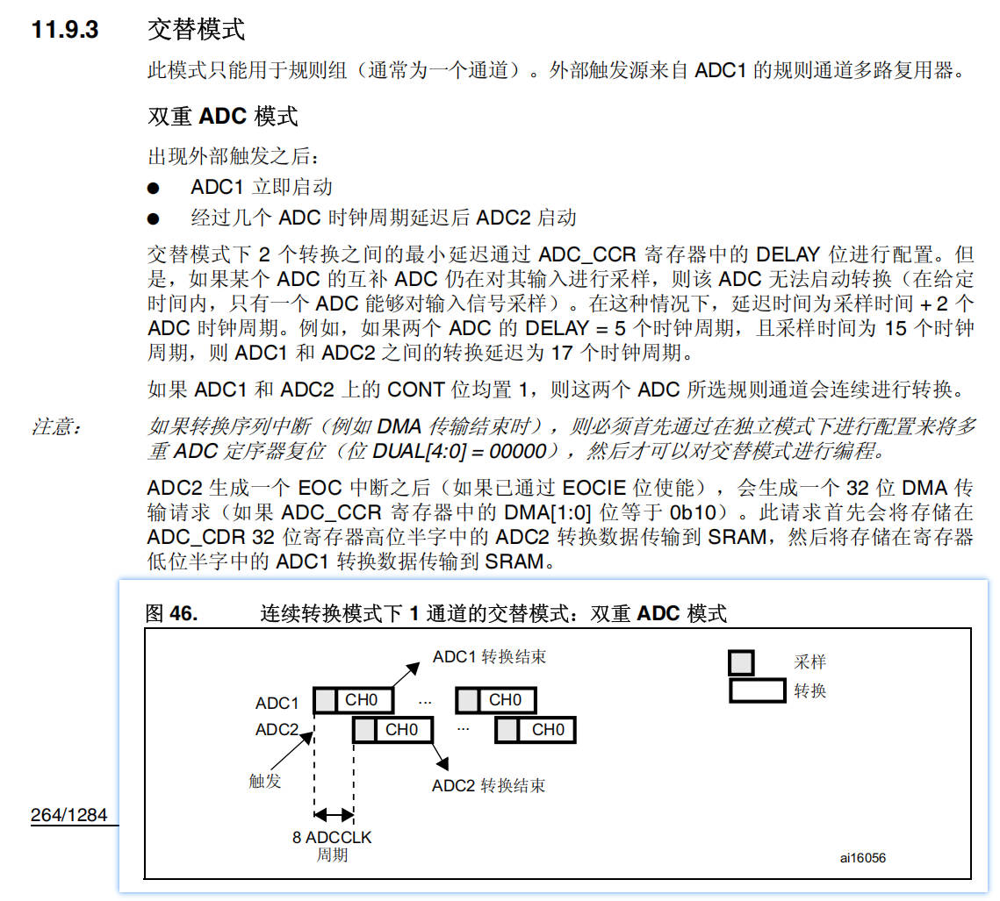
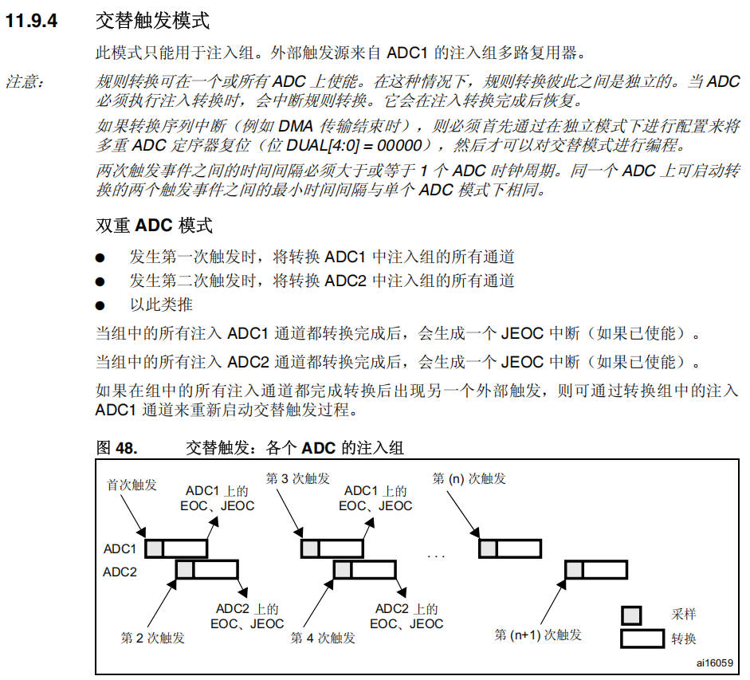
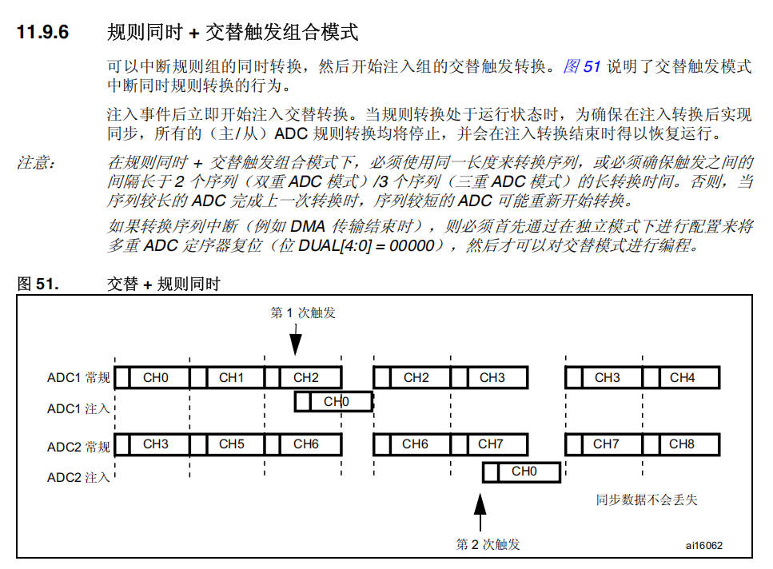
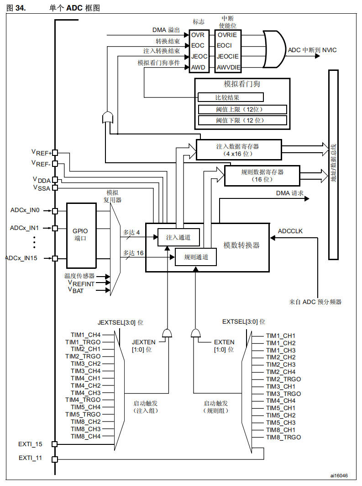
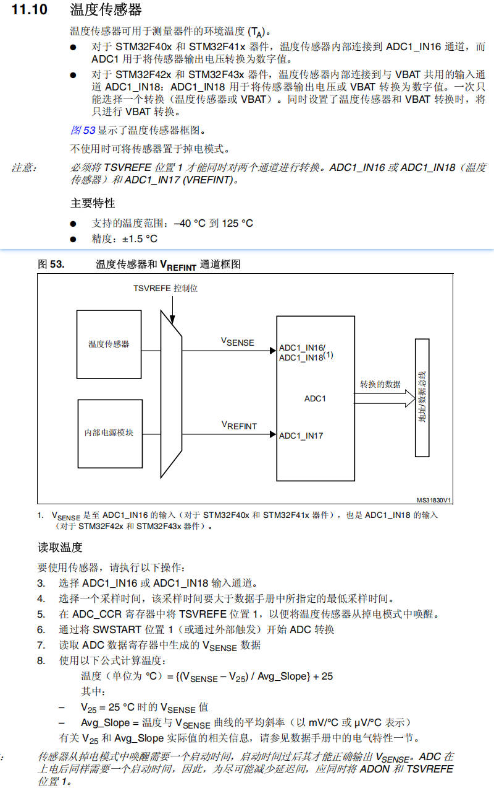
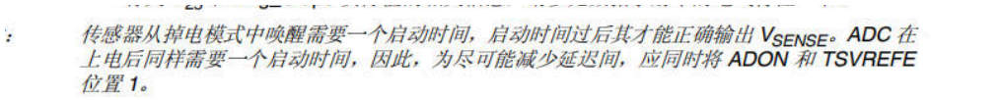
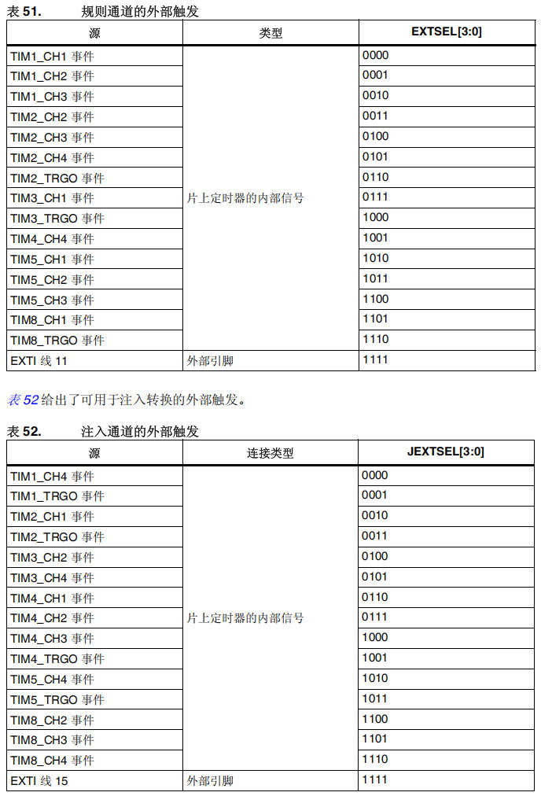

# 20 STM32-ADC数模转换

> 本课整理自 `STM32-ADC数模转换.pdf`(共 16 页)。返回 [[STM32学习目录|📑 STM32学习目录]]。

## 本章要点

- ADC 是逐次逼近型 12 位模数转换器，最多 18 个通道（16 个外部通道 + 2 个内部通道），输入时钟由 PCLK2 分频产生、不得超过 14MHz。
- 转换可按单次、连续、扫描、间断四种模式执行；通道分成规则组（最多 16 个转换）和注入组（最多 4 个转换）两组。
- 转换结果可左对齐或右对齐存入 16 位数据寄存器，并可产生 EOC、JEOC、AWD 中断，扫描模式下还能用 DMA 搬运数据。
- 模拟看门狗可监视通道电压是否超出 ADC_HTR/ADC_LTR 定义的高、低阈值，监视范围由 AWDSEL/AWDEN/JAWDEN 位组合决定。
- 双 ADC 模式分单模式（同步注入、同步规则、快速/慢速交叉、交替触发、独立）与组合模式（同步注入+同步规则、同步规则+交替触发、同步注入+交叉）。
- 温度传感器内部连接到 ADC1_IN16，置位 TSVREFE 唤醒后按公式换算出温度。

## ADC的功能介绍以及特性

1. ADC（Analog-to-Digital Converter）模拟数字转换器，是将模拟信号转换成数字信号的一种器件。
2. 12位ADC是一种逐次逼近型模拟数字转换器。它有多达18个通道，可测量16个外部通道和2个内部通道。



- 我们给大家使用的STM32F407单片机，共有3个12位的ADC通道，每个通道有16个引脚。
- 可以单次、连续、扫描或间断模式执行。ADC的结果可以左对齐或右对齐方式存储在16位寄存器中。
- 模拟输入检测电路电压是否超出用户定义的高/低阈值。
- ADC的输入时钟由PCLK2分频产生，频率不得超过14MHz。

## ADC的功能和特性

| 特性 | 描述 |
| --- | --- |
| ADC类型 | 逐次逼近型 |
| 分辨率 | 12位 |
| 转换模式 | 1.单次<br>2.连续（只适用于规则通道）<br>3.扫描模式（数据保存在ADC_DR或者ADC_JDR寄存器） |
| 校准模式 | 内置自动校准模式 |
| ADC时钟频率 | 最大到14MHz（PCLK2分频得到） |
| 采样周期 | 采样周期越长，转换结果越准确，但是转换时间会变长（通过ADC_SMPR1和ADC_SMPR2寄存器中的SMP[2:0]位更改） |
| 输入通道 | ADC1是16个GPIO通道和3个内部通道（温度传感器和VREFINT）<br>ADC2是16个GPIO通道<br>ADC3是11个GPIO通道 |
| 中断 | 1.规则组转换结束（标志位EOC）<br>2.注入组转换结束（标志位JEOC）<br>3.模拟看门狗状态位（标志位AWD） |
| 间断模式 | 规则组和注入组 |
| 注入通道管理 | 触发注入和自动注入 |
| 双重模式 | 双ADC模式（带2个或以上ADC的器件） |

## 单次转换模式

单次转换模式下，ADC只执行一次转换。该模式既可通过设置ADC_CR2寄存器的ADON位（只适用于规则通道）启动，也可通过外部触发启动（适用于规则通道或注入通道）。这时CONT位为0。一旦选择通道的转换完成：

- 如果一个规则通道被转换：
  - 转换数据被储存于16位ADC_DR寄存器中
  - EOC（转换结束）标志被设置
  - 如果设置了EOCIE位，则产生中断
- 如果一个注入通道被转换：
  - 转换数据被储存于16位ADC_DRJ1寄存器中
  - JEOC（注入转换结束）标志被设置
  - 如果设置了JEOCIE位，则产生中断

## 连续转换模式

在连续转换模式下，当前面ADC转换一结束马上就启动另一次转换。此模式可通过外部触发启动或通过设置ADC_CR2寄存器上的ADON位启动，此时CONT位是1。每个转换后：

- 如果一个规则通道被转换：
  - 转换数据被储存于16位的ADC_DR寄存器中
  - EOC（转换结束）标志被设置
  - 如果设置了EOCIE位，则产生中断
- 如果一个注入通道被转换：
  - 转换数据被储存于16位的ADC_DRJ1寄存器中
  - JEOC（注入转换结束）标志被设置
  - 如果设置了JEOCIE位，则产生中断

## 扫描模式

用于扫描一组模拟通道。可通过ADC_CR1寄存器中的SCAN位置1来选择扫描模式。将此位置1后，ADC将扫描在ADC_SQRx寄存器（对于规则通道）或ADC_JSQR寄存器（对于注入通道）中选择的所有通道。为组中的每个通道都执行一次转换。每次转换结束后，会自动转换该组的下一个通道。如果CONT位置1，规则通道转换不会在组中最后一个所选通道处停止，而是再次从第一个通道继续转换。

如果将DMA位置1，则在每次规则通道转换之后（EOC为1），均使用直接存储器访问（DMA）控制器将转换后规则通道组的数据（储存在ADC_DR寄存器中）传送到SRAM（而注入通道转换的数据是总存放在ADC_JDRx寄存器中）。

## 通道组选择

有16个多路通道。可以把转换组分成两组：规则组和注入组。在任意多个通道上以任意顺序进行的一系列转换构成成组转换。例如，可以以下顺序完成转换：通道3、通道8、通道2、通道0、通道2、通道0、通道2、通道15。

规则组由多达16个转换组成。规则通道和它们的转换顺序在ADC_SQRx寄存器中选择。规则组中转换的总数应写入ADC_SQR1寄存器的[3:0]位中。

注入组由多达4个转换组成。注入通道和它们的转换顺序在ADC_JSQR寄存器中选择。注入组里的转换总数应写入ADC_JSQR寄存器的[1:0]位中。

如果ADC_SQRx或ADC_JSQR寄存器在转换期间被更改，当前的转换被清除，一个新的启动脉冲将发送到ADC以转换新选择的组。

> 📄 原课件 p.4

**温度传感器/VREFINT内部通道**：温度传感器通道ADC1_IN16相连接，内部参照电压VREFINT和ADC1_IN17相连接。可以按注入或规则通道对这两个内部通道进行转换。

## 间断模式-注入组

此模式通过设置ADC_CR1寄存器中的JDISCEN位激活。在一个外部触发事件后，该模式按通道顺序逐个转换ADC_JSQR寄存器中所选择的序列。一个外部触发信号可以启动ADC_JSQR寄存器选择的下一个通道的转换，直到序列中所有的转换完成为止。总的序列长度由ADC_JSQR寄存器的[1:0]位定义。

例子：

n = 3，被转换的通道= 1、2、3

- 第一次触发：通道1被转换
- 第二次触发：通道2被转换
- 第三次触发：通道3被转换，并且产生EOC和JEOC事件
- 第四次触发：通道1被转换

注意：

1. 当完成所有注入通道转换后，下个触发启动第1个注入通道的转换。在上述例子中，第四次触发重新转换第1个注入通道1。
2. 不能同时使用自动注入和间断模式。
3. 必须避免同时为规则和注入组设置间断模式。间断模式只能作用于一组转换。

## 模拟看门狗

如果被ADC转换的模拟电压低于低阈值或高于高阈值，AWD模拟看门狗状态位被设置。阈值位于ADC_HTR和ADC_LTR寄存器的最低12个有效位中。通过设置ADC_CR1寄存器的AWDIE位以允许产生相应中断。

| 模拟看门狗监视的通道 | AWDSEL位 | AWDEN位 | JAWDEN位 |
| --- | --- | --- | --- |
| 无 | 任意值 | 0 | 0 |
| 所有注入通道 | 0 | 0 | 1 |
| 所有规则通道 | 0 | 1 | 0 |
| 所有注入和规则通道 | 0 | 1 | 1 |
| 单一的注入通道 | 1 | 0 | 1 |
| 单一的规则通道 | 1 | 1 | 0 |
| 单一的注入或规则通道 | 1 | 1 | 1 |

## 触发注入和自动注入

### 触发注入

清除ADC_CR1寄存器的JAUTO位，并且设置SCAN位，即可使用触发注入功能。

1. 利用外部触发或通过设置ADC_CR2寄存器的ADON位，启动一组规则通道的转换。
2. 如果在规则通道转换期间产生一外部注入触发，当前转换被复位，注入通道序列被以单次扫描方式进入转换。
3. 恢复上次被中断的规则组通道转换。如果在注入转换期间产生一规则事件，注入转换不会被中断，但是规则序列将在注入序列结束后被执行。

注意：当使用触发注入功能时，必须保证触发事件的间隔长于注入序列。例如：序列长度为28个ADC时钟周期（即2个具有1.5个时钟间隔采样时间的转换）。触发之间最小的间隔是29个ADC时钟周期。

### 自动注入

如果设置了JAUTO位，在规则通道之后，注入组通道被自动转换。

1. 这可以用来转换在ADC_SQRx和ADC_JSQR寄存器中设置的多至20个转换序列。
2. 在此模式下，必须禁止注入通道的外部触发。
3. 如果JAUTO位还设置了CONT位，规则通道至注入通道的转换序列将被连续执行。
4. 对于ADC时钟预分频系数为4时，当从规则转换切换到注入序列或从注入转换切换到规则序列时，会自动插入1个ADC时钟周期；当ADC时钟预分频系数为2时，则有2个ADC时钟周期的延迟。

注意：不可同时使用自动注入和间断模式。

## 双ADC模式

注意：在双ADC模式里，当转换配置成由外部事件触发时，用户必须将其设置成仅触发主ADC，从ADC设置成软件触发，这样可以防止意外的触发与转换。但是，主和从ADC的外部触发必须同时被激活。

### 单模式

**同步注入模式**

外部触发来自ADC1的注入组，同时给ADC2提供同步触发。



> 📄 原课件 p.6

**同步规则模式**

外部触发来自ADC1的规则组，同时给ADC2提供同步触发。



> 📄 原课件 p.7

**快速交叉模式**

只适用于规则通道（只能为一个通道）。外部触发来自ADC1的规则通道，ADC2立即启动并从ADC1在经过7个ADC时钟周期后启动，以避免ATC下转换重叠。



> 📄 原课件 p.8

**慢速交叉模式**

只适用于规则通道（只能为一个通道）。外部触发来自ADC1的规则通道，ADC2在延时14个ADC时钟周期后启动，以避免ATC下转换重叠。

**交替触发模式**

此模式只用于注入通道组。外部触发源来自ADC1的注入通道，当第一个触发产生时，ADC1被转换；当第二个触发到达时，ADC2被转换，依次循环……



> 📄 原课件 p.9

**独立模式**

此模式下，双ADC同步不工作，每个ADC接口独立工作。

### 组合模式

**同步注入模式+同步规则模式**

规则组和注入组都可以被中断，以启动注入组的同步转换。

**同步规则模式+交替触发模式**

规则组顺序转换可以被中断，以启动注入组交替触发转换。



> 📄 原课件 p.10

**同步注入模式+交叉模式**

一个注入事件可以中断一个交叉转换。这种情况下，交叉转换中断，注入转换被启动，在注入序列转换结束后，交叉转换继续。

## ADC的流程图和框图



## 温度传感器

1. 选择ADC_IN16输入通道。
2. 设置ADC时钟为17.1 μs。
3. 设置ADC控制寄存器2(ADC_CR2)的TSVREFE位，以唤醒关电模式下的温度传感器。
4. 通过设置ADON位启动ADC转换(或外部触发)。
5. 读ADC数据寄存器上的VAL值结果。
6. 利用下列公式得出温度：

```text
温度(°C) = (VTS - VSENSE) / Avg_Slope + 25
```

这里：

- VTS - VSENSE是25°C时的数值
- Avg_Slope =温度与VSENSE曲线的平均斜率(单位mV/°C或μV/°C)

参考数据手册的电气特性章节中VTS和Avg_Slope的实际值。



> 📄 原课件 p.14



### 外部触发转换

> 📄 原课件 p.16



## 小结与下一步

- ADC 为 12 位逐次逼近型，支持单次、连续、扫描、间断四种转换模式，通道分规则组与注入组，结果可左/右对齐存入 16 位数据寄存器。
- 转换可由软件 ADON 位或外部触发启动，EOC/JEOC/AWD 标志可产生中断，扫描模式下可用 DMA 将数据传送到 SRAM。
- 模拟看门狗按 AWDSEL/AWDEN/JAWDEN 组合决定监视范围；双 ADC 模式提供同步、交叉、交替触发及多种组合模式。
- 温度传感器接在 ADC1_IN16 内部通道上，置位 TSVREFE 唤醒后读取 VSENSE 并按公式换算温度。

➡️ 下一课:[[21-STM32-DMA|STM32-DMA]]
