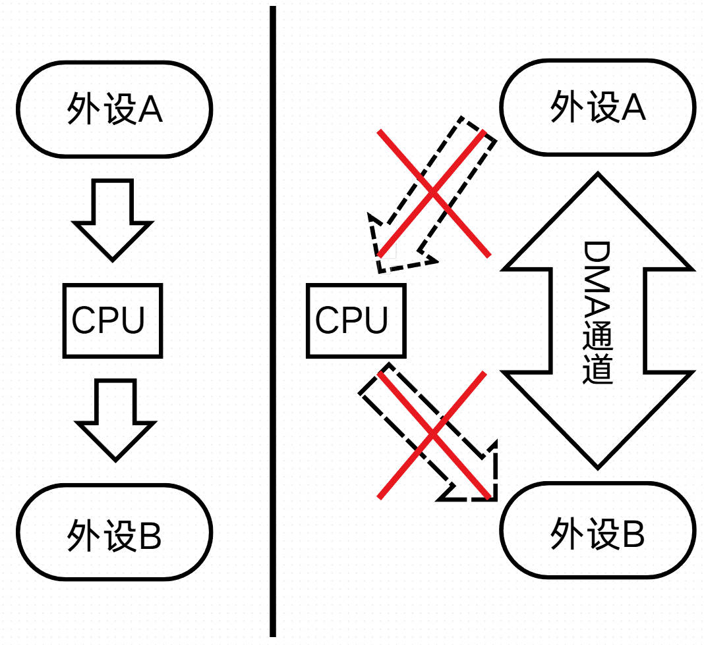
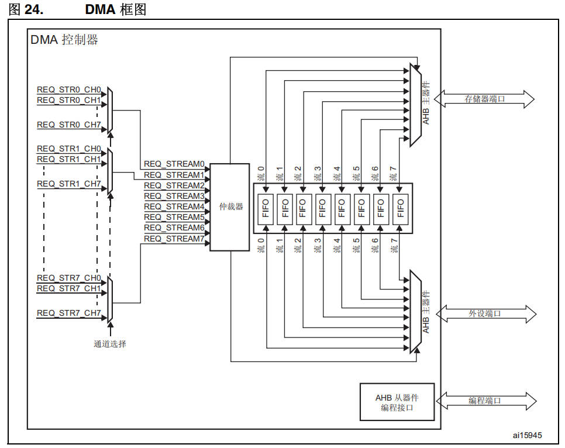
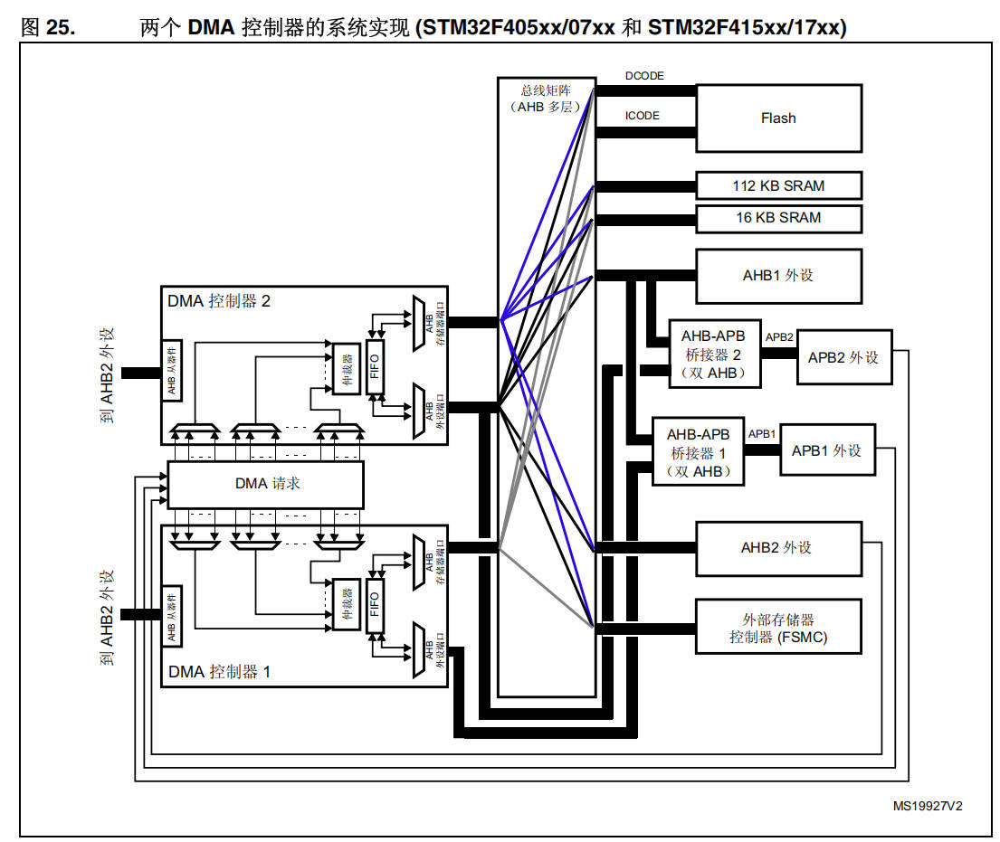
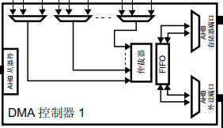
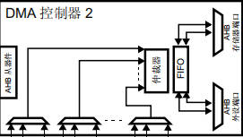
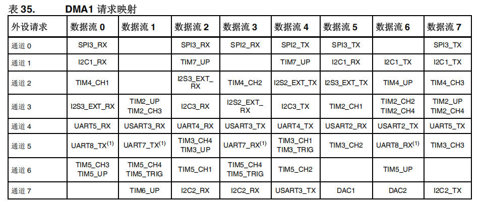
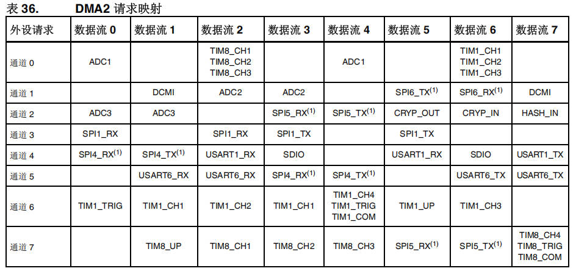
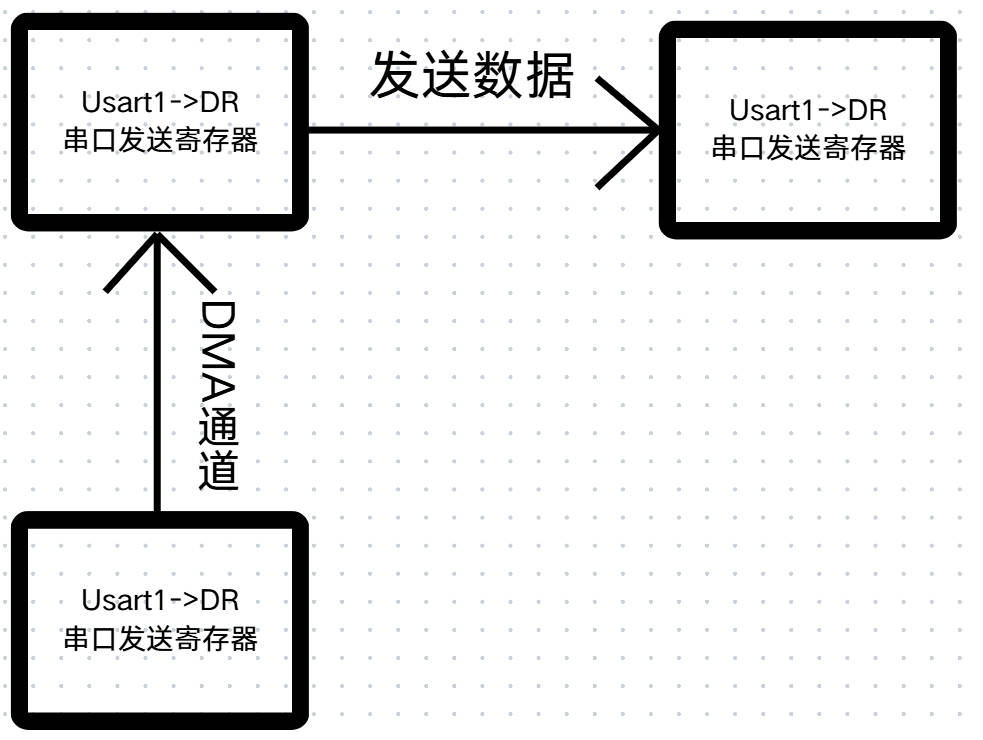
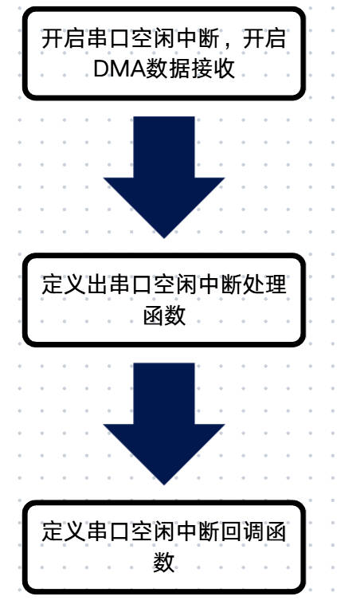

# 21 STM32-DMA

> 本课整理自 `STM32/21、STM32-DMA.zip → STM32-DMA/STM32-DMA.pdf`（共 10 页）。返回 [[STM32学习目录|📑 STM32学习目录]]。

## 本章要点

- DMA（直接存储器存取）在**无需 CPU 干预**的前提下完成外设与存储器之间、存储器与存储器之间的高速数据传输，节省 CPU 资源。
- 两个 DMA 控制器共 16 个通道（DMA1、DMA2 各 8 个），每个通道管理一个或多个外设对存储器访问的请求，并由**仲裁器**协调各请求的优先权；DMA2 仅存在于大量产品和互联型产品，F103 上没有。
- 传输模式有正常、循环、指针增量三种；传输数据量可编程、最大 65535，数据项计数寄存器每次传输后递减。
- DMA 中断含传输过半、传输完成、传输错误、FIFO 错误、直接模式错误五类标志；仲裁器按软件优先级（4 级）+ 硬件优先级（通道号小者优先）调度。
- 通道配置六步：外设地址 `DMA_CPARx` → 存储器地址 `DMA_CMARx` → 数据量 `DMA_CNDTRx` → 优先级 `DMA_CCRx` → 方向/模式/中断 `DMA_CCRx` → 使能 `DMA_CCRx` 的 `ENABLE` 位。
- 实践部分：串口可用 DMA 收发数据，配合 USART 空闲中断完成接收（开启中断与 DMA → 中断处理函数 → 回调函数）。

## DMA简介

> 📄 原课件 p.1

1. 直接存储器存取(DMA)用来提供在外设和存储器之间或者存储器和存储器之间的高速数据传输。无需CPU干预，数据可以通过DMA快速地移动。
2. 节省CPU的资源来做其他操作。

1. 两个DMA控制器有16个通道(DMA1有8个通道，DMA2有8个通道)，每个通道专门用来管理来自于一个或多个外设对存储器访问的请求。还有一个仲裁器来协调各个DMA请求的优先权。
2. DMA2仅存在于大量产品和互联型产品，如果你玩自己手上的F103，那个上面是没有相关功能的。

## DMA存取形式

> 📄 原课件 p.2

**存储器定义**：存储器包括自身的闪存（flash）或者内存（SRAM）以及外设的存储设备都可以作为访问的源或者目标。

**外设定义**：外设指的是spi、usart、iic、tim等基于APB1、APB2或AHB时钟外设，以及外设的SRAM。

移动目标：

1. 存储器 --> 存储器
2. 存储 --> 外设
3. 外设 --> 存储器
4. 外设 --> 外设

## DMA的传输模式

### 正常模式

- 一次性传输，结束之后即停止传输。
- 传输结束后（即传输计数变为0）将不再产生DMA操作。
- 要开始新的DMA传输，需要在关闭DMA通道的情况下，在DMA CNDTRx寄存器中重新写入传输数值。

### 循环模式

- 一次传输完了之后，自动重新装载初始值，进行下一轮传输。
- 处理循环缓冲区和连续的数据传输，比如ADC扫描模式。

### 指针增量模式

- 数据在每次传输完毕之后，自动向后递增，下一个要传输的地址，就是在当前地址上增量值。

**注意事项**：DMA传输的数据量是可编程的，最大达到65535。其中包含要传输的数据项数量的寄存器，在每次传后递减。

## DMA中断

> 📄 原课件 p.3

| 中断事件 | 事件标志位 | 使能控制位 | 所在寄存器 | 说明 |
| --- | --- | --- | --- | --- |
| 传输过半 | `HTIFx` | `HTIE` | `DMA_SxCR[3]` | 传输计数器达到设定值一半时触发（x=0~7，代表数据流编号） |
| 传输完成 | `TCIFx` | `TCIE` | `DMA_SxCR[4]` | 传输计数器归零，全部数据传输完成 |
| 传输错误 | `TEIFx` | `TEIE` | `DMA_SxCR[2]` | 包含地址错误、外设错误等传输异常 |
| FIFO错误 | `FEIFx` | `FEIE` | `DMA_SxFCR[7]` | FIFO上溢/下溢（仅当FIFO使能时有效） |
| 直接模式错误 | `DMEIFx` | `DMEIE` | `DMA_SxCR[5]` | FIFO禁用（直接模式）时发生错误（如突发传输冲突） |

## DMA仲裁器

- 仲裁器根据通道请求的优先级来启动外设/存储器的访问，分为软件优先级和硬件优先级组成。
- **软件**：每个通道的优先级可以在`DMA_CCRx`寄存器中设置，有4个等级：
  - 最高优先级
  - 高优先级
  - 中等优先级
  - 低优先级
- **硬件**：如果2个请求有相同的软件优先级，则较低编号的通道比较高编号的通道有较高的优先权。举个例子，通道2优先于通道4。

## DMA框图

> 📄 原课件 p.4

图 24 DMA 框图（编号 ai15945）关键组成：

- 左侧为各数据流的通道请求 `REQ_STR0_CH0`~`REQ_STR0_CH7`、`REQ_STR1_CH0`~`REQ_STR1_CH7`……直至 `REQ_STR7_CH0`~`REQ_STR7_CH7`，经**通道选择**器汇聚为 `REQ_STREAM0`~`REQ_STREAM7`。
- 请求进入**仲裁器**仲裁后，写入 8 个 `FIFO`（流0~流7，双向缓冲）。
- 经上、下两个 **AHB 主器件**分别连到**存储器端口**与**外设端口**；右下 **AHB 从器件编程接口**连**编程端口**。

> 📄 原课件 p.5（图 25，编号 MS19927V2）

图 25 关键组成：**总线矩阵（AHB 多层）** 连接 `DCODE`/`ICODE` → `Flash`、`112 KB SRAM`、`16 KB SRAM`、`AHB1 外设`、`AHB-APB 桥接 2（双 AHB）`→ `APB2 外设`、`AHB-APB 桥接 1（双 AHB）`→ `APB1 外设`、`AHB2 外设`、`外部存储器控制器（FSMC）`；左侧为 **DMA 控制器 2**（上）与 **DMA 控制器 1**（下），两者之间为 **DMA 请求**，控制器左侧标注"到 AHB2 外设"。

## DMA1请求映像

> 📄 原课件 p.5

> 📄 原课件 p.6（DMA 控制器 2 结构图）

两个控制器的结构一致：**AHB 从器件**接收编程，各通道请求经多路选择进入**仲裁器**，仲裁后通过 **FIFO**，由 **AHB 主器件**分别连到**存储器端口**与**外设端口**。

## DMA1对应外设

> 📄 原课件 p.6

| 外设请求 | 数据流 0 | 数据流 1 | 数据流 2 | 数据流 3 | 数据流 4 | 数据流 5 | 数据流 6 | 数据流 7 |
| --- | --- | --- | --- | --- | --- | --- | --- | --- |
| 通道 0 | `SPI3_RX` | | `SPI3_RX` | `SPI2_RX` | `SPI2_TX` | `SPI3_TX` | | `SPI3_TX` |
| 通道 1 | `I2C1_RX` | | `TIM7_UP` | | `TIM7_UP` | `I2C1_RX` | `I2C1_TX` | `I2C1_TX` |
| 通道 2 | `TIM4_CH1` | | `I2S3_EXT_RX` | `TIM4_CH2` | `I2S2_EXT_TX` | `I2S3_EXT_TX` | `TIM4_UP` | `TIM4_CH3` |
| 通道 3 | `I2S3_EXT_RX` | `TIM2_UP` `TIM2_CH3` | `I2C3_RX` | `I2S2_EXT_RX` | `I2C3_TX` | `TIM2_CH1` | `TIM2_CH2` `TIM2_CH4` | `TIM2_UP` `TIM2_CH4` |
| 通道 4 | `UART5_RX` | `USART3_RX` | `UART4_RX` | `USART3_TX` | `UART4_TX` | `USART2_RX` | `USART2_TX` | `UART5_TX` |
| 通道 5 | `UART8_TX`(1) | `UART7_TX`(1) | `TIM3_CH4` `TIM3_UP` | `UART7_RX`(1) | `TIM3_CH1` `TIM3_TRIG` | `TIM3_CH2` | `UART8_RX`(1) | `TIM3_CH3` |
| 通道 6 | `TIM5_CH3` `TIM5_UP` | `TIM5_CH4` `TIM5_TRIG` | `TIM5_CH1` | `TIM5_CH4` `TIM5_TRIG` | `TIM5_CH2` | | `TIM5_UP` | |
| 通道 7 | | `TIM6_UP` | `I2C2_RX` | `I2C2_RX` | `USART3_TX` | `DAC1` | `DAC2` | `I2C2_TX` |

表 35 DMA1 请求映射（原课件截图）：

## DMA2的对应外设

> 📄 原课件 p.7

| 外设请求 | 数据流 0 | 数据流 1 | 数据流 2 | 数据流 3 | 数据流 4 | 数据流 5 | 数据流 6 | 数据流 7 |
| --- | --- | --- | --- | --- | --- | --- | --- | --- |
| 通道 0 | `ADC1` | | `TIM8_CH1` `TIM8_CH2` `TIM8_CH3` | | `ADC1` | | `TIM1_CH1` `TIM1_CH2` `TIM1_CH3` | |
| 通道 1 | | `DCMI` | `ADC2` | `ADC2` | | `SPI6_TX`(1) | `SPI6_RX`(1) | `DCMI` |
| 通道 2 | `ADC3` | `ADC3` | | `SPI5_RX`(1) | `SPI5_TX`(1) | `CRYP_OUT` | `CRYP_IN` | `HASH_IN` |
| 通道 3 | `SPI1_RX` | | `SPI1_RX` | `SPI1_TX` | | `SPI1_TX` | | |
| 通道 4 | `SPI4_RX`(1) | `SPI4_TX`(1) | `USART1_RX` | `SDIO` | | `USART1_RX` | `SDIO` | `USART1_TX` |
| 通道 5 | | `USART6_RX` | `USART6_RX` | `SPI4_RX`(1) | `SPI4_TX`(1) | | `USART6_TX` | `USART6_TX` |
| 通道 6 | `TIM1_TRIG` | `TIM1_CH1` | `TIM1_CH2` | `TIM1_CH1` | `TIM1_CH4` `TIM1_TRIG` `TIM1_COM` | `TIM1_UP` | `TIM1_CH3` | |
| 通道 7 | | `TIM8_UP` | `TIM8_CH1` | `TIM8_CH2` | `TIM8_CH3` | `SPI5_RX`(1) | `SPI5_TX`(1) | `TIM8_CH4` `TIM8_TRIG` `TIM8_COM` |

表 36 DMA2 请求映射（原课件截图）：

## DMA通道配置流程

> 📄 原课件 p.7

### 1. 配置外设地址

作为数据传输的源或目标，`DMA_CPARx`寄存器。

### 2. 配置存储器地址

作为数据传输的源或目标，`DMA_CMARx`寄存器。

### 3. 配置传输的数据量

`DMA_CNDTRx`寄存器。

### 4. 设置通道优先级

`DMA_CCRx`寄存器。

> 📄 原课件 p.8

### 5. 设置数据传输的方向

模式（正常/循环），中断使能等，`DMA_CCRx`寄存器。

### 6. 启动该通道

`DMA_CCRx`寄存器的 `ENABLE`位。

## 使用串口使用DMA

> 📄 原课件 p.8（原课件本页仅给出本节标题，串口配合 DMA 的程序编写见下文「DMA程序编写」与「空闲中断+DMA程序编写」）

## USART空闲中断与DMA接收

### DMA程序编写

> 📄 原课件 p.9

图中三个方框均标注为 `Usart1->DR`（串口发送寄存器），数据流向：下方方框 —**DMA通道**→ 左上方框 —**发送数据**→ 右上方框。

### 空闲中断+DMA程序编写

> 📄 原课件 p.10

程序编写流程（原课件流程图）：

1. 开启串口空闲中断，开启DMA数据接收；
2. 定义出串口空闲中断处理函数；
3. 定义串口空闲中断回调函数。

## 小结与下一步

- DMA 无需 CPU 干预即可完成外设↔存储器、存储器↔存储器的高速传输；两个控制器共 16 个通道，由仲裁器按软件（4 级）+ 硬件（通道号小者优先）优先级调度。
- 传输模式分正常、循环、指针增量三种；数据量可编程、最大 65535，计数寄存器每次传输后递减；中断有过半/完成/传输错误/FIFO 错误/直接模式错误五类标志。
- 通道配置六步：`DMA_CPARx` → `DMA_CMARx` → `DMA_CNDTRx` → `DMA_CCRx`（优先级）→ `DMA_CCRx`（方向、模式、中断）→ `DMA_CCRx` 的 `ENABLE` 位启动。
- DMA1、DMA2 的请求映射见表 35、表 36；串口实践用 DMA 收发，配合 USART 空闲中断按"开启中断与 DMA → 中断处理函数 → 回调函数"三步编写程序。

➡️ 下一课：[[22-STM32-看门狗|STM32-看门狗]]
