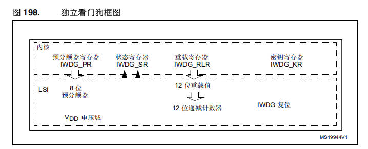
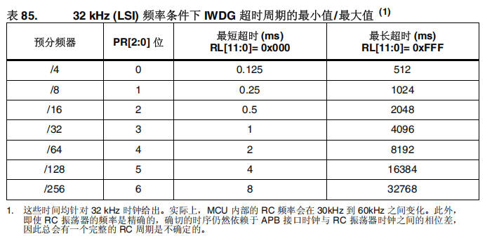
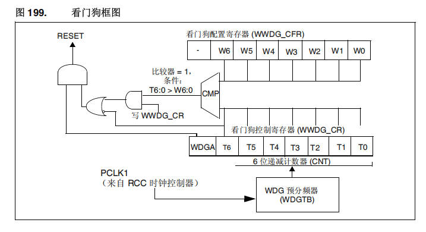
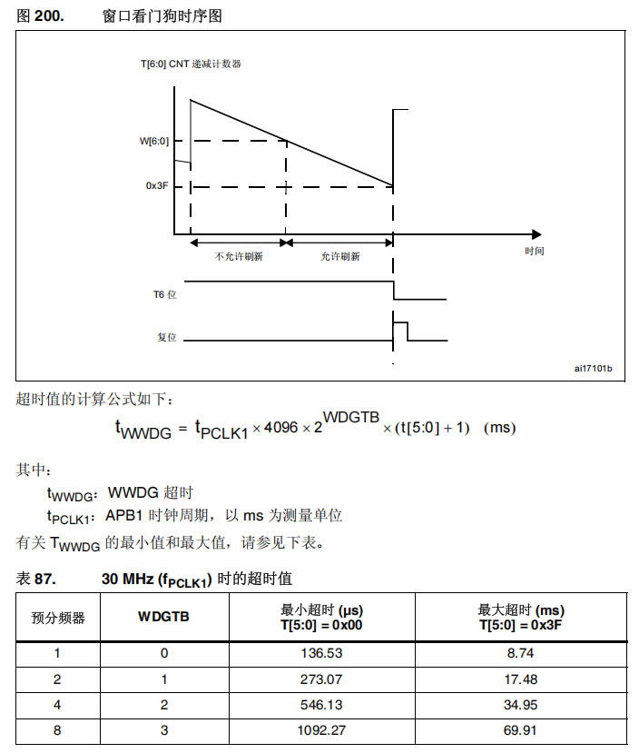

# 22 STM32-看门狗

> 本课整理自 `STM32/22、STM32-看门狗.zip → STM32-看门狗/STM-看门狗.pdf`（共 5 页）。返回 [[STM32学习目录|📑 STM32学习目录]]。

## 本章要点

- 独立看门狗 IWDG 独立于主时钟之外，由内部低速时钟 LSI 提供时钟、VDD 供电，用于监控软件故障、信号干扰、外部恶劣环境导致的系统无法正常运行。
- IWDG 用 12 位倒计时器计数，递减到 0 就产生复位；在减到 0 之前重置计数器的值即“喂狗”，超时范围由 PR[2:0] 预分频与 RL[11:0] 重载值决定。
- 窗口看门狗 WWDG 的时钟由 APB1 总线提供，采用 7 位递减计数器：计数器大于上窗口值或减到 0x3F 会复位，减到 0x40 时产生 EWI 中断，可在中断内部喂狗。
- WWDG 超时值按 `t_WWDG = t_PCLK1 × 4096 × 2^WDGTB × (t[5:0] + 1) (ms)` 计算；调试模式下由 `DBG_WWDG_STOP` 配置位决定计数器继续工作还是停止。
- 手动延时的喂狗时间可用 `喂狗时间(ms)=(127-窗口值)/(时钟频率(Hz)/4096/分频系数)*1000` 估算。

## 独立看门狗（IWDG）

### 独立看门狗的功能和特性

#### 介绍：

独立于主时钟之外，内部低速时钟（LSI）提供时钟，独立运行，VDD供电；

#### 作用：

监控软件故障/信号干扰/外部恶劣环境导致的系统无法正常运行；

#### 喂狗原理：

12位倒计时器，递减到0，就产生复位信号，系统重新运行；如果在减到0之前重置计数器的值，就不会产生复位信号，重置过程就称为“喂狗”。

### 独立看门狗框图



框图（图 198）包含：内核侧的预分频器寄存器 `IWDG_PR`、状态寄存器 `IWDG_SR`、重载寄存器 `IWDG_RLR`、密钥寄存器 `IWDG_KR`；VDD 电压域中的 `LSI`、8 位预分频器、12 位重载值、12 位递减计数器，以及 `IWDG` 复位输出。

#### 超时时间

> 📄 原课件 p.2



原表内容如下：

**表 85.　32 kHz (LSI) 频率条件下 IWDG 超时周期的最小值/最大值 (1)**

| 预分频器 | PR[2:0] 位 | 最短超时 (ms) RL[11:0]= 0x000 | 最长超时 (ms) RL[11:0]= 0xFFF |
| --- | --- | --- | --- |
| /4 | 0 | 0.125 | 512 |
| /8 | 1 | 0.25 | 1024 |
| /16 | 2 | 0.5 | 2048 |
| /32 | 3 | 1 | 4096 |
| /64 | 4 | 2 | 8192 |
| /128 | 5 | 4 | 16384 |
| /256 | 6 | 8 | 32768 |

> 1. 这些时间均针对 32 kHz 时钟给出。实际上，MCU 内部的 RC 频率会在 30kHz 到 60kHz 之间变化。此外，即使 RC 振荡器的频率是精确的，确切的时序仍然依赖于 APB 接口时钟与 RC 振荡器时钟之间的相位差，因此总会有一个完整的 RC 周期是不确定的。

## 窗口看门狗

### 窗口看门狗的功能和特性

- 时钟源：APB1总线时钟提供时钟源
- 计数器：七位递减计数器，如果处于运行中，即使禁止，计数器也会继续计数
- 复位：计数器大于设定数值（上窗口），计数器等于0x3F（十进制是63）值（下窗口）
- 中断：计数器等于0x40（十进制是64）的时候，产生中断（EWI），在中断内部进行喂狗，防止复位

### 窗口看门狗框图

> 📄 原课件 p.3



框图（图 199）包含：

- 看门狗配置寄存器（`WWDG_CFR`）：`-`、`W6`、`W5`、`W4`、`W3`、`W2`、`W1`、`W0`；
- 看门狗控制寄存器（`WWDG_CR`）：`WDGA`、`T6`~`T0`，下方标注为 6 位递减计数器（`CNT`）；
- 比较逻辑：`CMP` 比较器，条件为“比较器 = 1，`T6:0 > W6:0`”，另有“写 `WWDG_CR`”通路，经或门、与门输出到 `RESET`；
- 时钟：`PCLK1`（来自 RCC 时钟控制器）送入 `WDG` 预分频器（`WDGTB`）。

### 窗口看门狗时序图

> 📄 原课件 p.4



时序图（图 200）中，`T[6:0]` CNT 递减计数器从初值下降：高于 `W[6:0]` 的阶段标注为“不允许刷新”，`W[6:0]` 与 `0x3F` 之间标注为“允许刷新”；计数器减到 `0x3F` 时 `T6` 位变低，同时产生复位脉冲，横轴为时间。

超时值的计算公式如下：

```text
t_WWDG = t_PCLK1 × 4096 × 2^WDGTB × (t[5:0] + 1) (ms)
```

其中：

- `t_WWDG`：WWDG 超时
- `t_PCLK1`：APB1 时钟周期，以 ms 为测量单位

有关 `T_WWDG` 的最小值和最大值，请参见下表。

**表 87.　30 MHz (f_PCLK1) 时的超时值**

| 预分频器 | WDGTB | 最小超时 (µs) T[5:0] = 0x00 | 最大超时 (ms) T[5:0] = 0x3F |
| --- | --- | --- | --- |
| 1 | 0 | 136.53 | 8.74 |
| 2 | 1 | 273.07 | 17.48 |
| 4 | 2 | 546.13 | 34.95 |
| 8 | 3 | 1092.27 | 69.91 |

### 调试模式

当微控制器进入调试模式时（Cortex™-M4F内核停止），WWDG计数器会根据DBG模块中的 `DBG_WWDG_STOP` 配置位选择继续正常工作或者停止工作。

### 计算公式

> 📄 原课件 p.5

```text
手动延时的喂狗时间
喂狗时间(ms)=(127-窗口值)/(时钟频率(Hz)/4096/分频系数)*1000
```

## 小结与下一步

- IWDG 由 LSI 独立驱动、12 位倒计时，在超时前“喂狗”即可避免复位；表 85 给出不同预分频/重载值下的最短与最长超时。
- WWDG 基于 APB1 时钟的 7 位递减计数器，设有上、下窗口：早于上窗口或减到 0x3F 都会复位，减到 0x40 的 EWI 中断是安全的喂狗时机。
- 表 87 与两条公式分别给出 WWDG 超时值、手动延时喂狗时间的计算方法，调试时可用 `DBG_WWDG_STOP` 控制计数器启停。

➡️ 返回 [[STM32学习目录|📑 STM32学习目录]]
