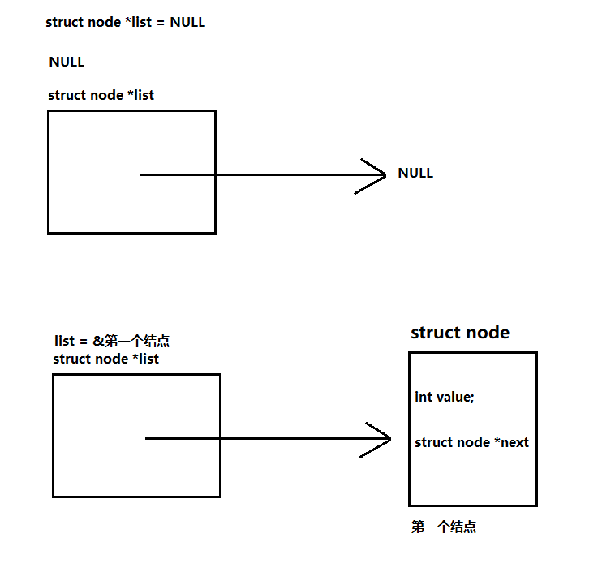
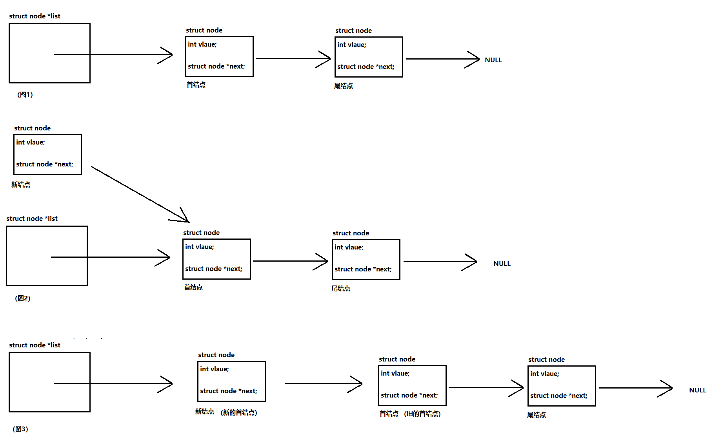
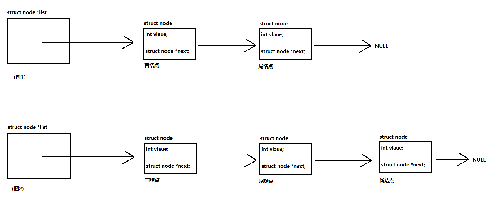

# 单链表
在 IT 界有一个公式：程序 = 数据结构 + 算法

## 什么是数据？

**数据**（ data ）是客观事物的一个符号表示，在计算机科学中式指所有能够输入到计算机中并能够被计算机程序处理的符号统称。

**数据元素**（ data element ）是数据的基本单位，在计算机程序中通常作为一个整体进行考虑和处理。一个数据元素可以由若干个数据项（ data item ）组成。数据项是数据不可分割的最小单位。

**数据对象**（ data object ）是性质相同的数据元素的集合，是一个数据的子集。

## 什么是结构？

结构：数据元素之间的关系的不同性质称之为：结构（ structure ）

根据数据元素之间的关系的性质不同，  通常有四类基本结构：

集合：结构中的数据元素之间，除了 “**同属于一个集合的关系**” 之外，就没有其它关系了。

线性结构：（顺序）

树状结构：（层次）

网状结构：（图状）

## 什么是数据结构？

数据结构的形式定义：数据结构是一个二元组

```c
Data_Sturcture = (D,S)
```

其中： D 是数据元素的有限集， S 是 D 上的关系的有限集（数据元素之间的关系的集合）

结构定义中的 “**关系**” 描述的是数据元素之间的逻辑关系（指向关系），因此又称之为： “**逻辑结构**”

“**逻辑结构**” 并不一定是数据元素在计算机中的存储（称为：映像）表示，数据元素存储结构称为：数据的物理结构，又称： “**存储结构**” 。

## 线性结构（线性表）

例子：

线性表的数据元素可以是各种各样、但是同一个线性表中的元素必须要具有相同的特性，即同属于同一个数据对象，相邻的元素之间存在**序偶关系**。

若将线性表记为：（ a1 、 a2 、 a3....an ）那么则会存在以下性质：

存在唯一的一个被称为：**" 第一个 "**的数据元素

存在唯一的一个被称为：**“ 最后一个 ”**的数据元素

除了第一个元素之外，集合中的每一个数据元素均只有一个前驱结点

```c
// 26 个英文字母（ A 、 B 、 C 、 D...Z ）
// 班上同学的学号
// 日期
...
```

除了最后一个元素之外，集合中的每一个数据元素均只有一个后继结点

前驱结点：前面有结点

后继结点：后面有结点

### 线性表的物理结构的实现

在计算机中是怎么存储线性表的

顺序结构：

线性表的顺序表示的是用**一组地址连续的存储单元**依次存储线性表中数据元素。

数组

动态开辟内存空间（数组空间）

链式结构：

链式结构存储用的**存储单元的地址不一定是连续的**

## 链表

链表：链式存储的线性表

### 无头结点的单链表

无头结点的单链表：没有头结点的单向的链式存储的线性表

**问题**：我们在定义数组的时候，需要规定数组的长度，定义好了就不能修改了。

### 新内容、老面孔

先来看一下下面这种结构体类型（带指针的结构体）

即想要按需分配，又可以进行灵活的删除和增加元素的时候：链表就可以解决这样的问题。

### 数组和链表的优缺点

数组：

优点：

数组将元素按顺序存放在内存中，而且元素的内存占用都是相同的，因为它的地址连续、所有可以通过下标快速的对数组元素进行访问。

内存不会有太多的碎片化

缺点：

```c
int a[10]; // 定义了一个元素为 int 类型的数组，数组大小为 10 个 int 类型
// 修改数组的大小
a = malloc(sizeof(int) * 100); // 不行的，因为 a 是常量指针，不能改变 a 指向。
struct data
{
    int d_data; // 数据
    struct data *p_data; // 指针  存储数据元素的地址。在单链表结构里面，存储下一个数据元素的
// 内存地址
};
```

有可能造成内存资源的浪费

数组元素的插入和删除比较复杂

有可能内存资源不够用，容易造成段错误（内存越界）

链表：

优点：

插入和删除很方便

可以按需分配，不会造成空间的浪费

缺点：

空间不是连续，访问相对数组而言效率要低很多碎片化比数组要高

**获取结构体空间方式：**

动态内存开辟：堆空间的内存

特性：空间的生存期是随进程持续性，需要手动释放

保存空间地址

通过定义变量：栈空间的内存

特性：作用域结束，空间就会被系统释放

用变量名

### 链表的概念

链表就是由一个或者是多个包含指针成员变量的结构体，通过其指针变量来指向其他**同类型结构体**内存地址来形成一种逻辑上的链式的数据结构。我们把每一个结构体实例（变量 / 空间）称为该链表的：**结点（ node)**

**首结点**：

是链表中唯一一个没有前驱结点、只有后继结点的结点。**是唯一一个指向其他的结点的结点首结点同时也是整个链表的首地址。**

**尾结点：**

是链表中唯一一个没有后继结点，只有前驱结点的结点。**是唯一一个被其他结点指向的结点。**

**注意：尾结点的指针成员是指向  **空**  的**

可以保证尾结点的指针成员不会成为野指针

可以通过判断指针是否指向空 来判断是不是查询到了最后一个元素

### 链表的创建步骤

每获取一个数据，就一个创建一个结构体空间来存储数据把数据存放到结构体体空间中

把这个新的结构体加入到链表中

#### 创建过程

从无到有的过程：

第一个结点诞生，此时首结点和尾结点都是第一个结点本身

从少到多的过程

在链表中增加结点，可以在链表尾部增加（尾插法）、也可以在链表的中间增加（中间插入法）、也可以在链表头部增加（头插法）

#### 头插法

新结点在**原首结点**的前面，即新结点指向首结点（成为原首结点的前驱结点），然后新结点代替**原首结点**称为新的首结点

特点：先加入链表的结点在后面，后加入链表的结点在前面



#### 尾插法

新节点增加在链表**原尾结点**的后面，即链表**原尾结点**要指向新结点（成为原尾结点的后继结点），然后新结点就代替**原尾结点**成为新的尾结点

**特点**：先加入的链表的结点在前面，而后加入结点在后面

#### 中间插入法

通过和每个结点数据进行比对，从而找到新结点存放的位置。通过中间插入法创建的链表是有序的。

**特点**：链表的结点数据是有序的。

作业：

完成一下中间插入法。

尝试现实链表的销毁和结点的删除。

示例代码

```c
/*
// 无头的单向链表
*/
```





```c
#include <stdio.h>
#include <stdlib.h>
// 结点类型
typedef struct node
{
    int _value; // 数据域，数据域可以是多个数据，这里只有一个数据
    struct node * _pNext;// 指针域，指针可以是多个，这里只有一个指针
}ListNode;
/*
// 头部插入法
        新结点在 ** 原首结点 ** 的前面，即新结点指向首结点（成为原首结点的前驱结点），
        然后新结点代替 ** 原首结点 ** 称为新的首结点
*/
ListNode *InsertHead(ListNode*list,int value)
{
    // 创建并初始化结点数据
    ListNode *newNode = malloc(sizeof(ListNode));
    newNode->_value   = value;
    newNode->_pNext   = NULL;
    // 头插法
    // 先获取头结点
    ListNode *headNode = list;
    // 让新结点的 pNext 指向原首结点
    newNode->_pNext = headNode;
    // 更新 list （链表首地址指针）的指向
    list = newNode;
}
/*
// 尾部插入法
        新节点增加在链表 ** 原尾结点 ** 的后面，即链表 ** 原尾结点 ** 要指向新结点（成为原尾结点的后继
// 结点），
        然后新结点就代替 ** 原尾结点 ** 成为新的尾结点
*/
void InsertTail(ListNode*list,int value)
{
    // 创建并初始化结点数据
    ListNode *newNode = malloc(sizeof(ListNode));
    newNode->_value   = value;
    newNode->_pNext   = NULL;
    // 尾插法
    // 找到尾结点
    ListNode *tailNode = list;// 先获取首结点
    // 通过循环去找 pNext 指针为空的结点
    while(tailNode->_pNext)tailNode = tailNode->_pNext;
    // 将尾结点的 pNext 指针指向新结点
    tailNode->_pNext = newNode;
}
/*
// 创建链表
// 从无到有
*/
// ListNode *CreateNewList(int value)
// {
//     ListNode *node = malloc(sizeof(ListNode)); // 创建一个结点空间
//     // 初始化结构体成员
//     node->_value = value;
//     node->_pNext = NULL; // 尾结点置空，它既是第一个也是最后一个
//     // 返回这个结点的地址，作为链表的首地址
//     return node;
// }
/*
// 创建链表
// 从无到有
// 从少到多
// @pargam list 需要增加结点的链表指针（链表首地址指针）
// @pargam value 需要增加到链表当中的结点数据
// @return 链表的首地址
*/
ListNode *Append(ListNode*list,int value)
{
    // 判断 list 是否为空  ：从无到有
    if(!list) // 如果 list 为空说明它是一个空链表，直接增加第一个结点
    {
        list = malloc(sizeof(ListNode));
        list->_value = value;
        list->_pNext = NULL;
        return list;
    }
    // 从少到多
    // 头尾插入的区分条件：对 2 取余，如果为 0 放前面，如果不为 0 放后面
    if(value % 2)
        InsertTail(list,value);
    else
        list = InsertHead(list,value);
    return list;
}
// 打印链表数据
void PrintListValue(ListNode *list)
{
    // 判断链表是否为空
    if(!list)
        printf("NULL\n");
    else
    {
        ListNode *currentNode = list;
        while(currentNode)
        {
            printf("%d->",currentNode->_value);
            currentNode = currentNode->_pNext;
        }
        printf("NULL\n");
    }
}
int main()
```

```c
{
    // 创建链表
    // ListNode *list = CreateNewList(0); // 不太妙
    ListNode *list = NULL; // 创建一个空链表
    for(int i = 0;i < 10;i++)
    {
        int number = 0;
        scanf("%d",&number);
        list = Append(list,number);
    }
    PrintListValue(list);
    return 0;
}
```
