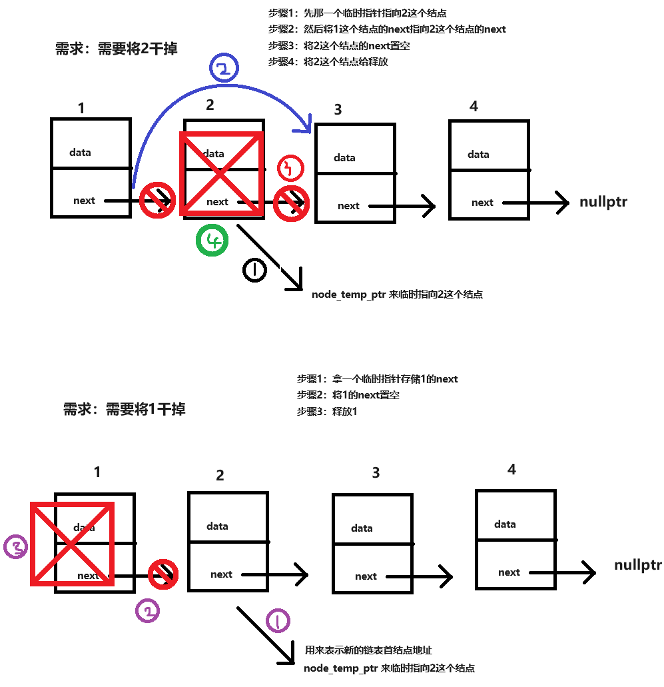
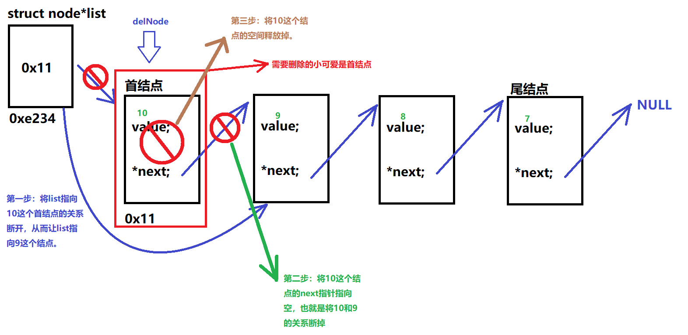
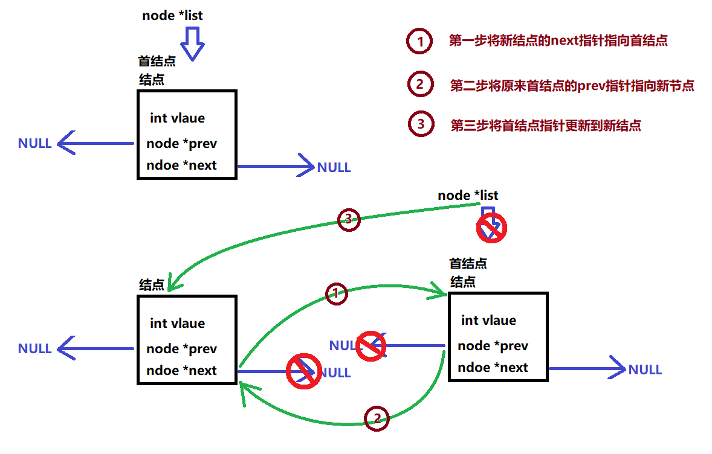
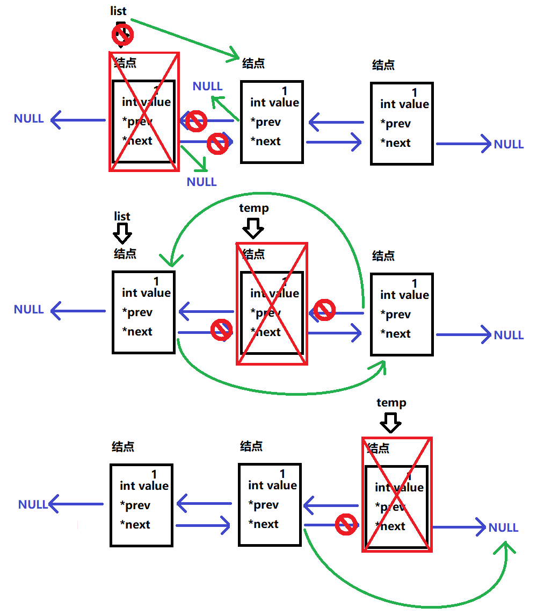
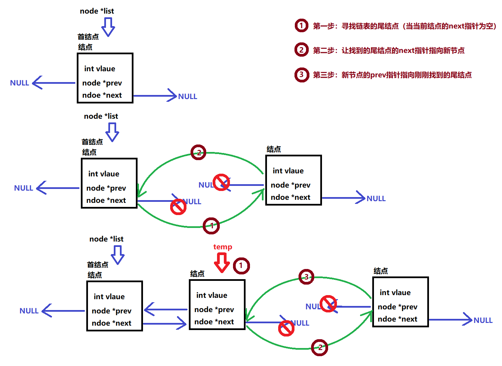
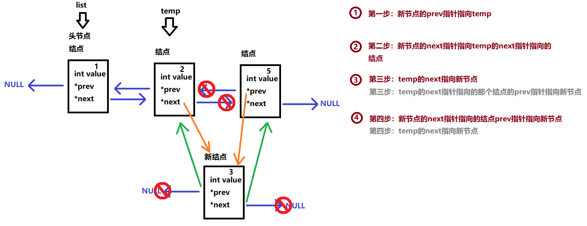

# 双链表
上次的作业：

中间插入法（做排序）

链表的结点的删除

```c
ListNode * InsertMid(ListNode*list,int value)
{
    // 创建并初始化结点数据
    ListNode *newNode = malloc(sizeof(ListNode));
    newNode->_value   = value;
    newNode->_pNext   = NULL;
    // 判断链表是否为空
    if(!list)
        return newNode;
    // 查找需要插入的位置
    // 与链表中的每个结点进行比较
    ListNode *prevNode    = NULL;
    ListNode *currentNode = list;
    while(currentNode)
    {
        // 与当前结点的数据进行比较，如果大于当前结点，则将当前结点向后更新
        if(currentNode->_value < value)
        {
            prevNode = currentNode;
            currentNode = currentNode->_pNext;
        }
        else // 如果当前结点的数据，大于等于 value 说明找到了插入的位置
        {
            // 先让新结点的 next 指针指向 current 结点
            newNode->_pNext = currentNode;
            // 让 current 的前一个结点的 next 指针指向新结点。
            if(!prevNode)return newNode; // 如果 prev 为空说明 newNode 是头插
// 法，直接返回
            else prevNode->_pNext = newNode;
            break;
        }
    }
    if(!currentNode)prevNode->_pNext = newNode; // 尾插法
    return list;
}
ListNode * DeleteNode(ListNode*list,int value)
{
    if(!list)return list;
    // 需要删除可能是首结点
    if(list->_value == value)
    {
        ListNode *tempNode = list->_pNext;
        list->_pNext = NULL;
        free(list); // 删除首结点空间
        // 更新新的首结点
        return tempNode;
    }
    // 尾结点和中间结点的删除方式是一致的
    ListNode *prevNode = list;
    ListNode *currentNode = list->_pNext;
    while(currentNode)
    {
        if(currentNode->_value == value) // 找到了
        {
            prevNode->_pNext = currentNode->_pNext; // 将被删除的结点的前驱
// 结点的 next 指针指向被删除的结点的后继结点
            currentNode->_pNext = NULL;
            free(currentNode); // 删除节点空间
```



链表的整体的销毁

但是我们发现单链表存在一个弊端：不能回溯（没法直接回到前一个结点）

有木有方法可以解决这个问题？

双向链表它可以解决单向链表只有一个指针指向下一个结点没法回溯的这么一个问题。

## 双向链表

双向链表它包含数据域和指针域（但是指针域相对单链表而言多出了一个指针： prev 指针）

```c
            return list;
        }
        // 更新结点
        prevNode = currentNode;
        currentNode = currentNode->_pNext;
    }
    return list;
}
ListNode *DestoryList(ListNode*list)
{
    if(!list)return list;
    ListNode *nextNode = list; // 存储下一个结点
    while(nextNode)
    {
        nextNode = nextNode->_pNext;
        list->_pNext = NULL;
        free(list); // 删除首结点空间
        list = nextNode;
    };
    return NULL;
}
```



### 头插法

### 删除结点

```c
struct node
{
// 数据域
    ElementType data;
// 指针域
    struct node *prev; // 前指针
    struct node *next; // 后指针
};
```



### 尾插法



### 中间插入法

作业：

手搓单双链表的，增删改查代码。




