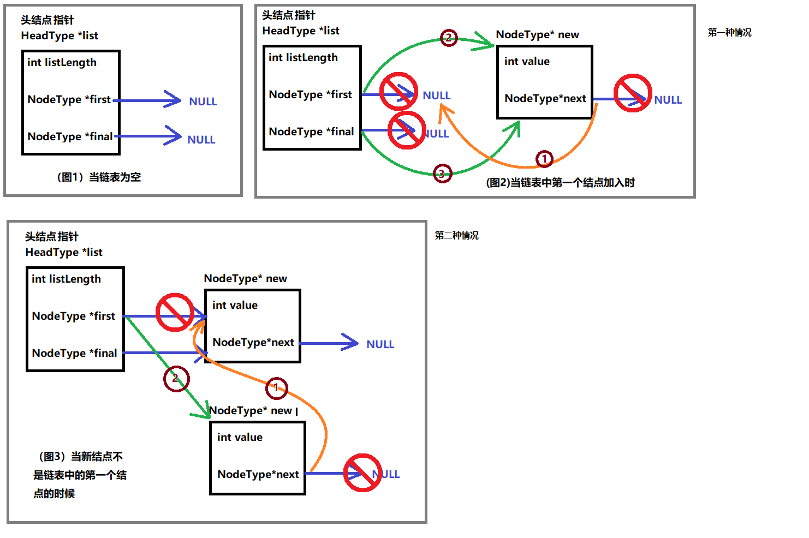
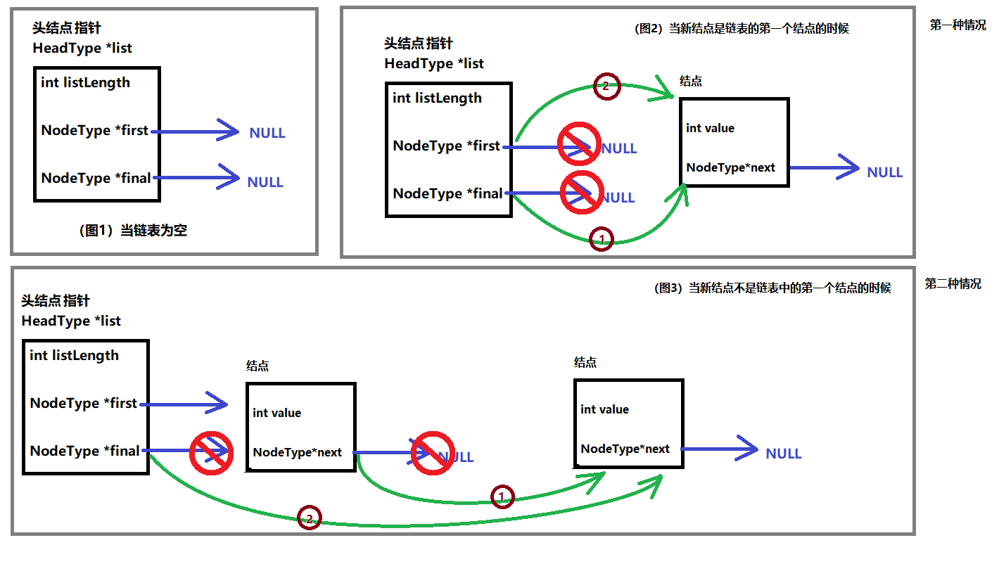
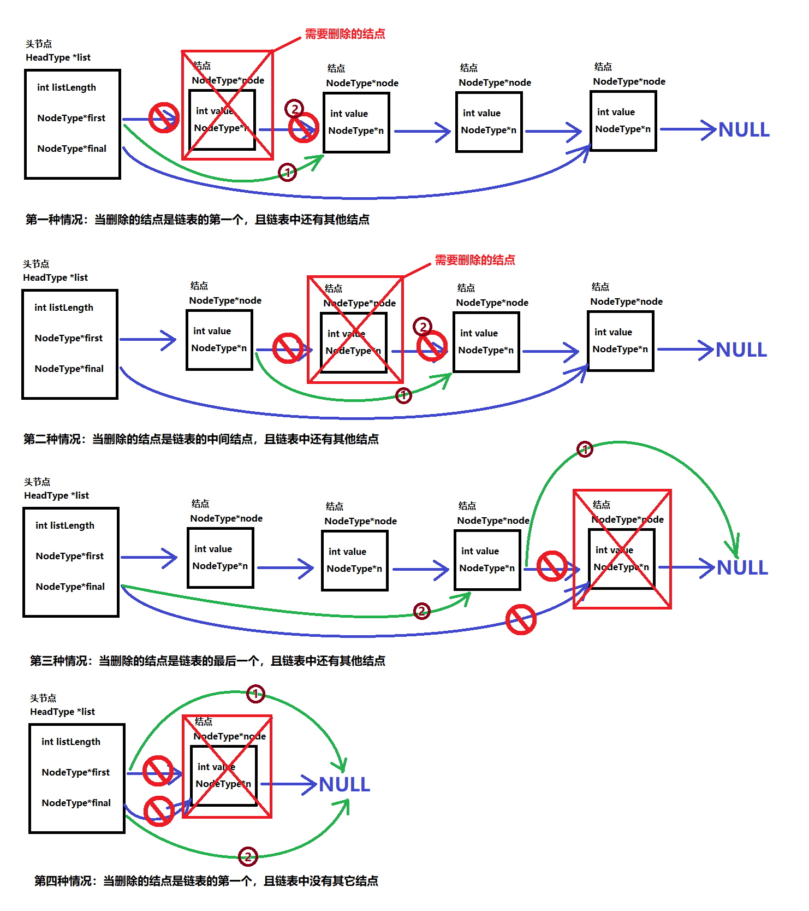
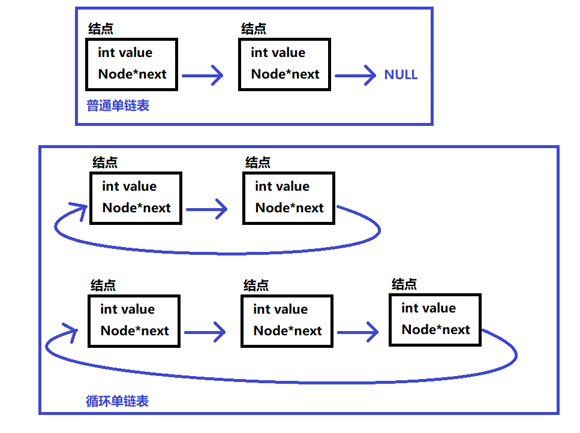
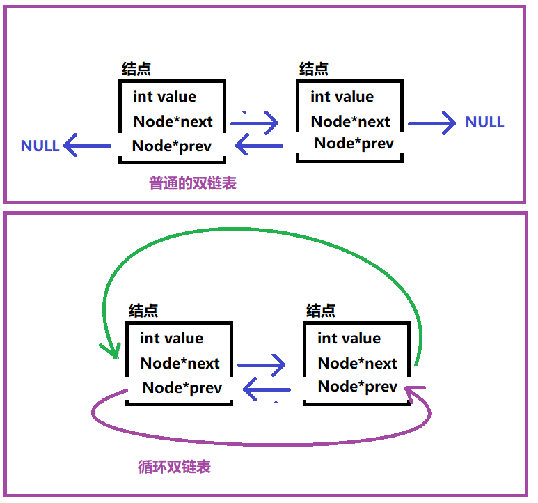

# 链表其他形态
## 带头结点的链表

引入：链表的操作起来比较舒服，但是如果记录（获取）链表长度比较麻烦。需要遍历链表，一个一个计数。比较费时间（占 CPU 资源）

所以可以不可以用一个比较特殊一点的结点来保存链表相关的信息。

头节点

头节点其实就是一个特殊的结点，它的类型和其他的结点不一样的，它是专门用来存储链表的一些属性信息。

**注意：**

头节点不参与链表的长度计数

头节点也是不参与链表遍历

头节点也不会作为链表的结点

带头结点链表，头节点是在链表中存储链表信息的作用。

**注意：当对链表进行增删操作的时候需要对头节点进行及时的更新。**

### 带头结点的链表的头插法

### 带头结点的链表的尾插法

```c
struct head
{
    int length; // 链表长度
    结点类型*first; // 首结点地址
    结点类型*final; // 尾结点地址
};
```



### 带头结点的链表的结点删除



## 循环链表

循环链表：第一个数据结点和最后一个数据结点相连链表

**循环单链表**：最后一个数据结点往后就到了第一个数据结点



### 创建循环链表

### 循环链表的遍历





用两个指针，一个指针跑，另一个指针不动，当两个指针重叠的时候就跑完了。

### 链表中的闭环

链表的尾结点指向了链表中的任意一个随机的结点

**求闭环的算法**

使用两个指针

一个移动步数快些

一个移动步数慢些

通过他两如果重叠了那么就是有闭环

如果其中一个指针出现空指针的情况，就是没有环的

## 静态链表

静态链表是一种使用数组来实现链表概念的数据结构。它通过在每个元素中存储下一个元素的索引来实现链式存储，从而在有限的空间内实现对大量元素的有效管理。

```c
// 普通链表
// 静态链表
```

### 插入元素

```c
struct node
{
    int data;
    struct node *next;
};
// 结点
struct node
{
    int data;
    int next; // 不是指针，而是下标
};
struct node static_list[100]={0};
// 尾插法
int i = 0;
for(i < 100;i++)
if(static_list[i].next == -1)
    break;
// 找空位
for(int l = 0; l < 100;l++)
{
    if(static_list[l] == NULL)
    {
        static_list[l] = newNode;
        static_list[i].next = l;
    }
}
```

#### 注意事项

静态链表是一种在内存空间有限时使用的数据结构。

使用数组和指针来实现链表的功能。

初始化静态链表时，需要正确设置每个节点的data 和next 指针。

在向静态链表添加元素时，需要检查是否已满。

访问静态链表元素时，要确保索引有效。

静态链表的大小是固定的，因此在设计时需要合理估计最大元素数量。

作业：

实现求闭环的算法。

实现静态链表的增删改查。
