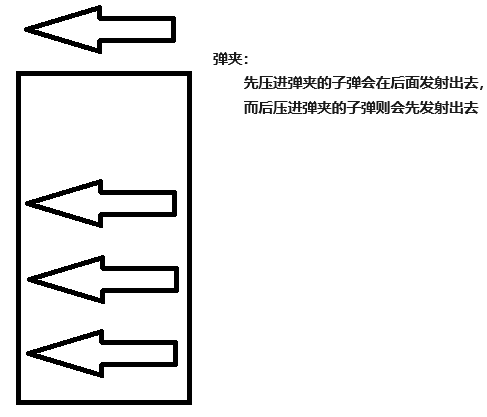

# 栈与队列
## 栈和队列

栈和队列并不是一个什么具体的东西，是一种思想，建立在线性表上的一种思想。

### 栈思想

思想：**先进后出，后进先出**

例如：

弹夹

压子弹：在弹夹的上方进来

发射子弹：在弹夹上方出去

### 栈存储结构分为两类

#### 顺序栈

数组 + 整型数据：结构体 ( 类 )

特点：栈中元素的地址是连续的。且栈空间大小是固定的。

```c
struct seqStack
{
    int top; // 指向栈顶元素的下标。栈顶指针
    ElementType stack[长度]; // 栈的空间（栈元素存放的空间）
};
#include <stdio.h>
#include <stdlib.h>
#include <stdbool.h>
#define STACK_MAX_LEN 10
#define STACK_NULL    -9999999
struct _SqlStack
{
    int _top;
    int _stack[STACK_MAX_LEN];
```



```c
}SeqStackTypeDef;
typedef struct _SqlStack* pSeqStackTypeDef;
pSeqStackTypeDef CreateSeqStack()
{
    pSeqStackTypeDef pStack = malloc(sizeof(struct _SqlStack));
    pStack->_top = 0;
    return pStack;
}
bool PushValue(pSeqStackTypeDef pStack,int value)
{
    // 判断一下，栈的空间有没有满
    if(!pStack||pStack->_top >= STACK_MAX_LEN)return false;
    // top 指向空位置，待插入的下标
    pStack->_stack[pStack->_top] = value;
    pStack->_top++; // 更新栈顶指针
    return true;
    // top 指向最后一个增加进去元素，永远指向栈顶元素
    /*
        pStack->_top++;
        pStack->_stack[pStack->_top] = value;
        return true;
    */
}
bool PopValue(pSeqStackTypeDef pStack)
{
    // 判断栈是否为空
    if(!pStack||pStack->_top == 0)return false;
    // 把栈顶指针减一就表示了删除了栈顶指针
    pStack->_top--;
    return true;
}
int GetStackTop(pSeqStackTypeDef pStack)
{
    // 栈是否为空
    if(!pStack||pStack->_top == 0)return STACK_NULL;
    return pStack->_stack[pStack->_top-1];
}
void DestoryStack(pSeqStackTypeDef *pStack)
{
    if(!pStack||!(*pStack)||(*pStack)->_top == 0)return;
    while((*pStack)->_top != 0)PopValue(*pStack);
    (*pStack) = NULL;
}
void PrintStack(pSeqStackTypeDef pStack)
{
```

**注意：顺序栈在取元素的时候其实没有删除元素的，只是把下标移动了，在下一次增加元素就会覆盖原来的元素。**

#### 链式栈

由一个单链表表示

特点：只能在**表头**操作（插入和删除）（插 / 取）。空间大小可以不固定，且地址不连续。

**表头**：以单链表为例，那么表头就是首结点（链表的第一个结点）。

```c
    if(!pStack)printf(" 栈不存在 !\n");
    else if(pStack->_top==0)printf(" 栈为空 !\n");
    else
    {
        printf("---> 栈底 \n");
        for(int i = 0;i <  pStack->_top;i++)
            printf("|%d|\n",pStack->_stack[i]);
        printf("--- 栈顶 \n");
    }
}
int main()
{
    pSeqStackTypeDef pStack = CreateSeqStack();
    while(1)
    {
        int number;
        scanf("%d",&number);
        if(number == -1)break;
        PushValue(pStack,number);
    }
    PrintStack(pStack);
    PopValue(pStack);
    PrintStack(pStack);
    PopValue(pStack);
    printf(" 栈顶元素为： %d\n",GetStackTop(pStack));
    DestoryStack(&pStack);
    return 0;
}
#include <stdio.h>
#include <stdlib.h>
#include <stdbool.h>
#include "SingleList.h"
int main()
{
    pListStack pStack = NULL;
    while(1)
    {
        int number;
        scanf("%d",&number);
```

## 队列

### 思想

先进先出，后进后出

例如：排队买奶茶

入队：队伍新增一个来买奶茶的人。（应当要排在队伍最后面）出队：有一个一个买到了奶茶离开队伍。（应当是队伍第一个人）

### 队列的两类

顺序队列

数组 + 整型 ===> 结构体

地址是连续

循环队列解决无法回到起点问题

循环队列存在一个空间会浪费

解决：在结构体再定义一个长度

```c
        if(number == -1)break;
        pStack = PushValue(pStack,number);
    }
    PrintStack(pStack);
    pStack = PopValue(pStack);
    PrintStack(pStack);
    pStack = PopValue(pStack);
    printf(" 栈顶元素 :%d\n",pStack->_value);
    pStack = DestoryStack(pStack);
    PrintStack(pStack);
    return 0;
}
struct queue
{
    int head; // 表示队头
    int tail; // 表示队尾
    ElementType queue[MAXLENG]; // 数组：表示队列的空
};
#include <stdio.h>
#include <stdlib.h>
#include <stdbool.h>
#define QUEUE_MAX_LEN 10
#define QUEUE_NULL    -99999999
struct _SeqQueue
{
    int _pHead;
    int _pTail;
    int queue[QUEUE_MAX_LEN];
};
typedef struct _SeqQueue * pSeqQueue;
pSeqQueue CreateQueue()
{
    pSeqQueue pQueue = malloc(sizeof(struct _SeqQueue));
    pQueue->_pHead = 0;
    pQueue->_pTail = 0;
    return pQueue;
}
bool PushValue(pSeqQueue pQueue,int value)
{
    // 判断队列满了没有
    if((pQueue->_pTail+1)%QUEUE_MAX_LEN == pQueue->_pHead)return false;
    // 重置下标
    pQueue->queue[pQueue->_pTail] = value;
    pQueue->_pTail = (pQueue->_pTail+1)%QUEUE_MAX_LEN;
    return true;
}
bool PopValue(pSeqQueue pQueue)
{
    // 判断队列是否为空
    if(pQueue->_pHead == pQueue->_pTail)return false;
    pQueue->_pHead = (pQueue->_pHead+1)%QUEUE_MAX_LEN;
    return true;
}
int GetQueueHead(pSeqQueue pQueue)
{
    // 判断队列是否为空
    if(pQueue->_pHead == pQueue->_pTail)return QUEUE_NULL;
    return pQueue->queue[pQueue->_pHead];
}
void PrintStack(pSeqQueue pQueue)
{
    if(!pQueue)printf(" 队列不存在 !\n");
    else if(pQueue->_pHead == pQueue->_pTail)printf(" 队列为空 !\n");
    else
    {
        printf("---> 队头 \n");
        for(int i = pQueue->_pHead;i <  pQueue->_pTail;i++)
            printf("|%d|\n",pQueue->queue[i]);
        printf("--- 队尾 \n");
    }
}
int main()
```

链式队列

带头结点的单链表实现

可以不固定长度。

```c
{
    pSeqQueue pQueue = CreateQueue();
    while(1)
    {
        int number;
        scanf("%d",&number);
        if(number == -1)break;
        PushValue(pQueue,number);
    }
    PrintStack(pQueue);
}
struct QueueNode
{
    ElementType data; // 数据域
    struct QueueNode *next; // 指针域
}
struct QueueHead
{
    int count; // 数量
    struct QueueNode* head; // 头指针
    struct QueueNode *tail; // 尾指针
}
#include "HH_SingleList.c"
#include <stdbool.h>
#define CreateListQueue CreateList
#define DestoryListQueue DestoryList
#define PrintListQueue   PrintList
#define pListQueue pListTypeDef
#define QUEUE_NULL    -99999999
bool PushValue(pListQueue pQueue,int value)
{
    if(!pQueue) return false;
    pNodeTypeDef pNewNode = malloc(sizeof(NodeTypeDef));
    pNewNode->_Value = value;
    pNewNode->_pNext = NULL;
    // 表尾增加
    if(pQueue->_ListLength == 0&&!pQueue->_pHead&&!pQueue->_pTail)
    {
        pQueue->_pHead = pNewNode;
        pQueue->_pTail = pNewNode;
```

作业：

请大家封装好，栈与队列的所有 API （函数）

```c
    }
    else
    {
        pQueue->_pTail->_pNext   = pNewNode;
        pQueue->_pTail = pNewNode;
    }
    pQueue->_ListLength++;
    return true;
}
bool PopValue(pListQueue pQueue)
{
    if(!pQueue||pQueue->_ListLength == 0) return false;
    // 从表头删除元素
    pNodeTypeDef pTempNode = pQueue->_pHead;
    pQueue->_pHead = pQueue->_pHead->_pNext;
    pTempNode->_pNext = NULL;
    free(pTempNode);
    pQueue->_ListLength--;
    return true;
}
int GetQueueHead(pListQueue pQueue)
{
    if(!pQueue||pQueue->_ListLength == 0) return QUEUE_NULL;
    return pQueue->_pHead->_Value;
}
int main()
{
    pListQueue pQueue = CreateListQueue();
    while(1)
    {
        int number;
        scanf("%d",&number);
        if(number == -1)break;
        PushValue(pQueue,number);
    }
    PrintListQueue(pQueue);
    PopValue(pQueue);
    PrintListQueue(pQueue);
    DestoryListQueue(&pQueue);
    PrintListQueue(pQueue);
    return 0;
}
```
