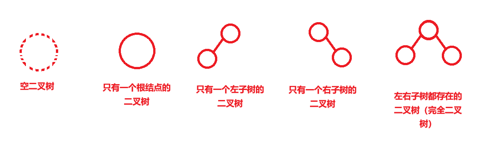
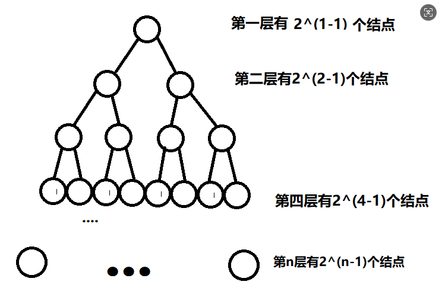
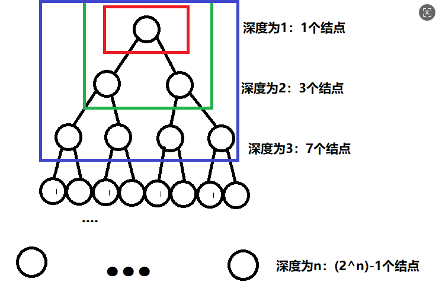
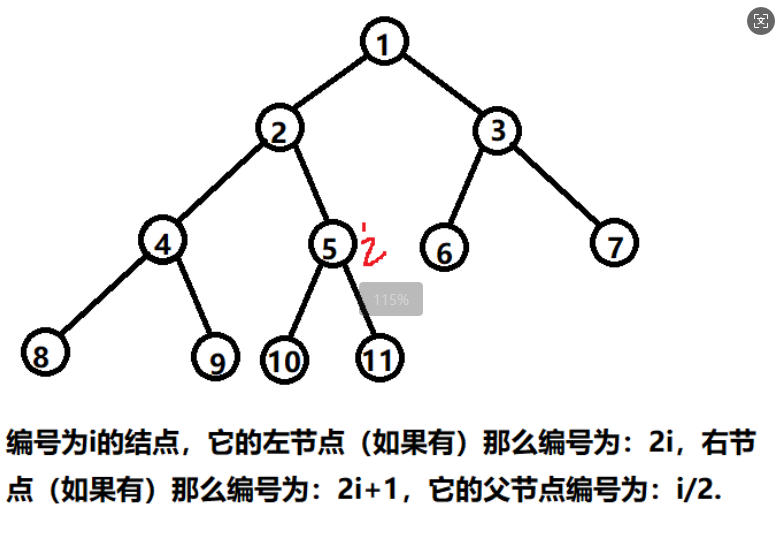
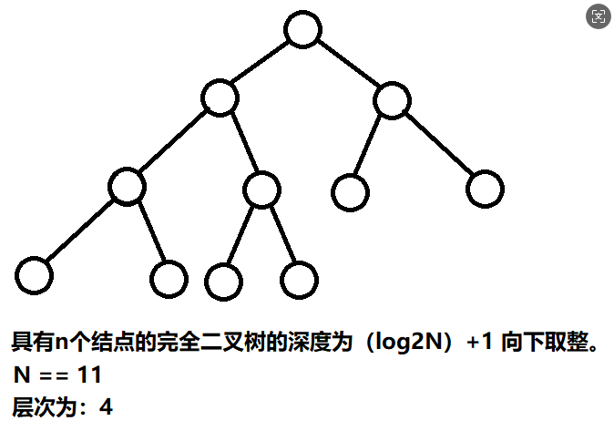
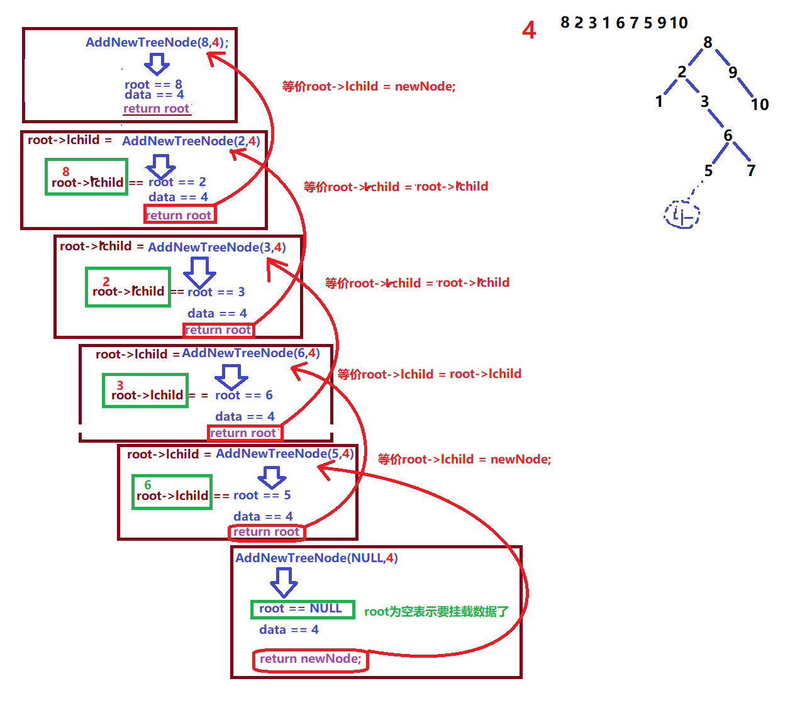

# 二叉树排序树
## 树与二叉树

### 树的概念

树（ tree ）是 n （ n>=0 ）个结点的有限集 , 在任意一棵非空树中

有且仅有一个特点的结点称为（ root ）**根结点**当 n>1 的时候，其余结点可以分为 m （ m>0 ）个互不相交有限集 :T1 、 T2 、 T3...Tm 。其中每一个有限集，又可以看成是一棵树，并且称之为根的子树。

树结点包含数据域以及若干个指向其子树的分支（指针域）

#### 结点层次

结点层次：从根开始定义的，根结点为第一层、根的子结点（孩子）为第二层、 .... 、树中结点的最大的层次称为：**树的高度**（ height ）或者说是**树的深度**（ depth ）

#### 结点的度

结点的度：**结点拥有的子树的数量：度**。**度为 0 的结点称为：叶子结点 (leaf)**或者是**终端结点**、**度不为 0的结点：分支结点**

## 二叉树

二叉树是一种树的形状结构

它的特点：

它的每一个结点最多最多只能有两个子树，也就是说二叉树它不能存在度大于 2 的结点二叉树的子树称为：**左子树、右子树**。**注意：子树的次序不能颠倒**

### 二叉树的五大形态

空二叉树

```c
/*
    struct _TreeNode
    {
        ElementType data; // 数据域
        struct _TreeNode *t1,*t2,*t3....*tn; // 指针域
    };
*/
struct _Node // 子树的下标结点
{
    int index;
    struct _Node *next; // 下一棵子树的下标结点地址
};
struct _TreeNode // 树的结点
{
    int _Value; // 树的数据域
    struct _Node *_pNextTree; // 子树的下标集
};
```

只有一个根结点的二叉树

只有一个左子树的二叉树

只有一个右子树的二叉树

左右子树都存在的二叉树（完全二叉树）

### 二叉树的性质

1. 在二叉树的第 i 层上至多有 2^(i-1) 个结点 (i>=1)

2. 在一棵深度为 k 的二叉树中至多有 2^k-1 个结点

3. 在任何一棵二叉树下，如果其终端结点（叶子结点）个数为 n0 ，度为 2 的结点树为 n2, 则有 n2=n0-1

满二叉树：

一棵深度为 k 具有 2^k-1 个结点的二叉树（在不改变二叉树的深度情况下，不能增加新的结点的二叉树）

完全二叉树：

除去最后一层之后，就是一棵满二叉树

最后一层结点必须要是从左至右排列







4. 具有 n 个结点的完全二叉树，如果自上而下，自左到右，从 1 到 n 进行编号，那么编号的为 i 的结点，它的左结点（如果存在）那么比编号为： 2i 、右结点（如果存在）那么编号： 2i+1 ，它的父结点编号： i/2

5. 具有 n 个结点完全二叉树的深度为 (log2N)+1 向下取整

### 二叉树的存储结构

顺序存储结构

数组

链式存储结构

## 二叉排序树

二叉树排序树：以某个结点为准，该结点的左子树内所有的结点都会比该结点要小。该结点的右子树内的所有结点都会大于该结点。

**注意：二叉树排序树中不会存在值相等数据。**

```c
struct tree_node
{
    // 数据域
    int data;
    // 指针域
    struct tree_node *lchild; // left child 左子树  / 左孩子
    struct tree_ndoe *rchild; // right child 右子树  / 右孩子
}
```





### 二叉树排序树插入

**插入结点**

树为空的时候

把结点作为根结点插入

树不为空时候

和根结点比较

如果比根结点小，则判断根结点左子结点是否存在

如果左子结点存在的话，将根结点的左子结点作为根结点继续比较如果不存在，直接将新数据作为该根结点的左子结点插入如果比根结点大，则判断根结点右子结点是否存在

如果右子结点存在的话，将根结点的右子结点作为根结点继续比较如果不存在，直接将新数据作为该根结点的右子结点插入插入新节点无法就是重复上述步骤

#### 两种插入方法

**循环法**

逻辑

如果根结点为空，那么新结点直接作为根结点返回

如果不为空

通过前后指针，循环移动来找到待插入的位置

循环结束之后，待插入的位置

父结点指针的下一级

需要通过再对父结点数据比较一次，来确定插入方向（左右）

**递归法**

```c
#include <stdio.h>
#include <stdlib.h>
struct _TreeNode
{
    int _Value;
    struct _TreeNode *lchind,*rchind;
};
typedef struct _TreeNode *pTreeTypeDef;
#include "ListQueue.c"
// 循环插入结点
pTreeTypeDef InsertLoop(pTreeTypeDef tree,int value)
{
    // 新结点
    pTreeTypeDef _NewTreeNode = malloc(sizeof(struct _TreeNode));
    _NewTreeNode->_Value = value;
    _NewTreeNode->lchind = NULL;
    _NewTreeNode->rchind = NULL;
    // 判断树是否为空
    if(!tree)
```



```c
        return _NewTreeNode; // 因为树为空，新结点直接作为这棵树的根结点返回即可
    // 树不为空，首先需要和根结点进行比较
    pTreeTypeDef _pFatherNode  = NULL; // 父结点指针
    pTreeTypeDef _pCurrentNode = tree; // 获取根结点
    while(_pCurrentNode) // 当 _pCurrentNode 不为空的情况下说明还没有找到自己需要插入的位置
    {
        _pFatherNode = _pCurrentNode; // 更新 _pCurrentNode 父结点指针，因为等会
// _pCurrentNode 指针会更新。
        // 判断当前结点 _pCurrentNode 是否大于 value ，如果大于，说明 value 是需要插入到
// _pCurrentNode 左边。
        if(_pCurrentNode->_Value > value)
            _pCurrentNode = _pCurrentNode->lchind; // 当前结点往左子树更新
        // 判断当前结点 _pCurrentNode 是否小于 value ，如果小于，说明 value 是需要插入到
// _pCurrentNode 右边。
        else if(_pCurrentNode->_Value < value)
            _pCurrentNode = _pCurrentNode->rchind; // 当前结点往右子树更新
        else return tree;// 不允许存在相同的数字
    }
    // 退出循环了，说明找到需要插入的空位
    if(_pFatherNode->_Value > value) // 左插
        _pFatherNode->lchind = _NewTreeNode;
    else
        _pFatherNode->rchind = _NewTreeNode;
    return tree;
}
// 递归插入
pTreeTypeDef InsertRecursion(pTreeTypeDef tree,int value)
{
    // 判断树是否为空
    if(!tree)
    {
        // 新结点
        pTreeTypeDef _NewTreeNode = malloc(sizeof(struct _TreeNode));
        _NewTreeNode->_Value = value;
        _NewTreeNode->lchind = NULL;
        _NewTreeNode->rchind = NULL;
        return _NewTreeNode;
    }
    // 如果树不为空的时候
    // 和当前结点进行比较
    if(tree->_Value > value) // 当前结点大于新数据，需要向左更新结点进行比较
        tree->lchind = InsertRecursion(tree->lchind,value); // 向左递归
    else if(tree->_Value < value) // 当前结点小于新数据，需要向右更新结点进行比较
        tree->rchind = InsertRecursion(tree->rchind,value); // 向右递归
    return tree;
}
void PrintTree(pTreeTypeDef tree)
{
```

作业：

自己手搓二叉排序树的，递归和循环两种插入方式。

### 二叉树的遍历

如何按照某条搜索路径去访问树里面的每一个结点，使得每一个结点均被访问一次，而且只能访问一次， ”**访问**“ 的含义很广，可以是对数据进行打印，修改，对比 ...

先序访问：

先访问根结点，再访问左子树，最后访问右子树（**根左右**）中序访问：

先访问左子树，再访问根结点，最后访问右子树（**左根右**）后序访问：

```c
    if(!tree) printf(" 空树 !\n");
    else
    {
        pListQueue pQueue = CreateListQueue();
        PushValue(pQueue,tree);
        while(pQueue->_ListLength!=0)
        {
            pTreeTypeDef current = GetQueueHead(pQueue);
            printf("%d,",current->_Value);
            if(current->lchind)
                PushValue(pQueue,current->lchind);
            if(current->rchind)
                PushValue(pQueue,current->rchind);
            PopValue(pQueue);
        }
        printf("\n");
    }
}
int main()
{
    pTreeTypeDef tree = NULL; // 创建一棵空树  1 形态
    while(1)
    {
        int number;
        scanf("%d",&number);
        if(number < 0)break;
        // tree = InsertRecursion(tree,number);
        tree = InsertLoop(tree,number);
    }
    PrintTree(tree);
    return 0;
}
```

先访问左子树，再访问右子树，最后访问根结点（**左右根**）

**注意：先中后序访问需要把左右子树都作为一棵正常的树来看待**

先序，中序，后序是针对于**根**来说的，就是围绕**根结点**（把当前结点看做根结点使用），若左和右不是终端结点，则会继续深入（**递归**）遍历，但是每次访问的结点都会当做根结点使用。

层次遍历：

一层一层的去遍历元素

后序访问

先访问左子树，再访问右子树，最后访问根结点（**左右根**）

### 二叉树的结点删除

**删除一个结点**

**第一种情况**：被删除的结点是叶子结点，直接删除

释放叶子结点空间

返回空指针

**第二种情况：**被删除结点只有左子树，将左子树中最大的结点替换为需要删除的结点

如果左子树中的第一个结点为最大结点（表示该左子树是没有右子树的）

将被删除结点的lchild 指向最大的那个结点的lchild释放左子树中的第一个结点的空间

返回被删除节点

如果左子树中第一个节点不为最大结点（表示该左子树是有右子树）

将最大结点的父结点的rchild 指向最大结点的lchild释放左子树中最大结点的空间

返回被删除结点

**第三种情况：**被删除的结点只有右子树，将右子树中的最小结点替换为需要删除的结点

如果右子树的第一个结点为最小结点

将被删除结点的rchild 指向最小结点的rchild释放最小结点

返回被删除结点

如果右子树的第一个结点不为最小结点

将最小结点的父结点的lchild 指向最小结点的rchild释放最小结点

返回被删除结点

**第四种情况：**被删除结点即存在左子树也存在右子树

可以在左子树中找最大的结点替换，操作和第二种情况方式一样可以在右子树中找最小的结点替换，操作和第三种情况方式一样

```c
#include <stdio.h>
#include <stdlib.h>
struct _TreeNode
{
    int _Value;
    struct _TreeNode *lchind,*rchind;
};
typedef struct _TreeNode *pTreeTypeDef;
#include "ListQueue.c"
// 循环插入结点
pTreeTypeDef InsertLoop(pTreeTypeDef tree,int value)
{
    // 新结点
    pTreeTypeDef _NewTreeNode = malloc(sizeof(struct _TreeNode));
    _NewTreeNode->_Value = value;
    _NewTreeNode->lchind = NULL;
    _NewTreeNode->rchind = NULL;
    // 判断树是否为空
    if(!tree)
        return _NewTreeNode; // 因为树为空，新结点直接作为这棵树的根结点返回即可
    // 树不为空，首先需要和根结点进行比较
    pTreeTypeDef _pFatherNode  = NULL; // 父结点指针
    pTreeTypeDef _pCurrentNode = tree; // 获取根结点
    while(_pCurrentNode) // 当 _pCurrentNode 不为空的情况下说明还没有找到自己需要插入的位置
    {
        _pFatherNode = _pCurrentNode; // 更新 _pCurrentNode 父结点指针，因为等会
// _pCurrentNode 指针会更新。
        // 判断当前结点 _pCurrentNode 是否大于 value ，如果大于，说明 value 是需要插入到
// _pCurrentNode 左边。
        if(_pCurrentNode->_Value > value)
            _pCurrentNode = _pCurrentNode->lchind; // 当前结点往左子树更新
        // 判断当前结点 _pCurrentNode 是否小于 value ，如果小于，说明 value 是需要插入到
// _pCurrentNode 右边。
        else if(_pCurrentNode->_Value < value)
            _pCurrentNode = _pCurrentNode->rchind; // 当前结点往右子树更新
        else return tree;// 不允许存在相同的数字
    }
    // 退出循环了，说明找到需要插入的空位
    if(_pFatherNode->_Value > value) // 左插
        _pFatherNode->lchind = _NewTreeNode;
    else
        _pFatherNode->rchind = _NewTreeNode;
    return tree;
}
// 递归插入
pTreeTypeDef InsertRecursion(pTreeTypeDef tree,int value)
{
    // 判断树是否为空
    if(!tree)
    {
        // 新结点
        pTreeTypeDef _NewTreeNode = malloc(sizeof(struct _TreeNode));
        _NewTreeNode->_Value = value;
        _NewTreeNode->lchind = NULL;
        _NewTreeNode->rchind = NULL;
        return _NewTreeNode;
    }
    // 如果树不为空的时候
    // 和当前结点进行比较
    if(tree->_Value > value) // 当前结点大于新数据，需要向左更新结点进行比较
        tree->lchind = InsertRecursion(tree->lchind,value); // 向左递归
    else if(tree->_Value < value) // 当前结点小于新数据，需要向右更新结点进行比较
        tree->rchind = InsertRecursion(tree->rchind,value); // 向右递归
    return tree;
}
// 先序
void FPrint(pTreeTypeDef tree)
{
    if(!tree)return;// 说明此时是一个空结点
    // 当此时这个结点不为空时
    // 将其作为本棵树的根结点访问
    printf("%d,",tree->_Value);
    // 判断左右子树是否存在
    FPrint(tree->lchind);
    FPrint(tree->rchind);
}
// 中序
void MPrint(pTreeTypeDef tree)
{
    if(!tree)return;// 说明此时是一个空结点
    // 判断左右子树是否存在
    MPrint(tree->lchind);
    // 当此时这个结点不为空时
    // 将其作为本棵树的根结点访问
    printf("%d,",tree->_Value);
    MPrint(tree->rchind);
}
void LPrint(pTreeTypeDef tree)
{
    // 判断树是不是为空
    if(!tree) printf(" 空树 !\n");
    pListQueue queue = CreateListQueue();
    PushValue(queue,tree);
    while(queue->_ListLength!=0)
    {
        // 打印 / 访问结点数据
        pTreeTypeDef pCurrentNode = GetQueueHead(queue);
        printf("%d,",pCurrentNode->_Value);
        // 检查当前打印的结点是否存在左右子树
        if(pCurrentNode->lchind)PushValue(queue,pCurrentNode->lchind);
        if(pCurrentNode->rchind)PushValue(queue,pCurrentNode->rchind);
        PopValue(queue);
    }
    printf("\n");
    DestoryListQueue(&queue);
}
pTreeTypeDef DeleteNode(pTreeTypeDef tree,int value)
{
    if(!tree)return tree;
    // 查找结点
    pTreeTypeDef pFatherNode = NULL;
    pTreeTypeDef pDeleteNode = tree;
    while(pDeleteNode)
    {
        if(pDeleteNode->_Value == value)break;
        pFatherNode = pDeleteNode; // 父结点进行了更新
        if(pDeleteNode->_Value > value) // 当前结点数据大于需要删除的数据
            pDeleteNode = pDeleteNode->lchind; // 往左边移动
        else // 当前结点数据小于需要删除的数据
            pDeleteNode = pDeleteNode->rchind; // 往右边移动
    }
    // 找到了需要删除的结点
    if(pDeleteNode)
    {
        // 第一种情况：叶子结点
        if(!pDeleteNode->lchind&&!pDeleteNode->rchind)
        {
            if(pDeleteNode == tree)tree = NULL;
            free(pDeleteNode);
            if(pFatherNode->_Value > value)pFatherNode->lchind = NULL;
            else pFatherNode->rchind = NULL;
        }
        // 第二种情况：只要左子树存在的情况
        else if(pDeleteNode->lchind)
        {
            /*
// 1. 如果左子树中的第一个结点为最大结点（表示该左子树是没有右子树的）
// 2. 如果左子树中第一个节点不为最大结点（表示该左子树是有右子树
            */
            pTreeTypeDef pMaxFatherNode = NULL;
            pTreeTypeDef pLeftMaxNode = pDeleteNode->lchind;
            while(pLeftMaxNode->rchind)
            {
                pMaxFatherNode = pLeftMaxNode;
                pLeftMaxNode = pLeftMaxNode->rchind;
            }
            // 交换两个结点的数据
            int _TempValue = pDeleteNode->_Value;
            pDeleteNode->_Value = pLeftMaxNode->_Value;
            pLeftMaxNode->_Value = _TempValue;
            // 拿到了左子树中最大的结点
            // 左子树中的第一个结点为最大结点
            if(!pMaxFatherNode)
                pDeleteNode->lchind = pLeftMaxNode->lchind;
            else
                pMaxFatherNode->rchind = pLeftMaxNode->lchind;
            pLeftMaxNode->lchind = NULL;
            pLeftMaxNode->rchind = NULL;
            free(pLeftMaxNode);
        }
        // 第三种情况：被删除的结点只有右子树，将右子树中的最小结点替换为需要删除的结点
        else if(pDeleteNode->rchind)
        {
            /*
// 1. 如果右子树的第一个结点为最小结点
// 2. 如果右子树的第一个结点不为最小结点
            */
            pTreeTypeDef pMinFatherNode = NULL;
            pTreeTypeDef pLeftMinNode = pDeleteNode->rchind;
            while(pLeftMinNode->lchind)
            {
                pMinFatherNode = pLeftMinNode;
                pLeftMinNode = pLeftMinNode->lchind;
            }
            // 交换两个结点的数据
            int _TempValue = pDeleteNode->_Value;
            pDeleteNode->_Value = pLeftMinNode->_Value;
            pLeftMinNode->_Value = _TempValue;
            // 拿到了左子树中最大的结点
            // 左子树中的第一个结点为最大结点
            if(!pMinFatherNode)
                pDeleteNode->rchind = pLeftMinNode->rchind;
            else
                pMinFatherNode->lchind = pLeftMinNode->rchind;
            pLeftMinNode->lchind = NULL;
            pLeftMinNode->rchind = NULL;
            free(pLeftMinNode);
        }
    }
    return tree;
}
pTreeTypeDef DestoryTree(pTreeTypeDef tree)
{
    if(!tree)return NULL;
```

作业：

将二叉排序树的插入，删除，销毁，遍历等思路捋清楚。

代码敲一敲。

```c
    if(tree->lchind)tree->lchind = DestoryTree(tree->lchind);
    if(tree->rchind)tree->rchind = DestoryTree(tree->rchind);
    free(tree);
    return NULL;
}
int main()
{
    pTreeTypeDef tree = NULL; // 创建一棵空树  1 形态
    while(1)
    {
        int number;
        scanf("%d",&number);
        if(number < 0)break;
        // tree = InsertRecursion(tree,number);
        tree = InsertLoop(tree,number);
    }
    MPrint(tree);puts("");
    tree = DeleteNode(tree,1);
    MPrint(tree);puts("");
    tree = DeleteNode(tree,10);
    MPrint(tree);puts("");
    tree = DeleteNode(tree,5);
    MPrint(tree);puts("");
    tree = DestoryTree(tree);
    MPrint(tree);puts("");
    return 0;
}
```
