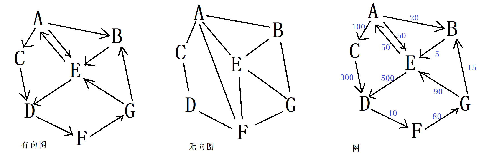
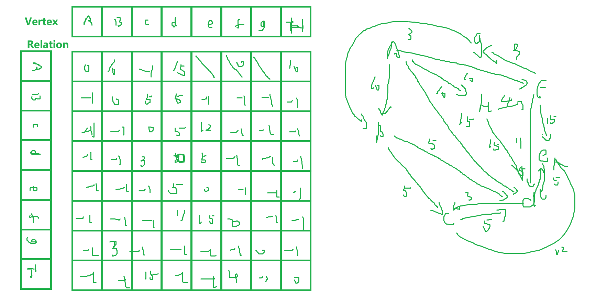
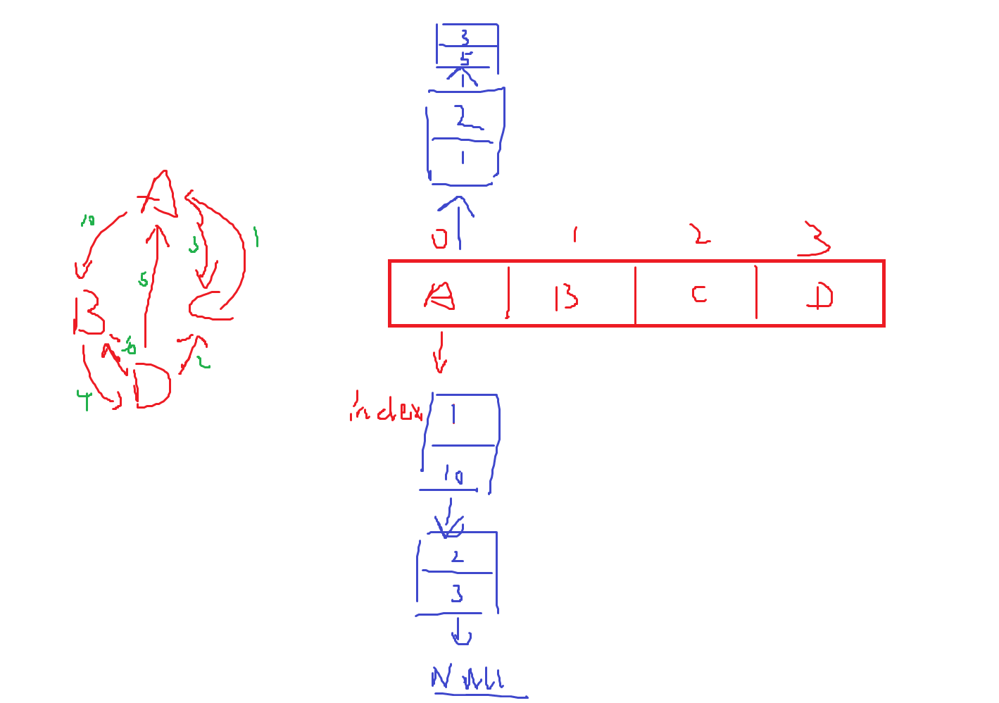
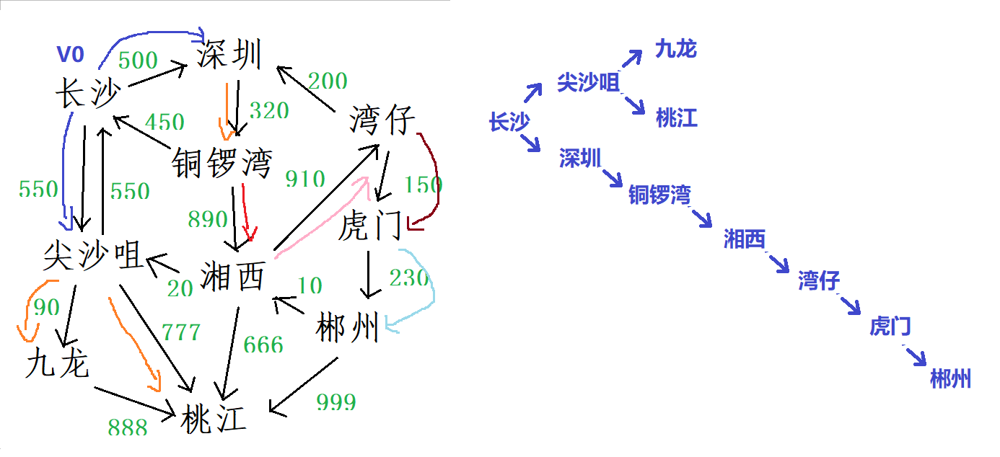

# 图的遍历
## 图

图的定义：图（ graph ）非线性的数据结构，形式描述为： graph= （ V,R ）

其中 V 是图中元素 Vn （称为顶点 Vertex ）的集合，当 n=0 ， V 是空集

其中 R 是图中顶点之间的关系集， <vi,vj> 为顶点 vi 、 vj 之间是否存在路径（关系）的判断条件。即 vi 、 vj 之间存在关系，则关系 <vi,vj> 属于 R

### 图的分类

有向图（ Digraph ）

有方向的图就是**有向图**

有向图的那个方向的线条称为：**弧**

无向图（ Undigraph ）

没有方向的图就是**无向图**

无向图的那个线条称为：**边**

网：

若在图的关系 <vi,vj> 上面 , 或者是 <vj,vi> 上去附加一个值 w ，称 w 为弧上或者是边上的权值。

带权的图称为：**网**（权值 w 的具体含义在不同的应用场景下去定义，比如：顶点表示城市，）

### 顶点的度

顶点的度：顶点的边或者是顶点的弧条数称为：**度**

但是**有向图**分为：**入度和出度**。

### 路径

路径：一个顶点到另一个顶点的方式（怎么到达的）

### 连通图

两个顶点之间存在路径（到达方式），说明它们是**连通**。若任意两个顶点之间都是连通的话，则图是**连通图**。

有向图则称为：**强连通图**

## 图的存储结构

数组表示法、邻接表、逆邻接表、十字链表、 ...



### 数组表示法

数组表示法：又称**邻接矩阵**

使用一个二维数组来描述图的顶点之间的**关系集 R**。

G=(V,R)

用一个一维数组来存储图中**顶点集 V**

```c
#include <stdio.h>
#include <stdlib.h>
#define VERTEX_MAX_SIZE 10
typedef struct
{
    // 顶点集
    char _VertexArray[VERTEX_MAX_SIZE];
    // 关系集
    int  _RelationArray[VERTEX_MAX_SIZE][VERTEX_MAX_SIZE];
    // 当前顶点数量
    int  _CurrentVertexSize;
}GraphTypeDef;
typedef GraphTypeDef* pGraphTypeDef;
typedef struct
{
    int _Relation_sp;// 起始坐标  start posation
    int _Relation_ep;// 终止坐标  end   posation
    int _Weight;     // 权值
}RelationTypeDef;
pGraphTypeDef CreateGraph()
{
    pGraphTypeDef graph = malloc(sizeof(GraphTypeDef));
    graph->_CurrentVertexSize = 0;
```



```c
    return graph;
}
// 新增顶点
void InsertVertex(pGraphTypeDef graph,char vertex)
{
    if(!graph)return;
    // 新增顶点
    if(graph->_CurrentVertexSize >= VERTEX_MAX_SIZE)return;
    graph->_VertexArray[graph->_CurrentVertexSize++] = vertex;
}
// 新增关系
void InsertRelation(pGraphTypeDef graph,RelationTypeDef relation)
{
    if(!graph)return;
    graph->_RelationArray[relation._Relation_sp][relation._Relation_ep] =
relation._Weight;
    return;
}
void PrintGraph(pGraphTypeDef graph)
{
    if(!graph)printf(" 图不存在 !\n");
    else
    {
        if(graph->_CurrentVertexSize == 0)printf(" 空图 !\n");
        else
        {
            // 打印图的顶点
            printf(" 顶点集 :[");
            for(int i = 0;i < graph->_CurrentVertexSize;i++)
                printf("%c ",graph->_VertexArray[i]);
            puts("]");
            // 打印顶点直接的关系
            for(int row = 0;row < graph->_CurrentVertexSize;row++)
            {
                for(int column = 0;column < graph->_CurrentVertexSize;column++)
                {
                    printf("[%c,%c]:%d\n",graph->_VertexArray[row],graph-
>_VertexArray[column],graph->_RelationArray[row][column]);
                }
            }
        }
    }
}
int GetVertexPosation(pGraphTypeDef graph,char vertex)
{
    if(!graph)return -1;
    for(int i = 0;i < graph->_CurrentVertexSize;i++)
    {
        if(graph->_VertexArray[i] == vertex)return i;
    }
    return -1;
```

**邻接矩阵**

优势：

存储 / 设计比较简单

劣势：

浪费空间，遍历出度比较费时间。

### 邻接表 - 图类型

```c
}
int main()
{
    pGraphTypeDef graph = CreateGraph();
    printf("Please Enter Vertexs!\n");
    char vertex_array[VERTEX_MAX_SIZE];
    scanf("%s",vertex_array);
    for(int i = 0;vertex_array[i] != '\0';i++)
        InsertVertex(graph,vertex_array[i]);
    printf("Please Enter Relations!\n");
    // 添加关系
    while(1)
    {
        char _SV,_EV;
        int _Weight;
        scanf("%c,%c:%d",&_SV,&_EV,&_Weight);
        if(_SV=='\n'||_EV=='\n')continue;
        if(_SV=='!'||_EV=='!'|_Weight == -99999)break;
        RelationTypeDef relation;
        relation._Relation_sp = GetVertexPosation(graph,_SV);
        relation._Relation_ep = GetVertexPosation(graph,_EV);
        relation._Weight = _Weight;
        InsertRelation(graph,relation);
    }
    PrintGraph(graph);
    return 0;
}
#include <stdio.h>
#include <stdlib.h>
#define VERTEX_MAX_SIZE 10
typedef struct _VertexInfo
{
    int _VertexIndex;  // 顶点下标
    int _VertexWeight; // 路径权值
    struct _VertexInfo *_pNext; // 下一个出度的顶点信息
}VertexInfoTypeDef;
typedef VertexInfoTypeDef* pVertexInfoTypeDef;
typedef struct
{
    // 顶点
    char _Vertex;
    // 关系集
    pVertexInfoTypeDef _RelationList;
}VertexTypeDef;
typedef VertexTypeDef* pVertexTypeDef;
typedef struct
{
    // 当前顶点数量
    int  _CurrentVertexSize;
    // 顶点集
    VertexTypeDef _VertexArray[VERTEX_MAX_SIZE];
}GraphTypeDef;
typedef GraphTypeDef* pGraphTypeDef;
typedef struct
{
    int _Relation_sp;// 起始坐标  start posation
    int _Relation_ep;// 终止坐标  end   posation
    int _Weight;     // 权值
}RelationTypeDef;
int GetVertexPosation(pGraphTypeDef graph,char vertex)
{
    if(!graph)return -1;
    for(int i = 0;i < graph->_CurrentVertexSize;i++)
    {
        if(graph->_VertexArray[i]._Vertex == vertex)return i;
    }
    return -1;
}
pGraphTypeDef CreateGraph()
{
    pGraphTypeDef graph = malloc(sizeof(GraphTypeDef));
    graph->_CurrentVertexSize = 0;
    // 初始化每个顶点的链表的初始指向
    for(int i = 0;i < VERTEX_MAX_SIZE;i++)
        graph->_VertexArray[i]._RelationList = NULL;
    return graph;
}
// 新增顶点
void InsertVertex(pGraphTypeDef graph,char vertex)
{
    if(!graph)return;
    // 新增顶点
    if(graph->_CurrentVertexSize >= VERTEX_MAX_SIZE)return;
    graph->_VertexArray[graph->_CurrentVertexSize++]._Vertex = vertex;
}
// 新增关系
void InsertRelation(pGraphTypeDef graph,RelationTypeDef relation)
{
    if(!graph)return;
    // 创建新的出度顶点的信息结点
    pVertexInfoTypeDef pNewVertexInfo = malloc(sizeof(VertexInfoTypeDef));
    pNewVertexInfo->_pNext = NULL;
    pNewVertexInfo->_VertexIndex  = relation._Relation_ep;
    pNewVertexInfo->_VertexWeight = relation._Weight;
    pVertexInfoTypeDef pRelation = graph-
>_VertexArray[relation._Relation_sp]._RelationList;
    // 如果 _RelationList 一开始就为空，那么直接指向新的信息结点
    if(!pRelation)
    {
        graph->_VertexArray[relation._Relation_sp]._RelationList =
pNewVertexInfo;
        return;
    }
    // 遍历找到尾结点
    while(pRelation->_pNext)pRelation = pRelation->_pNext;
    pRelation->_pNext = pNewVertexInfo;
    return;
}
void PrintGraph(pGraphTypeDef graph)
{
    if(!graph)printf(" 图不存在 !\n");
    else
    {
        if(graph->_CurrentVertexSize == 0)printf(" 空图 !\n");
        else
        {
            // 打印图的顶点
            printf(" 顶点集 :[");
            for(int i = 0;i < graph->_CurrentVertexSize;i++)
                printf("%c ",graph->_VertexArray[i]._Vertex);
            puts("]");
            // 打印顶点直接的关系
            for(int count = 0;count < graph->_CurrentVertexSize;count++)
            {
                pVertexInfoTypeDef pRelation = graph-
>_VertexArray[count]._RelationList;
                while(pRelation)
                {
                    printf("[%c->%c]:%d\n",graph-
>_VertexArray[count]._Vertex,graph->_VertexArray[pRelation-
>_VertexIndex]._Vertex,pRelation->_VertexWeight);
                    pRelation = pRelation->_pNext;
```

### 逆邻接表

主要实现和邻接表类似，只不过将存储的出度信息改成了入度信息。

### 十字链表

存储了图中顶点的出度信息以及顶点入度信息。

```c
                }
            }
        }
    }
}
int main()
{
    pGraphTypeDef graph = CreateGraph();
    printf("Please Enter Vertexs!\n");
    char vertex_array[VERTEX_MAX_SIZE];
    scanf("%s",vertex_array);
    for(int i = 0;vertex_array[i] != '\0';i++)
        InsertVertex(graph,vertex_array[i]);
    printf("Please Enter Relations!\n");
    // 添加关系
    while(1)
    {
        char _SV,_EV;
        int _Weight;
        scanf("%c,%c:%d",&_SV,&_EV,&_Weight);
        if(_SV=='\n'||_EV=='\n')continue;
        if(_SV=='!'||_EV=='!'|_Weight == -99999)break;
        RelationTypeDef relation;
        relation._Relation_sp = GetVertexPosation(graph,_SV);
        relation._Relation_ep = GetVertexPosation(graph,_EV);
        relation._Weight = _Weight;
        InsertRelation(graph,relation);
    }
    PrintGraph(graph);
    return 0;
}
#include <stdio.h>
#include <stdlib.h>
// 顶点类型
typedef struct _Vertex
{
    // 数据域
    int  _VertexValue;
    // 顶点集
    struct _Vertex *_NextVertex;
    // ------------- 出度与入度的信息链表
    struct _VertexInfo
    {
        struct _Vertex *_VertexPoint;  // 顶点的指针
        struct _VertexInfo *_NextNode; // 下一个顶点信息
        int _Weight; // 权值
    }*InArray,*OutArray;
}VertexTypeDef;
typedef VertexTypeDef* pVertexTypeDef;
typedef struct _Graph
{
    int _VertexCount; // 顶点数量
    struct _Vertex *_VertexArray; // 链表中的 next 指针
}GraphTypeDef;
typedef GraphTypeDef * pGraphTypeDef;
typedef struct _VertexInfo *pVertexInfoTypeDef;
typedef struct
```



```c
{
    int _Relation_sp;// 起始
    int _Relation_ep;// 终止
    int _Weight;     // 权值
}RelationTypeDef;
// 创建一个图
pGraphTypeDef CreateGraph()
{
    pGraphTypeDef graph = malloc(sizeof(GraphTypeDef));
    graph->_VertexCount = 0;
    graph->_VertexArray = NULL;
    return graph;
}
// 增加顶点
void InsertVertex(pGraphTypeDef graph,int vertex)
{
    if(!graph)return;
    // 找到顶点集中的最后一个顶点进行尾插
    pVertexTypeDef _NewVertex = malloc(sizeof(VertexTypeDef));
    _NewVertex->_VertexValue  = vertex;
    _NewVertex->InArray       = NULL;
    _NewVertex->OutArray      = NULL;
    // 当前顶点是否为图中第一个顶点
    if(graph->_VertexCount == 0||graph->_VertexArray == NULL)
    {
        graph->_VertexArray = _NewVertex;
    }
    else
    {
        pVertexTypeDef _TailVertex = graph->_VertexArray;
        while(_TailVertex->_NextVertex)_TailVertex = _TailVertex->_NextVertex;
        _TailVertex->_NextVertex = _NewVertex;
    }
    graph->_VertexCount ++;
}
pVertexTypeDef FindVertexAddress(pGraphTypeDef graph,char vertex)
{
    if(!graph)return NULL;
    pVertexTypeDef _TargetVertex = graph->_VertexArray;
    while(_TargetVertex)
    {
        if(_TargetVertex->_VertexValue == vertex)break;
        _TargetVertex = _TargetVertex->_NextVertex;
    }
    return _TargetVertex;
}
void InsertInRelation(pVertexTypeDef startVertex,pVertexTypeDef endVertex,int
weight)
{
    if(!startVertex||!endVertex)return;
    pVertexInfoTypeDef _NewVertexInfo = malloc(sizeof(struct _VertexInfo));
    _NewVertexInfo->_VertexPoint      = endVertex;
    _NewVertexInfo->_NextNode         = NULL;
    _NewVertexInfo->_Weight           = -1;
    // 判断是不是第一个信息结点
    if(!startVertex->InArray)
    {
        startVertex->InArray = _NewVertexInfo;
    }
    else
    {
        pVertexInfoTypeDef _TailVertexInfo = startVertex->InArray;
        while(_TailVertexInfo->_NextNode)_TailVertexInfo = _TailVertexInfo-
>_NextNode;
        _TailVertexInfo->_NextNode = _NewVertexInfo; // 尾插法
    }
}
void InsertOutRelation(pVertexTypeDef startVertex,pVertexTypeDef endVertex,int
weight)
{
    if(!startVertex||!endVertex)return;
    pVertexInfoTypeDef _NewVertexInfo = malloc(sizeof(struct _VertexInfo));
    _NewVertexInfo->_VertexPoint      = endVertex;
    _NewVertexInfo->_NextNode         = NULL;
    _NewVertexInfo->_Weight           = weight;
    // 判断是不是第一个信息结点
    if(!startVertex->OutArray)
    {
        startVertex->OutArray = _NewVertexInfo;
    }
    else
    {
        pVertexInfoTypeDef _TailVertexInfo = startVertex->OutArray;
        while(_TailVertexInfo->_NextNode)_TailVertexInfo = _TailVertexInfo-
>_NextNode;
        _TailVertexInfo->_NextNode = _NewVertexInfo; // 尾插法
    }
}
// 增加关系
void InsertRelation(pGraphTypeDef graph,RelationTypeDef relation)
{
    if(!graph)return;
    // 找到当前关系的起始顶点
    pVertexTypeDef _StartVertex =
FindVertexAddress(graph,relation._Relation_sp);
    // 终止顶点
    pVertexTypeDef _EndVertex = FindVertexAddress(graph,relation._Relation_ep);
    // 建立关系
    // 建立出度关系
    InsertOutRelation(_StartVertex,_EndVertex,relation._Weight);
    // 建立入度关系
    InsertInRelation(_EndVertex,_StartVertex,relation._Weight);
}
void Print(pGraphTypeDef graph)
{
    if(!graph)return;
    pVertexTypeDef _CurrentVertex = graph->_VertexArray;
    while(_CurrentVertex)
    {
        pVertexInfoTypeDef _InCurrentVertexInfo = _CurrentVertex->InArray; // 遍
// 历入度关系
        printf("%d 的入度关系集 :-----------------------------------------
\n",_CurrentVertex->_VertexValue);
        while(_InCurrentVertexInfo)
        {
            printf("[%d<-%d]:%d\n",_CurrentVertex-
>_VertexValue,_InCurrentVertexInfo->_VertexPoint-
>_VertexValue,_InCurrentVertexInfo->_Weight);
            _InCurrentVertexInfo = _InCurrentVertexInfo->_NextNode;
        }
        pVertexInfoTypeDef _OutCurrentVertexInfo = _CurrentVertex->OutArray; //
// 遍历出度关系
        printf("%d 的出度关系集 :-----------------------------------------
\n",_CurrentVertex->_VertexValue);
        while(_OutCurrentVertexInfo)
        {
            printf("[%d->%d]:%d\n",_CurrentVertex-
>_VertexValue,_OutCurrentVertexInfo->_VertexPoint-
>_VertexValue,_OutCurrentVertexInfo->_Weight);
            _OutCurrentVertexInfo = _OutCurrentVertexInfo->_NextNode;
        }
        _CurrentVertex = _CurrentVertex->_NextVertex;
    }
}
int main()
{
    pGraphTypeDef graph = CreateGraph();
    // 增加顶点
    while(1)
    {
        int number = -1;
        scanf("%d",&number);
        if(number == -1)break;
        InsertVertex(graph,number);
    }
```

## 图的遍历

图的遍历是对树的遍历的推广，是按照一种规划（或者说是一种次序）访问图中各顶点一次，并且只能访问一次，亦或者是将网状结构按照某种规划进行线性化。

对于图的遍历通常有两种方式：

**广度优先搜索算法（ Breath First search ） BFS深度优先搜索算法（ Depth First search ） DFS**

两者是现代人工智能 AI 的基础。

### 广度优先搜索算法

广度优先搜索算法（ Breath First search ） BFS

类似于树的层次遍历，初始化的时候，图中的各项顶点均未被访问，**从图某个顶点开始（ V0 ）依次的访问 V0 的各个邻接点（广度优先）**

然后分别冲这些被访问过的顶点出发，仍然按照广度优先的策略访问其他的顶点 ... 直到所有能访问的顶点均被访问完毕。

作业：

1. 通过邻接表实现广度优先搜索。

```c
    // 增加关系
    while(1)
    {
        RelationTypeDef relation;
 scanf("%d>%d:%d",&relation._Relation_sp,&relation._Relation_ep,&relation._Weigh
t);
        if(relation._Relation_sp==-1||relation._Relation_ep==-1)break;
        InsertRelation(graph,relation);
    }
    Print(graph);
    return 0;
}
```


