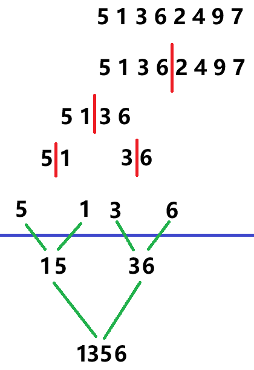

# 经典算法
## 排序算法

排序：是最基本一个算法之一。

十大经典排序：

插入排序

冒泡排序

选择排序

希尔排序

计数排序

基数排序

快速排序

归并排序

桶排序

堆排序

**关于时间复杂度**

计算方式：

时间（空间）复杂度的计算公式： T(n) = O(f(n))

T(n) ：代码执行的时间

f(n) ：每一行代码的执行次数的总和（平常只关心量级最大的代码次数，忽略低阶，常数，系数）

f(n) = 2n^2 + 2n+3  则时间复杂度为 T(n) = O(n^2)n ：表示数据规模

**常见的复杂度量级**：

常数阶： O(1) 算法的执行时间不会随数据规模变化而改变对数阶：O(logn) 搜索空间每次缩小一半，所以关键性的操作执行次数大约为log2(n)线性阶： O(n) 执行时间与数据规模成正比

线性对数阶：O(nlogn)

k 次方阶： O(n^k)

指数阶： O(2^n)

阶乘阶： O(n!)

### 冒泡排序

冒泡排序：两两一组进行比较，将其中大的数据往后移动。类似显示生活中的烧开水。

相邻的两个数据进行比较，然后如果前一个大于后一个则将前一个与后一个进行交换。

```c
#include <stdio.h>
void BubbleSort(int array[],int length)
{
    // 需要排序的数据总量，减一是因为最后一个数据会与倒数第二个进行比较。不需要单独进行比较了
    for(int count = 0;count < length-1;count++)
    {
        // 只排序未排序数据中的最大的数据
        for(int current = 0;current < length-current-1;current++)
```

### 归并排序

归并排序：是将待排序的数据，分割成若干个长度为 1 集合

怎么样变成长度为一呢，不断地二分数据就可以了

两两进行合并操作，最后直到所有的数组全部合并完毕了，排序就完成了

#### 算法逻辑

第一步：拆分数据

通过递归的形式拆分

第二步：将两个有序数据集合进行合并

合并两个有序的数组

第三步：将合并完成的数据同步到原始集合中

```c
        {
            // 如果前一个大于后一个则交换数据
            if(array[current] > array[current+1])
            {
                int cacheNumber = array[current];
                array[current]  = array[current+1];
                array[current+1]= cacheNumber;
            }
        }
    }
}
int main()
{
    int array[10]={0};
    int i = 0;
    while(1)
    {
        int number = 0;
        scanf("%d",&number);
        if(number == -1||i==10)break;
        array[i++] = number;
    }
    BubbleSort(array,i);
    for(int l = 0;l < i;l++)
        printf("%d,",array[l]);
    return 0;
}
#include <stdio.h>
#include <stdlib.h>
int *MergeSort(int array[],int length)
{
    // 拆为一个元素的时候就需要直接返回了，为什么？因为一个元素的数组已经是有序的了
    if(length == 1)return array;
    // 拆分数组
    int _LtLen = length/2;// 左侧数组的长度
    int _RtLen = length - _LtLen; // 右侧数组的长度
    // 拆分数组，也接受有序数组的返回
    int *_LtArray = MergeSort(array,_LtLen);// 拆出左侧数组
    int *_RtArray = MergeSort(array + _LtLen,_RtLen);// 拆出右侧数组
    // 将两个有序数组进行合并
    // 影子数组
    int *shadowArray = malloc(sizeof(int)*length); // 搞一个数组空间
    int shadowSize   = 0;
    // 左右有序数组的初始下标
    int _LtPos = 0,_RtPos = 0;
    // 进行合并
    while(_LtPos < _LtLen&&_RtPos < _RtLen)
        shadowArray[shadowSize++] = (_LtArray[_LtPos] < _RtArray[_RtPos]?
_LtArray[_LtPos++]:_RtArray[_RtPos++]);
    // 检查是否有数组残留数据
    while(_LtPos < _LtLen)
        shadowArray[shadowSize++] = _LtArray[_LtPos++];
    while(_RtPos < _RtLen)
        shadowArray[shadowSize++] = _RtArray[_RtPos++];
    // 将影子数组当中数据，同步到原来的数组中
    for(int pos = 0;pos < length;pos++)
```



### 快速排序

- **选择基准元素**：从数组中选取一个元素作为基准（ pivot ）。这个元素可以是任意的，但通常选择第一个元素、最后一个元素或中间的元素。

- **分区（ Partitioning ）**：重新排列数组，所有比基准元素小的元素都被放到基准的左边，所有比基准元素大的元素都被放到基准的右边。这个过程称为分区。

- **递归排序**：递归地对左子数组和右子数组进行快速排序。

- **合并**：由于快速排序是原地排序（ in-place sorting ），不需要额外的合并步骤。在递归完成后，原数组就已经排序完成。

```c
        array[pos] = shadowArray[pos];
    free(shadowArray);
    return array;
}
int main()
{
    int array[10]={0};
    int i = 0;
    while(1)
    {
        int number = 0;
        scanf("%d",&number);
        if(number == -1||i==10)break;
        array[i++] = number;
    }
    MergeSort(array,i);
    for(int l = 0;l < i;l++)
        printf("%d,",array[l]);
    return 0;
}
#include <stdio.h>
#include <stdlib.h>
void QuickSort(int array[],int length)
{
    // 数组长度小于等于 1 说明已经有序了
    if(length <= 1)return;
    // 初始化基准值
    int benchmark = array[length/2];
    printf(" 基准值 :%d\n",benchmark);
    // 初始化左右分区的下标
    int _LtPos = 0;
    int _RtPos = length-1;
    // 分区
    while(_LtPos < _RtPos) // 左侧下标不能超过右侧下标
```

### 桶排序

桶排序：是一种将待排序的数据分到不同的 “**桶**中，再对每一个 “**桶**” 进行排序，最后再将有序之后的 ”**桶**“ 中数据进行合并

#### 算法逻辑

第一步：确定桶的数量和大小

桶的数量取决于数据的范围和分布。例如：数据范围 0~100 ，可以设定 10 个桶，每个桶负责十个数据

第二步：遍历待排序的数据，将其放入到对应桶中

通过循环找到每一个数据所要存放的那个桶，将其存入第三步：对每一个中内元素进行排序操作

```c
    {
        // 左边找比基准值大的
        while(array[_LtPos] < benchmark)_LtPos++;
        // 右边找比基准值小的
        while(array[_RtPos] > benchmark)_RtPos--;
        // 交换位置，让其去各自的分区
        if(_LtPos <= _RtPos)
        {
            int CacheNumber = array[_LtPos];
            array[_LtPos]   = array[_RtPos];
            array[_RtPos]   = CacheNumber;
        }
    }
    // 拆分数组，对左右子数组进行处理
    QuickSort(array,_LtPos);
    QuickSort(array+_LtPos,length-_LtPos);
}
int main()
{
    int array[10]={0};
    int i = 0;
    while(1)
    {
        int number = 0;
        scanf("%d",&number);
        if(number == -1||i==10)break;
        array[i++] = number;
    }
    QuickSort(array,i);
    for(int l = 0;l < i;l++)
        printf("%d,",array[l]);
    return 0;
}
```

使每一个桶内的数据变得有序

第四步：将所有排序号的桶进行合并，得到最终的数据

```c
#include <stdio.h>
#include <stdlib.h>
void BubbleSort(int array[],int length)
{
    // 需要排序的数据总量，减一是因为最后一个数据会与倒数第二个进行比较。不需要单独进行比较了
    for(int count = 0;count < length-1;count++)
    {
        // 只排序未排序数据中的最大的数据
        for(int current = 0;current < length-current-1;current++)
        {
            // 如果前一个大于后一个则交换数据
            if(array[current] > array[current+1])
            {
                int cacheNumber = array[current];
                array[current]  = array[current+1];
                array[current+1]= cacheNumber;
            }
        }
    }
}
void BucketSort(int array[],int length)
{
    // 拿到原始数据中的最大值和最小值来确定数据范围
    int minData = array[0];
    int maxData = array[0];
    for(int i = 0;i < length;i++)
    {
        if(array[i] < minData)minData = array[i];
        else if(array[i] > maxData) maxData = array[i];
    }
    // 确定桶的数量                         2 表示桶的大小为两个数据
    int bucketCount = (maxData-minData) / 2 + 1;
    // 创建桶
    int bucket[bucketCount][2];
    for(int i = 0;i < bucketCount;i++)
    {
        bucket[i][0] = 0;
        bucket[i][1] = 0;
    }
    // 将对应的数据放到对应的桶中
    for(int i = 0;i < length;i++)
    {
        /*
            array[i] = 7 minData = 1 maxData = 10
            bucketSize  = 2
            bucketCount = (5)
            (7 - 1) / 2 = 3 桶编号
```

作业：

整个数据结构的内容进行复盘和巩固，问题（不可能没有问题）进行梳理。然后解决问题。

```c
        */
        int bucketNumber = (array[i] - minData) / 2;
        if(bucket[bucketNumber][0] == 0)
            bucket[bucketNumber][0] = array[i];
        else
            bucket[bucketNumber][1] = array[i];
    }
    // 对每个桶进行排序
    for (int  i = 0; i < bucketCount; i++)
    {
        BubbleSort(bucket[i],2);
    }
    // 把每个桶的数据进行合并
    for(int row = 0;row < bucketCount;row++)
    {
        for(int column = 0; column < 2;column++)
        {
            array[row*2+column] = bucket[row][column];
        }
    }
}
int main()
{
    int array[10]={0};
    int i = 0;
    while(1)
    {
        int number = 0;
        scanf("%d",&number);
        if(number == -1||i==10)break;
        array[i++] = number;
    }
    BucketSort(array,i);
    for(int l = 0;l < i;l++)
        printf("%d,",array[l]);
    return 0;
}
```
